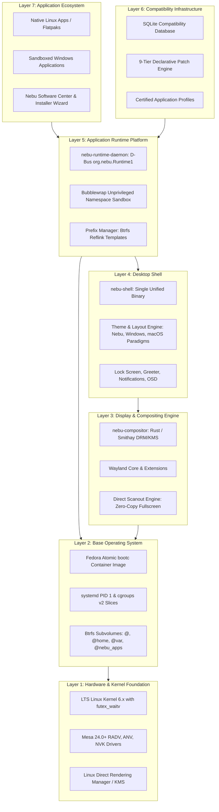

# NebuOS — Master Engineering Blueprint & Technical Specification

> **NebuOS:** Lightweight Linux Desktop OS with Native-Feeling Windows Application Compatibility  
> **Target Architecture:** x86_64 | **Primary Language:** Rust | **Base OS:** Fedora Atomic (bootc)  
> **Display Architecture:** Wayland | **Windows Compatibility:** Wine / Proton / DXVK / VKD3D  
> **Core Architectural Rule:** Virtual Machine: NOT PART OF NEBUOS  

---

## 1. Architectural Topology & Component Layers

NebuOS is structured into 7 encapsulated layers with strict unidirectional dependencies:

---

## 2. Documentation Architecture & Directory Map

The engineering specifications are organized into 12 structured domains:

| Directory | Scope & Domain Responsibility | File Count |
|---|---|:---:|
| [`specification/`](specification/00-system-specification.md) | Core system specs: ownership matrix, boot sequence, IPC, filesystem, security, hardware, resources. | 7 |
| [`desktop/`](desktop/00-desktop-specification.md) | Desktop shell, compositor, native theming engine, layout solver, window management, input. | 8 |
| [`runtime/`](runtime/00-runtime-specification.md) | Windows PE runtime, 16-state lifecycle, process model, Btrfs reflink prefixes, Wine/Proton, sandboxing. | 8 |
| [`compatibility/`](compatibility/00-compatibility-specification.md) | Compatibility database schema, declarative profiles, 9-tier patch engine, application detection, certification. | 7 |
| [`graphics/`](graphics/00-graphics-specification.md) | GPU detection, Mesa integration, Vulkan/OpenGL, DXVK/VKD3D translation, GPU profiles, shader caching. | 7 |
| [`applications/`](applications/00-application-specification.md) | Unified application model, installer wizard, registration, path mapping, file associations, uninstallation, store. | 7 |
| [`updates/`](updates/00-update-specification.md) | Transactional `bootc` container updates, Containerfile build stages, release channels, regression gates, rollback. | 5 |
| [`testing/`](testing/00-test-strategy.md) | Testing pyramid, unit tests, integration tests, system tests, 11-stage compatibility lab, certification. | 9 |
| [`interfaces/`](interfaces/00-interface-overview.md) | Formal IPC wire protocols, D-Bus XML schemas, Wayland extensions, Rust traits, relational schemas. | 7 |
| [`development/`](development/00-development-model.md) | Engineering workflow, repository structure, build systems, CI/CD pipelines, dependency policies, Rust style. | 7 |
| [`decisions/`](decisions/ADR-0001-linux-kernel.md) | Architectural Decision Records (ADR-0001 through ADR-0009). | 9 |
| [`roadmap/`](roadmap/00-implementation-roadmap.md) | Engineering implementation roadmap across phases P0 through P8, and future milestones. | 11 |

**Master Documentation Catalog:** See [INDEX.md](INDEX.md) for the complete directory of all files.

---

## 3. Core Architectural Invariants

1. **NO Virtual Machines:** Windows applications run as native Linux processes via Wine/Proton within unprivileged Bubblewrap namespaces. No hypervisors (KVM/QEMU) are used for application compatibility.
2. **Immutable System Root:** `/usr` is mounted strictly read-only. The OS is updated as atomic container images via `bootc`.
3. **Rust Systems Architecture:** Core userland daemons (`nebu-compositor`, `nebu-shell`, `nebu-runtime-daemon`, `nebu-installer-ui`) are authored in 100% safe Rust.
4. **Single Unified Shell (ADR-0009):** `nebu-shell` is a single binary that dynamically re-anchors layer-shell surfaces to support Nebu, Windows-like, and macOS-like paradigms live at runtime in <= 150ms.
5. **Strict Resource Constraints:** System idle memory must remain < 800 MB RAM on 4GB hardware baseline. Compositor + Shell idle <= 80 MB RSS combined.
6. **Zero Data Loss & Deterministic Rollback:** Btrfs subvolumes and GRUB boot-counters ensure instant recovery from bad updates or prefix corruptions.

---

## 4. Master Registers & Matrices

- [OPEN_QUESTIONS.md](OPEN_QUESTIONS.md) — 34 prioritized design decisions awaiting resolution.
- [RISK_REGISTER.md](RISK_REGISTER.md) — Quantitative risk register and containment architectures.
- [ASSUMPTIONS.md](ASSUMPTIONS.md) — 42 foundational engineering assumptions and validation plans.
- [TRACEABILITY.md](TRACEABILITY.md) — Requirements traceability matrix mapping PRD sections 1–103 to specifications and tests.
