# NebuOS Requirements Traceability Matrix

**Status:** APPROVED  
**Purpose:** Comprehensive end-to-end traceability matrix mapping every PRD requirement (Sections 1 through 103) to technical specifications, architectural decision records, implementation crates, and automated verification test cases.  
**Scope:** Covers all functional, non-functional, security, compatibility, and performance requirements defined in `/root/NebuOS/PRD.md`.  
**Audience:** Systems Architects, Subsystem Leads, QA Engineers, and Certification Auditors.

---

## 1. Domain Groupings & Architecture Overview

The 103 PRD sections are classified across 15 engineering domains:

```mermaid
graph TD
    PRD[NebuOS Master PRD Sec 1-103] --> GOV[Governance & Vision Sec 1-4, 80-81, 85, 91-93, 100-103]
    PRD --> PLAT[Hardware & Platform Base Sec 5-8, 43, 60-61, 95]
    PRD --> DESK[Desktop & Compositor Sec 11-13, 52-54, 56-57, 62]
    PRD --> APP[Application Model & Runtime Sec 14, 16-19, 37-40, 47-51, 66, 68-71]
    PRD --> FS[Filesystem & Storage Sec 15, 43-44, 55]
    PRD --> COMPAT[Compatibility Engine & Wine/Proton Sec 20-24, 67, 73]
    PRD --> GFX[Graphics Pipeline Sec 25-26, 74]
    PRD --> PROF[Professional Apps Certification Sec 27-30, 77-79]
    PRD --> PKG[Store & Packaging Sec 45-46]
    PRD --> SEC[Security & Sandboxing Sec 41-42]
    PRD --> PERF[Performance & Modes Sec 6, 63-65, 89-90]
    PRD --> UPD[Atomic Updates & OS Lifecycle Sec 9-10, 72, 75]
    PRD --> QA[Testing & Compatibility Lab Sec 31-36, 76, 98]
    PRD --> MEDIA[Audio & Network Sec 58-59]
    PRD --> DEV[Engineering Lifecycle Sec 82-84, 86-88, 94, 96-97, 99]
```

---

## 2. Master Requirements Traceability Tables

### 2.1 Product Vision, Principles & Strategic Invariants

| PRD Section | PRD Title | Specification Document(s) | Architectural Decision | Verification / Test | Status |
|---|---|---|---|---|---|
| **Sec 1** | PRODUCT VISION | [specification/00-system-specification.md](specification/00-system-specification.md), [architecture/00-overview.md](architecture/00-overview.md) | [ADR-0001](decisions/ADR-0001-linux-kernel.md), [ADR-0004](decisions/ADR-0004-rust.md) | `TEST-SYS-001` | STABLE |
| **Sec 2** | PRODUCT GOALS | [specification/00-system-specification.md](specification/00-system-specification.md), [performance/00-performance-goals.md](performance/00-performance-goals.md) | [ADR-0002](decisions/ADR-0002-fedora-base.md) | `TEST-PERF-001` | STABLE |
| **Sec 3** | NON-GOALS | [specification/00-system-specification.md](specification/00-system-specification.md), [compatibility/06-known-limitations.md](compatibility/06-known-limitations.md) | [ADR-0009-no-vm](decisions/ADR-0009-no-vm.md) | Architecture Audit | STABLE |
| **Sec 4** | TARGET USERS | [specification/00-system-specification.md](specification/00-system-specification.md), [desktop/00-desktop-overview.md](desktop/00-desktop-overview.md) | [ADR-0006](decisions/ADR-0006-nebu-shell.md) | UX Scenario Tests | STABLE |
| **Sec 80** | LEGAL/LICENSING | [development/04-dependency-policy.md](development/04-dependency-policy.md), [compatibility/06-known-limitations.md](compatibility/06-known-limitations.md) | [ADR-0007](decisions/ADR-0007-wine.md) | `cargo-deny` License Audit | STABLE |
| **Sec 81** | SOURCE CODE POLICY | [development/00-development-model.md](development/00-development-model.md), [development/04-dependency-policy.md](development/04-dependency-policy.md) | [ADR-0004](decisions/ADR-0004-rust.md) | CI License Scanner | STABLE |
| **Sec 85** | DEVELOPMENT PRINCIPLES | [development/05-coding-guidelines.md](development/05-coding-guidelines.md), [development/00-development-model.md](development/00-development-model.md) | [ADR-0004](decisions/ADR-0004-rust.md) | Code Review & Clippy | STABLE |
| **Sec 91** | CRITICAL PRODUCT REQUIREMENT | [specification/00-system-specification.md](specification/00-system-specification.md), [runtime/00-runtime-specification.md](runtime/00-runtime-specification.md) | [ADR-0009-no-vm](decisions/ADR-0009-no-vm.md) | `TEST-RUN-002` | STABLE |
| **Sec 92** | NO VM REQUIREMENT | [specification/00-system-specification.md](specification/00-system-specification.md), [runtime/00-runtime-specification.md](runtime/00-runtime-specification.md) | [ADR-0009-no-vm](decisions/ADR-0009-no-vm.md) | Process Hierarchy Audit | STABLE |
| **Sec 93** | COMPATIBILITY PHILOSOPHY | [compatibility/01-database-schema.md](compatibility/01-database-schema.md), [runtime/04-wine-integration.md](runtime/04-wine-integration.md) | [ADR-0007](decisions/ADR-0007-wine.md), [ADR-0014](decisions/ADR-0014-compatibility-database.md) | Lab Test Suite | STABLE |
| **Sec 100** | FINAL PRODUCT ARCHITECTURE | [specification/00-system-specification.md](specification/00-system-specification.md), [architecture/01-system-architecture.md](architecture/01-system-architecture.md) | Master System Architecture | Full Regression Suite | STABLE |
| **Sec 101** | FINAL PRODUCT PRINCIPLES | [specification/00-system-specification.md](specification/00-system-specification.md), [development/05-coding-guidelines.md](development/05-coding-guidelines.md) | Master System Architecture | Architecture Audit | STABLE |
| **Sec 102** | DEFINITION OF DONE | [testing/07-release-certification.md](testing/07-release-certification.md), [roadmap/00-engineering-roadmap.md](roadmap/00-engineering-roadmap.md) | [ADR-0015](decisions/ADR-0015-compatibility-lab.md) | Tier 0-3 Quality Gates | STABLE |
| **Sec 103** | LONG-TERM VISION | [roadmap/00-engineering-roadmap.md](roadmap/00-engineering-roadmap.md), [roadmap/13-p12.md](roadmap/13-p12.md) | Strategic Roadmap | 1.0 GA Sign-off | STABLE |

---

### 2.2 Hardware Platform & Base Operating System

| PRD Section | PRD Title | Specification Document(s) | Architectural Decision | Verification / Test | Status |
|---|---|---|---|---|---|
| **Sec 5** | HARDWARE TARGET | [specification/05-hardware-specification.md](specification/05-hardware-specification.md), [specification/00-system-specification.md](specification/00-system-specification.md) | [ADR-0001](decisions/ADR-0001-linux-kernel.md), [ADR-0010](decisions/ADR-0010-hardware-compatibility-and-power-management.md) | `TEST-HW-001` (x86_64, UEFI, CPU/GPU) | STABLE |
| **Sec 7** | CORE ARCHITECTURE | [specification/00-system-specification.md](specification/00-system-specification.md), [specification/05-hardware-specification.md](specification/05-hardware-specification.md) | [ADR-0001](decisions/ADR-0001-linux-kernel.md), [ADR-0002](decisions/ADR-0002-fedora-base.md) | System Topology Verification | STABLE |
| **Sec 8** | BASE OPERATING SYSTEM | [specification/00-system-specification.md](specification/00-system-specification.md), [specification/01-boot-specification.md](specification/01-boot-specification.md) | [ADR-0002](decisions/ADR-0002-fedora-base.md), [ADR-0014](decisions/ADR-0014-boot-experience-and-graphical-handoff.md) | `TEST-OS-001` (bootc inspect), `TEST-BOOT-001` (Silent Boot) | STABLE |
| **Sec 60** | POWER MANAGEMENT | [specification/05-hardware-specification.md](specification/05-hardware-specification.md), [testing/07-hardware-testing.md](testing/07-hardware-testing.md) | [ADR-0010](decisions/ADR-0010-hardware-compatibility-and-power-management.md) | `TC-SR-001`..`006` (S0ix/S3 Suspend/Resume) | STABLE |
| **Sec 61** | LAPTOP OPTIMIZATION | [specification/05-hardware-specification.md](specification/05-hardware-specification.md), [testing/07-hardware-testing.md](testing/07-hardware-testing.md) | [ADR-0010](decisions/ADR-0010-hardware-compatibility-and-power-management.md) | `TC-SR-004` (Overnight Sleep Drain < 1.5%/hr) | STABLE |
| **Sec 95** | FIRST HARDWARE VALIDATION | [testing/07-hardware-testing.md](testing/07-hardware-testing.md), [roadmap/01-p0-foundation.md](roadmap/01-p0-foundation.md) | [ADR-0010](decisions/ADR-0010-hardware-compatibility-and-power-management.md) | `TEST-LAB-001` (P0 Hardware Boot) | STABLE |

---

### 2.3 Desktop Environment, Compositor & System UI

| PRD Section | PRD Title | Specification Document(s) | Architectural Decision | Verification / Test | Status |
|---|---|---|---|---|---|
| **Sec 11** | NEBUCOMPOSITOR | [desktop/01-nebucompositor-specification.md](desktop/01-nebucompositor-specification.md), [desktop/06-input-display.md](desktop/06-input-display.md) | [ADR-0003](decisions/ADR-0003-wayland.md), [ADR-0014](decisions/ADR-0014-boot-experience-and-graphical-handoff.md) | `TEST-COMP-001` (DRM Buffer Flip / Handover) | STABLE |
| **Sec 12** | NEBUSHELL | [desktop/02-nebushell-specification.md](desktop/02-nebushell-specification.md), [design/02-theming-layout-behavior.md](design/02-theming-layout-behavior.md), [design/03-components.md](design/03-components.md) | [ADR-0009](decisions/ADR-0009-nebushell-ui-architecture.md), [ADR-0013](decisions/ADR-0013-ui-design-system-and-icon-architecture.md) | `TEST-SHELL-001` (Memory & IPC) | STABLE |
| **Sec 13** | DESKTOP UX | [design/00-design-system.md](design/00-design-system.md), [design/01-iconography.md](design/01-iconography.md), [desktop/03-ui-theme-system.md](desktop/03-ui-theme-system.md) | [ADR-0009](decisions/ADR-0009-nebushell-ui-architecture.md), [ADR-0013](decisions/ADR-0013-ui-design-system-and-icon-architecture.md), [ADR-0014](decisions/ADR-0014-boot-experience-and-graphical-handoff.md) | UX Interaction Benchmark / Boot Splash | STABLE |
| **Sec 52** | TASK MANAGER | [desktop/07-system-ui.md](desktop/07-system-ui.md), [runtime/01-application-lifecycle.md](runtime/01-application-lifecycle.md) | Native Rust Process Monitor | `TEST-UI-001` (Process Kill Test) | PROPOSED |
| **Sec 53** | FILE MANAGER | [desktop/02-nebushell-specification.md](desktop/02-nebushell-specification.md), [applications/03-filesystem-mapping.md](applications/03-filesystem-mapping.md) | Native Rust File Browser | `TEST-UI-002` (VFS Path Navigation) | PROPOSED |
| **Sec 54** | FILE ASSOCIATIONS | [applications/04-file-associations.md](applications/04-file-associations.md) | FreeDesktop MIME Registration | `TEST-MIME-001` (Extension Binding) | STABLE |
| **Sec 56** | MULTI-MONITOR | [desktop/06-input-display.md](desktop/06-input-display.md), [design/02-theming-layout-behavior.md](design/02-theming-layout-behavior.md) | Smithay KMS Output Manager | `TEST-DISP-001` (Hotplug & Scaling) | STABLE |
| **Sec 57** | INPUT & ACCESSIBILITY | [desktop/06-input-display.md](desktop/06-input-display.md), [design/04-accessibility-and-performance.md](design/04-accessibility-and-performance.md) | `libinput` & AccessKit AT-SPI | `TEST-INP-001` (Gesture & Contrast) | STABLE |
| **Sec 62** | DESKTOP ANIMATIONS | [design/00-design-system.md](design/00-design-system.md), [design/04-accessibility-and-performance.md](design/04-accessibility-and-performance.md) | [ADR-0013](decisions/ADR-0013-ui-design-system-and-icon-architecture.md) (Reduced Motion Gate) | `TEST-ANIM-001` (60 FPS Pacing) | STABLE |

---

### 2.4 Application Model & Runtime Execution Engine

| PRD Section | PRD Title | Specification Document(s) | Architectural Decision | Verification / Test | Status |
|---|---|---|---|---|---|
| **Sec 14** | NEBU APPLICATION MODEL | [applications/00-application-model.md](applications/00-application-model.md), [runtime/00-runtime-specification.md](runtime/00-runtime-specification.md) | [ADR-0010](decisions/ADR-0010-per-application-wine-prefixes.md) | `TEST-APP-001` (Metadata Parse) | STABLE |
| **Sec 16** | APPLICATION PREFIX MODEL | [runtime/03-prefix-management.md](runtime/03-prefix-management.md) | [ADR-0010](decisions/ADR-0010-per-application-wine-prefixes.md), [ADR-0012](decisions/ADR-0012-btrfs.md) | `TEST-PFX-001` (Prefix Isolation) | STABLE |
| **Sec 17** | NEBU RUNTIME | [runtime/00-runtime-specification.md](runtime/00-runtime-specification.md), [runtime/01-application-lifecycle.md](runtime/01-application-lifecycle.md) | [ADR-0007](decisions/ADR-0007-wine.md) | `TEST-RUN-001` (Runtime Launch) | STABLE |
| **Sec 18** | INSTALLER | [applications/01-installation.md](applications/01-installation.md) | Native PE Installer Heuristics | `TEST-INST-001` (Setup.exe Detection) | STABLE |
| **Sec 19** | APPLICATION REGISTRATION | [applications/00-application-model.md](applications/00-application-model.md), [applications/03-file-associations.md](applications/03-file-associations.md) | Desktop Entry Generator | `TEST-REG-001` (.desktop Generation) | STABLE |
| **Sec 37** | WARM RUNTIME | [runtime/00-runtime-specification.md](runtime/00-runtime-specification.md), [performance/04-launch.md](performance/04-launch.md) | Pre-warmed Wineserver Daemon | `TEST-PERF-004` (Warm Launch <800ms) | STABLE |
| **Sec 38** | PREFIX CREATION | [runtime/03-prefix-management.md](runtime/03-prefix-management.md), [architecture/04-filesystem.md](architecture/04-filesystem.md) | [ADR-0012](decisions/ADR-0012-btrfs.md) (reflink clone) | `TEST-PFX-002` (Creation <1.5s) | STABLE |
| **Sec 39** | APPLICATION CACHE | [performance/04-launch.md](performance/04-launch.md), [graphics/05-shader-cache.md](graphics/05-shader-cache.md) | Page Cache & Shared Shaders | `TEST-CACHE-001` (Eviction Threshold) | STABLE |
| **Sec 40** | APPLICATION UNINSTALL | [applications/04-uninstallation.md](applications/04-uninstallation.md) | Atomic Prefix Removal & DB Purge | `TEST-UNINST-001` (Zero Residue) | STABLE |
| **Sec 47** | INSTALLER UX | [applications/01-installation.md](applications/01-installation.md), [desktop/07-system-ui.md](desktop/07-system-ui.md) | Wizard Progress & Sandboxing UI | `TEST-UX-002` (Silent vs Wizard) | STABLE |
| **Sec 48** | UNKNOWN WINDOWS APPLICATION | [applications/01-installation.md](applications/01-installation.md), [compatibility/01-database-schema.md](compatibility/01-database-schema.md) | Generic Safe Profile Fallback | `TEST-GEN-001` (Generic Fallback) | STABLE |
| **Sec 49** | FAILURE HANDLING | [runtime/01-application-lifecycle.md](runtime/01-application-lifecycle.md), [runtime/00-runtime-specification.md](runtime/00-runtime-specification.md) | Process Crash Interceptor | `TEST-ERR-001` (Crash Log Extraction) | STABLE |
| **Sec 50** | PREFIX REPAIR | [runtime/03-prefix-management.md](runtime/03-prefix-management.md), [applications/04-uninstallation.md](applications/04-uninstallation.md) | Snapshot Rollback & Registry Reset | `TEST-REP-001` (Prefix Self-Healing) | STABLE |
| **Sec 51** | DIAGNOSTICS | [runtime/00-runtime-specification.md](runtime/00-runtime-specification.md), [interfaces/01-ipc-interfaces.md](interfaces/01-ipc-interfaces.md) | D-Bus Diagnostics API & Log Dumper | `TEST-DIAG-001` (Bundle Export) | STABLE |
| **Sec 66** | CLI | [runtime/00-runtime-specification.md](runtime/00-runtime-specification.md), [development/01-repository-structure.md](development/01-repository-structure.md) | `nebu` Unified Management CLI | `TEST-CLI-001` (CLI Command Suite) | STABLE |
| **Sec 68** | LAUNCH PERFORMANCE | [performance/04-launch.md](performance/04-launch.md), [performance/00-performance-goals.md](performance/00-performance-goals.md) | Execution Pipeline Profiling | `TEST-PERF-003` (Cold <2.5s) | STABLE |
| **Sec 69** | APPLICATION LAUNCH PIPELINE | [runtime/01-application-lifecycle.md](runtime/01-application-lifecycle.md), [runtime/00-runtime-specification.md](runtime/00-runtime-specification.md) | 8-Stage Execution Pipeline | `TEST-PIPE-001` (Pipeline Stage Latency) | STABLE |
| **Sec 70** | COLD START VS WARM START | [performance/04-launch.md](performance/04-launch.md), [runtime/00-runtime-specification.md](runtime/00-runtime-specification.md) | Memory Pinning & Cache Retention | `TEST-PERF-005` (Differential Bench) | STABLE |
| **Sec 71** | CRASH ISOLATION | [runtime/00-runtime-specification.md](runtime/00-runtime-specification.md), [interfaces/00-interface-overview.md](interfaces/00-interface-overview.md) | Bubblewrap User Namespace Isolation | `TEST-SEC-002` (Sandbox Cross-Bleed) | STABLE |

---

### 2.5 Filesystem Translation & Storage Subsystem

| PRD Section | PRD Title | Specification Document(s) | Architectural Decision | Verification / Test | Status |
|---|---|---|---|---|---|
| **Sec 15** | WINDOWS FILESYSTEM COMPATIBILITY | [applications/02-filesystem-mapping.md](applications/02-filesystem-mapping.md) | [ADR-0010](decisions/ADR-0010-per-application-wine-prefixes.md) | `TEST-FS-001` (Path Redirection) | STABLE |
| **Sec 43** | FILESYSTEM DESIGN | [architecture/04-filesystem.md](architecture/04-filesystem.md), [performance/05-storage.md](performance/05-storage.md) | [ADR-0012](decisions/ADR-0012-btrfs.md) | `TEST-FS-002` (Subvolume Mounts) | STABLE |
| **Sec 44** | SNAPSHOT SYSTEM | [architecture/04-filesystem.md](architecture/04-filesystem.md), [runtime/03-prefix-management.md](runtime/03-prefix-management.md) | [ADR-0012](decisions/ADR-0012-btrfs.md) (Btrfs Subvolume Snapshots) | `TEST-SNAP-001` (Instant Snapshot) | STABLE |
| **Sec 55** | WINDOWS PATH MAPPING | [applications/02-filesystem-mapping.md](applications/02-filesystem-mapping.md) | `dosdevices` Symlink Management | `TEST-PATH-001` (Drive Letter Mapping) | STABLE |

---

### 2.6 Compatibility Subsystem, Profiles & Wine/Proton Integration

| PRD Section | PRD Title | Specification Document(s) | Architectural Decision | Verification / Test | Status |
|---|---|---|---|---|---|
| **Sec 20** | NEBU COMPATIBILITY DATABASE | [compatibility/01-database-schema.md](compatibility/01-database-schema.md) | [ADR-0011](decisions/ADR-0011-sqlite.md), [ADR-0014](decisions/ADR-0014-compatibility-database.md) | `TEST-DB-001` (SQLite Query Latency) | STABLE |
| **Sec 21** | COMPATIBILITY PROFILES | [compatibility/01-database-schema.md](compatibility/01-database-schema.md), [runtime/00-runtime-specification.md](runtime/00-runtime-specification.md) | [ADR-0014](decisions/ADR-0014-compatibility-database.md) | `TEST-PROF-001` (Profile Ingestion) | STABLE |
| **Sec 22** | NEBU PATCH ENGINE | [compatibility/01-database-schema.md](compatibility/01-database-schema.md), [runtime/00-runtime-specification.md](runtime/00-runtime-specification.md) | Multi-Layer Patch Injector | `TEST-PAT-001` (Reversible Patch) | STABLE |
| **Sec 23** | WINE STRATEGY | [runtime/04-wine-integration.md](runtime/04-wine-integration.md) | [ADR-0007](decisions/ADR-0007-wine.md) (Dual-track Staging/Stable) | `TEST-WINE-001` (PE Binary Execution) | STABLE |
| **Sec 24** | PROTON STRATEGY | [runtime/05-proton-integration.md](runtime/05-proton-integration.md) | [ADR-0008](decisions/ADR-0008-proton.md) (Gaming Optimization) | `TEST-PRO-001` (Direct3D Steam Launch) | STABLE |
| **Sec 67** | DATABASE | [compatibility/01-database-schema.md](compatibility/01-database-schema.md), [runtime/00-runtime-specification.md](runtime/00-runtime-specification.md) | [ADR-0011](decisions/ADR-0011-sqlite.md) (WAL Mode SQLite) | `TEST-DB-002` (Concurrent Multi-Read) | STABLE |
| **Sec 73** | WINE UPDATE POLICY | [runtime/04-wine-integration.md](runtime/04-wine-integration.md), [updates/02-release-channels.md](updates/02-release-channels.md) | [ADR-0007](decisions/ADR-0007-wine.md) | `TEST-UPD-003` (Prefix Abi Stability) | STABLE |

---

### 2.7 Graphics Subsystem & GPU Acceleration

| PRD Section | PRD Title | Specification Document(s) | Architectural Decision | Verification / Test | Status |
|---|---|---|---|---|---|
| **Sec 25** | GRAPHICS COMPATIBILITY | [graphics/00-graphics-overview.md](graphics/00-graphics-overview.md), [graphics/00-graphics-specification.md](graphics/00-graphics-specification.md), [graphics/03-dxvk-vkd3d.md](graphics/03-dxvk-vkd3d.md) | Mesa + Vulkan Translation | `TEST-GFX-001` (Vulkan Conformance) | STABLE |
| **Sec 26** | HYBRID GPU | [graphics/01-gpu-detection.md](graphics/01-gpu-detection.md), [graphics/04-gpu-profiles.md](graphics/04-gpu-profiles.md) | Dynamic PRIME Driver Offloading | `TEST-GFX-002` (DRI_PRIME Arbitration) | STABLE |
| **Sec 74** | MESA UPDATE POLICY | [graphics/00-graphics-specification.md](graphics/00-graphics-specification.md), [updates/03-regression-gates.md](updates/03-regression-gates.md) | Mesa Driver Promotion Matrix | `TEST-GFX-003` (Shader CTS Test) | STABLE |

---

### 2.8 Professional Windows Applications Certification

| PRD Section | PRD Title | Specification Document(s) | Architectural Decision | Verification / Test | Status |
|---|---|---|---|---|---|
| **Sec 27** | MICROSOFT OFFICE COMPATIBILITY | [testing/03-compatibility-testing.md](testing/03-compatibility-testing.md), [compatibility/01-database-schema.md](compatibility/01-database-schema.md) | Office DLL Profiles & OLE Config | `TEST-APP-OFFICE` (Word/Excel E2E) | PROPOSED |
| **Sec 28** | AUTOCAD COMPATIBILITY | [testing/03-compatibility-testing.md](testing/03-compatibility-testing.md), [compatibility/01-database-schema.md](compatibility/01-database-schema.md) | AutoCAD DXVK Profile & .NET bridge | `TEST-APP-CAD` (DWG 2D/3D Stress) | PROPOSED |
| **Sec 29** | MAYA COMPATIBILITY | [testing/03-compatibility-testing.md](testing/03-compatibility-testing.md), [graphics/04-gpu-profiles.md](graphics/04-gpu-profiles.md) | Maya Viewport 2.0 OpenGL Profile | `TEST-APP-MAYA` (Viewport Render) | PROPOSED |
| **Sec 30** | 3DS MAX COMPATIBILITY | [testing/03-compatibility-testing.md](testing/03-compatibility-testing.md), [runtime/06-dependencies.md](runtime/06-dependencies.md) | Nitrous D3D11 Engine Profile | `TEST-APP-3DS` (Scene Benchmark) | PROPOSED |
| **Sec 77** | COMPATIBILITY CERTIFICATION | [testing/07-release-certification.md](testing/07-release-certification.md) | [ADR-0015](decisions/ADR-0015-compatibility-lab.md) | Gold/Silver/Bronze Tier Checklist | STABLE |
| **Sec 78** | APPLICATION TEST SCORE | [testing/07-release-certification.md](testing/07-release-certification.md), [compatibility/01-database-schema.md](compatibility/01-database-schema.md) | Quantitative Compatibility Score (0-100) | `TEST-SCORE-001` (Score Formula) | STABLE |
| **Sec 79** | COMPATIBILITY REPORT | [testing/07-release-certification.md](testing/07-release-certification.md), [testing/03-compatibility-testing.md](testing/03-compatibility-testing.md) | Automated Headless Telemetry Report | Telemetry Pipeline Verification | STABLE |

---

### 2.9 Package Management, Application Platform & Marketplace

| PRD Section / Subphase | Requirement Title | Specification Document(s) | Architectural Decision | Verification / Test | Status |
|---|---|---|---|---|---|
| **Sec 45** | PACKAGE MANAGEMENT | [applications/00-application-specification.md](applications/00-application-specification.md), [applications/07-app-manager-specification.md](applications/07-app-manager-specification.md) | [ADR-0012](decisions/ADR-0012-application-distribution-and-marketplace.md) (Flatpak + App Manager) | `TEST-PKG-001` (Flatpak User-Space Install) | STABLE |
| **Sec 46** | APPLICATION STORE | [applications/06-software-center.md](applications/06-software-center.md), [applications/08-developer-platform-and-security.md](applications/08-developer-platform-and-security.md) | [ADR-0012](decisions/ADR-0012-application-distribution-and-marketplace.md) (Nebu Marketplace) | `TEST-STORE-001` (FTS5 Catalog Search) | STABLE |
| **P6.0** | APP RUNTIME & MANAGEMENT | [applications/07-app-manager-specification.md](applications/07-app-manager-specification.md) | [ADR-0012](decisions/ADR-0012-application-distribution-and-marketplace.md) | `TEST-MGR-001` (10-State Lifecycle Transition) | STABLE |
| **P6.1** | NEBU MARKETPLACE UI | [applications/06-software-center.md](applications/06-software-center.md) | [ADR-0012](decisions/ADR-0012-application-distribution-and-marketplace.md) | `TEST-MKT-001` (Slint UI Idle RAM < 35MB) | STABLE |
| **P6.2** | APPLICATION SECURITY | [applications/08-developer-platform-and-security.md](applications/08-developer-platform-and-security.md) | [ADR-0012](decisions/ADR-0012-application-distribution-and-marketplace.md) | `TEST-SEC-002` (Signature Check & Permission Audit) | STABLE |
| **P6.3** | DEVELOPER PLATFORM | [applications/08-developer-platform-and-security.md](applications/08-developer-platform-and-security.md) | [ADR-0012](decisions/ADR-0012-application-distribution-and-marketplace.md) | `TEST-DEV-001` (Manifest Validation Pipeline) | STABLE |
| **P6.4** | ECOSYSTEM INTEGRATION | [applications/00-application-specification.md](applications/00-application-specification.md) | [ADR-0012](decisions/ADR-0012-application-distribution-and-marketplace.md) | `TEST-ECO-001` (Flathub & Windows Recipe Route) | STABLE |

---

### 2.10 Security, Sandboxing & Privilege Model

| PRD Section | PRD Title | Specification Document(s) | Architectural Decision | Verification / Test | Status |
|---|---|---|---|---|---|
| **Sec 41** | SECURITY | [architecture/05-security.md](architecture/05-security.md), [specification/00-system-specification.md](specification/00-system-specification.md) | Multi-Layer Defense-in-Depth | `TEST-SEC-001` (Host Jailbreak Test) | STABLE |
| **Sec 42** | WINDOWS APP SANDBOX | [architecture/05-security.md](architecture/05-security.md), [runtime/00-runtime-specification.md](runtime/00-runtime-specification.md) | Bubblewrap Namespace Confinement | `TEST-SAND-001` (Filesystem Bleed) | STABLE |

---

### 2.11 Resource Management, Performance & System Modes

| PRD Section | PRD Title | Specification Document(s) | Architectural Decision | Verification / Test | Status |
|---|---|---|---|---|---|
| **Sec 6** | RESOURCE TARGETS | [performance/00-performance-goals.md](performance/00-performance-goals.md), [performance/01-memory.md](performance/01-memory.md) | Resource Budgeting (<800MB Idle RAM) | `TEST-PERF-001` (Idle Resource Profiler) | STABLE |
| **Sec 63** | LOW-END MODE | [performance/01-memory.md](performance/01-memory.md), [desktop/01-compositor.md](desktop/01-compositor.md) | Nebu Lite Mode (4GB Optimization) | `TEST-LITE-001` (Low-End Mode Trigger) | STABLE |
| **Sec 64** | HIGH-PERFORMANCE MODE | [performance/02-cpu.md](performance/02-cpu.md), [graphics/04-gpu-profiles.md](graphics/04-gpu-profiles.md) | CPU Governor Performance + GameMode | `TEST-PERF-002` (Governor Switch) | STABLE |
| **Sec 65** | DEVELOPER MODE | [architecture/05-security.md](architecture/05-security.md), [runtime/00-runtime-specification.md](runtime/00-runtime-specification.md) | Debug Portals, Wine Logging Toggle | `TEST-DEV-002` (WINEDEBUG Ingestion) | STABLE |
| **Sec 89** | PERFORMANCE BENCHMARK | [performance/00-performance-goals.md](performance/00-performance-goals.md), [testing/05-performance-testing.md](testing/05-performance-testing.md) | Automated Performance Regression Harness | `TEST-BENCH-001` (KPI Baseline Suite) | STABLE |
| **Sec 90** | SUCCESS METRICS | [performance/00-performance-goals.md](performance/00-performance-goals.md), [testing/07-release-certification.md](testing/07-release-certification.md) | 1.0 Milestone Success Scorecard | Release Gate Review | STABLE |

---

### 2.12 Atomic Updates, Rollback & Operating System Lifecycle

| PRD Section | PRD Title | Specification Document(s) | Architectural Decision | Verification / Test | Status |
|---|---|---|---|---|---|
| **Sec 9** | ATOMIC UPDATE MODEL | [updates/00-update-specification.md](updates/00-update-specification.md), [updates/01-image-build.md](updates/01-image-build.md) | [ADR-0008](decisions/ADR-0008-atomic-updates.md), [ADR-0011](decisions/ADR-0011-os-image-updates-and-rollback.md) | `TEST-UPD-001` (Transactional Deploy) | STABLE |
| **Sec 10** | RELEASE CHANNELS | [updates/02-release-channels.md](updates/02-release-channels.md) | [ADR-0011](decisions/ADR-0011-os-image-updates-and-rollback.md) | `TEST-CHAN-001` (Channel Switching) | STABLE |
| **Sec 72** | UPDATE SAFETY | [updates/00-update-specification.md](updates/00-update-specification.md), [updates/04-rollback-recovery.md](updates/04-rollback-recovery.md) | [ADR-0011](decisions/ADR-0011-os-image-updates-and-rollback.md) | `TEST-UPD-002` (Interrupted Update & Watchdog Rollback) | STABLE |
| **Sec 73** | WINE UPDATE POLICY | [updates/03-regression-gates.md](updates/03-regression-gates.md), [runtime/05-wine-integration.md](runtime/05-wine-integration.md) | [ADR-0005](decisions/ADR-0005-wine.md), [ADR-0011](decisions/ADR-0011-os-image-updates-and-rollback.md) | `TEST-WINE-REG-001` (11-Stage Tier 1 Apps) | STABLE |
| **Sec 74** | MESA UPDATE POLICY | [updates/03-regression-gates.md](updates/03-regression-gates.md), [graphics/02-mesa-integration.md](graphics/02-mesa-integration.md) | [ADR-0010](decisions/ADR-0010-hardware-compatibility-and-power-management.md), [ADR-0011](decisions/ADR-0011-os-image-updates-and-rollback.md) | `TEST-MESA-REG-001` (Vulkan/DRM Conformance) | STABLE |
| **Sec 75** | KERNEL UPDATE POLICY | [updates/03-regression-gates.md](updates/03-regression-gates.md), [specification/05-hardware-specification.md](specification/05-hardware-specification.md) | [ADR-0001](decisions/ADR-0001-linux-kernel.md), [ADR-0010](decisions/ADR-0010-hardware-compatibility-and-power-management.md), [ADR-0011](decisions/ADR-0011-os-image-updates-and-rollback.md) | `TEST-KRNL-001` (Driver ABI Compat & S0ix Stress) | STABLE |

---

### 2.13 Testing Strategy, Compatibility Lab & Quality Gates

| PRD Section | PRD Title | Specification Document(s) | Architectural Decision | Verification / Test | Status |
|---|---|---|---|---|---|
| **Sec 31** | COMPATIBILITY LAB | [testing/06-hardware-testing.md](testing/06-hardware-testing.md), [testing/00-testing-strategy.md](testing/00-testing-strategy.md) | [ADR-0015](decisions/ADR-0015-compatibility-lab.md) | Lab Automation Heartbeat | STABLE |
| **Sec 32** | AUTOMATED TESTING | [testing/00-testing-strategy.md](testing/00-testing-strategy.md), [testing/02-integration-testing.md](testing/02-integration-testing.md) | Headless Wayland/Wine Automation | `TEST-AUTO-001` (Nightly Regression) | STABLE |
| **Sec 33** | MANUAL TESTING | [testing/00-testing-strategy.md](testing/00-testing-strategy.md), [testing/07-release-certification.md](testing/07-release-certification.md) | QA Exploratory Test Protocols | Exploratory QA Checklists | STABLE |
| **Sec 34** | COMPATIBILITY MATRIX | [compatibility/01-database-schema.md](compatibility/01-database-schema.md), [testing/03-compatibility-testing.md](testing/03-compatibility-testing.md) | Hardware x Application Matrix | Continuous Matrix Execution | STABLE |
| **Sec 35** | REGRESSION TESTING | [testing/00-testing-strategy.md](testing/00-testing-strategy.md), [updates/03-regression-gates.md](updates/03-regression-gates.md) | Automated Tier 0-2 Blocking Gates | `TEST-REG-GATE-001` | STABLE |
| **Sec 36** | PERFORMANCE TESTING | [testing/05-performance-testing.md](testing/05-performance-testing.md), [performance/00-performance-goals.md](performance/00-performance-goals.md) | Continuous Benchmarking Harness | `TEST-PERF-REG-001` | STABLE |
| **Sec 76** | TEST HARDWARE LAB | [testing/06-hardware-testing.md](testing/06-hardware-testing.md) | [ADR-0015](decisions/ADR-0015-compatibility-lab.md) | Bare-Metal PXE Rig Automation | STABLE |
| **Sec 98** | QUALITY GATES | [testing/07-release-certification.md](testing/07-release-certification.md), [updates/03-regression-gates.md](updates/03-regression-gates.md) | Zero-Tolerance Release Barriers | Automated Release Gate Evaluation | STABLE |

---

### 2.14 Audio, Video & Network Subsystems

| PRD Section | PRD Title | Specification Document(s) | Architectural Decision | Verification / Test | Status |
|---|---|---|---|---|---|
| **Sec 58** | AUDIO | [architecture/03-process-and-ipc.md](architecture/03-process-and-ipc.md), [architecture/06-hardware.md](architecture/06-hardware.md) | PipeWire + WirePlumber Routing | `TEST-AUD-001` (ALSA/Pulse Emulation) | STABLE |
| **Sec 59** | NETWORK | [architecture/03-process-and-ipc.md](architecture/03-process-and-ipc.md), [architecture/05-security.md](architecture/05-security.md) | NetworkManager + Sandbox Netns | `TEST-NET-001` (Network Namespace Isolation) | STABLE |

---

### 2.15 Engineering Lifecycle, Tooling & Roadmap

| PRD Section | PRD Title | Specification Document(s) | Architectural Decision | Verification / Test | Status |
|---|---|---|---|---|---|
| **Sec 82** | REPOSITORY STRUCTURE | [development/01-repository-structure.md](development/01-repository-structure.md) | Cargo Workspace Crate Separation | `TEST-DEV-001` (Workspace Integrity) | STABLE |
| **Sec 83** | CODING LANGUAGE | [development/05-coding-guidelines.md](development/05-coding-guidelines.md) | [ADR-0004](decisions/ADR-0004-rust.md) (Pure Rust System Daemons) | `cargo clippy -- -D warnings` | STABLE |
| **Sec 84** | RUST COMPONENTS | [development/01-repository-structure.md](development/01-repository-structure.md), [specification/00-system-specification.md](specification/00-system-specification.md) | [ADR-0004](decisions/ADR-0004-rust.md), [ADR-0005](decisions/ADR-0005-nebu-compositor.md) | Cargo Test Suites | STABLE |
| **Sec 86** | DEVELOPMENT PHASES | [roadmap/00-engineering-roadmap.md](roadmap/00-engineering-roadmap.md) | Phased Delivery Model (P0–P12) | Phase Gate Reviews | STABLE |
| **Sec 87** | MVP | [roadmap/00-engineering-roadmap.md](roadmap/00-engineering-roadmap.md), [roadmap/06-p5.md](roadmap/06-p5.md) | Milestones P0–P5 Delivery Baseline | MVP Demo Verification | STABLE |
| **Sec 88** | POST-MVP | [roadmap/00-engineering-roadmap.md](roadmap/00-engineering-roadmap.md), [roadmap/07-p6.md](roadmap/07-p6.md) | Milestones P6–P12 Production Delivery | Production Hardening Gates | STABLE |
| **Sec 94** | FIRST DEVELOPMENT TASKS | [roadmap/01-p0.md](roadmap/01-p0.md), [roadmap/02-p1.md](roadmap/02-p1.md) | Tasks 1–25 Sequential Plan | P0 Deliverable Sign-off | STABLE |
| **Sec 96** | DEVELOPMENT ENVIRONMENT | [development/02-build-system.md](development/02-build-system.md) | Containerized Reproducible Toolchain | Dev Container Verification | STABLE |
| **Sec 97** | CI/CD | [development/03-ci-cd.md](development/03-ci-cd.md) | GitHub Actions / Woodpecker CI | CI Build & Test Pipeline | STABLE |
| **Sec 99** | DOCUMENTATION | [README.md](README.md), [INDEX.md](INDEX.md) | 20-Section Standard Architecture Docs | Documentation CI Linter | STABLE |

---

## 3. Related Documents
- [README.md](README.md) — Master documentation index and subsystem overview
- [INDEX.md](INDEX.md) — Complete documentation catalog and reading paths
- [OPEN_QUESTIONS.md](OPEN_QUESTIONS.md) — Architectural trade-offs and decision log
- [RISK_REGISTER.md](RISK_REGISTER.md) — Quantitative risk register and mitigations
- [ASSUMPTIONS.md](ASSUMPTIONS.md) — Engineering assumptions register
- [roadmap/00-engineering-roadmap.md](roadmap/00-engineering-roadmap.md) — Engineering milestone roadmaps (P0–P12)
