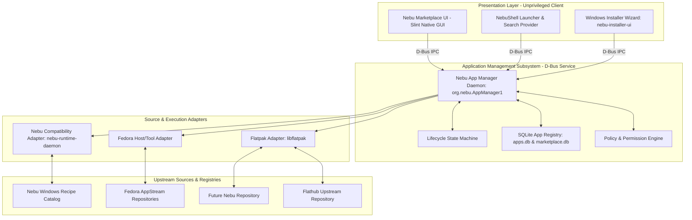
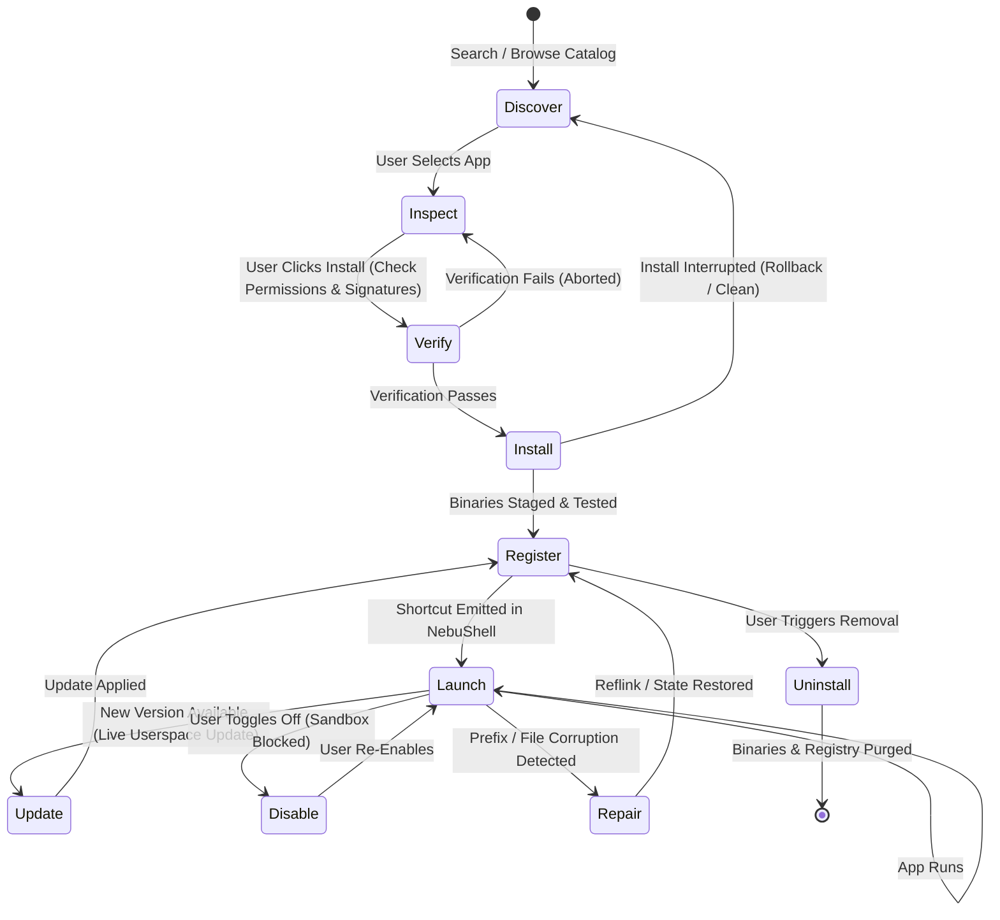

# Application Platform Specification — NebuOS

**Status:** DRAFT  
**Purpose:** Define the unified Application Platform model, package abstractions, multi-source topology, manifest schema, execution lifecycles, and security boundaries for native Linux and Windows applications in NebuOS.  

---

## 1. Status
DRAFT — Authoritative master implementation specification for the Phase P6 Application Platform.

## 2. Purpose
NebuOS provides a coherent, unified application environment where users can effortlessly discover, install, launch, update, and manage both native Linux desktop software and certified Windows applications without dealing with package manager commands, dependency conflicts, or host filesystem corruption. 

Rather than creating a bespoke packaging ecosystem from scratch, NebuOS builds upon proven, mature industry standards:
- **Flatpak** provides the packaging, sandboxing, and runtime isolation foundation for third-party Linux desktop applications.
- **Flathub** serves as the primary external application discovery and retrieval ecosystem for Linux software.
- **Fedora Repositories** provide the complementary foundation for base OS components, command-line tools, and containerized development environments.
- **Nebu Compatibility Engine** provides an independent, dedicated execution pathway for Windows PE binaries via Wine/Proton and per-application Btrfs prefixes.
- **Future Nebu Repository** serves as a planned architectural capability for first-party tools, desktop integrations, and specialized packages.

## 3. Scope
- Unified application abstraction across Flatpaks, host system tools, and sandboxed Windows executables.
- Application Source Abstraction (`ApplicationSource`) governing Flathub, Fedora repositories, future Nebu repositories, and Windows recipe catalogs.
- Canonical application identity rules and decoupled semantic versioning.
- Standardized Application Manifest format (JSON/RON).
- 10-state application lifecycle state machine.
- Permission architecture and pre-installation transparency.
- Update lifecycle separation (strictly isolating Application updates from OS bootc updates).
- Offline caching, resilient resumable downloads, and transaction rollbacks.
- Multi-architecture readiness (`x86_64` baseline and `aarch64` readiness).
- High-level coordination between `Nebu Marketplace`, `Nebu App Manager`, `NebuShell`, and `nebu-runtime-daemon`.

## 4. Non-goals
- Creating a proprietary, custom Linux package manager (e.g. `.nebu` or custom binary package formats).
- Forking Flatpak or hosting private complete mirrors of the Flathub infrastructure in initial phases.
- Packaging Windows applications into Flatpaks or conflating Windows prefixes with Flatpak runtimes.
- Allowing desktop applications direct write access to the immutable `/usr` root filesystem.
- Bundling heavy web runtimes (Electron or Chromium) for the Marketplace or App Manager daemons.
- Implementing payment gateways, commercial billing, or subscription processing in initial P6 milestones.

## 5. Requirements

### 5.1 Packaging and Abstraction Requirements
- **R-APP-01 (Flatpak-First):** Flatpak is the primary format for all graphical third-party Linux desktop applications. Applications install to user space (`~/.local/share/flatpak`) or system space (`/var/lib/flatpak`).
- **R-APP-02 (Flathub Integration):** The platform must index, search, query, and install applications from Flathub using standard AppStream metadata without claiming ownership or forking upstream.
- **R-APP-03 (Fedora Separation):** Fedora repositories provide the immutable base OS (via `bootc`). Desktop end-user applications are not installed directly via mutable host `dnf`.
- **R-APP-04 (Source Abstraction):** All application sources must implement the normalized `ApplicationSource` interface, abstracting backend mechanics from the UI.
- **R-APP-05 (Windows App Separation):** Windows applications must run through the Nebu Compatibility Engine, isolating each app into its own Btrfs reflink prefix (`~/.nebu/apps/<app-id>/`), completely distinct from Flatpaks.

### 5.2 Identity, Metadata and Lifecycle Requirements
- **R-APP-06 (Stable Identity):** Every application must possess an immutable, unique reverse-DNS identifier (`app_id`, e.g. `org.videolan.VLC`, `com.microsoft.Word`).
- **R-APP-07 (Decoupled Versioning):** Application semantic versions must remain strictly independent of NebuOS, Fedora, or Wine release numbers.
- **R-APP-08 (10-State Lifecycle):** The App Manager must enforce the formal 10-state lifecycle: `Discover -> Inspect -> Verify -> Install -> Register -> Launch -> Update -> Disable -> Repair -> Uninstall`.
- **R-APP-09 (Unified Manifest):** All applications must parse into a normalized manifest containing identity, metadata, publisher info, licensing, runtime dependencies, permission requests, and compatibility badges.

### 5.3 Security and Updates Requirements
- **R-APP-10 (Permission Transparency):** Before installation, the user must be presented with an understandable list of requested capabilities (network, audio, camera, mic, filesystem, GPU, devices).
- **R-APP-11 (Cryptographic Verification):** Every package and recipe must be verified via GPG/Cosign signatures and SHA-256 checksums prior to installation.
- **R-APP-12 (Update Independence):** Desktop application updates must execute live in user space without requiring an OS reboot or invoking `bootc`.

---

## 6. Architecture

The Application Platform operates as a clean layered stack:



---

## 7. Component Definitions

### 7.1 Nebu App Manager Daemon (`nebu-app-manager-daemon`)
The central system service responsible for all application operations. It abstracts underlying package systems, normalizes metadata, executes downloads, manages local caches, enforces permission policies, coordinates application lifecycles, and exposes D-Bus interface `org.nebu.AppManager1`.

### 7.2 Application Source Abstraction (`ApplicationSource`)
A Rust trait and object model defining the contract for all application origins:
- `source_id`: Unique identifier (e.g. `"flathub"`, `"fedora-system"`, `"nebu-certified-recipes"`).
- `source_type`: `FlatpakRepo`, `FedoraSystemRepo`, `WindowsRecipeCatalog`, `NebuRepository`.
- `publisher_trust`: GPG keyrings, Cosign roots, or HTTPS certificate authorities.
- `supported_architectures`: Supported hardware ABIs (`x86_64`, `aarch64`).
- `metadata_endpoint`: Remote URL providing AppStream or recipe metadata.
- `package_endpoint`: Remote repository or binary storage URL.
- `update_mechanism`: Automated delta checks, polling schedules, or push triggers.

### 7.3 Application Registry (`apps.db`)
A local SQLite database maintaining the source of truth for:
- Installed applications, versions, and install paths.
- Granted and denied sandbox permissions.
- Assigned Windows prefix paths, DLL overrides, and wine versions.
- Desktop entry and MIME associations.
- Usage statistics and health checkpoints.

---

## 8. Application Manifest Schema

All applications indexed by the App Manager conform to the following unified manifest schema:

```json
{
  "id": "org.videolan.VLC",
  "name": "VLC Media Player",
  "version": "3.0.21",
  "description": "VLC is a free and open source cross-platform multimedia player.",
  "publisher": {
    "name": "VideoLAN",
    "verified": true,
    "identity": "https://videolan.org",
    "trust_tier": "official_vendor"
  },
  "license": "GPL-2.0-or-later",
  "categories": ["AudioVideo", "Player"],
  "icon": {
    "cached_path": "/var/lib/nebu/icons/org.videolan.VLC.svg",
    "remote_url": "https://dl.flathub.org/repo/appstream/x86_64/icons/128x128/org.videolan.VLC.png"
  },
  "screenshots": [
    "https://dl.flathub.org/repo/screenshots/org.videolan.VLC/1.png"
  ],
  "architectures": ["x86_64", "aarch64"],
  "package_type": "flatpak",
  "source": "flathub",
  "runtime": "org.freedesktop.Platform//24.08",
  "permissions": [
    {"name": "network", "description": "Stream online media and download subtitles", "risk": "low"},
    {"name": "audio", "description": "Play sound via PipeWire", "risk": "low"},
    {"name": "filesystem:home:ro", "description": "Read media files from user home directory", "risk": "medium"},
    {"name": "gpu", "description": "Hardware video decoding via VA-API/NVDEC", "risk": "low"}
  ],
  "compatibility": {
    "status": "Verified",
    "score": 100,
    "tested_nebu_version": "0.1.0",
    "known_issues": []
  },
  "homepage": "https://www.videolan.org/vlc/",
  "documentation": "https://wiki.videolan.org/",
  "release_notes": "Maintenance release with updated decoders."
}
```

For Windows applications, the manifest includes a dedicated `windows_compatibility` block:

```json
{
  "windows_compatibility": {
    "target_wine_version": "wine-staging-9.22",
    "prefix_architecture": "win64",
    "required_dll_overrides": ["riched20:native", "mso:native"],
    "direct3d_backend": "dxvk",
    "installer_sha256": "e3b0c44298fc1c149afbf4c8996fb92427ae41e4649b934ca495991b7852b855",
    "requires_dotnet": false
  }
}
```

---

## 9. Application Identity and Versioning Decoupling

To prevent architectural drift and dependency tangling, NebuOS strictly decouples all layers:

| Layer | Example Value | Authority & Lifecycle |
|---|---|---|
| **Application ID** | `org.blender.Blender` | Immutable upstream reverse-DNS identifier; persists across updates and installs. |
| **Application Version** | `4.2.1` | Assigned by the application developer; completely independent of OS releases. |
| **NebuOS Release** | `1.0.0` | Semantic version of the overall operating system distribution. |
| **Fedora Base Baseline**| `44` | Upstream Linux distribution release providing the kernel and base sysroot. |
| **Wine/Proton Runtime** | `9.22-staging` | Upstream Windows compatibility runtime version selected per application. |

An update to Fedora 45 or NebuOS 1.1 does **not** alter the application's internal versioning or prefix paths.

---

## 10. Application Lifecycle State Machine

The App Manager orchestrates application lifecycles through 10 deterministic states:



1. **Discover:** Application metadata browsed from local cache or remote catalog.
2. **Inspect:** Detailed view renders screenshots, publisher trust, and permissions.
3. **Verify:** Pre-installation checks validate package checksums, signatures, disk space, and present permission consent.
4. **Install:** Package layers downloaded, verified, and placed in sandbox storage (`~/.local/share/flatpak` or prefix).
5. **Register:** Desktop entry emitted into `~/.local/share/applications/`, icons extracted, and MIME types bound.
6. **Launch:** Application process spawned inside its designated sandbox (Bubblewrap).
7. **Update:** Live userspace delta applied without interrupting system services or prompting for OS reboot.
8. **Disable:** Application access suspended (desktop entry hidden, network severed) without deleting data.
9. **Repair:** Prefix or local data validated against checksums and restored from golden template or reflink snapshot.
10. **Uninstall:** Clean removal purges all binaries, prefixes, icons, and associations with zero lingering host state.

---

## 11. Permission Architecture and Security Model

NebuOS exposes a transparent, user-centric permission model built on Linux containment primitives:
- **Presentation Layer:** The Marketplace UI presents human-readable permission cards using intuitive icons (Globe for Network, Camera for Video, Folders for Filesystem).
- **Enforcement Layer:** 
  - For Flatpaks: Bubblewrap user namespaces and XDG Desktop Portals (`xdg-desktop-portal`).
  - For Windows Executables: Bubblewrap filesystem isolation (read-only `/usr`, private temporary directories, virtualized `C:\` drive, portal file pickers, Landlock LSM).
- **Pre-Installation Consent:** Any application requesting sensitive capabilities (microphone, webcam, unconfined home access, device access) prompts for explicit user approval prior to staging.
- **Post-Installation Revocation:** Users can audit and toggle granted permissions at any time via NebuOS System Settings without modifying the application binary.

---

## 12. Update Architecture Independence

NebuOS strictly partitions system and application updates into four non-overlapping lifecycles:

```text
┌────────────────────────────────────────────────────────────────────────┐
│ 1. Operating System (NebuOS Base)                                      │
│    Engine: bootc / OSTree                                              │
│    Target: /usr (Read-Only Immutable Image)                            │
│    Lifecycle: Staged in background -> Applied upon next reboot         │
├────────────────────────────────────────────────────────────────────────┤
│ 2. Desktop Applications (Linux & Tools)                                │
│    Engine: Flatpak / Nebu App Manager                                  │
│    Target: ~/.local/share/flatpak or /var/lib/flatpak                  │
│    Lifecycle: Live in userspace -> Immediate restart of app only       │
├────────────────────────────────────────────────────────────────────────┤
│ 3. Compatibility Database & Recipes (Windows Profiles)                 │
│    Engine: Nebu Compatibility Daemon                                   │
│    Target: ~/.local/share/nebu/compat.db & recipes/                    │
│    Lifecycle: SQLite delta patch -> Seamless zero-downtime hot reload  │
├────────────────────────────────────────────────────────────────────────┤
│ 4. Hardware Firmware (UEFI, GPU, Wireless, Docks)                      │
│    Engine: fwupd / LVFS                                                │
│    Target: Device NVRAM / SPI Flash                                    │
│    Lifecycle: Staged via capsule -> Applied during hardware reboot     │
└────────────────────────────────────────────────────────────────────────┘
```

Conflating these distinct lifecycles is strictly prohibited. An application update must never force an OS reboot, and an OS rollback must never wipe user applications or personal documents.

---

## 13. Offline Behavior and Resiliency

To handle intermittent connectivity, mobile tethering, or offline air-gapped environments:
- **Metadata Caching:** All browsed application metadata, icons, and compatibility reports are cached in local SQLite database `marketplace.db`. Searches work seamlessly offline.
- **Resumable Downloads:** Package downloads utilize HTTP range requests (`Range: bytes=...`). Interrupted downloads automatically resume where they stopped.
- **Disk Space Pre-Flight:** Before downloading, the App Manager checks `statvfs` on the target filesystem. If available space is less than `size_bytes * 1.5`, the transaction aborts with a clear user prompt.
- **Atomic Staging:** Downloads stage in temporary directories (`~/.local/share/nebu/staging/`). If a transaction fails mid-flight, the staging directory is cleaned up automatically, leaving no orphaned files.

---

## 14. Multi-Architecture Strategy

- **Baseline Architecture:** Milestone P0 establishes the foundation strictly for `x86_64`.
- **Architectural Readiness:** The manifest schema, App Manager D-Bus signatures, and metadata databases explicitly support `aarch64` (ARM64).
- **Package Availability Filtering:** The Marketplace UI queries the host machine architecture via `uname -m` and filters the catalog so that only packages matching the active host architecture are displayed and installable.

---

## 15. Performance and Resource Budgets

In alignment with NebuOS's lightweight performance principles:
- **Native Lightweight UI:** The Marketplace UI is implemented in Rust using Slint. Electron, Chromium, and heavy webviews are strictly prohibited.
- **Idle Memory Budget:**
  - `nebu-app-manager-daemon`: Idle RSS <= 18 MB.
  - `nebu-marketplace-ui`: Idle RSS <= 35 MB.
- **Search Latency:** Full-text local metadata search completes in <= 40 ms for catalogs of 5,000+ applications.
- **Launch Dispatch Overhead:** Launch dispatch from NebuShell via App Manager completes in <= 30 ms.

---

## 16. Failure Modes and Recovery

| Failure Mode | Cause | Recovery Mechanism |
|---|---|---|
| **Interrupted Download** | Network dropout or laptop sleep during download | Resume via HTTP range requests; exponential backoff retry. |
| **Corrupted Download** | Bit flip or truncated archive | Checksum mismatch triggers automatic purge of staged blob and re-download. |
| **Disk Space Exhaustion** | Multiple heavy Flatpak runtimes filling `/var` | Pre-flight disk space probe blocks transaction; automated runtime prune wizard offered. |
| **Wine Prefix Corruption** | Crashing Windows installer leaving half-installed state | Revert prefix to pristine golden template via instant Btrfs reflink rollback. |
| **Flathub Server Downtime**| Upstream API outage or CDN failure | Fall back to local SQLite metadata cache; notify user of offline browsing mode. |

---

## 17. Testing Requirements

- **Unit Tests:** Manifest parsing, permission calculation, and state machine transitions.
- **Integration Tests:** End-to-end simulated Flatpak installation via mock OCI registry; icon extraction from diverse Windows PE binaries.
- **Resilience Tests:** Simulated SIGKILL during package staging; verify zero corrupted state in `apps.db`.
- **Performance Benchmarks:** Measure memory usage, search response latency, and prefix generation speed.

---

## 18. Open Questions

- **OQ-APP-01:** How frequently should the App Manager synchronize background AppStream metadata without draining mobile battery? (Proposed: Daily on AC power, weekly on battery).
- **OQ-APP-02:** Should the Future Nebu Repository support private enterprise/internal software catalogs? (Proposed: Architecture supports multiple custom `ApplicationSource` entries).

---

## 19. Related Documents

- [docs/decisions/ADR-0012-application-distribution-and-marketplace.md](../decisions/ADR-0012-application-distribution-and-marketplace.md)
- [docs/applications/06-software-center.md](06-software-center.md)
- [docs/applications/07-app-manager-specification.md](07-app-manager-specification.md)
- [docs/applications/08-developer-platform-and-security.md](08-developer-platform-and-security.md)
- [docs/roadmap/00-implementation-roadmap.md](../roadmap/00-implementation-roadmap.md)
