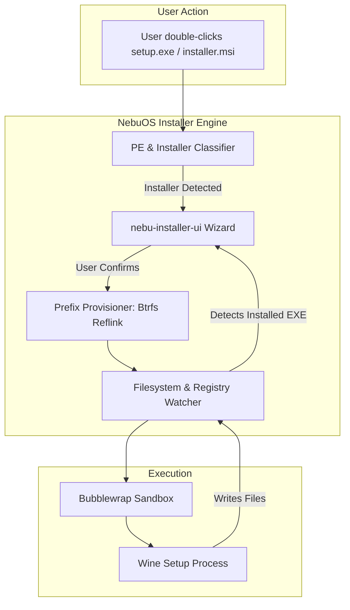
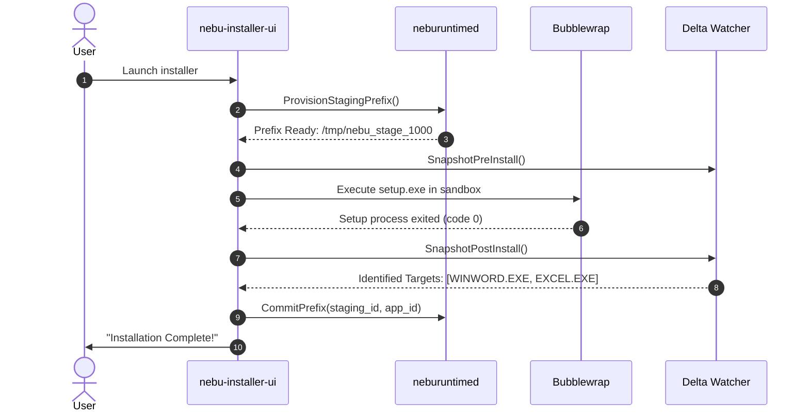

# Installer Subsystem Specification — NebuOS

**Status:** DRAFT  
**Purpose:** Specify the Windows setup and installer execution workflow, wizard UI, silent installation automation, and post-install discovery in NebuOS.

---

## 1. Status
DRAFT — Technical implementation specification for Phase P6 installer subsystem.

## 2. Purpose
Installing Windows applications on Linux is historically confusing and failure-prone. This specification defines the automated, guided installation workflow of NebuOS. It intercepts `.exe` and `.msi` setup binaries, provisions isolated environments, guides the user through a clean native wizard, and discovers the resulting main application executable automatically.

## 3. Scope
- Installer binary inspection (MSI, Inno Setup, NSIS, InstallShield, Wise, WiX).
- Automated silent install flag injection when available.
- Interactive GUI installer wizard (`nebu-installer-ui`).
- Filesystem delta tracking to identify newly created executables.
- Registry analysis to determine installed display names and version numbers.

## 4. Non-goals
- Modifying proprietary installer binaries on disk.
- Reverse engineering encrypted or password-protected setup packages.
- Installing device drivers (.sys files) packaged inside Windows installers.

## 5. Requirements
1. **R-INS-01:** Intercept double-clicked `.exe` and `.msi` files from file manager or browser downloads.
2. **R-INS-02:** Determine whether executable is an installer vs. standalone portable application.
3. **R-INS-03:** Present a clean native installation dialog showing app name, icon, estimated disk space, and sandbox security level.
4. **R-INS-04:** Execute installation inside a transient staging sandbox before committing prefix.
5. **R-INS-05:** Automatically identify the primary installed executable and generate desktop launcher.

## 6. Architecture
The installer engine coordinates between detection heuristics, prefix management, and user interaction:

## 7. Components
1. **Installer Classifier:** Reads PE headers and string tables to identify installer engine (NSIS, Inno, MSI).
2. **Setup Wizard (`nebu-installer-ui`):** Slint-based native dialog presenting install progress, license agreements, and target drive options.
3. **Delta Monitor:** Snapshots prefix filesystem before setup runs and compares after termination to isolate installed files.
4. **Target Selector:** Heuristic algorithm scoring newly created `.exe` files to select the main application binary (rejecting `unins000.exe`, `update.exe`, `crashpad.exe`).

## 8. Data Flow
1. User launches `setup.exe`.
2. Classifier detects Inno Setup installer.
3. Wizard displays: *"Install Microsoft Office 2024?"* with estimated footprint (2.4 GB).
4. User clicks "Install".
5. Runtime reflinks clean template prefix at `~/.nebu/apps/com.microsoft.office2024/`.
6. Setup executes within Bubblewrap jail.
7. Setup completes; Delta Monitor identifies:
   - `drive_c/Program Files/Microsoft Office/root/Office16/WINWORD.EXE`
   - `drive_c/Program Files/Microsoft Office/root/Office16/EXCEL.EXE`
   - `drive_c/Program Files/Microsoft Office/root/Office16/POWERPNT.EXE`
8. Wizard creates separate desktop entries for Word, Excel, and PowerPoint.

## 9. Control Flow

## 10. Interfaces
- **D-Bus Interface:** `org.nebu.Installer1`
  - `InspectInstaller(String path) -> InstallerInfo`
  - `StartInstallation(String path, InstallOptions options) -> String job_id`
  - Signals: `InstallProgress(String job_id, Double percent, String status)`
- **Installer Heuristic Signatures:**
  - Inno Setup: String `"Inno Setup Setup Data"` in `.data` section.
  - NSIS: Nullsoft signature `0xDEADBEEF` at offset 0x80.
  - MSI: OLE compound document magic `D0 CF 11 E0 A1 B1 1A E1`.

## 11. Dependencies
- `bwrap` >= 0.8.0.
- `msitools` (for headless MSI inspection).
- Btrfs filesystem with snapshot capabilities.

## 12. Security
- Installers run with network disabled by default unless user checks "Allow internet access during install".
- Installers cannot write to real user home directory or Linux system root.
- Post-install analysis validates that no malicious auto-start registry keys escape into host system.

## 13. Resource Requirements
- Installer wizard idle RAM: <= 20 MB RSS.
- Staging prefix creation time: <= 250ms (Btrfs reflink).
- Post-install delta scanning time: <= 500ms on SSD.

## 14. Failure Modes
1. **Installer Hangs:** Setup process deadlocks waiting for unsupported Windows driver installation.
2. **Silent Failure:** Installer exits with non-zero error code.
3. **No Target Found:** Setup finishes but no valid executable files were written.

## 15. Recovery Behavior
- User provided with an explicit "Cancel & Clean Up" button; terminates sandbox and purges staging prefix immediately.
- If installer crashes, wizard displays error log excerpt and checks `compat.db` for known missing DLL workarounds.
- Staging prefixes automatically cleaned up after 24 hours if installation abandoned.

## 16. Testing Requirements
- Automated test installing 20 representative open-source Windows installers (Notepad++, 7-Zip, VLC Windows build, Blender).
- Delta detection accuracy test asserting correct target executable selection.
- Sandbox escape prevention tests during setup execution.

## 17. Performance Requirements
- Total wizard startup latency: <= 150ms.
- Staging prefix allocation: <= 300ms.
- Target discovery and desktop entry generation: <= 1.0s after setup exits.

## 18. Compatibility Considerations
- Handles multi-disk / multi-part installers seamlessly via mounted ISO or folder binds.
- Injects `WINEARCH=win64` or `win32` dynamically based on installer architecture.

## 19. Open Questions
- **OQ-INS-01:** Should NebuOS support an "Express Install" mode that bypasses all wizard prompts for known certified applications?
- **OQ-INS-02:** How should installer reboot prompts ("You must restart your computer now") be handled cleanly?

## 20. Related Documents
- [00-application-specification.md](00-application-specification.md)
- [02-application-registration.md](02-application-registration.md)
- [03-filesystem-mapping.md](03-filesystem-mapping.md)
- [05-uninstallation.md](05-uninstallation.md)
