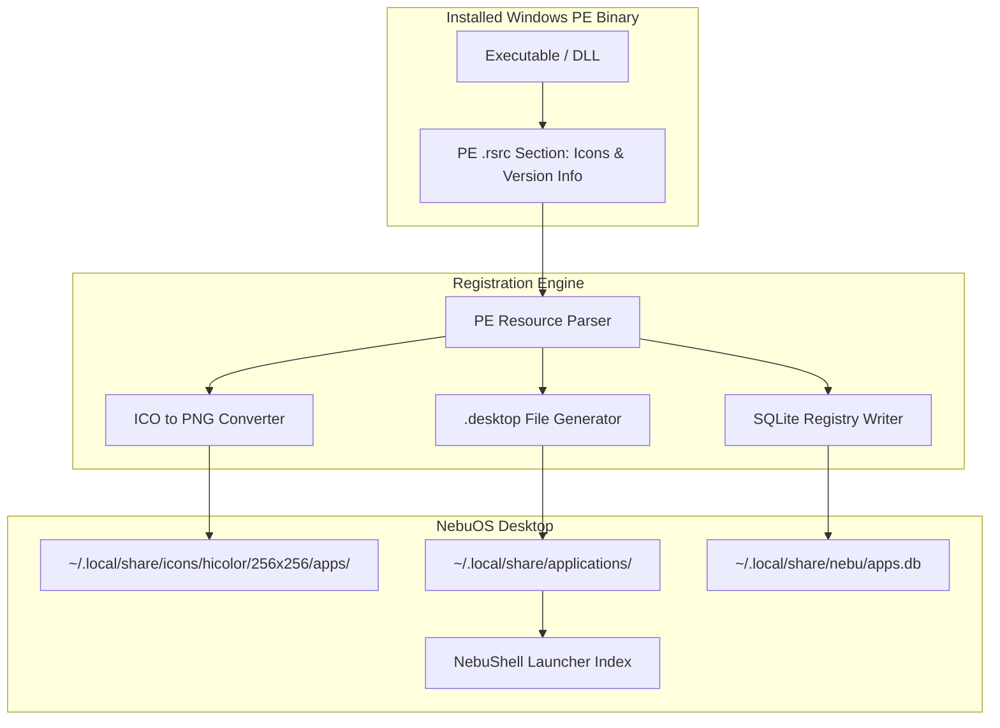
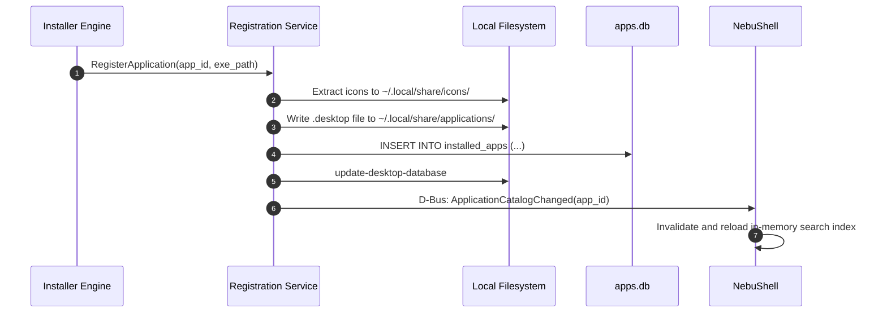

# Application Registration Specification — NebuOS

**Status:** DRAFT  
**Purpose:** Specify the application registration workflow, FreeDesktop `.desktop` entry generation, icon decoding and caching, and MIME association persistence in NebuOS.

---

## 1. Status
DRAFT — Technical implementation specification for Phase P6 application registration.

## 2. Purpose
When a Windows application is installed, it must integrate seamlessly into the Linux desktop environment. This specification defines how NebuOS extracts application metadata, registers records in the local SQLite database, extracts high-resolution embedded icons from Windows PE binaries, generates standard `.desktop` files, and updates desktop launcher caches.

## 3. Scope
- Extraction of metadata from Windows PE headers and `VS_VERSIONINFO` resource blocks.
- Decoding multi-resolution Windows `.ico` formats and converting to standard PNG.
- Generating FreeDesktop Desktop Entry Specification 1.5 `.desktop` files.
- Managing localized desktop entries (English, Indonesian, etc.).
- Registering application state in `~/.local/share/nebu/apps.db`.

## 4. Non-goals
- Modifying host system `/usr/share/applications` (all user apps reside in user space).
- Supporting legacy Windows 3.1 16-bit icon structures.
- Inventing proprietary desktop entry formats incompatible with Linux standards.

## 5. Requirements
1. **R-REG-01:** Automatically register every installed application in `~/.local/share/nebu/apps.db`.
2. **R-REG-02:** Extract highest resolution embedded icon (up to 256x256 PNG) from target PE binary.
3. **R-REG-03:** Emit compliant `.desktop` files in `~/.local/share/applications/` referencing `nebu-launch`.
4. **R-REG-04:** Register standard categories (`Office`, `Graphics`, `Development`, `Game`) derived from application profile.
5. **R-REG-05:** Trigger immediate notification to desktop shell launcher to refresh search indexes.

## 6. Architecture
Application registration bridges the Windows binary structure with the Linux FreeDesktop desktop specification:



## 7. Components
1. **PE Metadata Extractor:** Reads `VS_FIXEDFILEINFO` and `StringFileInfo` (ProductName, FileDescription, ProductVersion, CompanyName).
2. **Icon Pipeline:** Parses `RT_GROUP_ICON` and `RT_ICON` structures, extracts largest icon bitmap/PNG, and saves to icon cache.
3. **Desktop Entry Synthesizer:** Formats desktop entry string with proper `Exec`, `Icon`, `Categories`, and `StartupWMClass`.
4. **Launcher Index Notifier:** Dispatches D-Bus signal notifying `nebu-shell` that application catalog updated.

## 8. Data Flow
1. Target binary identified: `~/.nebu/apps/com.adobe.photoshop2024/pfx/drive_c/Photoshop.exe`.
2. Parser extracts `ProductName`: "Adobe Photoshop 2024".
3. Icon pipeline extracts 256x256 PNG icon and writes to `~/.local/share/icons/hicolor/256x256/apps/nebu-com.adobe.photoshop2024.png`.
4. Synthesizer generates `.desktop` entry:
   ```ini
   [Desktop Entry]
   Version=1.5
   Type=Application
   Name=Adobe Photoshop 2024
   GenericName=Graphics Editor
   Comment=Professional photo editing and digital art
   Exec=/usr/bin/nebu-launch com.adobe.photoshop2024 %F
   Icon=nebu-com.adobe.photoshop2024
   Terminal=false
   Categories=Graphics;Photography;2DGraphics;RasterGraphics;
   MimeType=image/vnd.adobe.photoshop;image/x-psd;
   StartupWMClass=photoshop.exe
   X-Nebu-AppID=com.adobe.photoshop2024
   X-Nebu-Runtime=wine-stable
   ```
5. Writes file to `~/.local/share/applications/nebu-com.adobe.photoshop2024.desktop`.
6. Updates desktop database via `update-desktop-database ~/.local/share/applications`.

## 9. Control Flow


## 10. Interfaces
- **Database Schema Table:**
  ```sql
  CREATE TABLE installed_apps (
      app_id TEXT PRIMARY KEY,
      display_name TEXT NOT NULL,
      version TEXT,
      publisher TEXT,
      kind TEXT NOT NULL, -- 'windows_pe', 'flatpak', 'native'
      prefix_path TEXT,
      exe_path TEXT NOT NULL,
      desktop_file TEXT NOT NULL,
      icon_path TEXT NOT NULL,
      installed_at INTEGER NOT NULL
  );
  ```
- **Registration Command:** `nebu app register --app-id <id> --exe <path>`

## 11. Dependencies
- Rust crate `pelite` (zero-copy PE parsing).
- `image` crate (for PNG resizing and format conversion).
- `update-desktop-database` (FreeDesktop tools).

## 12. Security
- Desktop entry `Exec` line strictly formatted to call `/usr/bin/nebu-launch` with validated `app_id` argument; never invokes raw shell strings or unescaped paths.
- Extracted icons validated to ensure valid image dimensions and prevent decompression bomb attacks.

## 13. Resource Requirements
- Complete registration process execution time: <= 120ms per application.
- Peak memory during icon conversion: <= 15 MB RSS.
- Disk footprint of generated assets: <= 150 KB per application.

## 14. Failure Modes
1. **PE Binary Lacks Embedded Icon:** Minimalist console or utility executable contains no `.rsrc` icon group.
2. **Malformed Version String:** Windows executable contains non-UTF-8 or corrupt version info table.
3. **MIME Association Conflict:** Windows app attempts to hijack critical system MIME types (e.g. `inode/directory`).

## 15. Recovery Behavior
- When embedded icon is missing, registration service assigns standard themed category icon (e.g. `application-x-executable`).
- Non-UTF8 strings sanitized via lossless replacement characters (`U+FFFD`).
- Blacklisted system MIME types automatically stripped from generated `.desktop` file.

## 16. Testing Requirements
- Unit tests parsing PE resources across 50 real-world Windows applications.
- Icon extraction tests verifying proper handling of ICO format variations (BMP vs PNG sub-streams).
- Conformance test running `desktop-file-validate` on all generated `.desktop` entries.

## 17. Performance Requirements
- PE resource inspection latency: <= 20ms.
- Icon decoding and PNG export: <= 40ms.
- Shell search index update latency: <= 50ms from file commit.

## 18. Compatibility Considerations
- Handles multi-language string tables in Windows executables, selecting current system locale if available, falling back to English (US).

## 19. Open Questions
- **OQ-REG-01:** Should application registration generate Windows Start Menu folder hierarchies as sub-menus or flatten them into standard categories?
- **OQ-REG-02:** Should actions / jump-lists (e.g. "New Document", "Open Project") be supported via Desktop Actions specification?

## 20. Related Documents
- [00-application-specification.md](00-application-specification.md)
- [01-installer.md](01-installer.md)
- [03-filesystem-mapping.md](03-filesystem-mapping.md)
- [04-file-associations.md](04-file-associations.md)
- [05-uninstallation.md](05-uninstallation.md)
