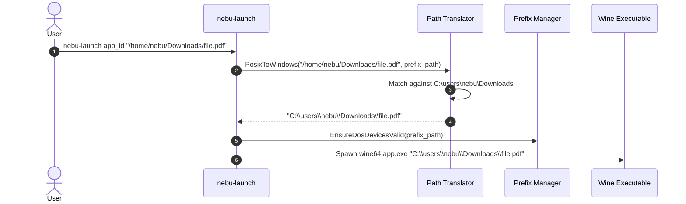

# Filesystem Mapping Specification — NebuOS

**Status:** DRAFT  
**Purpose:** Specify the Windows drive letter abstraction (C:, Z:), path translation algorithms, user directory linking, and sandbox isolation in NebuOS.

---

## 1. Status
DRAFT — Technical implementation specification for Phase P6 filesystem mapping.

## 2. Purpose
Windows applications expect DOS/NT drive letters (`C:\`, `D:\`), backslash separators (`\`), and case-insensitive path lookups. This specification defines how NebuOS maps the Linux filesystem hierarchy into standard Windows drive representations, safely presents user document directories, and translates path strings bidirectionally with zero data loss.

## 3. Scope
- Drive letter assignment (`C:`, `Z:`, removable media).
- Symlink topology inside application prefixes (`drive_c`, `dosdevices/`).
- User directory mapping (`~/Documents`, `~/Downloads`, `~/Pictures`, `~/Desktop`).
- Bidirectional path translation algorithm (Linux POSIX path <-> Windows DOS path).
- Security sandboxing restrictions on root filesystem visibility (`Z:\` drive isolation).

## 4. Non-goals
- Emulating raw block-level NTFS file streams or alternate data streams (ADS).
- Case-folding the entire host Linux root filesystem (case-insensitivity enforced inside prefix and Wine).
- Exposing raw unpartitioned host disks to Windows applications.

## 5. Requirements
1. **R-MAP-01:** Map prefix root `drive_c/` to Windows `C:\` drive.
2. **R-MAP-02:** Map user personal folders (`~/Documents`, `~/Downloads`, etc.) into `C:\users\nebu\` using standard symlinks or bind mounts.
3. **R-MAP-03:** Restrict `Z:\` (host root) drive access strictly to read-only whitelisted runtime dependencies; completely hide `/root`, `/etc`, and `/home/<other_users>`.
4. **R-MAP-04:** Provide bi-directional path translation utility via `nebu-path` CLI and Rust library.
5. **R-MAP-05:** Automatically map removable USB drives and optical media to sequential letters (`D:`, `E:`) when mounted.

## 6. Architecture
Filesystem mapping is established at sandbox launch by `nebu-runtime-daemon` and Bubblewrap:

```mermaid
graph TD
    subgraph HostSystem[Linux Host Filesystem]
        PREFIX[~/.nebu/apps/app_id/pfx/drive_c]
        DOCS[~/Documents]
        DLS[~/Downloads]
        SYS_USR[/usr: Runtimes & Libraries - Read Only]
        SECURE[/etc, /root, ~/.ssh - Blocked]
    end

    subgraph Sandbox[Bubblewrap Isolated Mount Namespace]
        BWRAP_ROOT[/]
        DEV_DOS[/dosdevices/]
        WIN_C[C: -> drive_c]
        WIN_Z[Z: -> / (Sandboxed Root)]
        WIN_USERS[C:\users\nebu\]
    end

    PREFIX --> WIN_C
    DOCS --> WIN_USERS
    DLS --> WIN_USERS
    SYS_USR --> WIN_Z
    SECURE -.->|Blocked by bwrap| BWRAP_ROOT
    WIN_C --> DEV_DOS
    WIN_Z --> DEV_DOS
```

## 7. Components
1. **Drive Link Manager:** Creates and maintains symlinks inside prefix `dosdevices/`:
   - `c:` -> `../drive_c`
   - `z:` -> `/`
   - `d:` -> `/media/usb` (dynamic)
2. **User Profile Synthesizer:** Configures `C:\users\nebu\` directories linking to corresponding XDG user directories.
3. **Path Translation Engine (`nebu-path`):** High-speed algorithm converting POSIX paths to Windows paths and vice-versa.
4. **Sandbox Visibility Filter:** Bubblewrap argument builder preventing exposure of sensitive host directories.

## 8. Data Flow
1. User invokes `nebu-launch com.app.cad ~/Documents/project.dwg`.
2. Path Translation Engine detects POSIX path `~/Documents/project.dwg`.
3. Resolves path within sandbox mount namespace:
   - Target translates to `C:\users\nebu\Documents\project.dwg`.
4. Wine command executed with translated argument:
   `wine64 app.exe "C:\users\nebu\Documents\project.dwg"`.
5. Application opens file directly without copy overhead.

## 9. Control Flow


## 10. Interfaces
- **Rust Translation API:**
  ```rust
  pub fn posix_to_dos_path(prefix: &Path, posix_path: &Path) -> Result<String, PathError>;
  pub fn dos_to_posix_path(prefix: &Path, dos_path: &str) -> Result<PathBuf, PathError>;
  ```
- **CLI Tool:**
  `nebu-path --to-dos --prefix ~/.nebu/apps/app_id /home/nebu/Documents/model.dwg`
  Output: `C:\users\nebu\Documents\model.dwg`

## 11. Dependencies
- Linux Btrfs / Ext4 POSIX filesystem features.
- Bubblewrap namespace isolation.
- XDG User Directories specification (`xdg-user-dirs`).

## 12. Security
- `Z:\` drive does not expose raw host root:
  - `/etc` is a sanitized dummy directory with minimal `/etc/passwd` and `/etc/resolv.conf`.
  - Sensitive user directories (`~/.ssh`, `~/.gnupg`, `~/.bashrc`, `~/.config/nebu`) are completely masked with `empty-dir` mounts.
- Windows applications cannot traverse symlinks out of their container boundary.

## 13. Resource Requirements
- Path translation latency: <= 0.2ms per path.
- In-memory footprint of translator: <= 50 KB RSS.
- Symlink creation on prefix initialization: <= 5ms.

## 14. Failure Modes
1. **Broken Symlink in dosdevices:** External drive unmounted while symlink remains.
2. **Case Sensitivity Collision:** Two files differing only in case (`File.txt` and `file.txt`) exist in same Linux directory.
3. **Path Length Overflow:** Deeply nested Windows path exceeds standard 260-character `MAX_PATH` limit.

## 15. Recovery Behavior
- Broken drive symlinks are pruned during sandbox initialization.
- Case collisions disambiguated by Wine's internal hashing and directory enumeration cache.
- Extended path prefix (`\\?\`) injected transparently for paths exceeding `MAX_PATH`.

## 16. Testing Requirements
- Unit tests verifying bidirectional path translation across 1,000 diverse path strings.
- Traversal attack test attempting to access `/etc/shadow` through `Z:\` drive.
- Removable media mount/unmount simulation test.

## 17. Performance Requirements
- Zero-copy path translation (string allocation only).
- Direct access to `~/Documents` without filesystem translation latency.

## 18. Compatibility Considerations
- Certain legacy Windows software relies on hardcoded `C:\Windows\System32` paths; prefix symlinks ensure complete compatibility.

## 19. Open Questions
- **OQ-MAP-01:** Should `Z:\` drive be disabled entirely for certified high-security application profiles?
- **OQ-MAP-02:** Should cloud storage directories (Nextcloud, Google Drive) be mounted as separate drive letters (e.g. `G:\`)?

## 20. Related Documents
- [00-application-specification.md](00-application-specification.md)
- [01-installer.md](01-installer.md)
- [02-application-registration.md](02-application-registration.md)
- [04-file-associations.md](04-file-associations.md)
