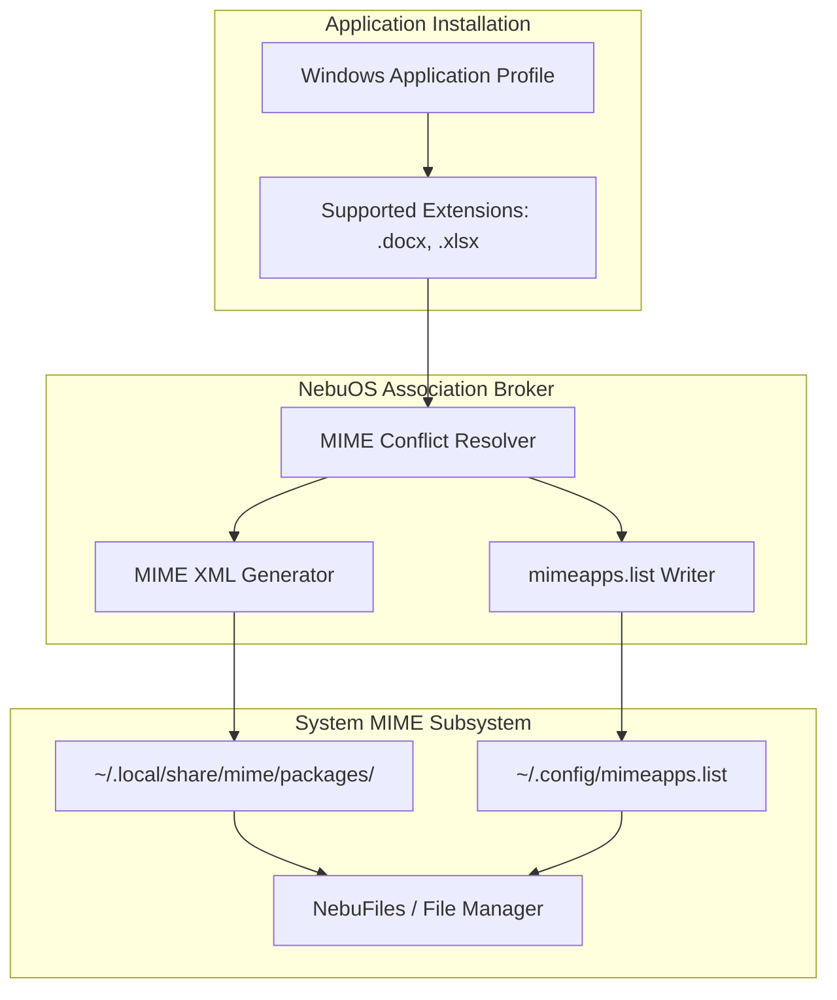
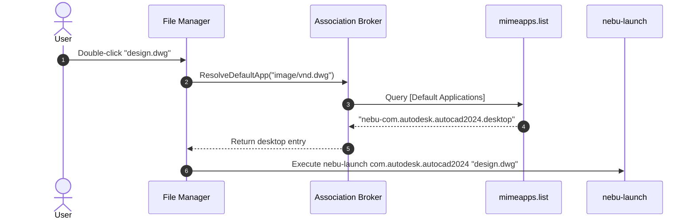

# File Associations Specification — NebuOS

**Status:** DRAFT  
**Purpose:** Specify MIME type database integration, default application selection, extension-to-MIME mapping, and conflict resolution between Linux and Windows applications in NebuOS.

---

## 1. Status
DRAFT — Technical implementation specification for Phase P6 file associations.

## 2. Purpose
When a user double-clicks a document (`.docx`, `.xlsx`, `.dwg`, `.psd`), the desktop must launch the correct application predictably. This specification defines how NebuOS manages file associations, registers proprietary Windows file extensions into the shared FreeDesktop MIME database, and resolves conflicts when multiple applications claim the same file format.

## 3. Scope
- Shared MIME database updates via `update-mime-database`.
- Configuration of default applications (`mimeapps.list`).
- Conflict arbitration between native Linux apps and sandboxed Windows apps.
- Double-click open-with context menu integration in file manager.
- Dynamic association registration upon application installation.

## 4. Non-goals
- Allowing Windows applications to silently overwrite user-configured default browser or email client.
- Registering executable extensions (`.exe`, `.msi`, `.bat`) to arbitrary applications (always handled by NebuRuntime).

## 5. Requirements
1. **R-ASC-01:** Integrate Windows application file extensions with standard FreeDesktop Shared MIME-Info Specification 2.4.
2. **R-ASC-02:** Store user default application preferences in `~/.config/mimeapps.list`.
3. **R-ASC-03:** Prompt user with an intuitive dialog when a newly installed app offers to handle already-associated extensions.
4. **R-ASC-04:** Provide CLI and D-Bus interfaces to query and update MIME associations.
5. **R-ASC-05:** Cleanly purge registered associations when an application is uninstalled.

## 6. Architecture
File association management operates through standard FreeDesktop mechanisms integrated with the NebuOS Application Manager:

## 7. Components
1. **MIME Association Broker:** Coordinates MIME type registration during application install and uninstall.
2. **Conflict Arbiter:** Detects when multiple applications support the same MIME type and applies user preferences.
3. **MIME XML Generator:** Emits standard XML definitions for custom or proprietary Windows file formats.
4. **Preferences Synchronizer:** Atomically updates `~/.config/mimeapps.list`.

## 8. Data Flow
1. User installs Microsoft Word 2024.
2. Installer registers support for `application/vnd.openxmlformats-officedocument.wordprocessingml.document` (`.docx`).
3. Conflict Arbiter checks `mimeapps.list`:
   - If no default set: assigns Microsoft Word 2024 as default.
   - If LibreOffice Writer already set: keeps current default, adds Word to "Open With..." secondary options, and displays non-intrusive toast notification: *"Set Word as default for .docx files? [Yes] [Keep Current]"*.
4. User double-clicks `report.docx` in File Manager; system reads `mimeapps.list` and launches Word.

## 9. Control Flow

## 10. Interfaces
- **CLI Management Command:**
  - `nebu mime get <extension>` (e.g. `nebu mime get .dwg`)
  - `nebu mime set <extension> <app_id>` (e.g. `nebu mime set .dwg com.autodesk.autocad2024`)
  - `nebu mime list <app_id>`
- **D-Bus Interface:** `org.nebu.Mime1`
  - `GetDefaultApplication(String mime_type) -> String desktop_file`
  - `SetDefaultApplication(String mime_type, String desktop_file) -> Boolean`

## 11. Dependencies
- `shared-mime-info` package (`update-mime-database`).
- `xdg-utils` (`xdg-mime`).

## 12. Security
- Windows applications cannot unilaterally hijack default browser (`x-scheme-handler/http`, `https`) or terminal handlers without explicit user confirmation.
- Malicious file associations (e.g. associating `.pdf` with an executable launcher script) are blocked by file type validation.

## 13. Resource Requirements
- MIME lookup latency: <= 1.0ms.
- Database update latency (`update-mime-database`): <= 250ms on background thread.
- Memory footprint: zero daemon overhead (queries read static config files directly).

## 14. Failure Modes
1. **Corrupted mimeapps.list:** Malformed syntax caused by abrupt shutdown.
2. **Missing Desktop File:** Associated application was deleted manually.
3. **MIME Database Lock Contention:** Concurrent updates collide on `mime.cache`.

## 15. Recovery Behavior
- Backups of `mimeapps.list` maintained (`mimeapps.list.bak`); corrupt files restored automatically.
- Dangling associations automatically fallback to generic system viewer or prompt user.
- Atomic file renaming prevents database corruption during concurrent writes.

## 16. Testing Requirements
- Unit tests verifying correct MIME type parsing and conflict resolution.
- Automated tests asserting that Windows uninstall cleanly removes registered MIME types.
- System test validating double-click execution flow from File Manager.

## 17. Performance Requirements
- Association resolution time: <= 1.5ms.
- Background MIME database rebuild: <= 400ms.

## 18. Compatibility Considerations
- Bridges Windows registry file association keys (`HKCR\.ext`, `HKCR\App.Assoc`) to Linux MIME types automatically.

## 19. Open Questions
- **OQ-ASC-01:** Should NebuOS provide a centralized "Default Apps" control panel in System Settings in P2 or P6?
- **OQ-ASC-02:** Should extension-less files be inspected via magic byte sniffing before launch?

## 20. Related Documents
- [00-application-specification.md](00-application-specification.md)
- [02-application-registration.md](02-application-registration.md)
- [03-filesystem-mapping.md](03-filesystem-mapping.md)
- [05-uninstallation.md](05-uninstallation.md)
