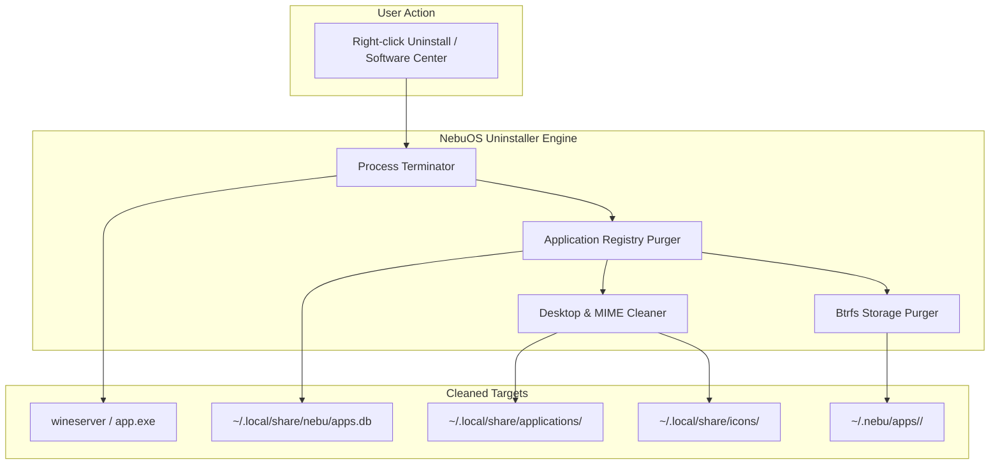
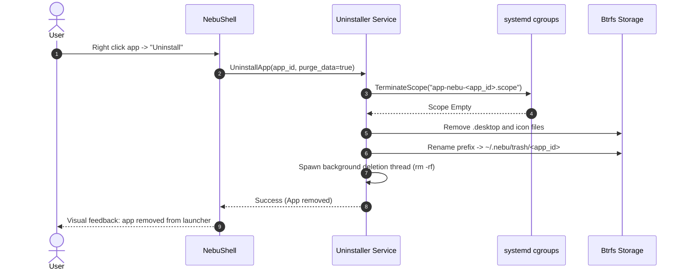

# Application Uninstallation Specification — NebuOS

**Status:** DRAFT  
**Purpose:** Specify the clean removal workflow, prefix purging, orphan detection, user data retention, and registry cleanup for applications in NebuOS.

---

## 1. Status
DRAFT — Technical implementation specification for Phase P6 uninstallation engine.

## 2. Purpose
Traditional Windows uninstallation leaves behind residual registry entries, temp files, and orphaned directories. In NebuOS, because every application runs in an isolated, per-application prefix, uninstallation can be 100% clean and deterministic. This specification defines the uninstallation workflow, data retention options, and artifact removal.

## 3. Scope
- End-to-end uninstallation workflow for Windows and Linux applications.
- Complete prefix purge vs. document data retention options.
- Desktop entry, icon cache, and MIME association removal.
- Running process termination prior to prefix deletion.
- Orphan prefix and dangling symlink detection.

## 4. Non-goals
- Modifying shared system runtimes in `/usr/lib/nebu/runtimes/`.
- Deleting user personal files outside the application prefix (`~/Documents`, `~/Downloads`).
- Restoring uninstalled applications without user backup snapshots.

## 5. Requirements
1. **R-UNS-01:** Provide single-click complete uninstallation from Software Center and application launcher context menu.
2. **R-UNS-02:** Terminate all running processes associated with target application before uninstallation begins.
3. **R-UNS-03:** Prompt user whether to retain or purge application user data (`drive_c/users/nebu/AppData`).
4. **R-UNS-04:** Atomically remove `.desktop` file, icons, and MIME associations.
5. **R-UNS-05:** Delete prefix directory using asynchronous background unlinking to prevent UI freezing.

## 6. Architecture
The uninstallation engine coordinates cleanup across the application registry, desktop integration files, and storage subvolumes:

## 7. Components
1. **Process Terminator:** Identifies active cgroup `app-nebu-<app_id>.scope`, sends SIGTERM, waits 2.0s, and issues SIGKILL.
2. **Integration Cleaner:** Unlinks `.desktop` file and icon files, then invokes `update-desktop-database`.
3. **Prefix Purger:** Moves prefix to ephemeral trash directory (`~/.nebu/trash/`) and asynchronously deletes extents.
4. **Orphan Scanner:** Periodic maintenance tool identifying prefixes on disk that have no matching entry in `apps.db`.

## 8. Data Flow
1. User clicks "Uninstall" for `com.autodesk.autocad2024`.
2. UI displays confirmation modal:
   - *"Uninstall AutoCAD 2024? This will free 4.2 GB of disk space."*
   - Checkbox: *[x] Delete application preferences and templates*.
3. User confirms.
4. Process Terminator halts any active AutoCAD processes.
5. Integration Cleaner deletes:
   - `~/.local/share/applications/nebu-com.autodesk.autocad2024.desktop`
   - `~/.local/share/icons/hicolor/256x256/apps/nebu-com.autodesk.autocad2024.png`
6. Association Broker removes AutoCAD from `mimeapps.list`.
7. Storage Purger unlinks `~/.nebu/apps/com.autodesk.autocad2024/`.
8. UI updates application list immediately (< 300ms).

## 9. Control Flow

## 10. Interfaces
- **D-Bus Interface:** `org.nebu.ApplicationManager1`
  - `UninstallApplication(String app_id, Boolean purge_data) -> Boolean`
- **CLI Command:** `nebu app uninstall <app_id> [--purge-data]`
- **Orphan Cleanup Command:** `nebu app cleanup-orphans`

## 11. Dependencies
- `systemd` cgroup v2 controller.
- Btrfs subvolume / file management tools.
- `update-desktop-database`.

## 12. Security
- Uninstallation strictly validates `app_id` to prevent directory traversal attacks (e.g. passing `../../` to delete arbitrary user directories).
- Prefix deletion runs under user privileges (UID 1000); cannot damage root filesystem.

## 13. Resource Requirements
- Perceived uninstallation latency (time to UI update): <= 300ms.
- Background directory deletion I/O priority: `IDLE` (ionice class 3) to prevent UI lag.
- Memory overhead: <= 8 MB RSS during cleanup.

## 14. Failure Modes
1. **Locked Files:** Process refuses to terminate, holding open file handles.
2. **Permission Denial:** User manually created files with root ownership inside prefix.
3. **Power Interruption During Deletion:** System loses power mid-unlink.

## 15. Recovery Behavior
- Stubborn processes killed forcefully via cgroup `cgroup.kill` interface.
- Permission errors reported to user with clear resolution instructions.
- Staged trash directory (`~/.nebu/trash/`) purged automatically at next system boot.

## 16. Testing Requirements
- Unit tests verifying complete asset removal across 10 sample applications.
- Concurrency test attempting launch during active uninstallation.
- Orphan scanner validation test.

## 17. Performance Requirements
- Immediate UI removal: <= 300ms.
- Complete disk space reclamation: <= 3.0s for 10 GB prefix on SSD.

## 18. Compatibility Considerations
- Deterministic 100% clean uninstall solves the notorious "Windows registry rot" problem entirely.

## 19. Open Questions
- **OQ-UNS-01:** Should NebuOS retain an automated Btrfs snapshot of uninstalled applications for 7 days before permanent deletion?
- **OQ-UNS-02:** Should the user be warned if other installed applications depend on files in the target prefix?

## 20. Related Documents
- [00-application-specification.md](00-application-specification.md)
- [01-installer.md](01-installer.md)
- [02-application-registration.md](02-application-registration.md)
- [04-file-associations.md](04-file-associations.md)
