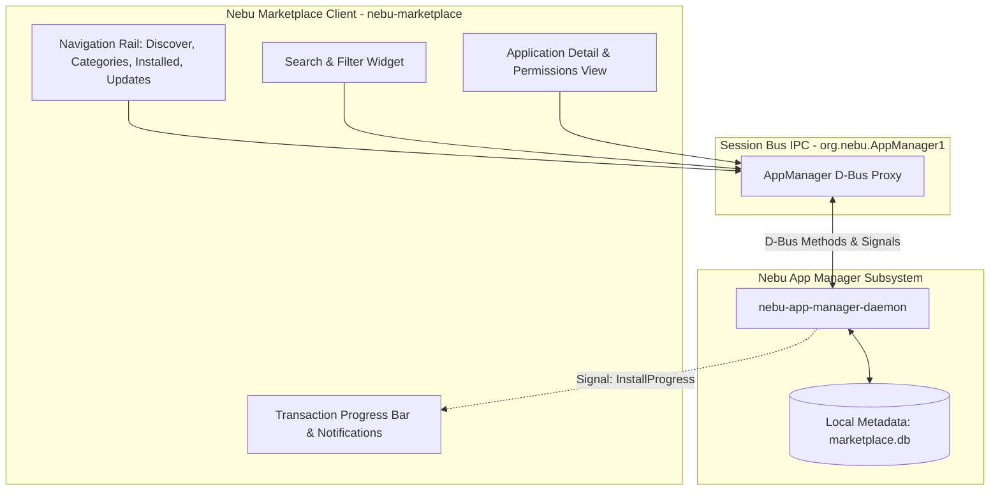
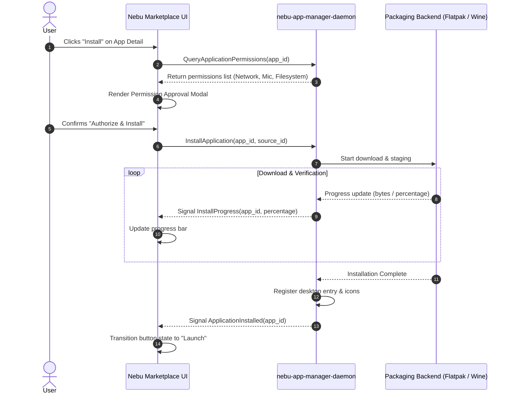

# Nebu Marketplace Specification — NebuOS

**Status:** DRAFT  
**Purpose:** Specify the native graphical user interface, discovery taxonomy, presentation contracts, compatibility badging, and user interactions for the Nebu Marketplace in NebuOS.  

---

## 1. Status
DRAFT — Technical implementation specification for Phase P6.1 Nebu Marketplace.

## 2. Purpose
The Nebu Marketplace serves as the official, native graphical application discovery and installation portal for NebuOS. It provides a curated, intuitive, and distraction-free experience where users can effortlessly find, inspect, install, update, and remove software. 

The Marketplace bridges two primary application ecosystems into a unified presentation:
1. **Native Linux Desktop Applications:** Discovered and retrieved from **Flathub** and complementary sources via **Flatpak**.
2. **Certified Windows Applications:** Discovered via declarative installation recipes and executed in isolated sandboxes via the **Nebu Compatibility Engine**.

Crucially, the Marketplace UI **never executes package managers directly**. It acts strictly as an unprivileged graphical client communicating with the `Nebu App Manager` abstraction daemon over D-Bus.

## 3. Scope
- User interface navigation layout (Discover, Categories, Installed, Updates).
- Search and categorization taxonomy.
- Application detail view: Descriptions, screenshots carousel, publisher verification badges, licensing, changelogs, and permission cards.
- Multi-source presentation and compatibility badges (Verified, Compatible, Partially Compatible, Known Issues, Not Tested, Unavailable).
- Visual permission inspection and pre-installation confirmation dialogs.
- Progress monitoring for downloads, installations, updates, and uninstalls.
- Offline browsing and local search via cached SQLite metadata (`marketplace.db`).
- Privacy-by-design principles and strict lightweight performance budgets.

## 4. Non-goals
- Embedding web browsers, Chromium, or Electron frameworks (Nebu Marketplace is 100% native Rust/Slint).
- Direct spawning of `flatpak`, `rpm`, `dnf`, `wineserver`, or shell commands from the UI process.
- Claiming ownership of Flathub or hosting private forks of upstream repositories.
- Commercial billing, in-app purchases, or credit card payment processing in initial P6 milestones.
- Replacing the standard desktop application launcher (NebuShell provides the launcher; Marketplace provides discovery).

## 5. Requirements

### 5.1 Presentation and Navigation Requirements
- **R-MKT-01 (Native Performance):** Built in Rust with Slint toolkit. Idle memory footprint must strictly remain under 35 MB RSS.
- **R-MKT-02 (Catalog Sections):** The UI must provide 4 primary top-level views:
  1. *Discover:* Featured banners, trending apps, editorial collections, recently updated apps.
  2. *Categories:* Organized taxonomy (Audio/Video, Development, Graphics, Internet, Office, Games, Education, Utilities, System).
  3. *Installed:* List of all installed user applications with version info, storage size, and clean uninstallation triggers.
  4. *Updates:* Centralized notification and batch/single update view for applications.
- **R-MKT-03 (Instant Search):** Full-text search with instant auto-completion responding in <= 40 ms against the local metadata cache.

### 5.2 Trust, Security and Compatibility Requirements
- **R-MKT-04 (Permission Card):** Before any installation begins, the Marketplace must display a clear, human-readable card highlighting all requested entitlements (Network, Audio, Camera, Microphone, Filesystem, USB, GPU).
- **R-MKT-05 (Compatibility Badging):** Every application must display its compatibility status:
  - *Verified:* Tested in Compatibility Lab; 100% functional.
  - *Compatible:* Community tested; functional with minor cosmetic quirks.
  - *Partially Compatible:* Specific features limited (e.g. cloud sync unavailable).
  - *Known Issues:* Explicitly lists known limitations before user installs.
  - *Not Tested:* Unverified application.
- **R-MKT-06 (Publisher Identity):** Display publisher verification status (Official Upstream, Community Packager, Unverified).

### 5.3 Architectural Decoupling Requirements
- **R-MKT-07 (Abstraction Invariant):** All search, install, update, and uninstall requests must be dispatched to `org.nebu.AppManager1` over the D-Bus session bus. The UI contains zero packaging logic.
- **R-MKT-08 (Update Independence):** Updating applications in the Marketplace must never trigger or request an OS reboot.

---

## 6. Architecture

The Marketplace UI functions strictly as a presentation frontend decoupled from system daemons and package engines:

---

## 7. User Interface Layout and Flows

### 7.1 Discover View
- **Hero Banner:** Highlights certified applications or featured tools (e.g. Blender, LibreOffice, Krita, Notepad++).
- **Popular Applications Grid:** Top downloaded applications organized in responsive cards.
- **Recently Updated Carousel:** Applications with recent version releases.
- **Hardware-Tailored Collections:** "Optimized for Your Device" (e.g. Touchscreen tools on convertible laptops, GPU-accelerated suites on discrete GPUs).

### 7.2 Application Detail View
When the user selects an application card, the detail view provides:
1. **Header:** Application icon (SVG/PNG), Display Name, Developer/Publisher, Verification Badge, Source Tag (`Flathub` or `Nebu Windows Recipe`).
2. **Action Bar:** Primary action button (`Install`, `Launch`, `Update`, or `Uninstall`), download size, and installed size.
3. **Compatibility Badge:** Color-coded status chip with popover detailing test scores and known issues.
4. **Screenshots Carousel:** High-resolution screenshots with full-screen zoom capability.
5. **Description & Metadata:** Extended description, license (SPDX), project homepage, source repository.
6. **Permission Inspection Card:** Expandable section detailing sandbox access requests.
7. **Version History & Changelog:** Release notes for the latest update.

### 7.3 Installation Flow

---

## 8. Privacy-by-Design Principles

Nebu Marketplace adheres to strict privacy and telemetry standards:
- **Zero Search Profiling:** User search queries are executed strictly against the local SQLite metadata cache (`marketplace.db`). Search keywords are **never** transmitted to remote analytics servers.
- **No Behavioral Tracking:** The Marketplace does not track application launch frequency, dwell time on application pages, or browsing patterns.
- **Direct Source Attribution:** When downloading an application from Flathub, requests connect directly to Flathub CDN endpoints without passing through tracking proxies.
- **Anonymous Metrics (Optional Opt-In):** If a user explicitly opts into telemetry in System Settings, only coarse anonymous statistics (e.g. crash report traces) are submitted.

---

## 9. Performance & Memory Budgets

| Metric | Target Budget | Enforcement Mechanism |
|---|---|---|
| **Process Idle Memory (RSS)** | <= 35 MB | Pure Rust + Slint native rasterization (no V8, no WebKit). |
| **Active Browsing Memory (RSS)** | <= 75 MB | Strict texture cache eviction for screenshot carousels. |
| **UI Startup Time (Cold)** | <= 250 ms | Zero web engine compilation; instant local SQLite bind. |
| **Search Query Latency** | <= 40 ms | SQLite FTS5 (Full-Text Search) with indexed trigrams. |
| **CPU Usage on Idle** | 0.0% | Event-driven architecture; zero background timer polling. |

---

## 10. Failure Handling and User Feedback

1. **Network Disruption During Download:** The progress bar pauses and displays a retry badge; download resumes via HTTP range requests upon reconnect.
2. **Insufficient Disk Space:** Before starting download, UI prompts: *"Insufficient disk space. Required: 1.2 GB, Available: 450 MB"* and suggests pruning unused runtimes.
3. **Corrupted Package Checksum:** Aborts install with message: *"Security verification failed: Package signature does not match publisher record. Installation canceled."*
4. **Offline Mode:** If no internet connection exists, Marketplace displays an informational banner: *"Offline Mode — Browsing locally cached applications. Connect to internet to install or update."*

---

## 11. Testing Requirements

- **UI Snapshot Tests:** Validate rendering of application cards, permission dialogs, and screenshot carousels across standard and high-DPI displays.
- **D-Bus Mock Tests:** Verify UI behavior under various daemon responses (success, error, progress signals, authorization denials).
- **FTS5 Search Benchmark:** Verify search response latency across 5,000 cached records.

---

## 12. Related Documents

- [docs/decisions/ADR-0012-application-distribution-and-marketplace.md](../decisions/ADR-0012-application-distribution-and-marketplace.md)
- [docs/applications/00-application-specification.md](00-application-specification.md)
- [docs/applications/07-app-manager-specification.md](07-app-manager-specification.md)
- [docs/applications/08-developer-platform-and-security.md](08-developer-platform-and-security.md)
