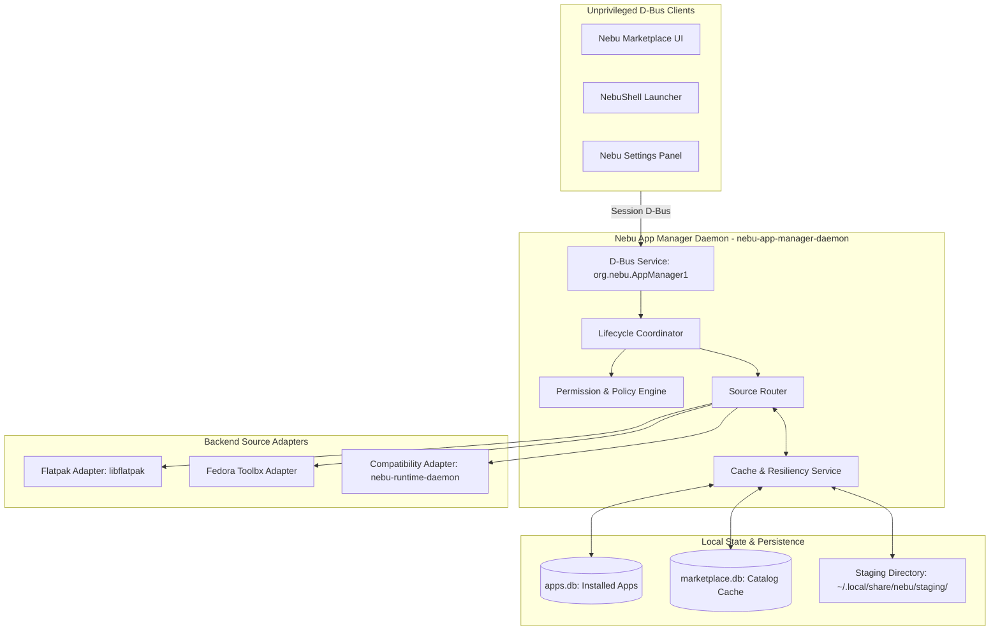

# Nebu App Manager Specification — NebuOS

**Status:** DRAFT  
**Purpose:** Specify the architecture, source abstractions, D-Bus interfaces, backend adapters, and persistence models of the Nebu App Manager daemon (`nebu-app-manager-daemon`).  

---

## 1. Status
DRAFT — Technical implementation specification for Phase P6.0 Application Runtime & App Management.

## 2. Purpose
The Nebu App Manager daemon (`nebu-app-manager-daemon`) is the central, headless orchestration service for all application lifecycle management in NebuOS. It decouples user-facing presentation layers (Nebu Marketplace, NebuShell launcher, settings dialogs) from underlying package managers, execution engines, and container runtimes.

The daemon fulfills five core engineering functions:
1. **Source Normalization:** Normalizes diverse application sources (Flathub, Fedora repositories, future Nebu repositories, and Windows recipe catalogs) behind a uniform `ApplicationSource` trait.
2. **Lifecycle Orchestration:** Coordinates the 10-state application lifecycle: `Discover -> Inspect -> Verify -> Install -> Register -> Launch -> Update -> Disable -> Repair -> Uninstall`.
3. **Security & Policy Enforcement:** Inspects requested sandbox permissions, validates cryptographic signatures, and enforces pre-install user authorization.
4. **Desktop Integration:** Manages FreeDesktop `.desktop` files, extracts Windows PE application icons, and registers MIME file type associations.
5. **Resilient Local Caching:** Manages local SQLite databases (`apps.db` and `marketplace.db`) to enable instant offline search, resumable downloads, and atomic transaction rollbacks.

## 3. Scope
- Daemon architecture, process model, and systemd integration (`packaging/systemd/user/nebu-app-manager.service`).
- `ApplicationSource` Rust trait definition and lifecycle hooks.
- Backend adapters: Flatpak Adapter (`libflatpak`), Fedora Adapter, and Nebu Compatibility Adapter (`nebu-runtime-daemon`).
- D-Bus API contracts: `org.nebu.AppManager1` and `org.nebu.AppSource1`.
- Offline metadata indexing, HTTP range resumable downloads, and staging mechanics.
- Logical database schemas for installed applications (`apps.db`) and catalog metadata (`marketplace.db`).

## 4. Non-goals
- Implementing a bespoke binary packaging format.
- Executing package operations with root privileges (daemon runs strictly as an unprivileged user service).
- Conflating application updates with operating system `bootc` deployments.
- Direct rendering of graphical user interfaces.

## 5. Requirements

### 5.1 Architecture & Abstraction Requirements
- **R-MGR-01 (Unprivileged User Daemon):** `nebu-app-manager-daemon` runs within the systemd user session (`systemd --user`), requiring zero root privileges for Flatpak user installs or Windows prefix management.
- **R-MGR-02 (Source Abstraction):** All application origins must implement the `ApplicationSource` trait, isolating the UI from backend implementation details.
- **R-MGR-03 (Flatpak-First Backend):** Native Linux desktop applications are dispatched to `libflatpak` targeting `~/.local/share/flatpak` (or `/var/lib/flatpak` when system install is authorized).
- **R-MGR-04 (Compatibility Engine Backend):** Windows executable recipes are dispatched to `nebu-runtime-daemon` to provision isolated Btrfs prefixes.

### 5.2 Transaction & Resiliency Requirements
- **R-MGR-05 (Atomic Staging):** Downloads and installations stage in `~/.local/share/nebu/staging/`. Partial failures are automatically cleaned up without leaving orphaned files.
- **R-MGR-06 (Resumable Downloads):** Package downloads must support HTTP range requests (`Range: bytes=...`) to recover from network disconnects.
- **R-MGR-07 (Disk Space Pre-Flight):** Before starting any download, the daemon verifies available disk space via `statvfs`. Transactions fail gracefully if free space is insufficient.

---

## 6. Architecture & Subsystem Boundaries



---

## 7. ApplicationSource Trait Specification

The daemon defines the core `ApplicationSource` trait in Rust:

```rust
pub enum SourceType {
    FlatpakRepo,
    FedoraSystemRepo,
    WindowsRecipeCatalog,
    NebuRepository,
}

pub enum PackageFormat {
    FlatpakBundle,
    FedoraRPM,
    WindowsRecipe,
    NebuPackage,
}

pub struct SourceMetadata {
    pub source_id: String,
    pub display_name: String,
    pub source_type: SourceType,
    pub supported_architectures: Vec<String>,
    pub package_format: PackageFormat,
    pub metadata_url: String,
    pub package_url: String,
    pub gpg_keyring_path: Option<String>,
    pub enabled: bool,
}

pub trait ApplicationSource: Send + Sync {
    fn id(&self) -> &str;
    fn metadata(&self) -> &SourceMetadata;
    fn refresh_metadata(&self, cache: &mut MetadataCache) -> Result<(), SourceError>;
    fn search(&self, query: &str, limit: usize) -> Result<Vec<AppSummary>, SourceError>;
    fn get_details(&self, app_id: &str) -> Result<AppManifest, SourceError>;
    fn install(&self, app_id: &str, progress_cb: ProgressCallback) -> Result<InstalledApp, SourceError>;
    fn update(&self, app_id: &str, progress_cb: ProgressCallback) -> Result<InstalledApp, SourceError>;
    fn uninstall(&self, app_id: &str, purge_data: bool) -> Result<(), SourceError>;
}
```

---

## 8. D-Bus Interface Specifications

### 8.1 `org.nebu.AppManager1`

```xml
<!DOCTYPE node PUBLIC "-//freedesktop//DTD D-BUS Object Introspection 1.0//EN"
 "http://www.freedesktop.org/standards/dbus/1.0/introspect.dtd">
<node name="/org/nebu/AppManager1">
  <interface name="org.nebu.AppManager1">
    <!-- Methods -->
    <method name="SearchApplications">
      <arg name="query" type="s" direction="in"/>
      <arg name="category" type="s" direction="in"/>
      <arg name="results" type="a(sssssssb)" direction="out"/>
    </method>
    
    <method name="GetApplicationDetails">
      <arg name="app_id" type="s" direction="in"/>
      <arg name="manifest_json" type="s" direction="out"/>
    </method>
    
    <method name="GetApplicationPermissions">
      <arg name="app_id" type="s" direction="in"/>
      <arg name="permissions_json" type="s" direction="out"/>
    </method>
    
    <method name="InstallApplication">
      <arg name="app_id" type="s" direction="in"/>
      <arg name="source_id" type="s" direction="in"/>
      <arg name="transaction_id" type="s" direction="out"/>
    </method>
    
    <method name="UpdateApplication">
      <arg name="app_id" type="s" direction="in"/>
      <arg name="transaction_id" type="s" direction="out"/>
    </method>
    
    <method name="UninstallApplication">
      <arg name="app_id" type="s" direction="in"/>
      <arg name="purge_data" type="b" direction="in"/>
      <arg name="success" type="b" direction="out"/>
    </method>
    
    <method name="ListInstalledApplications">
      <arg name="installed_apps" type="a(ssssst)" direction="out"/>
    </method>
    
    <method name="CheckForUpdates">
      <arg name="update_count" type="u" direction="out"/>
    </method>

    <!-- Signals -->
    <signal name="TransactionProgress">
      <arg name="transaction_id" type="s"/>
      <arg name="app_id" type="s"/>
      <arg name="status" type="s"/>
      <arg name="percentage" type="d"/>
    </signal>
    
    <signal name="ApplicationInstalled">
      <arg name="app_id" type="s"/>
    </signal>
    
    <signal name="ApplicationUninstalled">
      <arg name="app_id" type="s"/>
    </signal>
  </interface>
</node>
```

---

## 9. Database Architecture

The App Manager maintains two distinct SQLite database files in WAL (Write-Ahead Logging) mode:

### 9.1 `~/.local/share/nebu/apps.db` (Installed Applications State)
- **`installed_applications`**: `app_id` (PK), `display_name`, `version`, `package_type`, `source_id`, `install_path`, `desktop_file_path`, `installed_at`, `size_bytes`, `status`.
- **`application_permissions`**: `app_id` (FK), `permission_name`, `granted`, `granted_at`, `revocable`.
- **`windows_prefixes`**: `app_id` (FK), `prefix_path`, `wine_version`, `dll_overrides`, `created_at`, `snapshot_name`.

### 9.2 `~/.cache/nebu/marketplace.db` (Remote Metadata Cache)
- **`catalog_applications`**: `app_id` (PK), `source_id`, `name`, `summary`, `description`, `version`, `publisher_name`, `verified`, `license`, `category_primary`, `icon_url`, `homepage`, `updated_at`.
- **`catalog_screenshots`**: `id` (PK), `app_id` (FK), `screenshot_url`, `caption`, `order_index`.
- **`catalog_compatibility`**: `app_id` (PK), `status`, `score`, `tested_version`, `known_issues_json`.
- **`fts_applications`**: SQLite FTS5 virtual table indexing `name`, `summary`, `description`, `category_primary` for instant full-text search.

---

## 10. Performance Budgets

- **Idle Memory:** <= 18 MB RSS.
- **Search Dispatch Latency:** <= 15 ms for local FTS5 queries.
- **Desktop Entry Registration:** <= 20 ms after package staging.
- **Shutdown Time:** <= 100 ms on systemd session termination.

---

## 11. Related Documents

- [docs/decisions/ADR-0012-application-distribution-and-marketplace.md](../decisions/ADR-0012-application-distribution-and-marketplace.md)
- [docs/applications/00-application-specification.md](00-application-specification.md)
- [docs/applications/06-software-center.md](06-software-center.md)
- [docs/applications/08-developer-platform-and-security.md](08-developer-platform-and-security.md)
