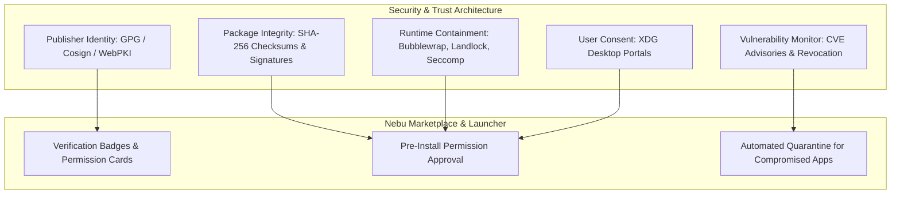
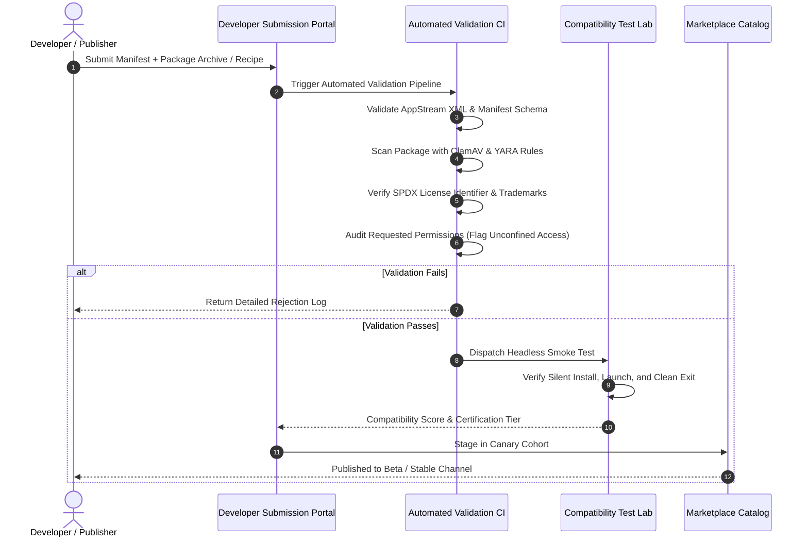

# Developer Platform & Application Security Specification — NebuOS

**Status:** DRAFT  
**Purpose:** Specify the security containment, cryptographic trust model, developer submission pipeline, automated verification gates, and production abuse response infrastructure for the NebuOS Application Platform.  

---

## 1. Status
DRAFT — Technical implementation specification for Phase P6.2 (Application Security), Phase P6.3 (Developer Platform), and Phase P8 (Production Readiness).

## 2. Purpose
An open application ecosystem must protect user privacy, host system stability, and intellectual property while enabling third-party developers to easily publish and update software. 

This specification establishes the end-to-end security and developer lifecycle across NebuOS:
1. **Multi-Layer Application Security:** Cryptographic package verification, granular sandbox containment, and transparent user permission controls.
2. **Developer Onboarding & Publishing Pipeline:** Automated metadata linting, security scans, and compatibility checks.
3. **Incident Response & Abuse Mitigation:** Automated CVE tracking, vulnerability advisories, blacklisting, and remote package revocation/takedown mechanisms.
4. **Production Infrastructure (Phase P8):** HSM-backed cryptographic signing, Sigstore Rekor transparency logging, and high-availability CDN distribution.

## 3. Scope
- Trust classification taxonomy: Publisher Trust, Package Integrity, Runtime Sandbox, and Application Compatibility.
- Cryptographic signing and validation (GPG keys, Sigstore/Cosign, SHA-256 digests).
- Developer registration, submission, and validation pipeline.
- Automated security analysis (privilege escalation, unconfined filesystem access, malicious PE headers).
- Package revocation, quarantine, blacklisting, and legal/DMCA-like takedown workflow.
- Production signing, CDN, and disaster recovery infrastructure for Phase P8.

## 4. Non-goals
- Implementing proprietary DRM (Digital Rights Management) technologies that restrict user ownership.
- Building a commercial advertising or user telemetry tracking network.
- Replacing upstream Flathub security processes (NebuOS validates upstream signatures and adds client-side defense-in-depth).
- Performing manual source code audits for every third-party open-source application (automated static analysis + community reporting model).

## 5. Requirements

### 5.1 Security & Trust Requirements
- **R-SEC-01 (Defense-in-Depth Taxonomy):** The security model must strictly separate five independent concepts:
  1. *Publisher Trust:* Verifiable identity of the developer or packaging entity.
  2. *Package Integrity:* Cryptographic proof that bits have not been tampered with since publishing.
  3. *Runtime Sandbox:* OS-level isolation restricting what running code can access.
  4. *Application Compatibility:* Operational score indicating how reliably the application runs.
  5. *Security Status:* Active CVE alerts or vulnerability warnings.
- **R-SEC-02 (Never Assume Safety):** The system must never label an application "100% Safe" merely because it originates from Flathub or an external source. All applications run sandboxed.
- **R-SEC-03 (Mandatory Signature Verification):** Unsigned packages or packages with mismatched SHA-256 checksums must be rejected before staging.
- **R-SEC-04 (Emergency Revocation):** The OS must support remote revocation lists allowing compromised package versions to be disabled and quarantined.

### 5.2 Developer Platform Requirements
- **R-SEC-05 (Automated Submission Pipeline):** Developer submissions must undergo automated linting, AppStream schema validation, license checking, and sandbox permission auditing.
- **R-SEC-06 (Staged Promotion):** Releases progress through deterministic gates: `Draft -> Automated Scan -> Compatibility Lab -> Staged Canary -> Public Release`.

---

## 6. Trust Classification & Security Architecture

### 6.1 Publisher Verification Tiers
1. **Tier 1 — Official Upstream:** Verified domain ownership and cryptographic keys matched directly to upstream software maintainers (e.g. `videolan.org`, `blender.org`, `mozilla.org`).
2. **Tier 2 — Community Verified:** Trusted open-source packagers whose identities and GPG keys are vetted by the NebuOS or Flathub community.
3. **Tier 3 — Unverified / Third-Party:** Custom or third-party repositories without established identity chains. Flagged in UI with an amber security notice.

### 6.2 Runtime Containment Invariants
- **Flatpak Containment:** Unprivileged user namespaces, isolated `/home`, separate `/tmp`, read-only sysroot `/usr`, mediated portal access for camera, mic, and screen sharing.
- **Windows Executable Containment:** Bubblewrap wrapper with Landlock LSM and seccomp BPF filters:
  - Linux root `/` is never mapped as `Z:\`.
  - Blocked syscalls: `ptrace`, `kexec_load`, `sys_rawio`, `reboot`.
  - Dedicated Btrfs reflink prefix prevents cross-app data leakage.

---

## 7. Developer Submission Pipeline (Subphase P6.3)

### 7.1 Automated Submission Gates
1. **Manifest Linting:** Verification of required fields (`id`, `name`, `version`, `license`, `category`, `screenshots`, `permissions`).
2. **Permission Audit:** Submissions requesting unrestricted host filesystem access (`filesystem=host`) or raw device nodes require manual security review.
3. **Binary Malware Scanning:** Automated scans against signature databases and heuristic analysis for known rootkits or cryptocurrency miners.
4. **License Compliance:** Automated validation against SPDX license list; proprietary licenses flagged for recipe verification.

---

## 8. Incident Response, Abuse Handling & Takedown

### 8.1 Vulnerability & Malicious Package Response
If a published application is found to contain malware or a critical zero-day vulnerability (CVSS >= 9.0):
1. **Takedown Signal:** The security team publishes an updated revocation list to the metadata CDN (`revocations.json`).
2. **Client Quarantine:** When `nebu-app-manager-daemon` synchronizes metadata:
   - Identifies revoked package hashes or application versions.
   - Immediately hides desktop shortcuts from NebuShell launcher.
   - Sets application state to `Quarantined`.
   - Displays a critical system notification to the user: *"Application [Name] has been revoked due to a critical security advisory. Launching is blocked to protect your system."*
3. **Uninstallation Option:** Prompts user with a one-click clean uninstallation wizard.

### 8.2 Legal and Copyright / DMCA Policy
- Clear notice-and-takedown procedure for copyright or trademark infringement claims.
- For proprietary Windows software, NebuOS never distributes binary installers; it distributes declarative installation recipes that fetch legal media directly from authorized vendor CDNs.

---

## 9. Production Infrastructure (Phase P8)

For Phase P8 production readiness, the Application Platform infrastructure requires:

1. **Hardware Security Module (HSM) Signing:**
   - Root release signing keys stored in FIPS 140-2 Level 3 HSMs.
   - Automated signing pipelines using Sigstore Cosign with ephemeral OIDC tokens.
   - Public auditability via the Sigstore Rekor transparency log.
2. **High-Availability Metadata CDN:**
   - Global Anycast CDN caching metadata snapshots and screenshots.
   - Multi-region origin fallback with 99.95% uptime SLA.
3. **Disaster Recovery & Redundancy:**
   - Daily encrypted backups of developer metadata registries.
   - Out-of-band kill switch for rapid revocation propagation.

---

## 10. Related Documents

- [docs/decisions/ADR-0012-application-distribution-and-marketplace.md](../decisions/ADR-0012-application-distribution-and-marketplace.md)
- [docs/applications/00-application-specification.md](00-application-specification.md)
- [docs/applications/06-software-center.md](06-software-center.md)
- [docs/applications/07-app-manager-specification.md](07-app-manager-specification.md)
- [docs/roadmap/00-implementation-roadmap.md](../roadmap/00-implementation-roadmap.md)
