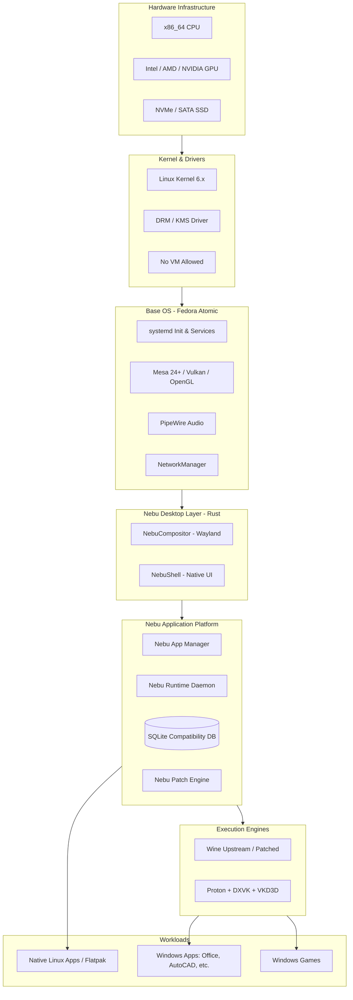

# Architecture Overview — NebuOS

**Status:** REVIEW  
**Purpose:** Provide the top-level architectural framework, core principles, system boundary definitions, and design invariants governing NebuOS.

---

## 1. Scope & System Purpose
NebuOS is an immutable, desktop-focused Linux operating system engineered to execute both native Linux applications and Windows PE binaries with seamless, native-feeling responsiveness. NebuOS eliminates the operational complexity of Wine prefix tuning, Winetricks scripts, and graphics backend configuration through a system-level compatibility layer while strictly prohibiting virtualization (VMs).

## 2. Non-Goals
- Designing or maintaining a custom kernel from scratch.
- Replacing mature Linux graphics stacks (Mesa, DRM/KMS, Vulkan, Wayland).
- Providing hypervisor-based compatibility (QEMU, KVM, VirtualBox).
- Developing a 100% clone of the Windows NT userland.

## 3. Core Architectural Principles
1. **Upstream Foundation First:** Reuse the Linux kernel, systemd, udev, Mesa, PipeWire, NetworkManager, and upstream Wine. Custom code is written exclusively where systemic integration gaps exist.
2. **Strict Component Isolation:** Userland desktop elements (NebuCompositor, NebuShell) run as unprivileged user processes. Windows applications execute in sandboxed, per-application isolated prefixes.
3. **Rust as System Implementation Language:** All Nebu-original components (`nebu-compositor`, `nebu-shell`, `nebu-runtime`, `nebu-compat`, `nebu-patcher`) are authored in memory-safe Rust.
4. **Predictable Low-End Performance:** Architecture guarantees fluent desktop operation on 4 GB RAM dual-core x86_64 machines (< 800 MB idle memory).

## 4. High-Level Subsystem Map

## 5. Subsystem Summary Table

| Subsystem | Upstream Technology | Nebu In-House Technology | Primary Responsibility |
|---|---|---|---|
| Core Kernel & Drivers | Linux Kernel, DRM/KMS, Mesa | HW Tuning Profiles | Hardware control, direct scanout, GPU buffer allocation. |
| OS Base & Immutability | Fedora Atomic, ostree, bootc | Staged Update Agent | Read-only rootfs (`/usr`), atomic deployments, A/B rollback. |
| Display & Windowing | Wayland Protocol, libinput | `nebu-compositor` (Rust) | Buffer composition, frame scheduling, multi-monitor, HiDPI. |
| Desktop Shell | FreeDesktop specs | `nebu-shell` (Rust) | Taskbar, launcher, quick settings, workspace manager. |
| Runtime & Compatibility | Wine, Proton, DXVK, VKD3D | `nebu-runtime`, `nebu-patcher` | PE binary detection, prefix lifecycle, DLL overrides, sandboxing. |
| Metadata & Intelligence | SQLite 3 | `nebu-compat-db` | Application profiles, certified configurations, hardware limits. |

## 6. Failure Modes & Degradation
- **Compositor Crash:** Monitored by systemd user session watchdog. Upon unexpected crash, state is serialized to IPC shm, restarting the compositor without terminating client processes.
- **Prefix Corruption:** NebuRuntime captures crash loops, automatically offering snapshot rollback to the last known working state.

## 7. Related Documents
- [01-system-architecture.md](01-system-architecture.md)
- [02-boot-and-init.md](02-boot-and-init.md)
- [../runtime/00-runtime-overview.md](../runtime/00-runtime-overview.md)
