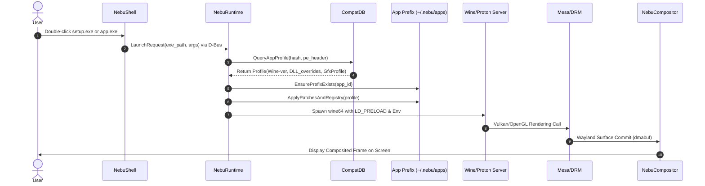

# System Architecture Specification — NebuOS

**Status:** REVIEW  
**Purpose:** Define the complete vertical stack of NebuOS, component interactions, interface boundaries, and operational invariants.

---

## 1. System Topology & Layers
NebuOS is structured into seven distinct architectural layers, ensuring strict encapsulation and unidirectional dependencies.

## 2. Detailed Layer Specifications

### Layer 1: Hardware & Kernel Foundation
- **Linux Kernel:** Standard LTS Linux kernel (6.6+ or 6.10+ as supplied by Fedora Atomic base).
- **Core Drivers:** In-tree DRM drivers (`i915`/`xe`, `amdgpu`, `nouveau`), proprietary NVIDIA via pre-compiled OSTree kmods.
- **Kernel Tunables:** `vm.max_map_count=2147483642` (mandatory for high-end Windows games and CAD runtime), `fs.file-max=2097152`, `split_lock_mitigate=0` for uninhibited Wine performance.

### Layer 2: Base Operating System (Fedora Atomic)
- **Deployment Model:** OCI container-based image deployments (`bootc` / `rpm-ostree`).
- **Filesystem Security:** `/usr` mounted read-only; `/etc` writable state managed via 3-way merge; `/var` persistent state.
- **Core Services:** `systemd` (init, cgroups v2, user sessions), `udev` (dynamic device enumeration), `NetworkManager`, `PipeWire` + `wireplumber` (audio/video pipeline).

### Layer 3: Display & Compositing Engine (`nebu-compositor`)
- **Protocol:** Wayland Core Protocol + `xdg_shell`, `linux_dmabuf_v1`, `viewporter`, `fractional_scale_v1`.
- **Backend:** DRM/KMS backend using Direct Render Nodes (`/dev/dri/cardX`, `/dev/dri/renderD128`).
- **Memory Footprint:** Budgeted <= 75 MB RSS on idle.

### Layer 4: Desktop Shell (`nebu-shell`)
- **Architecture:** Standalone Wayland client communicating via `wlr-layer-shell-unstable-v1` and custom IPC.
- **Rendering:** GPU-accelerated via Slint or Iced toolkit utilizing Vulkan/OpenGL. Strict prohibition against Chromium/Electron.
- **Components:** System Panel, Application Launcher, Quick Settings, System Tray (StatusNotifierWatcher), Lock Screen.

### Layer 5: Nebu Application Platform & Runtime
- **Daemon:** `neburuntimed` running as a `systemd --user` service.
- **Responsibilities:** PE header inspection, SHA-256 fingerprinting, prefix provisioning, environment sanitization, sandbox invocation (`bwrap`).

### Layer 6: Windows Compatibility Infrastructure
- **Wine Foundation:** Reused upstream Wine binaries (Stable & Staging trees) decoupled from base OS.
- **Proton Infrastructure:** Valve Proton runtime bundles deployed in `/usr/lib/nebu/runtimes/proton/` for gaming applications.
- **Translation Stacks:** DXVK (Direct3D 9/10/11 -> Vulkan), VKD3D-Proton (Direct3D 12 -> Vulkan).

### Layer 7: Applications & Storage
- Native Linux applications (packaged via Flatpak or system packages).
- Managed Windows applications residing within isolated directories: `~/.nebu/apps/<app-id>/`.

## 3. Data Interfaces & Contracts
1. **Shell-to-Runtime IPC:** D-Bus service `org.nebu.Runtime1` on the Session Bus.
2. **Runtime-to-Database:** In-process SQLite3 binding via `rusqlite` with WAL mode enabled.
3. **Compositor-to-Clients:** Standard Wayland UNIX domain socket (`$XDG_RUNTIME_DIR/wayland-0`).

## 4. Security & Privilege Boundaries
- NebuCompositor and NebuShell execute under the standard unprivileged user session UID (1000).
- Windows PE binaries are jailed using unprivileged user namespaces (`bwrap`):
  - Read-only bind mount of base system: `/usr`, `/lib64`.
  - Isolated temporary directory: isolated `/tmp`.
  - Filtered `/home`: Only `~/.nebu/apps/<app-id>/drive_c` and explicitly whitelisted user folders (`~/Documents`, `~/Downloads`) are exposed.

## 5. Performance Invariants
- Zero polling threads in system daemons; 100% epoll/eventfd event-driven loops.
- Idle CPU consumption across all Nebu background daemons < 0.5% total CPU utilization.

## 6. Related Documents
- [02-boot-and-init.md](02-boot-and-init.md)
- [03-process-and-ipc.md](03-process-and-ipc.md)
- [05-security.md](05-security.md)
