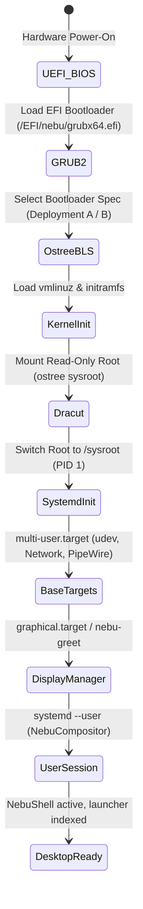

# Boot and Initialization Specification — NebuOS

**Status:** REVIEW  
**Purpose:** Specify the end-to-end boot sequence, initramfs design, systemd service dependency graph, graphical target transitions, and rollback triggers.

---

## 1. Boot Stages Sequence

## 2. Stage Breakdown & Responsibilities

### Stage 1: Firmware & Bootloader
- **Firmware:** UEFI 64-bit (Legacy CSM supported where present, but not validated).
- **Bootloader:** GRUB2 with Boot Loader Specification (BLS) integration.
- **A/B Deployment Choice:** GRUB reads `/boot/loader/entries/` populated by `bootc` / `ostree`. Default deployment is index 0; prior deployment is index 1.
- **Rollback Hook:** If boot fails 3 consecutive times (`boot_counter > 3`), GRUB automatically falls back to index 1.

### Stage 2: Initramfs (Dracut)
- **Components:** Minimal dracut profile containing storage drivers (NVMe, AHCI), Btrfs filesystem driver, and OSTree sysroot pivot tools.
- **Tasks:**
  1. Initialize storage and unlock encrypted LUKS volumes (if configured).
  2. Locate root filesystem UUID and mount Btrfs `@` subvolume.
  3. Prepare OSTree deployment mount at `/sysroot`.
  4. Perform `switch_root` to `/sysroot`.

### Stage 3: Systemd Initialization (PID 1)
- **Core Units Active:**
  - `systemd-journald.service`: High-performance binary logging.
  - `systemd-udevd.service`: Accelerated device node creation.
  - `systemd-oomd.service`: Out-of-memory killer monitoring memory pressure.
  - `dbus-broker.service`: High-throughput, low-latency D-Bus message broker.
- **Target Reach:** `basic.target` -> `sysinit.target` -> `multi-user.target` -> `graphical.target`.

### Stage 4: Session Startup & Graphical Target
- **Display Manager:** Lightweight native greeter (`nebu-greet`) or auto-login service for single-user desktop configurations.
- **Compositor Startup:** Launch `nebu-compositor.service` within `systemd --user` session.
- **Shell Startup:** `nebu-shell.service` starts after `wayland-session.target` is reached.

## 3. Boot Failure Behavior & Automated Recovery

| Boot Stage | Failure Symptom | Detection Mechanism | Automated Recovery Action |
|---|---|---|---|
| Kernel / Initramfs | Kernel Panic / Mount Failure | Watchdog timer (60s hardware watchdog) | Reboot into prior OSTree image deployment. |
| Systemd Base | Hang before `multi-user.target` | `systemd-boot-check-no-failures` | Enter emergency rescue shell; log diagnostic dump. |
| GPU Driver Init | Black screen, DRM fail | `nebu-greet` exit status != 0 | Fallback to `simpledrm` / `llvmpipe` software rasterizer. |
| Compositor Crash | Immediate exit or crash loop | systemd restart throttle (5 restarts in 10s) | Display Fallback Diagnostic Dialog with rollback option. |

## 4. Boot Performance Budget

| Milestone | SATA SSD Target | NVMe Gen3/4 Target |
|---|---|---|
| UEFI to Kernel Hand-off | 2.5 s | 1.8 s |
| Kernel + Initramfs | 1.8 s | 1.0 s |
| Userspace systemd to Graphical Target | 2.2 s | 1.2 s |
| Compositor + Shell Render | 0.8 s | 0.4 s |
| **Total Boot to Interactive Desktop** | **< 7.3 s** | **< 4.4 s** |

## 5. Related Documents
- [01-system-architecture.md](01-system-architecture.md)
- [../updates/04-rollback.md](../updates/04-rollback.md)
- [../performance/03-boot.md](../performance/03-boot.md)
