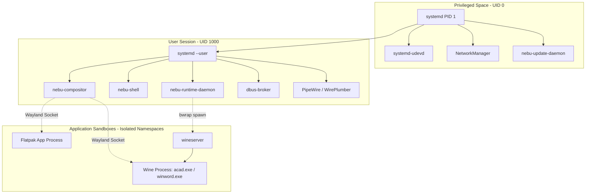

# Process and IPC Architecture Specification — NebuOS

**Status:** REVIEW  
**Purpose:** Define process isolation boundaries, privilege hierarchies, IPC protocols, and session communication contracts.

---

## 1. Process Hierarchy & Privilege Model

## 2. IPC Protocol Selection Rationale

1. **D-Bus (`dbus-broker`):**
   - *Use Case:* High-level system state changes, application launch requests, hardware notifications, and update orchestration.
   - *Rationale:* Standard Linux IPC mechanism. Reusing `dbus-broker` eliminates custom IPC bugs, provides strict polkit authorization, and exposes introspectable interfaces.
2. **Wayland UNIX Domain Sockets:**
   - *Use Case:* Surface buffer exchange, input events, window state negotiation between clients and `nebu-compositor`.
   - *Rationale:* Native display protocol standard with zero-copy `dmabuf` buffer sharing.
3. **Shared Memory (`memfd_create` + POSIX shm):**
   - *Use Case:* High-bandwidth telemetry, frame buffer passing, and crash state serialization between compositor and shell.

## 3. Core D-Bus Service Contracts

### Interface: `org.nebu.Runtime1`
- **Bus:** Session Bus (`dbus-broker`)
- **Object Path:** `/org/nebu/Runtime1`
- **Methods:**
  - `LaunchExecutable(String path, Array[String] args, Dict options) -> ObjectPath app_instance`
  - `IdentifyExecutable(String path) -> Struct(String app_id, String app_name, Int32 cert_status)`
  - `RepairPrefix(String app_id, Int32 repair_mode) -> Boolean success`
  - `TerminateApplication(String app_id) -> Boolean success`
- **Signals:**
  - `ApplicationStarted(String app_id, Int32 pid)`
  - `ApplicationTerminated(String app_id, Int32 exit_code)`
  - `ApplicationCrashed(String app_id, String error_report_path)`

### Interface: `org.nebu.Compositor1`
- **Bus:** Session Bus
- **Object Path:** `/org/nebu/Compositor1`
- **Methods:**
  - `GetWindowList() -> Array[Struct(UInt32 window_id, String title, String app_id, Rect geometry)]`
  - `ActivateWindow(UInt32 window_id) -> Void`
  - `SetWindowGeometry(UInt32 window_id, Rect geometry) -> Void`
  - `SetWorkspace(UInt32 workspace_index) -> Void`
- **Signals:**
  - `WindowCreated(UInt32 window_id, String app_id)`
  - `WindowDestroyed(UInt32 window_id)`
  - `ActiveWindowChanged(UInt32 window_id)`

## 4. Authentication & Authorization
- **Privileged Actions:** Admin actions (applying OS image, rollback, raw disk ops) require PolicyKit (`polkit`) authorization via `org.nebu.update.policy`.
- **Desktop Actions:** All desktop, runtime, and prefix management operations execute unprivileged as UID 1000 without requiring `sudo` or root privileges.

## 5. Related Documents
- [01-system-architecture.md](01-system-architecture.md)
- [05-security.md](05-security.md)
- [../runtime/02-windows-runtime.md](../runtime/02-windows-runtime.md)
