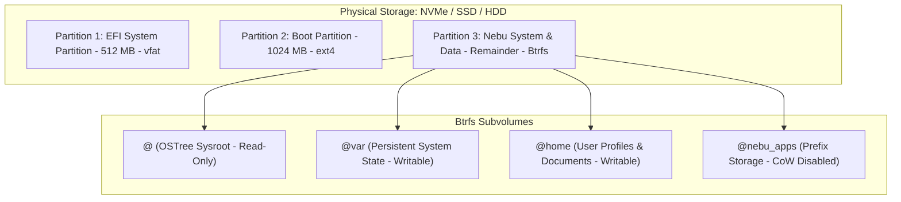

# Filesystem Architecture Specification — NebuOS

**Status:** REVIEW  
**Purpose:** Define system mount topologies, Btrfs subvolume layout, immutable root partitions, user data isolation, and Windows prefix filesystem virtualization.

---

## 1. Storage Layout & Partition Scheme



## 2. Partition & Subvolume Table

| Partition / Subvolume | Mount Point | Filesystem | Mount Options | Purpose |
|---|---|---|---|---|
| Partition 1 | `/boot/efi` | vfat | `umask=0077,shortname=winnt` | UEFI bootloaders (`grubx64.efi`). |
| Partition 2 | `/boot` | ext4 | `defaults,ro` | Kernel images (`vmlinuz`) and initramfs. |
| Subvolume `@` | `/` | Btrfs | `compress=zstd:1,ro` | Root filesystem managed by OSTree / bootc. |
| Subvolume `@var` | `/var` | Btrfs | `compress=zstd:1,rw,noatime` | System logs, Flatpak runtimes, libvirt. |
| Subvolume `@home` | `/home` | Btrfs | `compress=zstd:1,rw,noatime` | User configuration and personal files. |
| Subvolume `@nebu_apps` | `/home/$USER/.nebu/apps` | Btrfs | `rw,noatime,nodatacow` | Isolated Wine prefixes and Windows filesystems. |

*Note on `nodatacow`:* Wine prefix databases, registry hives, and high-frequency Direct3D shader caches exhibit fragmentation under copy-on-write. Setting `nodatacow` on `@nebu_apps` prevents SQLite / registry fragmentation while retaining snapshot capabilities at the subvolume level.

## 3. Directory Layout Hierarchy

```text
/
├── usr/                  # Immutable OS binaries, libraries, drivers (Read-Only)
│   ├── lib/nebu/         # Bundled Wine & Proton runtimes
│   └── share/nebu/       # Default compatibility profiles & patches
├── etc/                  # Machine-specific configuration (Writable overlay)
├── var/                  # Variable state (Logs, cache, system DB)
│   └── lib/nebu/db/      # System-wide compatibility database (compat.db)
└── home/
    └── user/
        ├── .config/nebu/ # User shell & desktop preferences
        └── .nebu/
            ├── apps/     # Application prefixes (~/.nebu/apps/<app_id>/)
            │   └── autodesk.autocad.2024/
            │       ├── prefix.json
            │       ├── dosdevices/
            │       │   ├── c: -> ../drive_c
            │       │   └── z: -> /home/user/Documents (Controlled)
            │       ├── drive_c/
            │       │   ├── Program Files/
            │       │   ├── ProgramData/
            │       │   └── windows/
            │       └── snapshots/ # Point-in-time prefix snapshots
            └── cache/    # Vulkan pipeline cache & font cache
```

## 4. Windows `C:\` and `Z:\` Drive Virtualization
- **`C:\` Drive:** Sandboxed inside `~/.nebu/apps/<app-id>/drive_c`. Any attempt by the Windows application to access `C:\Windows\System32` routes strictly into its private prefix.
- **`Z:\` Drive (Host Passthrough):** By default, unrestricted access to the root filesystem (`Z:\ -> /`) is **prohibited**. `Z:\` is restricted to mapped directories:
  - `Z:\Documents` -> `/home/$USER/Documents`
  - `Z:\Downloads` -> `/home/$USER/Downloads`
  - Any full-system access must be explicitly authorized by the user via a graphical permission prompt.

## 5. Related Documents
- [01-system-architecture.md](01-system-architecture.md)
- [05-security.md](05-security.md)
- [../runtime/03-prefix-management.md](../runtime/03-prefix-management.md)
