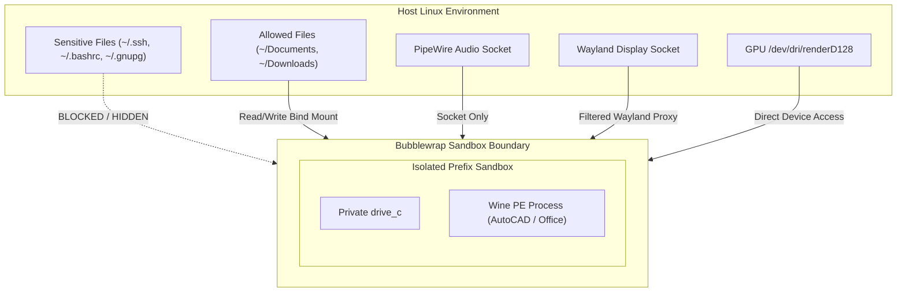

# Security Architecture Specification — NebuOS

**Status:** REVIEW  
**Purpose:** Define threat models, isolation boundaries, application sandboxing rules, cryptographic verification mechanisms, and credential protection.

---

## 1. Threat Model & Adversary Capabilities

| Threat Vector | Description | Attacker Objective | NebuOS Countermeasure |
|---|---|---|---|
| Malicious Windows Binary | User downloads untrusted `.exe` infected with ransomware or spyware. | Encrypt `/home/$USER`, exfiltrate SSH keys, inject rootkits. | Bubblewrap sandbox: no access to `~/.ssh`, `~/.gnupg`, or other prefixes. `C:\` is disposable. |
| Compromised Patch / Profile | Attacker supplies malicious patch recipe in community profile store. | Execute arbitrary shell commands during prefix initialization. | Patches are strictly declarative (JSON/Diff); no executable scripts allowed. Cryptographic GPG signing. |
| OS Update Tampering | Man-in-the-middle attack or compromised mirror during OS update. | Inject kernel backdoor or modify system services. | OSTree container images are signed with Sigstore / cosign and verified against embedded public keys. |
| Wine Escape Vulnerability | Exploit in Wine's NT syscall emulation or GDI parser. | Escape Wine process to gain standard Linux shell execution. | Seccomp BPF syscall filtering blocks `ptrace`, `kexec`, `bpf`, and namespace creation within prefix. |

## 2. Sandboxing Architecture (`nebu-sandbox`)

Every Windows application process spawned by `nebu-runtime` runs inside an ephemeral Bubblewrap (`bwrap`) container.



### Sandbox Launch Arguments Specification
When executing a Windows PE application, `nebu-runtime` constructs the following sandbox boundary:
```text
bwrap   --ro-bind /usr /usr   --ro-bind /lib64 /lib64   --ro-bind /etc/resolv.conf /etc/resolv.conf   --ro-bind /etc/fonts /etc/fonts   --proc /proc   --dev /dev   --dev-bind /dev/dri /dev/dri   --bind ~/.nebu/apps/<app_id>/drive_c ~/.nebu/apps/<app_id>/drive_c   --bind ~/.nebu/apps/<app_id>/dosdevices ~/.nebu/apps/<app_id>/dosdevices   --bind ~/Documents ~/.nebu/apps/<app_id>/drive_c/users/nebu/Documents   --ro-bind-try $XDG_RUNTIME_DIR/wayland-0 $XDG_RUNTIME_DIR/wayland-0   --ro-bind-try $XDG_RUNTIME_DIR/pipewire-0 $XDG_RUNTIME_DIR/pipewire-0   --unshare-all   --share-net   --die-with-parent   wine64 <app_binary.exe>
```

## 3. Privilege Escalation Mitigation
1. **No Setuid Binaries in Prefix:** Prefix directories are mounted with `nosuid,nodev`.
2. **SELinux in Enforcing Mode:** Base Fedora Atomic image runs targeted SELinux policies, preventing userland processes from altering systemd units or kernel tunables.
3. **Hardware Isolation:** Windows applications communicate with the GPU exclusively via unprivileged DRM render nodes (`/dev/dri/renderD128`). Master nodes (`/dev/dri/cardX`) are reserved for `nebu-compositor`.

## 4. Related Documents
- [01-system-architecture.md](01-system-architecture.md)
- [04-filesystem.md](04-filesystem.md)
- [../runtime/02-windows-runtime.md](../runtime/02-windows-runtime.md)
