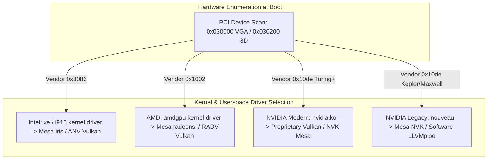

# Hardware Architecture Specification — NebuOS

**Status:** REVIEW  
**Purpose:** Establish hardware compatibility tiers, minimum specifications, driver matrix, power management profiles, and hybrid GPU configurations.

---

## 1. Hardware Target Tiers

| Parameter | Tier 1: Minimum (Lite) | Tier 2: Recommended | Tier 3: Professional / Workstation |
|---|---|---|---|
| **CPU Target** | 2 cores / 4 threads, x86_64 (Intel Core 4th Gen / AMD FX) | 4 cores / 8 threads (Intel 8th Gen+ / AMD Ryzen 2000+) | 8+ cores / 16+ threads (Intel 12th Gen+ / AMD Ryzen 5000+) |
| **System Memory (RAM)**| 4 GB DDR3 / DDR4 | 8 GB - 16 GB DDR4 / DDR5 | 32 GB - 64 GB ECC / High-Speed DDR5 |
| **Storage Subsystem** | 64 GB SATA SSD | 256 GB NVMe PCIe 3.0 SSD | 1 TB+ NVMe PCIe 4.0 / 5.0 SSD |
| **GPU Subsystem** | Intel HD Graphics 4400+ / AMD Radeon GCN 1+ | AMD Radeon RX 5000+ / NVIDIA GTX 1660+ / Intel Arc | Dedicated NVIDIA RTX 4000+ / AMD Radeon Pro / RX 7800+ |
| **Display Support** | 1x 1080p @ 60 Hz | 2x 1440p @ 60/144 Hz (Mixed DPI) | 3+ Displays / 4K UltraHD / HDR / Variable Refresh Rate |

## 2. GPU & Driver Matrix

## 3. Hybrid GPU (iGPU + dGPU) Management
On laptops equipped with hybrid graphics (e.g., Intel Iris Xe iGPU + NVIDIA RTX dGPU):
- **Desktop & General Apps:** `NebuCompositor`, `NebuShell`, browser, and Microsoft Office execute on the energy-efficient iGPU.
- **CAD & High-Performance Games:** NebuRuntime automatically sets environment variables for discrete GPU offloading based on the application compatibility profile:
  - *AMD dGPU:* `DRI_PRIME=1`
  - *NVIDIA dGPU:* `__NV_PRIME_RENDER_OFFLOAD=1 __GLX_VENDOR_LIBRARY_NAME=nvidia __VK_LAYER_NV_optimus=NVIDIA_only`

## 4. Power Management & Laptop Optimization
- **Idle Power Optimization:** Suspend idle polling; enable PCIe Active State Power Management (ASPM); enable SATA ALPM (`med_power_with_dipm`).
- **Thermal & Sleep States:** Full support for ACPI S3 (Deep Sleep) and Modern Standby (s2idle). Audio/GPU runtimes cleanly re-initialize upon resume without restarting Wine processes.

## 5. Related Documents
- [01-system-architecture.md](01-system-architecture.md)
- [../graphics/01-gpu-detection.md](../graphics/01-gpu-detection.md)
- [../performance/01-memory.md](../performance/01-memory.md)
