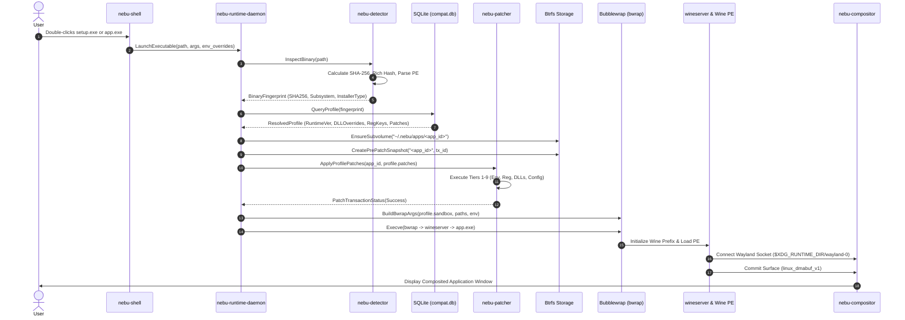
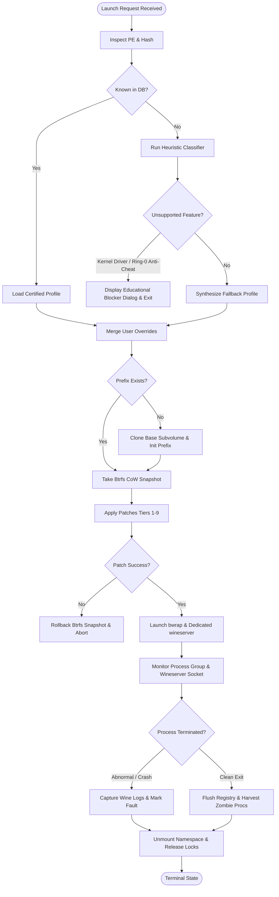
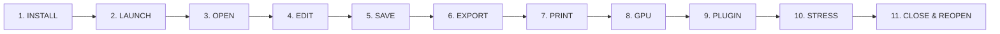

# Compatibility Platform Master Specification — NebuOS

**Status:** DRAFT  
**Purpose:** Define the architectural blueprint, component relationships, data and control flows, and operational invariants of the NebuOS Windows application compatibility platform.

---

## 1. Status
DRAFT — Under architectural review. Defines the overarching compatibility subsystem for NebuOS, establishing the integration contracts across runtime daemons, the SQLite compatibility catalog, the layered patch engine, detection algorithms, and graphics translation layers.

## 2. Purpose
The defining differentiator of NebuOS is not merely a modern Linux desktop interface, but the **Nebu Compatibility Platform**: an integrated, multi-layered runtime environment that enables seamless, out-of-the-box execution of complex Windows desktop applications (such as Microsoft Office 2024, Autodesk AutoCAD 2024, and Adobe Creative Cloud suites) on a Linux base without virtual machines.

This master specification establishes:
1. The architectural topology connecting all compatibility components.
2. The complete lifecycle data flow from raw executable inspection to sandboxed graphical execution.
3. The formal **Compatibility Verification Invariant**, an 11-stage validation pipeline that guarantees true production readiness beyond superficial launch success.
4. The system, vendor, and user boundary lines governing configuration profiles and patches.

## 3. Scope
- End-to-end orchestration of Windows Portable Executable (PE32/PE32+) binaries on NebuOS.
- Interactions between `nebu-runtime-daemon`, `nebu-patcher`, `compat.db`, upstream Wine/Proton runtime trees, DXVK/VKD3D-Proton translation layers, and `nebu-compositor`.
- Automated prefix provisioning and lifecycle management at `~/.nebu/apps/<app_id>/`.
- Sandboxing policies via Bubblewrap (`bwrap`) ensuring host isolation and per-app state encapsulation.
- Verification methodology spanning installation, interactive editing, file I/O, graphics rendering, plugin execution, and stress cycles.

## 4. Non-goals
- Emulating or re-implementing the Windows NT kernel inside a Virtual Machine (e.g., KVM/QEMU). All execution occurs in userland via Linux syscall translation.
- Maintaining an in-house, permanently diverged fork of Wine. Upstream Wine Stable and Wine Staging trees are packaged modularly.
- Supporting Windows kernel-mode device drivers (`.sys`), ring-0 anti-cheat systems (e.g., Vanguard), or direct hardware access bypassing Linux driver stacks.
- Re-architecting Linux kernel subsystems (DRM/KMS, Btrfs, cgroups v2, namespaces).

## 5. Requirements

### 5.1 Functional Requirements
- **REQ-COMP-001:** The system must automatically identify known Windows executables using SHA-256 binary hashing and PE header fingerprinting within $\le 50\text{ ms}$.
- **REQ-COMP-002:** The system must provision dedicated, isolated Wine prefixes for each application under `~/.nebu/apps/<app_id>/` backed by Btrfs subvolumes for instant copy-on-write snapshotting.
- **REQ-COMP-003:** The system must apply configuration profiles, DLL overrides, environment variables, and registry modifications transactionally prior to application execution.
- **REQ-COMP-004:** The system must support automatic graphics translation switching between DXVK (Direct3D 9/10/11), VKD3D-Proton (Direct3D 12), and WineD3D (OpenGL fallback) based on application profiles.
- **REQ-COMP-005:** The system must enforce the 11-stage Compatibility Verification Invariant for any application claiming `CERTIFIED` status.

### 5.2 Non-Functional Requirements
- **REQ-COMP-NFR-001 (Cold Launch Latency):** From executable double-click to first Wayland surface presentation $\le 1.8\text{ s}$ for warm prefixes; $\le 5.0\text{ s}$ for initial prefix initialization.
- **REQ-COMP-NFR-002 (Memory Overhead):** Runtime orchestration daemon and patch engine baseline resident set size (RSS) $\le 35\text{ MB}$.
- **REQ-COMP-NFR-003 (Crash Isolation):** A crash, hang, or memory leak within a Windows application prefix must never destabilize `nebu-compositor`, `nebu-shell`, or peer applications.
- **REQ-COMP-NFR-004 (State Rollback):** Any failed patch application or corrupted runtime state must be rollback-capable via Btrfs snapshots within $\le 500\text{ ms}$.

## 6. Architecture

The Nebu Compatibility Platform consists of six coordinated layers operating over Fedora Atomic (OSTree/bootc) and the Linux kernel:

```mermaid
graph TD
    subgraph UI_SHELL [Desktop & Presentation Layer]
        USER[User / File Manager / Launcher]
        SHELL[nebu-shell]
        COMP[nebu-compositor - Wayland / Smithay]
    end

    subgraph ORCHESTRATION [NebuOS Orchestration Layer]
        RUNTIME_D[nebu-runtime-daemon]
        DETECT[nebu-detector - PE & Signature Engine]
        PATCHER[nebu-patcher - 9-Tier Patch Engine]
    end

    subgraph DATABASE [Catalog & Knowledge Layer]
        SYS_DB[(/usr/share/nebu/compat.db - Read-Only)]
        USR_DB[(~/.local/share/nebu/user_compat.db - Read/Write)]
    end

    subgraph SANDBOX [Isolation & Execution Layer - Bubblewrap]
        BWRAP[bwrap Sandbox Jail]
        WINESERVER[Isolated wineserver Socket]
        WIN_PROC[Target Process: acad.exe / winword.exe]
    end

    subgraph RUNTIME_TREE [Wine / Proton Runtimes & Translation]
        WINE_STG[/usr/lib/nebu/runtimes/wine-staging-9.x]
        PROTON[/usr/lib/nebu/runtimes/proton-9.x]
        DXVK[DXVK / VKD3D-Proton DLLs]
        MESA[Mesa Vulkan / RADV / ANV / NVK]
    end

    subgraph STORAGE [Persistent Per-App Storage - Btrfs]
        APP_SUBVOL[~/.nebu/apps/<app_id>/]
        DRIVE_C[drive_c / Windows System / Registry]
        SNAP[snapshots / pre-patch-snap]
    end

    USER -->|Double-click setup.exe / app.exe| SHELL
    SHELL -->|org.nebu.Runtime1.LaunchExecutable| RUNTIME_D
    RUNTIME_D -->|Fingerprint PE| DETECT
    RUNTIME_D -->|Query Profile & Patches| SYS_DB
    RUNTIME_D -->|Query User Overrides| USR_DB
    RUNTIME_D -->|Provision Subvolume & Snapshots| APP_SUBVOL
    APP_SUBVOL --- DRIVE_C
    APP_SUBVOL --- SNAP
    RUNTIME_D -->|Apply 9-Tier Fixes| PATCHER
    PATCHER -->|Inject Registry & DLLs| DRIVE_C
    RUNTIME_D -->|Execute bwrap Jail| BWRAP
    BWRAP -->|Start Private wineserver| WINESERVER
    WINESERVER -->|Spawn Process| WIN_PROC
    WIN_PROC -->|D3D Calls| DXVK
    DXVK -->|Vulkan Commands| MESA
    MESA -->|DMA-BUF Frames| COMP
    COMP -->|Present Composited Frame| USER
```

### 6.1 Architectural Principles
1. **Zero System Pollution:** Windows binaries never touch the host root filesystem (`/usr`, `/etc`, `/var`). All registry hives, temporary files, AppData directories, and virtualized Windows system DLLs reside exclusively within `~/.nebu/apps/<app_id>/drive_c`.
2. **Deterministic Isolation:** Each running application executes against an independent, dedicated `wineserver` instance communicating over a private UNIX socket in `$XDG_RUNTIME_DIR/nebu/<app_id>/`.
3. **Layered Configuration:** Execution parameters are resolved deterministically through a strict hierarchy: System Defaults $\rightarrow$ Vendor Profiles $\rightarrow$ Community Profiles $\rightarrow$ User Overrides.
4. **Immutable Base Image Compatibility:** The runtime reads immutable definitions from `/usr/share/nebu/compat.db` while capturing dynamic user customizations in `~/.local/share/nebu/user_compat.db`.

## 7. Components

### 7.1 `nebu-runtime-daemon` (NebuOS Component)
- **Role:** Central supervisory daemon running as a `systemd --user` unit.
- **Responsibilities:**
  - Manages life cycle requests via D-Bus (`org.nebu.Runtime1`).
  - Coordinates executable fingerprinting with `nebu-detector`.
  - Provisions and snapshots Btrfs application subvolumes.
  - Generates Bubblewrap container command-line arguments.
  - Spawns and supervises sandboxed `wineserver` and application processes.

### 7.2 `nebu-detector` (NebuOS Component)
- **Role:** Executable inspection and classification library.
- **Responsibilities:**
  - Parses DOS and PE headers (COFF, Optional Header, Data Directories).
  - Calculates full and header SHA-256 checksums, Authenticode digests, and Rich Header hashes.
  - Identifies installer wrappers (Inno Setup, NSIS, InstallShield, MSI, WiX, SFX).
  - Employs heuristic classifiers for uncataloged binaries.

### 7.3 `nebu-patcher` (NebuOS Component)
- **Role:** Declarative configuration and compatibility remediation engine.
- **Responsibilities:**
  - Evaluates profile-defined compatibility fixes across a 9-tier priority ladder.
  - Manages atomic transactions, dependency DAG resolution, and conflict detection.
  - Records modification journals for zero-latency rollbacks.

### 7.4 Compatibility Databases (NebuOS Component)
- **Role:** Relational SQLite databases storing application definitions, profiles, patches, and hardware matrix results.
- **Storage Locations:**
  - System Database: `/usr/share/nebu/compat.db` (Read-only, deployed via OSTree container updates).
  - User Database: `~/.local/share/nebu/user_compat.db` (Read/write, tracks local overrides, custom profiles, and community imports).

### 7.5 Upstream Runtimes & Graphics Translation (External Dependencies)
- **Wine Trees:** Packaged under `/usr/lib/nebu/runtimes/wine-stable/` and `/usr/lib/nebu/runtimes/wine-staging/`.
- **Proton Trees:** Valve Proton distributions deployed under `/usr/lib/nebu/runtimes/proton/`.
- **DXVK & VKD3D-Proton:** Userland Vulkan-based Direct3D implementations injected via `WINEDLLOVERRIDES`.
- **Mesa Drivers:** In-tree Fedora Mesa Vulkan drivers (`radv`, `anv`, `nvk`) interacting with the Linux DRM/KMS subsystem.

### 7.6 Display & Compositing Infrastructure (NebuOS Component)
- **`nebu-compositor`:** Custom Wayland compositor based on Smithay managing surface commits, fractional scaling, direct scanout via DMA-BUF, and window grouping.
- **`nebu-shell`:** Slint/Iced-based desktop environment dispatching user launch actions and presenting compatibility status badges.

## 8. Data Flow

The lifecycle of an application execution request proceeds from raw file selection to continuous frame delivery:



### 8.1 Flow Stage Descriptions
1. **Initiation:** The desktop shell or file manager issues a D-Bus method call `LaunchExecutable` on `org.nebu.Runtime1`.
2. **Fingerprinting:** `nebu-detector` reads the first 64 KB and full binary to extract hashes, entry points, and resource strings.
3. **Catalog Resolution:** The runtime queries `/usr/share/nebu/compat.db` and merges any user overrides from `~/.local/share/nebu/user_compat.db`.
4. **Filesystem Provisioning:** The dedicated prefix directory `~/.nebu/apps/<app_id>/` is verified. If absent, a new Btrfs subvolume is created from a cached base template.
5. **Snapshot Creation:** A Btrfs snapshot named `pre_patch_<timestamp>` is taken to guarantee instant rollback on failure.
6. **Remediation & Patching:** `nebu-patcher` applies profile-specified environment variables, registry hives, and DLL overrides in monotonic tier order.
7. **Sandbox Execution:** Bubblewrap isolates process namespaces (`pid`, `net`, `ipc`, `uts`, `mount`). Host filesystems are mounted read-only, and only selected user directories are exposed.
8. **Surface Presentation:** The Windows application initializes its graphics subsystem via DXVK/VKD3D, submitting frames via `linux_dmabuf_v1` directly to `nebu-compositor`.

## 9. Control Flow



## 10. The Compatibility Verification Invariant

Superficial application launch is entirely inadequate for mission-critical desktop software. NebuOS strictly adheres to the **11-Stage Verification Invariant**: an application cannot be awarded `CERTIFIED` status unless it completes all 11 stages deterministically without data corruption, unhandled crashes, or severe visual artifacts.



### 10.1 Detailed Stage Analysis

| Stage | Stage Name | Verification Rationale & Target Invariant | Failure Criteria |
| :--- | :--- | :--- | :--- |
| **1** | **INSTALL** | Validates silent or interactive installer execution, custom action scripts, extraction of cabinet/MSI payloads, and desktop shortcut generation. | Installer hangs, prompts for unsupported kernel driver, crashes during CAB extraction, or fails to create start menu entries. |
| **2** | **LAUNCH** | Verifies basic executable loading, dynamic linking against Wine builtin/native DLLs, and initial main window mapping to a Wayland surface. | PE loader crash, missing entry point symbol in DLLs, window failing to map, or crash within 10 seconds of startup. |
| **3** | **OPEN** | Verifies file format parsers and file system abstraction layers by loading real-world production project files (e.g., 50 MB `.docx` or 200 MB `.dwg`). | Application crashes on file parse, throws "File Corrupted" errors, or deadlocks on file locking APIs. |
| **4** | **EDIT** | Validates interactive user input event delivery (keyboard, mouse, tablet), text shaping (DirectWrite/Uniscribe), GDI/Direct2D canvas operations, and undo/redo stacks. | Broken input delivery, corrupt font glyph rendering, unresponsive canvas redraws, or crash during basic editing. |
| **5** | **SAVE** | Tests filesystem commit semantics, write-through caching, atomic file replacements (write-temp-and-rename), and Btrfs metadata synchronization. | Zero-byte truncated files, file write permissions errors, failure to flush buffer caches, or corrupt output documents. |
| **6** | **EXPORT** | Exercises multi-process worker architectures and secondary format pipelines (e.g., PDF generation, DWG to DXF export, PNG rasterization). | Sub-process invocation failure, missing external conversion tools, blank exported documents, or missing embedded vectors. |
| **7** | **PRINT** | Verifies the Windows print spooler subsystem (`winspool.drv`) mapping to Linux CUPS daemons, print dialog rendering, and PostScript/PDF rasterization. | Print spooler deadlock, failure to enumerate CUPS printers, corrupt page margin calculation, or crash on print command. |
| **8** | **GPU** | Validates Direct3D/OpenGL hardware acceleration via DXVK/VKD3D-Proton, shader compilation, multi-sampled antialiasing, and DMA-BUF zero-copy presentation. | Software fallback rendering (<15 fps), GPU pipeline hangs, shader compilation crash, visual vertex tearing, or memory leaks. |
| **9** | **PLUGIN** | Verifies in-process COM/ActiveX objects, .NET Framework runtime hosting (via Mono or native runtime), VBScript/VBA macro engines, and C++ SDK add-ins. | COM CLSID lookup failure, crash on initializing .NET runtime host, broken macro execution, or plugin loading failure. |
| **10** | **STRESS** | Validates long-term stability via automated 48-hour continuous headless operation under simulated user load (repeated zoom, pan, calc, edit). | Memory leakage exceeding 50 MB/hour, handle exhaustion, thread deadlock, or unhandled crash prior to 48 hours. |
| **11** | **CLOSE & REOPEN** | Verifies graceful process termination, registry hive flushing to disk (`system.reg`, `user.reg`), wineserver teardown, clean restart, and document reload. | Lingering orphan processes, corrupted registry preventing relaunch, or failure to open the document saved in Stage 5. |

## 11. Interfaces

### 11.1 D-Bus Service Interface (`org.nebu.Runtime1`)
Exposed on the session bus by `nebu-runtime-daemon` at path `/org/nebu/Runtime1`:

```text
Interface: org.nebu.Runtime1
  Methods:
    LaunchExecutable(
        in  s exe_path, 
        in  as arguments, 
        in  a{ss} environment_overrides, 
        out o app_session_path
    )
    TerminateSession(
        in  o app_session_path, 
        in  u grace_period_ms
    )
    GetApplicationStatus(
        in  s app_id, 
        out s status, 
        out u active_pids
    )
    RollbackApplicationState(
        in  s app_id, 
        in  s target_snapshot_name
    )
  Signals:
    SessionStateChanged(o session_path, s state)
    CompatibilityWarning(s app_id, s warning_code, s message)
```

### 11.2 Storage Directory Structure
Applications reside within dedicated user directory hierarchies:
```text
~/.nebu/apps/<app_id>/
├── config.json              # Active resolved profile snapshot
├── patches.journal          # Transactional history of applied patches
├── drive_c/                 # Windows root directory
│   ├── Program Files/
│   ├── Program Files (x86)/
│   ├── users/nebu/
│   └── windows/
│       ├── system32/
│       └── syswow64/
├── system.reg               # Local Wine HKLM hive
├── user.reg                 # Local Wine HKCU hive
├── userdef.reg              # Default user hive
└── .snapshots/              # Btrfs read-only snapshots
    ├── pre_install/
    └── pre_patch_20260904_103000/
```

## 12. Dependencies

| Subsystem / Package | Component Class | Source / Origin | Architectural Role |
| :--- | :--- | :--- | :--- |
| `nebu-runtime-daemon` | Core Platform | NebuOS (Rust) | Lifecycle supervision and D-Bus IPC service |
| `nebu-detector` | Core Platform | NebuOS (Rust) | PE parsing, signature calculation, and matching |
| `nebu-patcher` | Core Platform | NebuOS (Rust) | Declarative 9-tier compatibility remediation |
| `nebu-compositor` | Display Server | NebuOS (Rust/Smithay) | Wayland frame presentation and window manager |
| `compat.db` | Catalog Data | NebuOS (SQLite) | System compatibility metadata and profiles |
| `wine-staging` | External Dependency | WineHQ / Fedora | High-performance Windows API implementation |
| `proton` | External Dependency | Valve Software | Game-optimized Wine variant with media foundation |
| `dxvk` | External Dependency | GitHub (`doitsujin`) | Direct3D 9/10/11 translation to Vulkan |
| `vkd3d-proton` | External Dependency | Valve / Hans-Kristian | Direct3D 12 translation to Vulkan |
| `bubblewrap` (`bwrap`) | Sandbox Base | Linux Foundation | Unprivileged container and namespace sandboxing |
| `btrfs-progs` | Storage Foundation | Linux Kernel | Copy-on-write subvolumes and snapshots |

## 13. Security

### 13.1 Sandbox Containment Model
Windows applications represent untrusted legacy code. Every application spawned via `nebu-runtime-daemon` runs in an unprivileged Bubblewrap container:
- **Filesystem Isolation:** The host root (`/`) is mounted read-only (`--ro-bind /usr /usr`, `--ro-bind /lib64 /lib64`).
- **User Home Protection:** Host `$HOME` is completely masked. A virtual home is synthesized where only `~/.nebu/apps/<app_id>/drive_c` is writable. Whitelisted user folders (`~/Documents`, `~/Downloads`) are exposed only when granted by profile or user prompt.
- **Namespace Virtualization:** New `ipc`, `pid`, `uts`, and `mount` namespaces are established. Application processes cannot observe or signal processes outside their sandbox.
- **Network Gating:** Offline applications and installers execute in an isolated network namespace (`--unshare-net`) unless explicit network access is defined in the compatibility profile.

### 13.2 Memory and Syscall Protection
- `vm.max_map_count` is elevated to `2147483642` on the host to support heavy Windows MMAP usage without permitting arbitrary kernel exploitation.
- Seccomp filters restrict Windows binaries from issuing dangerous Linux syscalls (e.g., `ptrace`, `bpf`, `mount`, `kexec_load`).

## 14. Resource Requirements

### 14.1 Hardware Baseline
- **CPU:** x86_64 architecture with SSE4.2 and AVX2 extensions.
- **RAM:** Minimum 4.0 GB physical RAM (Budget: OS + Compositor $\le 800\text{ MB}$, Application pool $\ge 3.2\text{ GB}$).
- **Storage:** Btrfs filesystem formatted partition; minimum 20 GB free space for prefixes, caches, and snapshots.
- **GPU:** Hardware Vulkan 1.3 capable GPU (Intel Skylake+, AMD GCN 4.0+, NVIDIA Maxwell+).

### 14.2 Per-Application Footprint
- **Base Prefix Disk Size:** $\sim 280\text{ MB}$ initial Btrfs shared footprint (deduplicated via CoW against base template).
- **Idle Memory Footprint:** Sandboxed `wineserver` + `services.exe` + `explorer.exe` consumes $\sim 42\text{ MB}$ RSS per isolated prefix.

## 15. Failure Modes

| Failure Identifier | Root Cause | Immediate Manifestation | User Impact |
| :--- | :--- | :--- | :--- |
| **FAIL-COMP-001** | Missing PE entry point in Wine builtin DLL | Application crashes on launch with `STATUS_ENTRYPOINT_NOT_FOUND` | Process terminates; launcher reports error |
| **FAIL-COMP-002** | Conflicting registry injection | `regedit` rejects key syntax or overwrites critical NT configuration | Application hangs on startup or crashes during init |
| **FAIL-COMP-003** | Graphics backend incompatibility | Vulkan device lost (`VK_ERROR_DEVICE_LOST`) under DXVK | Window freezes; screen renders black or gray canvas |
| **FAIL-COMP-004** | Btrfs disk quota exhaustion | Prefix subvolume reaches storage limit during document save | Stage 5 (SAVE) fails; possible data truncation |
| **FAIL-COMP-005** | Deadlocked Wineserver socket | Stalled Wine IPC thread prevents message processing | Application unresponsive; CPU spikes to 100% on one core |

## 16. Recovery Behavior

### 16.1 Automated Btrfs Subvolume Rollback
When a patch execution fails, or an application crash leaves registry hives corrupted:
1. `nebu-runtime-daemon` detects abnormal exit during initialization.
2. The daemon sends `SIGKILL` to all processes in the application cgroup.
3. The daemon tears down the active prefix directory: `btrfs subvolume delete ~/.nebu/apps/<app_id>`.
4. The daemon restores the last known good snapshot: `btrfs subvolume snapshot ~/.nebu/apps/<app_id>/.snapshots/pre_patch_<timestamp> ~/.nebu/apps/<app_id>`.
5. Rollback completes in under 500 ms without manual user intervention.

### 16.2 Wineserver Reaping & Lock Recovery
- Stale UNIX domain sockets in `/run/user/1000/nebu/<app_id>/wineserver.sock` are probed via zero-length ping.
- If the socket is unresponsive and the owning PID has terminated, the runtime cleans the socket file and clears `.lock` descriptors.

## 17. Testing Requirements

- **Verification Pipeline Conformance:** All certified profiles must execute the automated 11-stage invariant test script via the Nebu Compatibility Lab.
- **Zero Regression Gate:** Upstream updates to Wine, DXVK, or Mesa must pass automated regression testing against the Top 50 certified applications prior to OS image release.
- **Fuzz Testing:** `nebu-detector` PE parser must withstand continuous AFL++ fuzzing across 100,000 malformed Windows binaries without panicking or segfaulting.
- **Rollback Validation:** Every patch registered in `compat.db` must include an automated unit test verifying that applying and then rolling back the patch leaves the prefix byte-identical.

## 18. Performance Requirements

- **PE Header Parsing:** Complete binary classification and SHA-256 calculation $\le 50\text{ ms}$ for binaries under 500 MB.
- **Database Query Latency:** Indexed profile lookup by SHA-256 or version ID $\le 2\text{ ms}$ under cold cache; $\le 0.5\text{ ms}$ under warm cache.
- **Rendering Throughput:** DXVK/VKD3D translation layer overhead $\le 8\%$ frame time penalty compared to native Windows execution on identical GPU hardware.
- **Prefix Provisioning:** Instant Btrfs CoW snapshot clone $\le 300\text{ ms}$.

## 19. Compatibility Considerations

- **Wine API Volatility:** Newer Wine releases occasionally introduce regressions for older Win32 GDI applications. NebuOS pins runtime versions per application profile (e.g., pinning Office 2021 to `wine-staging-9.2` even if `wine-staging-10.x` is installed).
- **High-DPI Handling:** Windows applications vary widely in DPI awareness (unaware, system DPI, per-monitor DPI v2). `nebu-compositor` communicates scaling factors via Wayland `fractional_scale_v1` while `nebu-patcher` injects appropriate Windows registry scaling keys.

## 20. Open Questions

- **OPEN-COMP-001:** Should NebuOS support automatic cloud synchronization of user-generated compatibility profiles back to the central NebuOS community repository?
- **OPEN-COMP-002:** How should the runtime handle multi-disc or multi-part Windows installers that require swapping virtual media while sandboxed inside Bubblewrap?
- **OPEN-COMP-003:** Can kernel `io_uring` support in newer Linux kernels be exposed safely through Wine without introducing security sandbox bypass vectors?

## 21. Related Documents
- [01-database-schema.md](01-database-schema.md) — Relational Schema for Compatibility Profiles and Certifications
- [02-compatibility-profile.md](02-compatibility-profile.md) — Profile JSON Specification and Inheritance Rules
- [03-patch-engine.md](03-patch-engine.md) — 9-Tier Remediation Engine and Declarative DSL
- [04-application-detection.md](04-application-detection.md) — PE Header Fingerprinting and Installer Detection
- [05-certification-model.md](05-certification-model.md) — 7 Certification Tiers and Test Execution Model
- [06-known-limitations.md](06-known-limitations.md) — Hard Non-Compatibility Boundaries and Error Handling
- [../runtime/04-wine-integration.md](../runtime/04-wine-integration.md) — Runtime Wine and Wineserver Management
