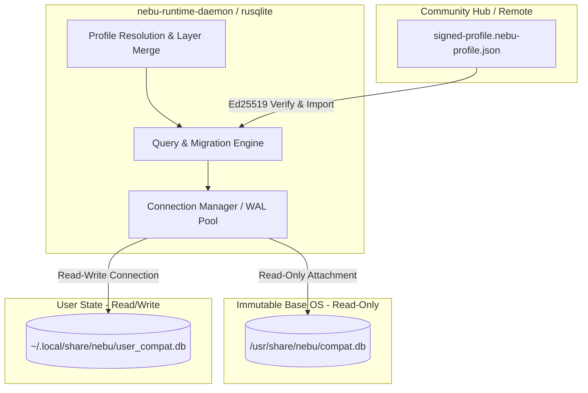
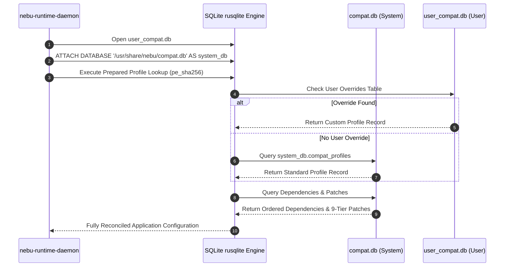
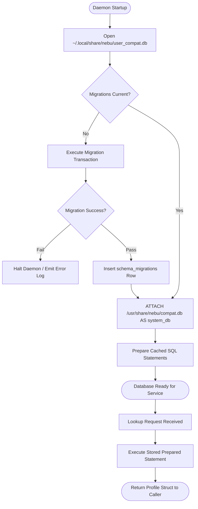
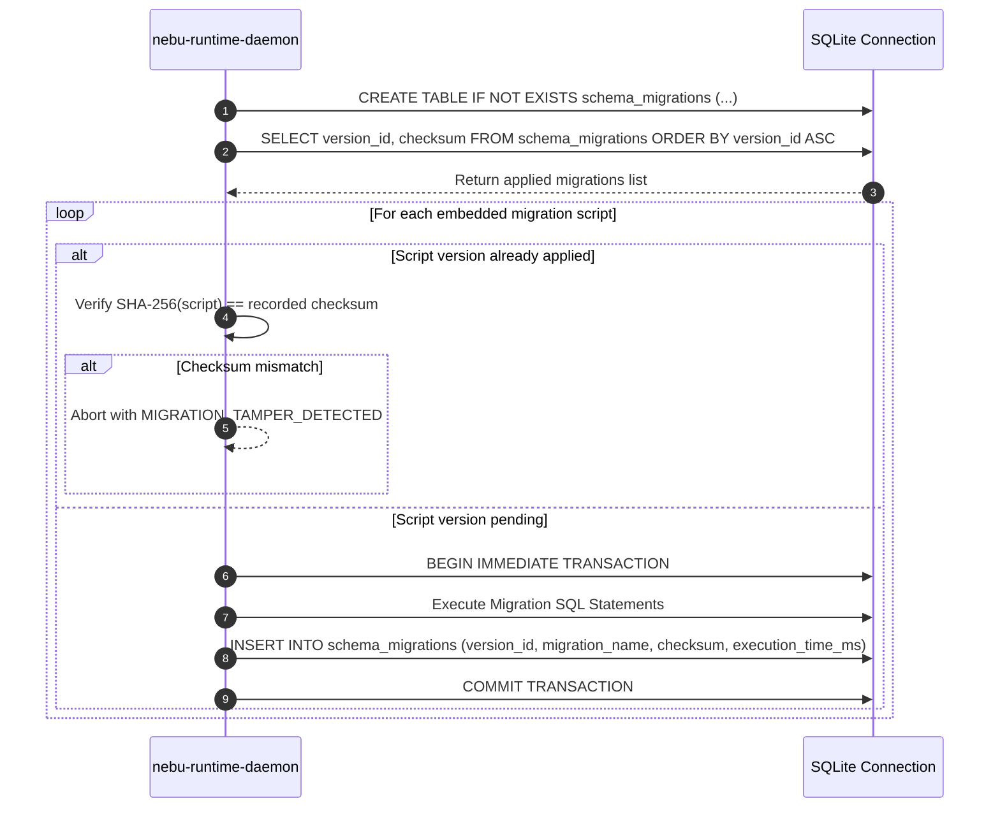

# Compatibility Database Schema Specification — NebuOS

**Status:** DRAFT  
**Purpose:** Define the relational SQLite database schema, constraints, indexing strategies, prepared query patterns, migration mechanisms, and import/export protocols for the NebuOS Compatibility Catalog.

---

## 1. Status
DRAFT — Under architectural review. Governs the relational data model for both the read-only system compatibility catalog (`/usr/share/nebu/compat.db`) and the read-write user database (`~/.local/share/nebu/user_compat.db`).

## 2. Purpose
The Nebu Compatibility Catalog is the central knowledge repository powering application detection, profile selection, patch sequencing, dependency provisioning, and hardware certification verification. 

This specification establishes:
1. Complete relational DDL schemas with explicit constraints, foreign key cascades, and data types.
2. High-performance index architectures ensuring sub-2-millisecond lookups on constrained client hardware.
3. Prepared statement access patterns used by `nebu-runtime-daemon`.
4. A deterministic, versioned migration framework with cryptographic verification.
5. Community profile export and import formats secured with Ed25519 digital signatures.

## 3. Scope
- Structural schema definitions for applications, versions, profiles, patches, dependencies, test matrices, and certifications.
- Concurrency and transaction models utilizing SQLite3 Write-Ahead Logging (WAL).
- Schema evolution and transactional migration strategy.
- Serialization schemas for offline seed datasets and community profile interchange.

## 4. Non-goals
- Operating a multi-user networked database server (e.g., PostgreSQL or MySQL). All database instances are local, embedded SQLite engines.
- Storing binary executables or redistributable installation packages within database blobs. Only cryptographic digests (SHA-256) and declarative metadata are stored.
- Managing user personal documents, save files, or unmanaged system packages.

## 5. Requirements

### 5.1 Functional Requirements
- **REQ-DBS-001:** The schema must support exact lookup of compatibility profiles by a 64-character SHA-256 binary hash or a composite version tuple (`app_id`, `version_string`).
- **REQ-DBS-002:** Foreign key constraints must enforce referential integrity across application versions, profiles, dependencies, and patch definitions (`PRAGMA foreign_keys = ON;`).
- **REQ-DBS-003:** The database must track patch execution priority across the 9-tier compatibility ladder with strict monotonic ordering constraints.
- **REQ-DBS-004:** The system must provide an append-only migration journal (`schema_migrations`) tracking migration version, execution timestamp, and checksum.
- **REQ-DBS-005:** The import engine must validate community profile signatures against trusted public keys before merging records into `user_compat.db`.

### 5.2 Non-Functional Requirements
- **REQ-DBS-NFR-001 (Query Latency):** Profile resolution queries indexed by PE SHA-256 must execute in $\le 1.5\text{ ms}$ on cold cache and $\le 0.3\text{ ms}$ on warm cache.
- **REQ-DBS-NFR-002 (Storage Footprint):** The compiled system database `/usr/share/nebu/compat.db` covering the Top 2,500 enterprise and gaming applications must not exceed $25\text{ MB}$.
- **REQ-DBS-NFR-003 (Concurrency):** Concurrent read operations by multiple launcher instances must never block on background telemetry or user override writes (WAL mode).

## 6. Architecture

NebuOS implements a dual-database architecture separating immutable operating system state from mutable user state:



### 6.1 Database Engine Parameters
Both database files are opened using the following SQLite pragma configuration:
```sql
PRAGMA journal_mode = WAL;
PRAGMA synchronous = NORMAL;
PRAGMA foreign_keys = ON;
PRAGMA busy_timeout = 5000;
PRAGMA cache_size = -4000; -- 4 MB cache per connection
PRAGMA temp_store = MEMORY;
PRAGMA mmap_size = 33554432; -- 32 MB Memory-mapped I/O
```

## 7. Components

### 7.1 `nebu-compat-db` (NebuOS Component)
Embedded Rust crate wrapping `rusqlite` with typed data structures, prepared statements, and connection pooling.

### 7.2 System Database (`compat.db`)
Read-only SQLite database bundled with the Fedora Atomic base image at `/usr/share/nebu/compat.db`. Updated strictly via atomic system updates (`bootc upgrade`).

### 7.3 User Database (`user_compat.db`)
Read-write SQLite database located at `~/.local/share/nebu/user_compat.db`. Stores user custom profiles, manual overrides, local patch modifications, and imported community profiles.

### 7.4 SQLite Migration Runner
Internal transactional tool that inspects `schema_migrations` on daemon startup, validates file hashes, and executes pending SQL migrations within `BEGIN IMMEDIATE ... COMMIT` blocks.

## 8. Data Flow



## 9. Control Flow



## 10. Interfaces

### 10.1 Complete DDL Schema
```sql
-- ============================================================================
-- NebuOS Compatibility Database Schema
-- Version: 1.0.0
-- Dialect: SQLite 3.42+
-- ============================================================================

-- ----------------------------------------------------------------------------
-- 1. Migration Management
-- ----------------------------------------------------------------------------
CREATE TABLE schema_migrations (
    version_id INTEGER PRIMARY KEY,
    migration_name TEXT NOT NULL,
    checksum TEXT NOT NULL,
    applied_at DATETIME NOT NULL DEFAULT CURRENT_TIMESTAMP,
    execution_time_ms INTEGER NOT NULL,
    CONSTRAINT chk_migration_version CHECK (version_id > 0)
);

-- ----------------------------------------------------------------------------
-- 2. Applications Catalog
-- ----------------------------------------------------------------------------
CREATE TABLE applications (
    app_id TEXT PRIMARY KEY,                       -- e.g., 'autodesk.autocad'
    name TEXT NOT NULL,                             -- e.g., 'Autodesk AutoCAD'
    vendor TEXT NOT NULL,                           -- e.g., 'Autodesk, Inc.'
    category TEXT NOT NULL,                         -- 'cad', 'office', 'creative', 'game', 'tool'
    description TEXT,
    homepage_url TEXT,
    created_at DATETIME NOT NULL DEFAULT CURRENT_TIMESTAMP,
    updated_at DATETIME NOT NULL DEFAULT CURRENT_TIMESTAMP,
    CONSTRAINT chk_app_id_format CHECK (length(app_id) <= 128 AND app_id LIKE '%.%'),
    CONSTRAINT chk_category CHECK (category IN ('cad', 'office', 'creative', 'game', 'productivity', 'tool', 'utility'))
);

-- ----------------------------------------------------------------------------
-- 3. Application Versions
-- ----------------------------------------------------------------------------
CREATE TABLE application_versions (
    version_id TEXT PRIMARY KEY,                    -- e.g., 'autodesk.autocad.2024'
    app_id TEXT NOT NULL,
    version_string TEXT NOT NULL,                   -- e.g., '2024.1.2'
    architecture TEXT NOT NULL DEFAULT 'x86_64',    -- 'x86_64', 'x86'
    pe_sha256 TEXT UNIQUE,                          -- SHA-256 digest of main executable
    header_sha256 TEXT,                             -- SHA-256 digest of first 64KB
    authenticode_thumbprint TEXT,                   -- X.509 code signing thumbprint
    installer_type TEXT NOT NULL,                   -- 'msi', 'inno', 'nsis', 'installshield', 'custom', 'portable'
    minimum_os_build INTEGER DEFAULT 19041,         -- Windows 10 20H1 build number
    created_at DATETIME NOT NULL DEFAULT CURRENT_TIMESTAMP,
    FOREIGN KEY (app_id) REFERENCES applications(app_id) ON DELETE CASCADE,
    CONSTRAINT chk_arch CHECK (architecture IN ('x86_64', 'x86')),
    CONSTRAINT chk_sha256_len CHECK (pe_sha256 IS NULL OR length(pe_sha256) = 64),
    CONSTRAINT chk_installer_type CHECK (installer_type IN ('msi', 'inno', 'nsis', 'installshield', 'wix', 'sfx', 'custom', 'portable'))
);

-- ----------------------------------------------------------------------------
-- 4. Compatibility Profiles
-- ----------------------------------------------------------------------------
CREATE TABLE compat_profiles (
    profile_id TEXT PRIMARY KEY,                    -- e.g., 'profile.autodesk.autocad.2024.v1'
    version_id TEXT NOT NULL,
    runtime_family TEXT NOT NULL DEFAULT 'wine',    -- 'wine', 'proton'
    runtime_version TEXT NOT NULL,                  -- 'wine-staging-9.2', 'proton-9.0-2'
    windows_version TEXT NOT NULL DEFAULT 'win10',  -- 'win7', 'win10', 'win11'
    graphics_backend TEXT NOT NULL DEFAULT 'dxvk',  -- 'dxvk', 'vkd3d', 'wined3d', 'vulkan', 'opengl'
    dxvk_version TEXT,                              -- '2.3.1'
    vkd3d_version TEXT,                             -- '2.12'
    prefer_discrete_gpu BOOLEAN NOT NULL DEFAULT 1,
    environment_variables_json TEXT NOT NULL DEFAULT '{}',
    dll_overrides_json TEXT NOT NULL DEFAULT '{}',
    sandbox_permissions_json TEXT NOT NULL DEFAULT '{}',
    is_active BOOLEAN NOT NULL DEFAULT 1,
    created_at DATETIME NOT NULL DEFAULT CURRENT_TIMESTAMP,
    updated_at DATETIME NOT NULL DEFAULT CURRENT_TIMESTAMP,
    FOREIGN KEY (version_id) REFERENCES application_versions(version_id) ON DELETE CASCADE,
    CONSTRAINT chk_runtime_family CHECK (runtime_family IN ('wine', 'proton')),
    CONSTRAINT chk_windows_version CHECK (windows_version IN ('win7', 'win8', 'win81', 'win10', 'win11')),
    CONSTRAINT chk_graphics_backend CHECK (graphics_backend IN ('dxvk', 'vkd3d', 'wined3d', 'vulkan', 'opengl', 'gdi'))
);

-- ----------------------------------------------------------------------------
-- 5. Profile Dependencies (Redistributables)
-- ----------------------------------------------------------------------------
CREATE TABLE profile_dependencies (
    dependency_id INTEGER PRIMARY KEY AUTOINCREMENT,
    profile_id TEXT NOT NULL,
    package_name TEXT NOT NULL,                     -- 'vcrun2019', 'dotnet48', 'corefonts'
    sha256 TEXT NOT NULL,                           -- Expected package SHA-256
    download_url TEXT NOT NULL,                     -- Official CDN URL
    install_arguments TEXT,                         -- Silent arguments: '/quiet /norestart'
    install_order INTEGER NOT NULL,                 -- Execution sequence (1, 2, 3...)
    requires_reboot BOOLEAN NOT NULL DEFAULT 0,
    FOREIGN KEY (profile_id) REFERENCES compat_profiles(profile_id) ON DELETE CASCADE,
    CONSTRAINT chk_sha256_dep CHECK (length(sha256) = 64),
    CONSTRAINT chk_order_pos CHECK (install_order > 0),
    CONSTRAINT uq_profile_dep UNIQUE (profile_id, package_name)
);

-- ----------------------------------------------------------------------------
-- 6. Profile Patches (Layered 9-Tier System)
-- ----------------------------------------------------------------------------
CREATE TABLE profile_patches (
    patch_id TEXT PRIMARY KEY,                      -- e.g., 'patch.autocad.reg_d3d_limit.v1'
    profile_id TEXT NOT NULL,
    patch_tier INTEGER NOT NULL,                    -- 1 to 9
    patch_name TEXT NOT NULL,
    description TEXT,
    patch_type TEXT NOT NULL,                       -- 'set_registry', 'override_dll', 'set_env', 'copy_file', 'xml_transform', 'binary_patch'
    payload TEXT NOT NULL,                          -- Declarative JSON payload definition
    execution_order INTEGER NOT NULL DEFAULT 100,
    is_reversible BOOLEAN NOT NULL DEFAULT 1,
    rollback_payload TEXT,                          -- Inverse JSON payload for rollback
    created_at DATETIME NOT NULL DEFAULT CURRENT_TIMESTAMP,
    FOREIGN KEY (profile_id) REFERENCES compat_profiles(profile_id) ON DELETE CASCADE,
    CONSTRAINT chk_patch_tier CHECK (patch_tier BETWEEN 1 AND 9),
    CONSTRAINT chk_patch_type CHECK (patch_type IN ('set_registry', 'delete_registry', 'override_dll', 'set_env', 'copy_file', 'symlink_file', 'xml_transform', 'ini_set', 'binary_patch'))
);

-- ----------------------------------------------------------------------------
-- 7. Hardware Test Configurations & Hardware Compatibility Catalog
-- ----------------------------------------------------------------------------
CREATE TABLE hardware_configurations (
    hw_config_id INTEGER PRIMARY KEY AUTOINCREMENT,
    cpu_model TEXT NOT NULL,                        -- 'AMD Ryzen 7 7840U'
    gpu_model TEXT NOT NULL,                        -- 'AMD Radeon 780M'
    gpu_driver_version TEXT NOT NULL,               -- 'Mesa 24.1.5'
    kernel_version TEXT NOT NULL,                   -- '6.10.3-nebu'
    ram_bytes INTEGER NOT NULL,                     -- 17179869184 (16GB)
    created_at DATETIME NOT NULL DEFAULT CURRENT_TIMESTAMP
);

CREATE TABLE hardware_devices (
    device_id INTEGER PRIMARY KEY AUTOINCREMENT,
    pci_vendor_id TEXT,                             -- '0x8086', '0x1002', '0x10de'
    pci_device_id TEXT,                             -- '0x4680'
    subsystem_vendor_id TEXT,                       -- '0x17aa' (Lenovo)
    subsystem_device_id TEXT,
    usb_vendor_id TEXT,                             -- '0x046d' (Logitech)
    usb_product_id TEXT,                            -- '0xc52b'
    device_name TEXT NOT NULL,                      -- 'Intel Wi-Fi 6E AX211'
    device_category TEXT NOT NULL,                  -- 'CPU', 'GPU', 'WIFI', 'BLUETOOTH', 'AUDIO', 'INPUT', 'CAMERA', 'STORAGE', 'DOCK'
    kernel_driver TEXT NOT NULL,                    -- 'iwlwifi', 'amdgpu', 'snd_hda_intel'
    mesa_driver TEXT,                               -- 'anv', 'radv', 'iris', 'radeonsi'
    firmware_package TEXT,                          -- 'iwl7000-firmware'
    status TEXT NOT NULL DEFAULT 'SUPPORTED',       -- 'NOT_TESTED', 'DETECTED', 'PARTIAL', 'SUPPORTED', 'CERTIFIED', 'KNOWN_ISSUE', 'UNSUPPORTED'
    CONSTRAINT chk_hw_status CHECK (status IN ('NOT_TESTED', 'DETECTED', 'PARTIAL', 'SUPPORTED', 'CERTIFIED', 'KNOWN_ISSUE', 'UNSUPPORTED'))
);

CREATE TABLE hardware_quirks (
    quirk_id INTEGER PRIMARY KEY AUTOINCREMENT,
    device_id INTEGER,
    dmi_product_name TEXT,                          -- 'ThinkPad T14 Gen 4', 'Dell XPS 13 9310'
    kernel_parameters TEXT,                         -- 'amdgpu.sg_display=0', 'pci=noaer'
    modprobe_options TEXT,                          -- 'options iwlwifi power_save=0'
    acpi_workaround TEXT,                           -- 'mem_sleep_default=deep'
    firmware_min TEXT,                              -- '1.20'
    firmware_max TEXT,
    recommended_config TEXT NOT NULL,
    notes TEXT,
    FOREIGN KEY (device_id) REFERENCES hardware_devices(device_id) ON DELETE CASCADE
);

CREATE TABLE hardware_fingerprints (
    fingerprint_hash TEXT PRIMARY KEY,              -- SHA-256 of composite hardware ID
    dmi_vendor TEXT NOT NULL,                       -- 'Lenovo'
    dmi_product_name TEXT NOT NULL,                 -- '21HD0001US'
    cpu_model TEXT NOT NULL,
    pci_hash TEXT NOT NULL,                         -- Sorted concatenated PCI IDs hash
    usb_hash TEXT NOT NULL,                         -- Sorted concatenated USB IDs hash
    created_at DATETIME NOT NULL DEFAULT CURRENT_TIMESTAMP
);

CREATE TABLE hardware_certifications (
    hw_cert_id INTEGER PRIMARY KEY AUTOINCREMENT,
    dmi_product_name TEXT NOT NULL,
    vendor TEXT NOT NULL,
    model TEXT NOT NULL,
    platform_type TEXT NOT NULL,                    -- 'Office Laptop', 'Gaming Laptop', 'Desktop', 'Ultrabook'
    certification_tier TEXT NOT NULL,               -- 'H0', 'H1', 'H2', 'H3', 'H4', 'H5'
    status TEXT NOT NULL,                           -- 'CERTIFIED', 'SUPPORTED', 'PARTIAL', 'UNSUPPORTED'
    suspend_mode TEXT NOT NULL,                     -- 's2idle', 'deep'
    measured_sleep_drain_rate REAL,                 -- e.g. 0.9 (% per hour)
    tested_os_version TEXT NOT NULL,
    certified_date DATE NOT NULL,
    expiration_date DATE,
    FOREIGN KEY (dmi_product_name) REFERENCES hardware_fingerprints(dmi_product_name) ON DELETE CASCADE,
    CONSTRAINT chk_hw_cert_tier CHECK (certification_tier IN ('H0', 'H1', 'H2', 'H3', 'H4', 'H5')),
    CONSTRAINT chk_hw_cert_status CHECK (status IN ('CERTIFIED', 'SUPPORTED', 'PARTIAL', 'UNSUPPORTED'))
);

-- ----------------------------------------------------------------------------
-- 8. Test Execution Runs
-- ----------------------------------------------------------------------------
CREATE TABLE test_runs (
    test_run_id INTEGER PRIMARY KEY AUTOINCREMENT,
    profile_id TEXT NOT NULL,
    hw_config_id INTEGER NOT NULL,
    executed_at DATETIME NOT NULL DEFAULT CURRENT_TIMESTAMP,
    duration_seconds INTEGER NOT NULL,
    all_passed BOOLEAN NOT NULL,
    total_stages_tested INTEGER NOT NULL DEFAULT 11,
    FOREIGN KEY (profile_id) REFERENCES compat_profiles(profile_id) ON DELETE CASCADE,
    FOREIGN KEY (hw_config_id) REFERENCES hardware_configurations(hw_config_id) ON DELETE RESTRICT
);

-- ----------------------------------------------------------------------------
-- 9. Invariant Test Results (Per-Stage)
-- ----------------------------------------------------------------------------
CREATE TABLE test_stage_results (
    result_id INTEGER PRIMARY KEY AUTOINCREMENT,
    test_run_id INTEGER NOT NULL,
    stage_number INTEGER NOT NULL,                  -- 1 to 11
    stage_name TEXT NOT NULL,                       -- 'INSTALL', 'LAUNCH', etc.
    passed BOOLEAN NOT NULL,
    latency_ms INTEGER,
    memory_peak_bytes INTEGER,
    error_message TEXT,
    artifact_log_path TEXT,
    FOREIGN KEY (test_run_id) REFERENCES test_runs(test_run_id) ON DELETE CASCADE,
    CONSTRAINT chk_stage_num CHECK (stage_number BETWEEN 1 AND 11),
    CONSTRAINT uq_run_stage UNIQUE (test_run_id, stage_number)
);

-- ----------------------------------------------------------------------------
-- 10. Certifications & Badging
-- ----------------------------------------------------------------------------
CREATE TABLE certifications (
    cert_id INTEGER PRIMARY KEY AUTOINCREMENT,
    version_id TEXT NOT NULL,
    status TEXT NOT NULL,                           -- 'CERTIFIED', 'SUPPORTED', 'MOSTLY_COMPATIBLE', 'LIMITED', 'BROKEN', 'UNSUPPORTED'
    score_percentage REAL NOT NULL,                 -- 0.00 to 100.00
    tested_os_version TEXT NOT NULL,                -- 'NebuOS 1.0.0-LTS'
    latest_test_run_id INTEGER,
    certified_by TEXT NOT NULL DEFAULT 'Nebu Compatibility Lab',
    awarded_date DATE NOT NULL,
    expiration_date DATE,
    FOREIGN KEY (version_id) REFERENCES application_versions(version_id) ON DELETE CASCADE,
    FOREIGN KEY (latest_test_run_id) REFERENCES test_runs(test_run_id) ON DELETE SET NULL,
    CONSTRAINT chk_cert_status CHECK (status IN ('CERTIFIED', 'SUPPORTED', 'MOSTLY_COMPATIBLE', 'LIMITED', 'UNTESTED', 'BROKEN', 'UNSUPPORTED')),
    CONSTRAINT chk_score_range CHECK (score_percentage BETWEEN 0.0 AND 100.0)
);

-- ----------------------------------------------------------------------------
-- 11. Known Issues & Workarounds
-- ----------------------------------------------------------------------------
CREATE TABLE known_issues (
    issue_id INTEGER PRIMARY KEY AUTOINCREMENT,
    version_id TEXT NOT NULL,
    severity TEXT NOT NULL,                         -- 'blocker', 'major', 'minor', 'cosmetic'
    title TEXT NOT NULL,
    description TEXT NOT NULL,
    workaround TEXT,
    upstream_bug_url TEXT,
    created_at DATETIME NOT NULL DEFAULT CURRENT_TIMESTAMP,
    FOREIGN KEY (version_id) REFERENCES application_versions(version_id) ON DELETE CASCADE,
    CONSTRAINT chk_issue_severity CHECK (severity IN ('blocker', 'major', 'minor', 'cosmetic'))
);

-- ----------------------------------------------------------------------------
-- 12. Community Submissions & Overrides (User Database Only)
-- ----------------------------------------------------------------------------
CREATE TABLE community_submissions (
    submission_id TEXT PRIMARY KEY,                 -- UUIDv4
    version_id TEXT NOT NULL,
    submitter_pubkey TEXT NOT NULL,                 -- Ed25519 public key hex
    signature TEXT NOT NULL,                        -- Cryptographic signature
    payload_json TEXT NOT NULL,                     -- Serialized profile & patch bundle
    verification_status TEXT NOT NULL DEFAULT 'PENDING',
    imported_at DATETIME NOT NULL DEFAULT CURRENT_TIMESTAMP,
    FOREIGN KEY (version_id) REFERENCES application_versions(version_id) ON DELETE CASCADE,
    CONSTRAINT chk_comm_status CHECK (verification_status IN ('PENDING', 'VERIFIED', 'REJECTED', 'ACTIVE'))
);
```

### 10.2 Indexes and Optimization Rationale

```sql
-- ----------------------------------------------------------------------------
-- Indexing Strategy
-- ----------------------------------------------------------------------------

-- 1. Fast binary signature lookups (<1.5ms cold lookup)
-- Rationale: When an EXE is opened, nebu-detector computes pe_sha256. 
-- This index performs direct B-tree lookup without scanning application_versions.
CREATE INDEX idx_app_versions_pe_sha256 
    ON application_versions(pe_sha256) 
    WHERE pe_sha256 IS NOT NULL;

-- 2. Fast header signature lookups for large installers
-- Rationale: Allows 64KB preliminary hash matching before computing 2GB full hashes.
CREATE INDEX idx_app_versions_header_sha256 
    ON application_versions(header_sha256) 
    WHERE header_sha256 IS NOT NULL;

-- 3. Version lookup by app_id foreign key
-- Rationale: Supports browsing application catalogs and resolving parent app cascades.
CREATE INDEX idx_app_versions_app_id 
    ON application_versions(app_id);

-- 4. Profile resolution by version_id
-- Rationale: Direct pointer from version record to active compatibility profile.
CREATE INDEX idx_compat_profiles_version_id 
    ON compat_profiles(version_id, is_active);

-- 5. Patch ordering index
-- Rationale: Crucial for nebu-patcher. Must extract patches pre-sorted by 
-- patch_tier (1-9) and execution_order (ascending) to guarantee deterministic apply.
CREATE INDEX idx_profile_patches_ordering 
    ON profile_patches(profile_id, patch_tier ASC, execution_order ASC);

-- 6. Dependency sequencing index
-- Rationale: Ensures prerequisites are fetched strictly by install_order.
CREATE INDEX idx_profile_dependencies_order 
    ON profile_dependencies(profile_id, install_order ASC);

-- 7. Certification lookup
-- Rationale: Desktop shell queries badge status during launcher search rendering.
CREATE INDEX idx_certifications_lookup 
    ON certifications(version_id, status);

-- 8. Known issues listing
-- Rationale: Fast filtering of blocker and major defects when reporting compatibility warnings.
CREATE INDEX idx_known_issues_version_severity 
    ON known_issues(version_id, severity);
```

### 10.3 Prepared Statement Query Patterns

`nebu-runtime-daemon` executes all database queries through pre-compiled, parameterized statements to eliminate SQL injection vectors and maximize query throughput.

#### 10.3.1 Resolve Profile by PE SHA-256
```sql
-- Statement ID: PREP_RESOLVE_BY_SHA256
SELECT 
    v.version_id,
    v.app_id,
    v.version_string,
    v.architecture,
    v.installer_type,
    p.profile_id,
    p.runtime_family,
    p.runtime_version,
    p.windows_version,
    p.graphics_backend,
    p.prefer_discrete_gpu,
    p.environment_variables_json,
    p.dll_overrides_json,
    p.sandbox_permissions_json
FROM application_versions v
JOIN compat_profiles p ON v.version_id = p.version_id
WHERE v.pe_sha256 = ?1 
  AND p.is_active = 1
LIMIT 1;
```

#### 10.3.2 Fetch Ordered Patches for Profile
```sql
-- Statement ID: PREP_FETCH_PATCHES
SELECT 
    patch_id,
    patch_tier,
    patch_name,
    patch_type,
    payload,
    execution_order,
    is_reversible,
    rollback_payload
FROM profile_patches
WHERE profile_id = ?1
ORDER BY patch_tier ASC, execution_order ASC;
```

#### 10.3.3 Fetch Dependencies in Sequence
```sql
-- Statement ID: PREP_FETCH_DEPENDENCIES
SELECT 
    package_name,
    sha256,
    download_url,
    install_arguments,
    install_order,
    requires_reboot
FROM profile_dependencies
WHERE profile_id = ?1
ORDER BY install_order ASC;
```

#### 10.3.4 Fetch Certification Badge and Score
```sql
-- Statement ID: PREP_FETCH_CERTIFICATION
SELECT 
    c.status,
    c.score_percentage,
    c.tested_os_version,
    c.awarded_date,
    COUNT(ki.issue_id) AS open_issues_count
FROM certifications c
LEFT JOIN known_issues ki ON c.version_id = ki.version_id AND ki.severity = 'blocker'
WHERE c.version_id = ?1
GROUP BY c.cert_id;
```

#### 10.3.5 Upsert User Profile Override
```sql
-- Statement ID: PREP_UPSERT_USER_PROFILE
INSERT INTO compat_profiles (
    profile_id,
    version_id,
    runtime_family,
    runtime_version,
    windows_version,
    graphics_backend,
    dxvk_version,
    prefer_discrete_gpu,
    environment_variables_json,
    dll_overrides_json,
    sandbox_permissions_json,
    is_active,
    updated_at
) VALUES (?1, ?2, ?3, ?4, ?5, ?6, ?7, ?8, ?9, ?10, ?11, 1, CURRENT_TIMESTAMP)
ON CONFLICT(profile_id) DO UPDATE SET
    runtime_family = excluded.runtime_family,
    runtime_version = excluded.runtime_version,
    windows_version = excluded.windows_version,
    graphics_backend = excluded.graphics_backend,
    dxvk_version = excluded.dxvk_version,
    prefer_discrete_gpu = excluded.prefer_discrete_gpu,
    environment_variables_json = excluded.environment_variables_json,
    dll_overrides_json = excluded.dll_overrides_json,
    sandbox_permissions_json = excluded.sandbox_permissions_json,
    updated_at = CURRENT_TIMESTAMP;
```

### 10.4 Schema Migration Strategy

NebuOS applies forward-only, transactional migrations to `user_compat.db`. The system database (`/usr/share/nebu/compat.db`) is compiled at OS build time and is never migrated dynamically at runtime.

#### 10.4.1 Migration File Conventions
Migrations are stored as embedded SQL assets inside the `nebu-runtime-daemon` binary:
```text
migrations/
├── V001__initial_schema.sql
├── V002__add_authenticode_thumbprint.sql
├── V003__add_community_submissions.sql
└── V004__patch_tier_chk_constraint.sql
```

#### 10.4.2 Transactional Execution Workflow
On initialization, the daemon verifies integrity using this algorithm:


### 10.5 Seed Data Format

The system catalog `/usr/share/nebu/compat.db` is built deterministically during the Fedora Atomic OS container build from JSON manifests stored under `profiles/seeds/*.json`:

```json
{
  "application": {
    "app_id": "autodesk.autocad",
    "name": "Autodesk AutoCAD",
    "vendor": "Autodesk, Inc.",
    "category": "cad",
    "description": "2D and 3D computer-aided design software."
  },
  "version": {
    "version_id": "autodesk.autocad.2024",
    "version_string": "2024.1.2",
    "architecture": "x86_64",
    "pe_sha256": "3a7b9c1d2e3f4a5b6c7d8e9f0a1b2c3d4e5f6a7b8c9d0e1f2a3b4c5d6e7f8a9b",
    "installer_type": "custom"
  },
  "profile": {
    "profile_id": "profile.autodesk.autocad.2024.v1",
    "runtime_family": "wine",
    "runtime_version": "wine-staging-9.2",
    "windows_version": "win10",
    "graphics_backend": "dxvk",
    "dxvk_version": "2.3.1",
    "prefer_discrete_gpu": true,
    "environment_variables": {
      "DXVK_ASYNC": "1",
      "WINEFSYNC": "1"
    },
    "dll_overrides": {
      "d3d11": "native,builtin",
      "dxgi": "native,builtin",
      "d3dcompiler_47": "native"
    }
  },
  "dependencies": [
    {
      "package_name": "vcrun2022",
      "sha256": "4c5d6e7f8a9b0c1d2e3f4a5b6c7d8e9f0a1b2c3d4e5f6a7b8c9d0e1f2a3b4c5d",
      "download_url": "https://aka.ms/vs/17/release/vc_redist.x64.exe",
      "install_arguments": "/quiet /norestart",
      "install_order": 1
    }
  ]
}
```

### 10.6 Import and Export for Community Profiles

#### 10.6.1 Package Format Specification (`.nebu-profile.json`)
Community profiles are distributed as canonical JSON documents containing cryptographic verification signatures:

```json
{
  "schema_version": "1.0",
  "metadata": {
    "author": "Nebu Engineering Community",
    "exported_at": "2026-09-04T10:30:00Z",
    "public_key": "e5b8e9a2f1c3d4e5...64_hex_chars...",
    "signature": "a1b2c3d4e5f6...128_hex_chars..."
  },
  "profile_data": {
    "app_id": "valve.half_life_alyx_tool",
    "version_id": "valve.half_life_alyx_tool.v1",
    "profile": {
      "runtime_family": "proton",
      "runtime_version": "proton-9.0-2",
      "graphics_backend": "vkd3d"
    },
    "patches": [
      {
        "patch_tier": 3,
        "patch_type": "set_registry",
        "payload": "{\"key\": \"HKCU\\\\Software\\\\Valve\", \"value\": \"VRMode\", \"data\": 1}"
      }
    ]
  }
}
```

#### 10.6.2 Import Security Verification Pipeline
1. **Schema Check:** The imported file is validated against the formal JSON Schema.
2. **Ed25519 Signature Verification:** The `signature` is verified against `public_key` across canonical `profile_data` bytes.
3. **Sandbox Validation:** The patch payload is checked to ensure it contains no binary modification or shell execution payloads (strictly Tier 1-7 allowed for community profiles).
4. **Isolated Insertion:** The validated record is inserted into `user_compat.db` within a single SQLite transaction.

## 11. Dependencies

| Component | Provider | Role |
| :--- | :--- | :--- |
| `sqlite3` (3.42+) | Fedora Base Package | Core transactional database engine |
| `rusqlite` (0.31+) | Rust Crate | In-process type-safe Rust bindings |
| `ring` / `ed25519-dalek` | Rust Crate | Signature verification for community profiles |
| `serde_json` | Rust Crate | High-speed JSON serialization for profile dictionaries |

## 12. Security

- **SQL Injection Prevention:** 100% of runtime SQL operations must use bound parameters (`?1`, `?2`). String concatenation in query construction is strictly prohibited by compiler lint rules.
- **Read-Only System DB:** The system database `/usr/share/nebu/compat.db` is owned by `root:root`, permissions `0444`, and is mounted inside an immutable OSTree deployment.
- **Filesystem Permissions:** The user database `~/.local/share/nebu/user_compat.db` is set to mode `0600` (readable and writable exclusively by UID 1000).

## 13. Resource Requirements

- **File Descriptors:** 2 open descriptors per active worker thread (database file + WAL index file).
- **RAM Allocation:** SQLite page cache configured to 4 MB per connection (`PRAGMA cache_size = -4000;`). Total database daemon memory budget $\le 12\text{ MB}$ RSS.
- **Disk Space:** System catalog $\le 25\text{ MB}$; User database initialized at $\sim 64\text{ KB}$ and bounded $\le 50\text{ MB}$.

## 14. Failure Modes

| Failure ID | Failure Description | Root Cause | System Impact |
| :--- | :--- | :--- | :--- |
| **FAIL-DBS-001** | `SQLITE_BUSY` (Database Locked) | Long-running transaction blocks user write | Operation retries up to 5000 ms before returning error |
| **FAIL-DBS-002** | `SQLITE_CORRUPT` | Sudden power loss during unbuffered write | Daemon fails to open database; recovery routine required |
| **FAIL-DBS-003** | `MIGRATION_TAMPER_DETECTED` | Checksum in `schema_migrations` mismatch | Daemon refuses to start to prevent data corruption |
| **FAIL-DBS-004** | Invalid Community Signature | Malformed or untrusted Ed25519 signature | Import rejected; warning displayed to user |

## 15. Recovery Behavior

### 15.1 Automatic Corruption Recovery
If `user_compat.db` reports `SQLITE_CORRUPT`:
1. The daemon moves the corrupt file to `~/.local/share/nebu/user_compat.db.corrupt.<timestamp>`.
2. A new empty `user_compat.db` is initialized.
3. The migration engine executes all embedded migrations to bring the schema to the current version.
4. If a recent backup (`user_compat.db.bak`) exists, records are restored via `sqlite3 .recover`.

### 15.2 WAL Checkpointing
`nebu-runtime-daemon` initiates an active passive checkpoint (`PRAGMA wal_checkpoint(PASSIVE);`) every 300 seconds and executes a truncate checkpoint (`PRAGMA wal_checkpoint(TRUNCATE);`) upon clean shutdown.

## 16. Testing Requirements

- **Query Benchmarks:** Automated microbenchmarks (`criterion`) ensuring single-row PE SHA-256 indexed lookup finishes in $< 1.5\text{ ms}$ under cold cache.
- **Referential Integrity Tests:** Automated test suites verifying that deleting an `application` cascades to `application_versions`, `compat_profiles`, `profile_patches`, and `profile_dependencies`.
- **Migration Rollforward:** Automated testing of every version upgrade path from V001 to latest without data loss.
- **Malicious Payload Fuzzing:** Verification that invalid JSON syntax or SQL injection payloads in profile fields are rejected by SQLite CHECK constraints.

## 17. Performance Requirements

- **Cold Lookup:** $\le 1.5\text{ ms}$ query latency for PE hash resolution.
- **Warm Lookup:** $\le 0.3\text{ ms}$ query latency when cached in SQLite page cache.
- **Write Transaction:** Insert or update of user profile override $\le 15\text{ ms}$ disk commit time.
- **Database Startup:** Opening, attaching system DB, and preparing statements $\le 20\text{ ms}$.

## 18. Compatibility Considerations

- **Cross-Architecture Support:** The database schema is fully agnostic to host CPU architecture, storing both `x86_64` and `x86` targets.
- **Upstream Wine Version String Formatting:** Version strings support semantic versioning (`9.0`), staging tags (`9.2-staging`), and custom Proton build tags (`proton-experimental-20260904`).

## 19. Open Questions

- **OPEN-DBS-001:** Should `sqlite3_fts5` full-text search be integrated directly into `compat.db` for interactive launcher search, or should searching remain in `nebu-shell` memory?
- **OPEN-DBS-002:** Should community submissions support multi-signature threshold approval (e.g., requires 3 certified developer signatures before automatic activation)?

## 20. Related Documents
- [00-compatibility-specification.md](00-compatibility-specification.md) — Master Compatibility Platform Specification
- [02-compatibility-profile.md](02-compatibility-profile.md) — Profile JSON Specification and Inheritance Rules
- [03-patch-engine.md](03-patch-engine.md) — 9-Tier Remediation Engine Specification
- [04-application-detection.md](04-application-detection.md) — Application Detection and PE Fingerprinting
- [05-certification-model.md](05-certification-model.md) — Certification Tiers and Test Execution Matrix

