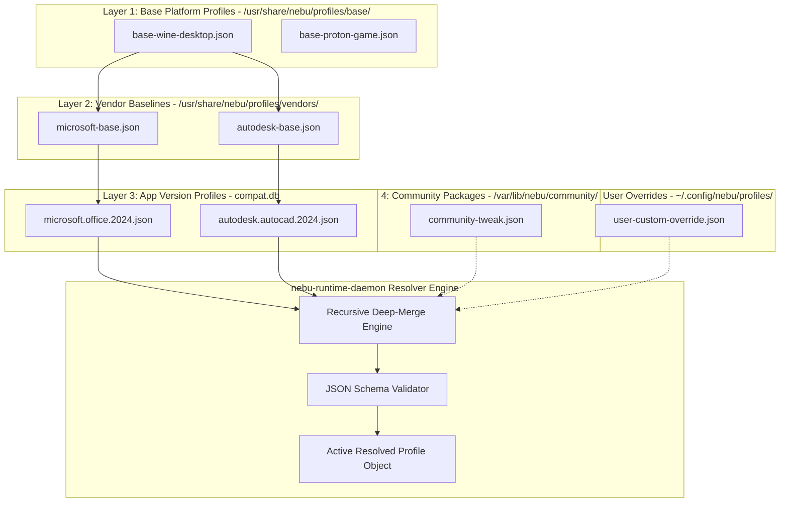
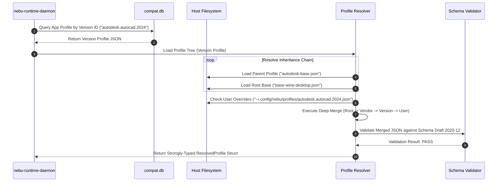
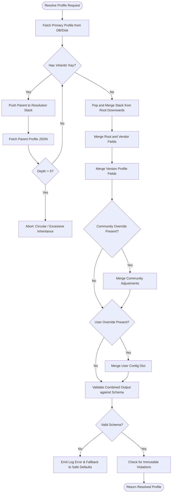

# Compatibility Profile Specification — NebuOS

**Status:** DRAFT  
**Purpose:** Define the JSON Schema, inheritance semantics, multi-layer override resolution, version matching logic, and concrete production profiles for the NebuOS Compatibility Platform.

---

## 1. Status
DRAFT — Under architectural review. Specifies the formal schema and runtime resolution algorithm governing application-specific compatibility profiles across system, vendor, community, and user layers.

## 2. Purpose
A Compatibility Profile is a declarative manifest that instructs `nebu-runtime-daemon` and `nebu-patcher` exactly how to configure, isolate, optimize, and execute a Windows binary. Rather than relying on fragile manual scripts or static winetricks recipes, NebuOS employs typed, schema-validated JSON profiles with inheritance and transactional rollback.

This specification provides:
1. The formal JSON Schema definition for all profile versions.
2. The hierarchical inheritance model and recursive dictionary merge semantics.
3. The deterministic 4-tier override resolution ladder.
4. Flexible semantic and heuristic version matching rules.
5. Fully populated production reference profiles for Microsoft Office 2024 and Autodesk AutoCAD 2024.

## 3. Scope
- Declarative profile structure spanning runtime engine, graphics translation, audio, DLL overrides, dependencies, registry injections, environment variables, and sandbox restrictions.
- Deep-merge mechanics for combining base profiles, vendor profiles, and user customizations.
- In-memory resolution pipeline executing within `nebu-runtime-daemon`.
- Validation criteria for third-party and community profile imports.

## 4. Non-goals
- Embedding arbitrary bash or shell scripts within profile definitions. All configuration actions must map to declarative, reversible engine primitives.
- Dynamic patching of native Linux host binaries or graphics drivers.
- Profiles for native Linux binaries (which follow standard Flatpak and OCI container models).

## 5. Requirements

### 5.1 Functional Requirements
- **REQ-PRF-001:** Profiles must validate against JSON Schema Draft 2020-12 without schema violations.
- **REQ-PRF-002:** The profile system must support single inheritance via an `inherits` pointer, resolving base parameters recursively up to 5 inheritance levels.
- **REQ-PRF-003:** The resolution engine must evaluate profile layers in strict priority: System Default $\rightarrow$ Vendor Base $\rightarrow$ Community Package $\rightarrow$ User Override.
- **REQ-PRF-004:** Merging must recursively combine dictionary objects, concatenate unique arrays by key identifier, and overwrite primitive types.
- **REQ-PRF-005:** Version matching must support exact versions, semver ranges (e.g., `>=2024.1.0 <2025.0.0`), glob patterns (e.g., `24.*`), and PE resource product version strings.

### 5.2 Non-Functional Requirements
- **REQ-PRF-NFR-001 (Parse & Resolve Latency):** Full resolution, schema validation, and deep-merging of an application profile must complete in $\le 5.0\text{ ms}$ on client CPUs.
- **REQ-PRF-NFR-002 (Memory Overhead):** In-memory representation of a resolved profile struct must not exceed $128\text{ KB}$ RSS.
- **REQ-PRF-NFR-003 (Deterministic Output):** Given the same input profile hierarchy and system parameters, the resolved configuration must be bit-for-bit identical across restarts.

## 6. Architecture

The profile architecture structures application configuration into reusable base layers, vendor baselines, release profiles, and user adjustments:



## 7. Components

### 7.1 Profile Store (`/usr/share/nebu/profiles/`)
Read-only system directory containing baseline configurations for Wine, Proton, and major software vendors. Deployed via immutable OSTree base image.

### 7.2 Database Profile Extractor (`nebu-compat-db`)
Runtime component that reads JSON blobs stored in `compat_profiles` within `/usr/share/nebu/compat.db` and maps them into native Rust structs.

### 7.3 Profile Resolver & Deep-Merge Engine
Rust module inside `nebu-runtime-daemon` implementing the inheritance walker, conflict detector, and dictionary merging algorithm.

### 7.4 Schema Validator
In-process validator utilizing `jsonschema` crate to enforce strict structural adherence prior to applying any configuration changes to prefixes.

## 8. Data Flow



## 9. Control Flow



## 10. Interfaces

### 10.1 JSON Schema Specification (Draft 2020-12)

The complete structural specification for NebuOS compatibility profiles:

```json
{
  "$schema": "https://json-schema.org/draft/2020-12/schema",
  "$id": "https://nebuos.org/schemas/v1/compatibility-profile.json",
  "title": "NebuOS Compatibility Profile",
  "type": "object",
  "required": [
    "schema_version",
    "profile_id",
    "name",
    "runtime",
    "graphics"
  ],
  "properties": {
    "schema_version": { "type": "string", "enum": ["1.0"] },
    "profile_id": {
      "type": "string",
      "pattern": "^[a-z0-9_]+(\\.[a-z0-9_]+)+$"
    },
    "name": { "type": "string", "minLength": 2, "maxLength": 128 },
    "vendor": { "type": "string" },
    "inherits": { "type": "string" },
    "immutable": { "type": "boolean", "default": false },
    "version_match": {
      "type": "object",
      "properties": {
        "exact": { "type": "string" },
        "glob": { "type": "string" },
        "semver_range": { "type": "string" },
        "pe_product_version": { "type": "string" },
        "min_build_number": { "type": "integer" }
      }
    },
    "runtime": {
      "type": "object",
      "required": ["engine", "version", "windows_version"],
      "properties": {
        "engine": { "type": "string", "enum": ["wine", "proton"] },
        "version": { "type": "string" },
        "windows_version": { "type": "string", "enum": ["win7", "win8", "win81", "win10", "win11"] },
        "architecture": { "type": "string", "enum": ["x86_64", "x86"], "default": "x86_64" }
      }
    },
    "graphics": {
      "type": "object",
      "required": ["backend"],
      "properties": {
        "backend": { "type": "string", "enum": ["dxvk", "vkd3d", "wined3d", "vulkan", "opengl", "gdi"] },
        "d3d11_feature_level": { "type": "string", "enum": ["10_0", "10_1", "11_0", "11_1"] },
        "prefer_discrete_gpu": { "type": "boolean", "default": true },
        "sync_interval": { "type": "integer", "minimum": 0, "maximum": 2 },
        "dxvk_config": {
          "type": "object",
          "additionalProperties": { "type": "string" }
        },
        "vkd3d_config": {
          "type": "object",
          "additionalProperties": { "type": "string" }
        }
      }
    },
    "audio": {
      "type": "object",
      "properties": {
        "backend": { "type": "string", "enum": ["pipewire", "pulseaudio", "alsa"], "default": "pipewire" },
        "latency_ms": { "type": "integer", "minimum": 5, "maximum": 200, "default": 20 },
        "period_size": { "type": "integer", "default": 512 }
      }
    },
    "dll_overrides": {
      "type": "object",
      "additionalProperties": {
        "type": "string",
        "enum": ["native", "builtin", "native,builtin", "builtin,native", "disabled"]
      }
    },
    "dependencies": {
      "type": "array",
      "items": {
        "type": "object",
        "required": ["package_name", "sha256", "download_url", "install_order"],
        "properties": {
          "package_name": { "type": "string" },
          "sha256": { "type": "string", "pattern": "^[a-f0-9]{64}$" },
          "download_url": { "type": "string", "format": "uri" },
          "install_arguments": { "type": "string" },
          "install_order": { "type": "integer", "minimum": 1 },
          "requires_reboot": { "type": "boolean", "default": false }
        }
      }
    },
    "registry_injections": {
      "type": "array",
      "items": {
        "type": "object",
        "required": ["key", "value", "type", "data"],
        "properties": {
          "key": { "type": "string" },
          "value": { "type": "string" },
          "type": { "type": "string", "enum": ["REG_DWORD", "REG_SZ", "REG_MULTI_SZ", "REG_EXPAND_SZ", "REG_BINARY"] },
          "data": { "oneOf": [{ "type": "string" }, { "type": "integer" }, { "type": "array" }] }
        }
      }
    },
    "environment_variables": {
      "type": "object",
      "additionalProperties": { "type": "string" }
    },
    "sandbox": {
      "type": "object",
      "properties": {
        "allow_network": { "type": "boolean", "default": true },
        "expose_directories": {
          "type": "array",
          "items": { "type": "string" }
        },
        "expose_devices": {
          "type": "array",
          "items": { "type": "string" }
        },
        "memory_limit_mb": { "type": "integer", "minimum": 512 },
        "cpu_quota_percent": { "type": "integer", "minimum": 10, "maximum": 100 }
      }
    },
    "workarounds": {
      "type": "array",
      "items": { "type": "string" }
    }
  }
}
```

### 10.2 Profile Inheritance & Deep-Merge Semantics
When Profile $C$ (Child) inherits from Profile $P$ (Parent):
1. **Scalar Properties:** Child values strictly overwrite parent values (`child.runtime.windows_version` replaces `parent.runtime.windows_version`).
2. **Key-Value Dictionaries (`dll_overrides`, `environment_variables`, `dxvk_config`):** Dictionaries are recursively combined. If a key exists in both, Child takes precedence. If Child sets a value to `"disabled"` or `null`, the property is deactivated.
3. **Arrays (`dependencies`, `registry_injections`, `workarounds`):**
   - Dependencies are matched by `package_name`. Child updates existing dependency fields or appends new ones.
   - Registry injections are keyed by `(key, value)`. Child entries overwrite parent entries with the same key/value identifier.
   - Array removal syntax: If a child array entry begins with `!`, the matching parent element is excised.
4. **Inheritance Limits:** Resolution depth is capped at 5 levels. Cyclic loops (`A -> B -> A`) cause immediate validation abort.

### 10.3 Override Resolution Hierarchy

```
Priority 1 (Highest): User Custom Override (~/.config/nebu/profiles/<app_id>.json)
Priority 2:           Community Profile (/var/lib/nebu/community-profiles/<app_id>.json)
Priority 3:           Catalog Release Profile (compat.db /compat_profiles)
Priority 4 (Lowest):  System Baseline Profile (/usr/share/nebu/profiles/base/*.json)
```

- **Lock Rule:** If any profile in the chain sets `"immutable": true`, subsequent layers (Community and User) cannot override `sandbox` security restrictions or `runtime.engine` parameters.

### 10.4 Version Matching Rules
When an unknown executable is fingerprinted, `nebu-runtime-daemon` evaluates matching rules against installed profiles in priority order:
1. **Exact SHA-256 Match:** Direct hash hit in `application_versions.pe_sha256`.
2. **PE Product Version String:** Matches `VS_FIXEDFILEINFO.dwProductVersionMS` against `version_match.pe_product_version`.
3. **Semantic Version Range:** If the version string parsed from PE resources satisfies `version_match.semver_range` (e.g. `>=2024.1.0 <2025.0.0`).
4. **Wildcard / Glob:** Matches against executable name and directory structure (e.g., `*AutoCAD 2024*`).

### 10.5 Fully Populated Profile: Microsoft Office 2024
File: `/usr/share/nebu/profiles/microsoft/office.2024.json`

```json
{
  "schema_version": "1.0",
  "profile_id": "microsoft.office.2024",
  "name": "Microsoft Office Professional 2024 (Word, Excel, PowerPoint)",
  "vendor": "Microsoft Corporation",
  "inherits": "microsoft-base",
  "immutable": false,
  "version_match": {
    "exact": "16.0.17932.20162",
    "glob": "16.0.*",
    "semver_range": ">=16.0.17000.0 <17.0.0.0",
    "pe_product_version": "16.0.17932.20162",
    "min_build_number": 19045
  },
  "runtime": {
    "engine": "wine",
    "version": "wine-staging-9.2",
    "windows_version": "win10",
    "architecture": "x86_64"
  },
  "graphics": {
    "backend": "dxvk",
    "d3d11_feature_level": "11_0",
    "prefer_discrete_gpu": false,
    "sync_interval": 1,
    "dxvk_config": {
      "d3d11.maxTessFactor": "0",
      "dxgi.syncInterval": "1",
      "d3d11.enableDirectWrite": "True",
      "d3d11.disableMsaa": "True"
    },
    "vkd3d_config": {}
  },
  "audio": {
    "backend": "pipewire",
    "latency_ms": 25,
    "period_size": 512
  },
  "dll_overrides": {
    "riched20": "native,builtin",
    "mso40i": "native,builtin",
    "mso": "native,builtin",
    "ole32": "native,builtin",
    "oleaut32": "native,builtin",
    "rpcrt4": "native,builtin",
    "ucrtbase": "native,builtin",
    "msvcp140": "native,builtin",
    "vcruntime140": "native,builtin",
    "d2d1": "builtin,native",
    "dwrite": "builtin,native"
  },
  "dependencies": [
    {
      "package_name": "vcrun2022",
      "sha256": "4c5d6e7f8a9b0c1d2e3f4a5b6c7d8e9f0a1b2c3d4e5f6a7b8c9d0e1f2a3b4c5d",
      "download_url": "https://aka.ms/vs/17/release/vc_redist.x64.exe",
      "install_arguments": "/quiet /norestart",
      "install_order": 1,
      "requires_reboot": false
    },
    {
      "package_name": "corefonts",
      "sha256": "8d9e0a1b2c3d4e5f6a7b8c9d0e1f2a3b4c5d6e7f8a9b0c1d2e3f4a5b6c7d8e9f",
      "download_url": "https://downloads.sourceforge.net/corefonts/msttcorefonts-2.0-1.spec",
      "install_arguments": "/extract",
      "install_order": 2,
      "requires_reboot": false
    },
    {
      "package_name": "msxml6",
      "sha256": "1a2b3c4d5e6f7a8b9c0d1e2f3a4b5c6d7e8f9a0b1c2d3e4f5a6b7c8d9e0f1a2b",
      "download_url": "https://download.microsoft.com/download/msxml6_x64.msi",
      "install_arguments": "/quiet",
      "install_order": 3,
      "requires_reboot": false
    }
  ],
  "registry_injections": [
    {
      "key": "HKEY_CURRENT_USER\\Software\\Microsoft\\Office\\16.0\\Common\\Graphics",
      "value": "DisableHardwareAcceleration",
      "type": "REG_DWORD",
      "data": 0
    },
    {
      "key": "HKEY_CURRENT_USER\\Software\\Microsoft\\Office\\Common\\Security",
      "value": "AutomationSecurity",
      "type": "REG_DWORD",
      "data": 1
    },
    {
      "key": "HKEY_CURRENT_USER\\Software\\Wine\\Direct3D",
      "value": "csmt",
      "type": "REG_DWORD",
      "data": 1
    },
    {
      "key": "HKEY_CURRENT_USER\\Software\\Wine\\X11 Driver",
      "value": "UseXVidMode",
      "type": "REG_SZ",
      "data": "N"
    }
  ],
  "environment_variables": {
    "DXVK_ASYNC": "1",
    "WINEFSYNC": "1",
    "WINEDLLOVERRIDES": "mso40i,riched20=n,b",
    "MESA_GL_VERSION_OVERRIDE": "4.5",
    "WINE_DISABLE_RECORDER": "1"
  },
  "sandbox": {
    "allow_network": true,
    "expose_directories": [
      "~/Documents",
      "~/Downloads",
      "~/Templates",
      "~/.local/share/fonts"
    ],
    "expose_devices": [
      "/dev/dri/renderD128"
    ],
    "memory_limit_mb": 4096,
    "cpu_quota_percent": 100
  },
  "workarounds": [
    "Disable Outlook modern auth embedded webview fallback; use native browser SSO",
    "Force software rasterizer for Excel 3D Map preview pane"
  ]
}
```

### 10.6 Fully Populated Profile: Autodesk AutoCAD 2024
File: `/usr/share/nebu/profiles/autodesk/autocad.2024.json`

```json
{
  "schema_version": "1.0",
  "profile_id": "autodesk.autocad.2024",
  "name": "Autodesk AutoCAD 2024",
  "vendor": "Autodesk, Inc.",
  "inherits": "autodesk-base",
  "immutable": false,
  "version_match": {
    "exact": "24.3.61.0",
    "glob": "24.*",
    "semver_range": ">=24.0.0 <25.0.0",
    "pe_product_version": "24.3.61.0",
    "min_build_number": 19041
  },
  "runtime": {
    "engine": "wine",
    "version": "wine-staging-9.2",
    "windows_version": "win10",
    "architecture": "x86_64"
  },
  "graphics": {
    "backend": "dxvk",
    "d3d11_feature_level": "11_1",
    "prefer_discrete_gpu": true,
    "sync_interval": 1,
    "dxvk_config": {
      "d3d11.maxTessFactor": "64",
      "dxgi.syncInterval": "1",
      "d3d11.relaxedBarriers": "True",
      "dxvk.numCompilerThreads": "8",
      "d3d11.constantBufferRangeCheck": "False"
    },
    "vkd3d_config": {}
  },
  "audio": {
    "backend": "pipewire",
    "latency_ms": 50,
    "period_size": 1024
  },
  "dll_overrides": {
    "d3d11": "native,builtin",
    "dxgi": "native,builtin",
    "d3dcompiler_47": "native",
    "d3dx11_43": "native",
    "glu32": "native,builtin",
    "opengl32": "builtin",
    "mfc140u": "native,builtin",
    "atl140": "native,builtin"
  },
  "dependencies": [
    {
      "package_name": "vcrun2022",
      "sha256": "4c5d6e7f8a9b0c1d2e3f4a5b6c7d8e9f0a1b2c3d4e5f6a7b8c9d0e1f2a3b4c5d",
      "download_url": "https://aka.ms/vs/17/release/vc_redist.x64.exe",
      "install_arguments": "/quiet /norestart",
      "install_order": 1,
      "requires_reboot": false
    },
    {
      "package_name": "dotnet48",
      "sha256": "7a8b9c0d1e2f3a4b5c6d7e8f9a0b1c2d3e4f5a6b7c8d9e0f1a2b3c4d5e6f7a8b",
      "download_url": "https://download.visualstudio.microsoft.com/download/pr/dotnet48-ndp48-x86-x64-allos-enu.exe",
      "install_arguments": "/q /norestart",
      "install_order": 2,
      "requires_reboot": true
    },
    {
      "package_name": "corefonts",
      "sha256": "8d9e0a1b2c3d4e5f6a7b8c9d0e1f2a3b4c5d6e7f8a9b0c1d2e3f4a5b6c7d8e9f",
      "download_url": "https://downloads.sourceforge.net/corefonts/msttcorefonts-2.0-1.spec",
      "install_arguments": "/extract",
      "install_order": 3,
      "requires_reboot": false
    },
    {
      "package_name": "directx9",
      "sha256": "9b0c1d2e3f4a5b6c7d8e9f0a1b2c3d4e5f6a7b8c9d0e1f2a3b4c5d6e7f8a9b0c",
      "download_url": "https://download.microsoft.com/download/8/4/A/84A35BF1-DAFE-4AE8-82AF-AD2AE20B6B14/directx_Jun2010_redist.exe",
      "install_arguments": "/Q /T:C:\\dxredist",
      "install_order": 4,
      "requires_reboot": false
    }
  ],
  "registry_injections": [
    {
      "key": "HKEY_CURRENT_USER\\Software\\Autodesk\\AutoCAD\\R24.3\\ACAD-7101:409\\3DGS Configuration\\GSDirect3D",
      "value": "HardwareAccelerated",
      "type": "REG_DWORD",
      "data": 1
    },
    {
      "key": "HKEY_CURRENT_USER\\Software\\Autodesk\\AutoCAD\\R24.3\\ACAD-7101:409\\3DGS Configuration\\GSDirect3D",
      "value": "DriverFeatureLevel",
      "type": "REG_DWORD",
      "data": 5
    },
    {
      "key": "HKEY_CURRENT_USER\\Software\\Wine\\Direct3D",
      "value": "MaxVersionGL",
      "type": "REG_DWORD",
      "data": 40006
    }
  ],
  "environment_variables": {
    "DXVK_ASYNC": "1",
    "WINEFSYNC": "1",
    "DRI_PRIME": "1",
    "ACAD_USE_DX11": "1",
    "WINE_LARGE_ADDRESS_AWARE": "1"
  },
  "sandbox": {
    "allow_network": true,
    "expose_directories": [
      "~/Documents/CAD",
      "~/Projects",
      "~/Downloads",
      "~/.local/share/fonts"
    ],
    "expose_devices": [
      "/dev/dri/card0",
      "/dev/dri/renderD128"
    ],
    "memory_limit_mb": 16384,
    "cpu_quota_percent": 100
  },
  "workarounds": [
    "Set Autodesk Desktop Licensing Service (AdskLicensingService) to startup type automatic delayed",
    "Redirect WebGL material render canvas to DXVK native viewport context"
  ]
}
```

## 11. Dependencies

| Library / Tool | Supplier | Role |
| :--- | :--- | :--- |
| `serde` & `serde_json` | Rust Crates | Deserialization of structured JSON profiles |
| `jsonschema` (Draft 2020-12) | Rust Crate | Compile-time and runtime profile validation |
| `semver` | Rust Crate | Semantic version range matching and evaluation |
| `glob` | Rust Crate | File and version string wildcard evaluation |

## 12. Security

- **Tamper Prevention:** System baseline profiles are deployed in read-only OSTree `/usr/share/nebu/profiles/`.
- **Sandbox Lockdown:** The `sandbox` block cannot be loosened by unprivileged community profiles. If a system profile specifies `allow_network: false`, a community profile setting `allow_network: true` is rejected by the resolver.
- **Path Escapes:** `expose_directories` entries are canonicalized via `std::fs::canonicalize`. Any paths resolving outside `$HOME` (such as `/etc` or `/root`) trigger immediate profile rejection.

## 13. Resource Requirements

- **Resolver Execution:** $\le 5.0\text{ ms}$ wall-clock time per resolution.
- **Memory Footprint:** Peak memory during multi-tier profile merging $\le 1.2\text{ MB}$; persistent resolved struct $\le 128\text{ KB}$.
- **Disk Storage:** Full profile catalog covering 2,500 applications requires $\le 8\text{ MB}$ storage.

## 14. Failure Modes

| Failure ID | Trigger | Immediate Consequence | System Reaction |
| :--- | :--- | :--- | :--- |
| **FAIL-PRF-001** | Malformed JSON syntax | Deserialization error | Log parse error; fallback to generic system baseline |
| **FAIL-PRF-002** | Cyclic inheritance (`A -> B -> A`) | Infinite loop risk | Resolver aborts when inheritance depth exceeds 5 |
| **FAIL-PRF-003** | Schema validation failure | Required key missing or invalid enum | Profile rejected; emit diagnostic warning to desktop shell |
| **FAIL-PRF-004** | Illegal path traversal in `expose_directories` | Security sandbox violation attempt | Profile rejected; security alert emitted to system journal |

## 15. Recovery Behavior

### 15.1 Fallback to Generic Profiles
If a specialized application profile fails schema validation or becomes corrupted:
1. `nebu-runtime-daemon` logs the exact JSON validation path and error.
2. The resolver falls back to `/usr/share/nebu/profiles/base/base-wine-desktop.json`.
3. The desktop shell displays a non-blocking notification: *"Application launched using generic compatibility settings due to profile syntax error."*

### 15.2 User Override Recovery
If a user customization breaks application launch:
- The command `nebu profile reset <app_id>` deletes `~/.config/nebu/profiles/<app_id>.json` and purges the override record from `user_compat.db`, immediately restoring the certified system profile.

## 16. Testing Requirements

- **Schema Conformance Tests:** Automated CI test suites validate every file under `profiles/` against the JSON Schema Draft 2020-12.
- **Deep-Merge Unit Tests:** Unit tests verifying recursive dictionary merges, array deduplication, array removal (`!key`), and scalar replacement.
- **Field Completeness Validation:** CI gate asserting that all certified tier profiles have 100% of defined schema fields explicitly populated.
- **Fuzz Testing:** Malformed JSON and fuzz payloads injected into the profile loader to ensure zero memory panics or denial-of-service vulnerabilities.

## 17. Performance Requirements

- **Deep-Merge Resolution Time:** Merging 5 levels of inheritance $\le 3.5\text{ ms}$.
- **Schema Validation Time:** In-memory validation against full draft 2020-12 schema $\le 1.5\text{ ms}$.
- **Cache Hit Latency:** Serving pre-resolved profile struct from LRU cache $\le 0.05\text{ ms}$.

## 18. Compatibility Considerations

- **Backwards Compatibility:** Schema versioning via `schema_version` allows introducing new properties without invalidating existing 1.0 profiles.
- **Environment Cross-Pollination:** Environment variables defined in profiles are injected strictly into the isolated Bubblewrap container, never leaking into host shell sessions.

## 19. Open Questions

- **OPEN-PRF-001:** Should NebuOS support dynamic profile downloading from an online CDN for zero-day Windows game releases without waiting for an OS image update?
- **OPEN-PRF-002:** Should the profile schema support hardware-conditional blocks (e.g., inject `d3d11.maxTessFactor: 32` if GPU vendor is Intel, but `64` if AMD)?

## 20. Related Documents
- [00-compatibility-specification.md](00-compatibility-specification.md) — Master Compatibility Platform Specification
- [01-database-schema.md](01-database-schema.md) — Relational Schema for Compatibility Profiles and Certifications
- [03-patch-engine.md](03-patch-engine.md) — 9-Tier Remediation Engine Specification
- [04-application-detection.md](04-application-detection.md) — Application Detection and PE Fingerprinting
- [05-certification-model.md](05-certification-model.md) — Certification Tiers and Test Execution Matrix
- [06-known-limitations.md](06-known-limitations.md) — Hard Non-Compatibility Boundaries and Error Handling
