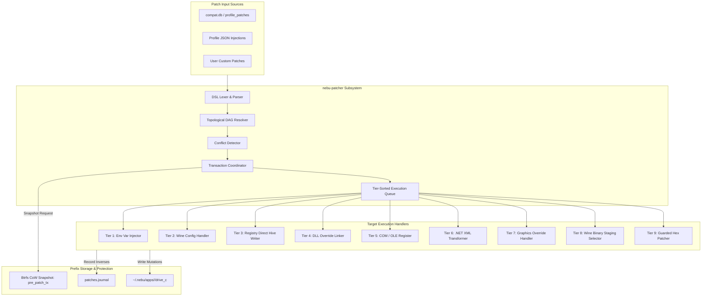
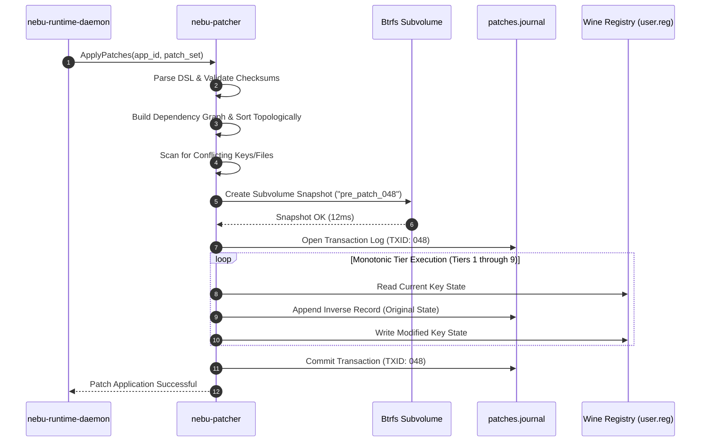
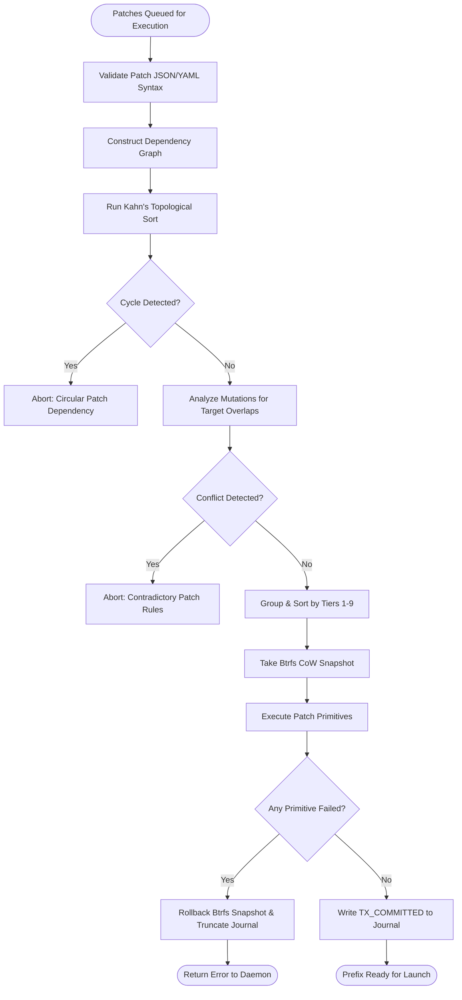

# Patch Engine Specification — NebuOS

**Status:** DRAFT  
**Purpose:** Define the architecture, 9-tier priority hierarchy, declarative patch DSL, dependency DAG resolution, conflict detection, execution order guarantees, and transactional rollback engine of `nebu-patcher`.

---

## 1. Status
DRAFT — Under architectural review. Governs the declarative remediation engine (`nebu-patcher`) utilized by `nebu-runtime-daemon` to prepare, configure, and heal isolated Wine application prefixes.

## 2. Purpose
Windows applications frequently rely on implicit Windows NT operating system quirks, vendor-specific DLL interactions, exact registry states, or legacy COM registrations that upstream Wine does not provide out of the box. Traditional approaches rely on ad-hoc shell scripts, unversioned winetricks calls, or manual registry edits that destabilize systems and prevent clean upgrades.

`nebu-patcher` solves this problem through:
1. A **9-tier priority hierarchy** enforcing least-invasive configuration fixes before attempting deeper code or binary modifications.
2. A **declarative patch DSL** covering registry, DLL overrides, environment variables, files, XML configurations, and guarded binary patches.
3. A **topological dependency DAG resolver** guaranteeing strict prerequisite ordering.
4. An **in-flight conflict detector** preventing overlapping or contradictory patch operations.
5. **Atomic transactions with zero-latency rollback** backed by Btrfs copy-on-write snapshots and inverse patch journals.

## 3. Scope
- Declarative schema and operational execution of patches on per-app prefixes (`~/.nebu/apps/<app_id>/`).
- Interactions with Wine registry hives (`system.reg`, `user.reg`), `drive_c` filesystem paths, and runtime environments.
- Automated rollback mechanics during installation failures or application updates.
- Validation, conflict detection, and sequencing of multi-vendor patch bundles.

## 4. Non-goals
- Modifying host operating system files outside the unprivileged user application sandbox.
- Arbitrary code execution or unstructured shell script execution inside patches.
- Hot-patching running executable memory in real time (patches are applied prior to process launch).

## 5. Requirements

### 5.1 Functional Requirements
- **REQ-PAT-001:** The patch engine must enforce the 9-tier priority hierarchy, applying configuration fixes strictly from Tier 1 through Tier 9.
- **REQ-PAT-002:** The engine must support all DSL primitives: `set_registry`, `delete_registry`, `override_dll`, `set_env`, `copy_file`, `delete_file`, `symlink_file`, `xml_transform`, `ini_set`, and `binary_patch`.
- **REQ-PAT-003:** The engine must resolve patch dependencies via topological sorting and reject cyclic dependencies with descriptive error traces.
- **REQ-PAT-004:** The engine must detect conflicts (e.g. two patches modifying the same registry value to differing targets) before applying any mutations.
- **REQ-PAT-005:** Every patch must define an explicit or auto-generated inverse operation recorded in `patches.journal`.
- **REQ-PAT-006:** A failed patch operation must automatically trigger an atomic rollback to the pre-patch Btrfs snapshot within $\le 500\text{ ms}$.

### 5.2 Non-Functional Requirements
- **REQ-PAT-NFR-001 (Execution Latency):** Applying a standard 10-patch configuration bundle must complete in $\le 250\text{ ms}$ excluding external file downloads.
- **REQ-PAT-NFR-002 (Atomicity):** Prefix state must be 100% all-or-nothing; partial patch application is strictly prohibited.
- **REQ-PAT-NFR-003 (Memory Footprint):** Peak memory of `nebu-patcher` during dependency resolution and execution $\le 16\text{ MB}$ RSS.

## 6. Architecture

`nebu-patcher` operates as an embedded Rust subsystem inside `nebu-runtime-daemon` or as a standalone CLI utility:



## 7. Components

### 7.1 `nebu-patcher` Core (NebuOS Component)
The engine library implementing the patch lifecycle, parser, DAG solver, and transaction monitor.

### 7.2 Registry Hive Manipulator
In-process Rust parser for Wine `system.reg`, `user.reg`, and `userdef.reg` text-based hive files, allowing direct atomic manipulation without spawning slow external `regedit.exe` processes.

### 7.3 Transaction Journaler
Appends structured JSON change records to `~/.nebu/apps/<app_id>/patches.journal`, ensuring that every applied modification has a recorded inverse state.

### 7.4 Btrfs Snapshot Coordinator
Interacts directly with the Btrfs filesystem ioctls (`BTRFS_IOC_SUBVOL_CREATE`, `BTRFS_IOC_SNAP_DESTROY`) to provide sub-second transactional rollbacks.

## 8. Data Flow



## 9. Control Flow



## 10. Interfaces

### 10.1 The 9-Tier Patch Hierarchy
`nebu-patcher` categorizes every fix into one of nine distinct architectural tiers. The priority rule is strict: **fixes at lower numerical tiers MUST be attempted before higher tiers are considered.**

```
Tier 1: Environment Variables                (Zero filesystem impact; transient)
Tier 2: Wine Configuration                   (winecfg keys, Windows NT version spoofing)
Tier 3: Registry Modifications               (HKCU / HKLM key insertions & deletions)
Tier 4: DLL Configuration & Overrides        (Native vs Builtin DLL routing)
Tier 5: COM / OLE Registration               (regsvr32 automation and stubbing)
Tier 6: .NET Framework Runtime Configuration (.config XML transforms & CLR options)
Tier 7: Graphics Backend Overrides           (DXVK / VKD3D configuration & pipeline tweaks)
Tier 8: Wine API Implementation Improvements (Wine staging builds & upstream patchsets)
Tier 9: Binary Modification                  (Guarded hex patches; strictly last resort)
```

#### Detailed Tier Analysis with Concrete Examples:

| Tier | Tier Name | Impact Scope | Concrete Production Example |
| :--- | :--- | :--- | :--- |
| **1** | Environment Variables | Ephemeral process environment | `DXVK_ASYNC=1` to prevent shader compilation stutter; `WINEFSYNC=1` for fast thread synchronization. |
| **2** | Wine Configuration | Prefix global settings | Setting virtual desktop mode for legacy full-screen games: `winecfg` desktop size `1920x1080`; setting Windows version spoof to `win10`. |
| **3** | Registry Modifications | Persistent registry hives | Injecting `HKCU\Software\Wine\Direct3D\MaxVersionGL = 40006` to expose OpenGL 4.6 to CAD viewports. |
| **4** | DLL Overrides | Dynamic linker routing | Routing Direct3D 11 through native DXVK: `WINEDLLOVERRIDES="d3d11=n,b;dxgi=n,b"`; replacing broken Wine rich text with `riched20=n`. |
| **5** | COM / OLE Registration | Component Object Model | Registering Autodesk licensing automation objects: `regsvr32 /s AdskLicensingAgent.dll`; stubbing unavailable Windows Media Player COM controls. |
| **6** | .NET Configuration | Managed CLR runtime | Injecting `<supportedRuntime version="v4.0.30319"/>` into `acad.exe.config` to prevent unhandled runtime initialization dialogs. |
| **7** | Graphics Backend | Direct3D translation layer | Injecting DXVK profile: `d3d11.maxTessFactor = 64` and `dxgi.syncInterval = 1` into `dxvk.conf` inside the application directory. |
| **8** | Wine Staging Improvements | Binary Wine runtime tree | Switching application runtime from standard Wine to `wine-staging-9.2` which incorporates experimental `winesync` fast futex patches. |
| **9** | Binary Modification | Permanent PE disk modification | **Strictly last resort:** Hex-patching a legacy 32-bit executable to set `IMAGE_FILE_LARGE_ADDRESS_AWARE` flag in COFF Characteristics. |

### 10.2 Patch File Format Specification
Patches are authored in structured YAML or JSON. Below is the canonical format:

```yaml
schema_version: "1.0"
patch_id: "patch.autodesk.autocad.2024.dx11_viewport"
name: "AutoCAD 2024 DX11 Viewport Optimization"
description: "Configures DXVK and injects DirectX 11 feature levels into AutoCAD registry."
patch_tier: 3
target_application: "autodesk.autocad"
version_constraints: ">=2024.0.0 <2025.0.0"
dependencies:
  - "patch.autodesk.base_registry"
conflicts:
  - "patch.autodesk.legacy_gdi_viewport"
execution_order: 150
is_reversible: true

operations:
  - op: "set_registry"
    hive: "HKEY_CURRENT_USER"
    key: "Software\\Autodesk\\AutoCAD\\R24.3\\ACAD-7101:409\\3DGS Configuration\\GSDirect3D"
    value: "HardwareAccelerated"
    type: "REG_DWORD"
    data: 1

  - op: "set_registry"
    hive: "HKEY_CURRENT_USER"
    key: "Software\\Autodesk\\AutoCAD\\R24.3\\ACAD-7101:409\\3DGS Configuration\\GSDirect3D"
    value: "DriverFeatureLevel"
    type: "REG_DWORD"
    data: 5

  - op: "ini_set"
    file: "drive_c/Program Files/Autodesk/AutoCAD 2024/Acad.ini"
    section: "Graphics"
    key: "PreferVulkan"
    value: "1"
```

### 10.3 Declarative Patch DSL Operations

`nebu-patcher` supports exactly ten strictly bounded operations:

#### 1. `set_registry`
Sets or overwrites a Windows registry key value.
```json
{
  "op": "set_registry",
  "hive": "HKEY_CURRENT_USER",
  "key": "Software\\Wine\\Direct3D",
  "value": "csmt",
  "type": "REG_DWORD",
  "data": 1
}
```

#### 2. `delete_registry`
Deletes a registry key or specific value.
```json
{
  "op": "delete_registry",
  "hive": "HKEY_CURRENT_USER",
  "key": "Software\\Microsoft\\Windows\\CurrentVersion\\Run",
  "value": "UnwantedUpdateTask"
}
```

#### 3. `override_dll`
Configures dynamic linker override in Wine.
```json
{
  "op": "override_dll",
  "dll_name": "d3dcompiler_47",
  "mode": "native"
}
```

#### 4. `set_env`
Injects process environment variable.
```json
{
  "op": "set_env",
  "variable": "MESA_GL_VERSION_OVERRIDE",
  "value": "4.6"
}
```

#### 5. `copy_file`
Copies a file from the host runtime cache into the prefix with SHA-256 verification.
```json
{
  "op": "copy_file",
  "source": "/usr/share/nebu/shims/d3d11_custom_shim.dll",
  "destination": "drive_c/windows/system32/d3d11_custom_shim.dll",
  "expected_sha256": "4a5b6c7d8e9f0a1b2c3d4e5f6a7b8c9d0e1f2a3b4c5d6e7f8a9b0c1d2e3f4a5b"
}
```

#### 6. `delete_file`
Removes an obsolete or conflicting file within the prefix.
```json
{
  "op": "delete_file",
  "path": "drive_c/Program Files/App/CrashReport.exe"
}
```

#### 7. `symlink_file`
Creates an internal symbolic link inside the Wine prefix.
```json
{
  "op": "symlink_file",
  "target": "drive_c/windows/system32/msvcp140.dll",
  "link_path": "drive_c/Program Files/App/msvcp140.dll"
}
```

#### 8. `xml_transform`
Applies an in-place XPath modification to XML configuration files (.NET configs, manifest files).
```json
{
  "op": "xml_transform",
  "target_file": "drive_c/Program Files/App/app.exe.config",
  "xpath": "/configuration/runtime",
  "action": "insert_child",
  "content": "<generatePublisherEvidence enabled=\"false\"/>"
}
```

#### 9. `ini_set`
Sets a key-value pair within standard Windows INI configuration files.
```json
{
  "op": "ini_set",
  "file": "drive_c/windows/system.ini",
  "section": "drivers",
  "key": "wave",
  "value": "mmdevapi.dll"
}
```

#### 10. `binary_patch` (Guarded Hex Patch)
Applies a byte-level patch to a specific PE binary. Requires matching original SHA-256, target offset, expected original bytes, replacement bytes, and target patched SHA-256.
```json
{
  "op": "binary_patch",
  "target_file": "drive_c/Program Files/LegacyApp/app.exe",
  "expected_original_sha256": "112233445566778899aabbccddeeff00112233445566778899aabbccddeeff00",
  "expected_patched_sha256": "aabbccddeeff00112233445566778899aabbccddeeff00112233445566778899",
  "patches": [
    {
      "offset_hex": "0x00041A20",
      "original_hex": "7405",
      "replacement_hex": "9090"
    }
  ]
}
```

### 10.4 Dependency DAG Resolution Algorithm
Patch dependencies are resolved using Kahn's topological sort algorithm:
1. Build adjacency list $G = (V, E)$ where vertices $V$ are patches and directed edge $(u, v)$ means patch $v$ depends on patch $u$.
2. Calculate in-degree for every vertex.
3. Enqueue vertices with in-degree 0 into a processing queue.
4. While queue is non-empty, dequeue $u$, append $u$ to sorted list, and decrement in-degree of all neighbors.
5. If processed vertex count $< |V|$, a cycle exists: abort and return cyclic node identifiers.

### 10.5 Conflict Detection Algorithm
Prior to execution, the conflict detector checks:
1. **Registry Collisions:** No two patches may set the same `(hive, key, value)` tuple to different data values.
2. **File Mutation Overlaps:** No two patches may write to or delete the same file path.
3. **Explicit Conflict Declarations:** If Patch A specifies Patch B in its `conflicts` list, and both are in the execution set, execution is rejected.

### 10.6 Execution Order Guarantees
1. Sorting primary key: `patch_tier` (Ascending: 1 through 9).
2. Sorting secondary key: `execution_order` integer (Ascending: 0 through 1000).
3. All dependencies must complete before dependent patches initiate.

### 10.7 Transaction Journal & Rollback Implementation
Every prefix maintains a write-ahead journal at `~/.nebu/apps/<app_id>/patches.journal`:
```json
{
  "transaction_id": "tx_20260904_104500",
  "patch_id": "patch.autodesk.autocad.2024.dx11_viewport",
  "timestamp": "2026-09-04T10:45:00Z",
  "snapshot_name": "pre_patch_20260904_104500",
  "inverses": [
    {
      "op": "set_registry",
      "hive": "HKEY_CURRENT_USER",
      "key": "Software\\Autodesk\\AutoCAD\\R24.3\\ACAD-7101:409\\3DGS Configuration\\GSDirect3D",
      "value": "HardwareAccelerated",
      "type": "REG_DWORD",
      "data": 0
    }
  ],
  "status": "COMMITTED"
}
```

If an error occurs during step execution:
1. `nebu-patcher` catches the error.
2. If Btrfs snapshot exists, the prefix subvolume is restored instantaneously:
   ```bash
   btrfs subvolume snapshot ~/.nebu/apps/<app_id>/.snapshots/pre_patch_20260904_104500 ~/.nebu/apps/<app_id>
   ```
3. If Btrfs is unavailable, the engine iterates through `inverses` in strict reverse chronological order.

## 11. Dependencies

| Component | Class | Description |
| :--- | :--- | :--- |
| `nebu-runtime-daemon` | Host Component | Spawns and coordinates `nebu-patcher` |
| `btrfs-progs` / Linux Kernel | System Tool | Handles Btrfs CoW snapshot creation and restoration |
| `roxmltree` / `xmlwriter` | Rust Crates | High-speed XML parsing and transformations |
| `sha2` | Rust Crate | SHA-256 verification of binaries and payload files |

## 12. Security

- **Strict Path Containment:** All file operations (`copy_file`, `delete_file`, `symlink_file`, `xml_transform`, `ini_set`, `binary_patch`) are restricted to paths within `~/.nebu/apps/<app_id>/`. Any path resolving outside the prefix triggers a security panic.
- **Binary Patching Auditing:** Tier 9 `binary_patch` operations are permitted ONLY for profiles signed by the official Nebu Engineering key. Community and unauthenticated profiles are restricted to Tiers 1 through 7.
- **Zero Shell Invocation:** No patch operation ever invokes `sh`, `bash`, or `cmd.exe`. All mutations are executed via pure Rust syscall implementations.

## 13. Resource Requirements

- **Execution Latency:** $\le 250\text{ ms}$ for 10-patch sequence.
- **Snapshot Overhead:** Btrfs snapshot creation takes $< 15\text{ ms}$ and consumes zero initial disk space (CoW).
- **RAM Consumption:** Peak memory usage during topological sort $\le 16\text{ MB}$ RSS.

## 14. Failure Modes

| Failure Code | Description | Trigger | Recovery Action |
| :--- | :--- | :--- | :--- |
| **FAIL-PAT-001** | Cyclic Dependency | Patch A depends on B, B depends on A | Abort transaction; emit error graph |
| **FAIL-PAT-002** | Conflict Detected | Two patches set conflicting registry keys | Abort transaction; notify user of profile collision |
| **FAIL-PAT-003** | SHA-256 Mismatch | Target binary differs from expected checksum | Abort binary patch; restore original file |
| **FAIL-PAT-004** | Disk Full during Patch | Btrfs returns `ENOSPC` during write | Restore pre-patch snapshot; emit low disk warning |

## 15. Recovery Behavior

### 15.1 Btrfs Snapshot Rollback
In the event of any operation failure:
1. All running prefix processes are terminated via `SIGKILL`.
2. The current mutable subvolume is unlinked.
3. The clean snapshot `pre_patch_<tx_id>` is restored as the active prefix subvolume.
4. The transaction journal is flagged as `ROLLED_BACK`.
5. Rollback completes in under 500 ms.

### 15.2 Journal Replay Rollback
If running on a non-Btrfs fallback filesystem:
1. `nebu-patcher` reads the `inverses` list from `patches.journal`.
2. Inverses are executed in reverse order (LIFO).
3. The transaction status is updated to `ROLLED_BACK`.

## 16. Testing Requirements

- **Idempotence Testing:** Applying an already applied patch bundle must produce no state change and return `ALREADY_APPLIED`.
- **Reversibility Testing:** Automated test suites verify that applying a patch set and executing its rollback leaves the prefix byte-for-byte identical to its starting state.
- **Fuzzing DSL Parser:** AFL++ fuzzing of YAML/JSON patch parser across 50,000 malformed inputs.
- **Cycle Detection Tests:** Unit tests verifying that complex cyclic graphs ($N \ge 10$) are detected without infinite loops.

## 17. Performance Requirements

- **Topological Sort:** Sorting 100 patches with 200 dependencies $\le 2.0\text{ ms}$.
- **Registry Write Latency:** Parsing and committing a 5-key registry update $\le 15\text{ ms}$.
- **Binary Patch Application:** Hashing, byte replacement, and re-hashing a 50 MB binary $\le 120\text{ ms}$.

## 18. Compatibility Considerations

- **Wine Version Agnosticism:** Registry mutations directly write standard Wine text hives (`system.reg`, `user.reg`), ensuring complete compatibility across Wine Stable 9.x, Wine Staging, and Proton.
- **Path Separator Normalization:** The DSL normalizes Windows backslashes (`\`) and POSIX slashes (`/`) automatically.

## 19. Open Questions

- **OPEN-PAT-001:** Should `nebu-patcher` support dynamic downloadable patches from remote URLs during installation, or must all patch payloads be compiled into local packages?
- **OPEN-PAT-002:** Can we safely introduce an in-memory memory-mapped registry hive editor to accelerate patching on slower mechanical storage?

## 20. Related Documents
- [00-compatibility-specification.md](00-compatibility-specification.md) — Master Compatibility Platform Specification
- [01-database-schema.md](01-database-schema.md) — Relational Schema for Compatibility Profiles and Certifications
- [02-compatibility-profile.md](02-compatibility-profile.md) — Profile JSON Specification and Inheritance Rules
- [04-application-detection.md](04-application-detection.md) — Application Detection and PE Fingerprinting
- [05-certification-model.md](05-certification-model.md) — Certification Tiers and Test Execution Matrix
- [06-known-limitations.md](06-known-limitations.md) — Hard Non-Compatibility Boundaries and Error Handling
