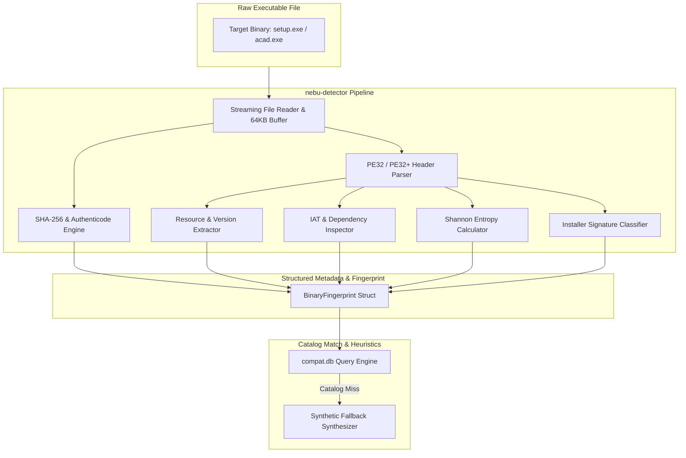
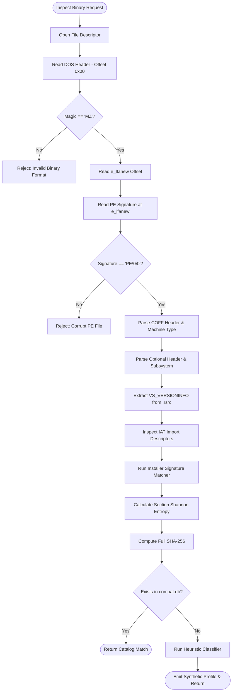
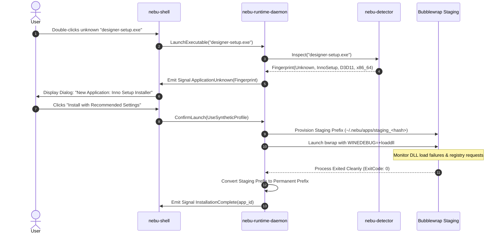

# Application Detection Specification — NebuOS

**Status:** DRAFT  
**Purpose:** Define the executable inspection algorithms, PE header fingerprinting, SHA-256 verification, installer classification, heuristic fallback analysis, and unknown application workflow in `nebu-detector`.

---

## 1. Status
DRAFT — Under architectural review. Governs the binary detection and classification subsystem (`nebu-detector`) within `nebu-runtime-daemon`.

## 2. Purpose
When a user launches a Windows executable (`.exe`, `.msi`), NebuOS must instantaneously and reliably determine what the binary is, whether it is an installer or an installed application, which Windows APIs it requires, and which compatibility profile in `compat.db` best matches it.

This specification establishes:
1. The deterministic PE32/PE32+ header fingerprinting pipeline.
2. Two-phase SHA-256 cryptographic matching (preliminary 64 KB header vs full binary).
3. Exact signature algorithms for identifying major installer engines (Inno Setup, NSIS, InstallShield, MSI/WiX, SFX).
4. Heuristic capability deduction for uncataloged binaries (extracting graphics backends, runtime needs, and subsystem requirements).
5. The end-to-end operational workflow for handling unknown applications.

## 3. Scope
- Parsing and validating Portable Executable (PE32/PE32+) binaries and Microsoft Installer (MSI) packages.
- Authenticode signature extraction and X.509 thumbprint calculation.
- Extraction of `VS_VERSIONINFO` resource metadata (Company, Product, Version).
- Section entropy calculation for packer and protector identification.
- Runtime generation of synthetic fallback profiles for uncataloged binaries.

## 4. Non-goals
- Decompiling or reverse-engineering application machine code.
- Dynamic behavioral sandboxing involving live heuristic malware detonation networks.
- Modifying executable binaries on disk during the detection phase.

## 5. Requirements

### 5.1 Functional Requirements
- **REQ-DET-001:** The detector must parse DOS, COFF, and Optional Headers of PE binaries and reject corrupted or non-PE files within $\le 5\text{ ms}$.
- **REQ-DET-002:** The detector must extract `VS_VERSIONINFO` strings (`ProductName`, `ProductVersion`, `CompanyName`, `OriginalFilename`) from `.rsrc`.
- **REQ-DET-003:** The detector must compute a 64 KB preliminary header SHA-256 hash for fast index lookup prior to streaming the entire file.
- **REQ-DET-004:** The detector must identify installer wrappers (Inno, NSIS, InstallShield, WiX/MSI, 7z/RAR SFX) via byte signatures and structure markers.
- **REQ-DET-005:** For uncataloged binaries, the detector must analyze the Import Address Table (IAT) to infer graphic backends (DX9, DX11, DX12, OpenGL, Vulkan) and runtime dependencies (.NET, VC++).
- **REQ-DET-006:** The detector must calculate section Shannon entropy to detect packed binaries (UPX, Themida, VMProtect).

### 5.2 Non-Functional Requirements
- **REQ-DET-NFR-001 (Inspection Latency):** Complete inspection, hash generation, and metadata extraction must complete in $\le 30\text{ ms}$ for binaries under 100 MB; $\le 150\text{ ms}$ for multi-gigabyte installers (using streaming I/O).
- **REQ-DET-NFR-002 (Memory Budget):** Peak memory consumption of `nebu-detector` during inspection $\le 8\text{ MB}$ RSS.
- **REQ-DET-NFR-003 (Robustness):** The parser must never panic, crash, or enter infinite loops when presented with malformed or fuzzed PE files.

## 6. Architecture

`nebu-detector` is implemented as an in-process Rust library integrated into `nebu-runtime-daemon`:



## 7. Components

### 7.1 `nebu-detector` (NebuOS Component)
Core Rust crate responsible for low-level PE file slicing, header decoding, and signature matching.

### 7.2 PE Header Inspector
Zero-copy parser utilizing memory-safe byte slices to navigate DOS headers, PE headers, Section Tables, and Data Directories.

### 7.3 Cryptographic Hashing Engine
Multi-threaded hashing pipeline generating full SHA-256, preliminary header SHA-256, Rich Header MD5/SHA-256, and Authenticode certificate thumbprints.

### 7.4 Heuristic Capability Classifier
Infers execution requirements by analyzing imported system DLLs and API symbols (e.g. `d3d11.dll` $\rightarrow$ Direct3D 11 / DXVK).

## 8. Data Flow

```mermaid
sequenceDiagram
    autonumber
    participant D as nebu-runtime-daemon
    participant Det as nebu-detector
    participant DB as compat.db
    participant UI as nebu-shell

    D->>Det: Inspect(file_path)
    Det->>Det: Read first 64 KB & verify DOS magic "MZ"
    Det->>Det: Compute header_sha256
    Det->>DB: Query by header_sha256 (Fast Path)
    alt Fast Path Hit
        DB-->>Det: Return Matching Application Version
        Det-->>D: Return BinaryFingerprint(Status: Known, ID)
    else Fast Path Miss
        Det->>Det: Stream entire file; compute full pe_sha256
        Det->>Det: Parse Optional Header, Sections, .rsrc, and IAT
        Det->>Det: Scan for Installer Engine Signatures
        Det->>DB: Query by pe_sha256 (Full Hash Path)
        alt Full Hash Hit
            DB-->>Det: Return Matching Application Version
            Det-->>D: Return BinaryFingerprint(Status: Known, ID)
        else Complete Miss
            Det->>Det: Execute Heuristic Capability Classifier
            Det->>Det: Generate Synthetic Profile
            Det-->>D: Return BinaryFingerprint(Status: Unknown, SyntheticProfile)
            D->>UI: Prompt User "New Application Detected"
        end
    end
```

## 9. Control Flow



## 10. Interfaces

### 10.1 PE Header Fingerprinting Algorithm

The binary inspection engine extracts a strongly-typed `BinaryFingerprint` representation:

```rust
pub struct BinaryFingerprint {
    pub pe_sha256: String,                 // Full file SHA-256 (64 hex characters)
    pub header_sha256: String,              // First 64KB SHA-256
    pub rich_header_hash: Option<String>,   // Rich header MD5 checksum
    pub architecture: Architecture,         // X86_64, X86, ARM64
    pub subsystem: Subsystem,               // WindowsGui, WindowsCui, Posix
    pub is_dotnet: bool,                    // True if CLR header present
    pub clr_version: Option<String>,        // e.g. "v4.0.30319"
    pub entropy: f64,                       // Shannon entropy (0.0 to 8.0)
    pub is_packed: bool,                    // True if entropy > 7.2
    pub installer_type: InstallerType,      // Inno, NSIS, InstallShield, MSI, None
    pub metadata: ApplicationMetadata,      // Strings extracted from .rsrc
    pub detected_capabilities: DetectedCapabilities, // Graphics, audio, drivers
}

pub struct ApplicationMetadata {
    pub product_name: Option<String>,
    pub product_version: Option<String>,
    pub file_version: Option<String>,
    pub company_name: Option<String>,
    pub original_filename: Option<String>,
    pub internal_name: Option<String>,
    pub authenticode_issuer: Option<String>,
    pub authenticode_thumbprint: Option<String>,
}
```

#### Step-by-Step Header Extraction Sequence:
1. **DOS Header:** Validate `e_magic == 0x5A4D` (`MZ`). Extract `e_lfanew` (32-bit pointer at offset `0x3C`). Verify `e_lfanew < file_size - 4`.
2. **PE Signature:** Read 4 bytes at `e_lfanew`. Must equal `0x00004550` (`PE\0\0`).
3. **COFF Header (20 bytes):**
   - `Machine`: `0x8664` (AMD64 / x86_64) or `0x014C` (Intel 386 / x86).
   - `NumberOfSections`: Integer count of section headers.
   - `TimeDateStamp`: 32-bit UNIX timestamp of compilation.
   - `Characteristics`: Check `IMAGE_FILE_DLL` (`0x2000`) and `IMAGE_FILE_LARGE_ADDRESS_AWARE` (`0x0020`).
4. **Optional Header (Standard & Windows Specific):**
   - `Magic`: `0x010B` (PE32) or `0x020B` (PE32+).
   - `AddressOfEntryPoint`: RVA of initial code execution.
   - `Subsystem`: `2` (`IMAGE_SUBSYSTEM_WINDOWS_GUI`) or `3` (`IMAGE_SUBSYSTEM_WINDOWS_CUI`).
   - `DllCharacteristics`: Inspect `IMAGE_DLLCHARACTERISTICS_DYNAMIC_BASE` (ASLR) and `NX_COMPAT` (DEP).
5. **Data Directories (16 entries):**
   - Directory 1: `Export Table`
   - Directory 2: `Import Table` (Pointer to `IMAGE_IMPORT_DESCRIPTOR` array)
   - Directory 3: `Resource Table` (Pointer to `.rsrc` directory tree)
   - Directory 4: `Certificate Table` (File offset to Authenticode `WIN_CERTIFICATE`)
   - Directory 14: `CLR Runtime Header` (Presence indicates managed .NET binary)

### 10.2 SHA-256 Matching & Authenticode Pipeline
NebuOS optimizes catalog lookups via a dual-phase hashing strategy:
1. **Header Hash Phase:** The engine computes SHA-256 over the initial $65,536$ bytes (64 KB). This contains DOS, PE, Section headers, and initial import directories. An index query against `application_versions.header_sha256` resolves known binaries in $< 1.5\text{ ms}$ without hashing gigabyte payloads.
2. **Full Hash Phase:** If header matching fails or requires definitive verification, a streaming SHA-256 digest is calculated over the entire file at $> 1.2\text{ GB/s}$ using hardware SHA-NI instructions.
3. **Authenticode Extraction & Validation:**
   - When Directory 4 (`IMAGE_DIRECTORY_ENTRY_SECURITY`) has non-zero size, the detector reads the `WIN_CERTIFICATE` structure.
   - It parses the PKCS #7 `SignedData` payload (OID `1.2.840.113549.1.7.2`).
   - Extracts leaf X.509 certificate subject, issuer, and computes the canonical SHA-256 certificate thumbprint.
   - Extracts `SpcSpOpusInfo` (OID `1.3.6.1.4.1.311.2.1.12`) to identify publisher program names and URLs.
   - Identifies counter-signatures and RFC 3161 timestamp authorities to verify whether code signatures remain valid after certificate expiry.

#### 10.2.1 Import Address Table (IAT) Fingerprinting & Imphash
To identify variations and updates of uncataloged binaries, `nebu-detector` computes an **Imphash** (Import Hash):
1. The detector walks the `IMAGE_IMPORT_DESCRIPTOR` array.
2. For each imported DLL, all imported function names (or ordinals) are resolved.
3. DLL names and function symbols are converted to lowercase, ordered deterministically, and formatted as `dllname.functionname`.
4. The list is joined by commas and hashed via MD5 / SHA-256:
   $$\text{Imphash} = \text{MD5}\left(\text{"kernel32.createfilew,kernel32.closehandle,user32.messageboxw..."}\right)$$
5. This signature allows NebuOS to match new point-releases of applications that share identical import tables with certified versions.

### 10.3 Installer Type Detection

The engine distinguishes installers from standard applications using structural byte markers:

#### 1. Inno Setup Detection
- **Signature Scan:** Scans the binary for the signature string `Inno Setup Setup Data` or `Inno Setup: Setup Version` within the first 1 MB or overlay data.
- **Section Marker:** Often contains `.idata` or resource type `10` / `24` with Inno identifier `0x6F6E6E49` (`Inno`).
- **Classification:** `InstallerType::InnoSetup`

#### 2. NSIS (Nullsoft Scriptable Install System)
- **Header Magic:** Inspects overlay data beginning immediately after `SizeOfImage`.
- **Magic Marker:** Matches 16-byte magic: `0xEFBEADDE` (`0xDEADBEEF`), `0x4E756C6C` (`Null`), `0x736F6674` (`soft`), `0x496E7374` (`Inst`).
- **Signature String:** `Nullsoft.NSIS.exehead` in StringFileInfo.
- **Classification:** `InstallerType::NSIS`

#### 3. InstallShield
- **Signature Check:** Scans resource strings for `InstallShield` and `ISSetup.dll`.
- **Payload Magic:** Searches for archive headers containing `0x28634766` (`fGc(`).
- **Embedded Components:** Presence of `data1.cab` or `setup.ini` within CAB data directories.
- **Classification:** `InstallerType::InstallShield`

#### 4. MSI / WiX (Windows Installer)
- **Native MSI:** File begins with 8-byte OLE Compound Document signature: `0xD0 0xCF 0x11 0xE0 0xA1 0xB1 0x1A 0xE1`.
- **WiX Burn Wrapper EXE:** PE executable containing resource type `WIXBUNDLE` or section named `.wix`.
- **Classification:** `InstallerType::MSI` or `InstallerType::WiXBundle`

#### 5. Self-Extracting Archives (SFX)
- **7-Zip SFX:** Byte sequence `0x37 0x7A 0xBC 0xAF 0x27 0x1C` (`7z¼¯'`).
- **WinRAR SFX:** Byte sequence `0x52 0x61 0x72 0x21 0x1A 0x07 0x00` (`Rar!...`).
- **Classification:** `InstallerType::SFX`

### 10.4 Heuristic Fallback Analysis

When a binary has no entry in `compat.db`, the heuristic analyzer derives a synthetic profile by inspecting imported functions in the Import Address Table (IAT):

```
+------------------------+--------------------------+-----------------------+
| Imported DLL / API     | Inferred Subsystem       | Synthetic Setting     |
+------------------------+--------------------------+-----------------------+
| d3d12.dll / vkd3d      | Direct3D 12 Engine       | backend: "vkd3d"      |
| d3d11.dll / dxgi.dll   | Direct3D 11 Engine       | backend: "dxvk"       |
| d3d9.dll               | Direct3D 9 Engine        | backend: "dxvk"       |
| opengl32.dll           | OpenGL CAD/Viewer        | backend: "opengl"     |
| mscoree.dll            | .NET Framework Runtime   | dep: "dotnet48"       |
| msvcp140.dll           | Visual C++ 2015-2022     | dep: "vcrun2022"      |
| msvcr120.dll           | Visual C++ 2013          | dep: "vcrun2013"      |
| winspool.drv           | Document Printing        | enable_cups_bridge    |
+------------------------+--------------------------+-----------------------+
```

#### Packer & Protector Detection (Shannon Entropy):
The entropy $H$ of each section is calculated:
$$H = -\sum_{i=0}^{255} P(i) \log_2 P(i)$$
- If section entropy $H > 7.2$, the section contains encrypted or compressed machine code.
- If section names match `.upx0`, `.upx1`, `.vmp`, `themida`, or `.enigma`, the binary is flagged as `is_packed = true`.
- Packed binaries are assigned `WINE_LARGE_ADDRESS_AWARE=1` and memory protections to prevent premature loader faulting.

### 10.5 Unknown Application Handling Workflow



## 11. Dependencies

| Library / Tool | Supplier | Role |
| :--- | :--- | :--- |
| `object` | Rust Crate | Zero-copy PE32 / PE32+ header decoding |
| `sha2` | Rust Crate | Hardware-accelerated SHA-256 hashing |
| `md-5` | Rust Crate | Legacy Rich Header checksum calculation |
| `x509-parser` | Rust Crate | Authenticode PKCS #7 and certificate decoding |

## 12. Security

- **Memory Safety:** The PE parser is implemented entirely in safe Rust. Out-of-bounds section offsets, integer overflows in RVA calculations, or recursive resource pointers trigger safe `Result::Err` returns without buffer overflows.
- **Untrusted File Boundary:** Executables under inspection are treated as potentially malicious. They are parsed as passive data buffers; no executable code from the PE is ever executed during detection.
- **Path Sanitization:** File paths extracted from PE resource strings (e.g. `OriginalFilename`) are strictly sanitized to prevent path traversal characters (`..`, `/`, `\`) before use in prefix names.

## 13. Resource Requirements

- **Inspection Latency:** $\le 30\text{ ms}$ for typical binaries; $\le 150\text{ ms}$ for 5 GB installers.
- **Memory Footprint:** Parser allocates a fixed 64 KB header buffer; streaming hash uses 128 KB buffer. Total memory during inspection $\le 8\text{ MB}$ RSS.
- **Disk I/O:** Reading is sequential streaming, leveraging the Linux page cache.

## 14. Failure Modes

| Failure ID | Trigger | Immediate Consequence | System Reaction |
| :--- | :--- | :--- | :--- |
| **FAIL-DET-001** | Truncated PE file | `UnexpectedEof` during header parse | Reject execution; notify user: "File is incomplete or corrupted." |
| **FAIL-DET-002** | Unsupported CPU Architecture (e.g. ARM32) | `Machine` mismatch in COFF header | Reject execution; notify user: "Unsupported binary architecture." |
| **FAIL-DET-003** | Malformed Resource Directory Loop | Cycle in resource tree pointers | Abort resource walk after 16 levels; return partial metadata |
| **FAIL-DET-004** | I/O Read Error | Disk read failure during streaming hash | Abort launch; report storage failure to desktop shell |

## 15. Recovery Behavior

### 15.1 Partial Metadata Fallback
If the `.rsrc` table is corrupted or stripped:
1. `nebu-detector` logs a warning.
2. Metadata fields are populated using filesystem metadata (file name, size, directory name).
3. Hashing and IAT analysis proceed normally to ensure compatibility settings can still be derived.

### 15.2 Synthetic Profile Recovery
If a synthetic profile fails to launch an unknown application:
1. The user is prompted with an interactive Troubleshooter dialog.
2. The user can switch graphics backend (e.g. DXVK $\rightarrow$ WineD3D) or Windows version (`win10` $\rightarrow$ `win7`) with a single click, regenerating the synthetic profile.

## 16. Testing Requirements

- **Fuzz Testing:** Continuous AFL++ and `cargo-fuzz` testing against the PE parser using 100,000 corrupt, truncated, and adversarial PE files.
- **Installer Test Matrix:** Automated regression tests verifying correct engine classification across a reference corpus of 200 real-world installers (Inno, NSIS, WiX, InstallShield).
- **Entropy Precision Test:** Unit tests validating that known UPX-packed binaries consistently score entropy $> 7.2$.
- **Hash Performance Benchmarking:** Criterion benchmarks asserting full SHA-256 streaming throughput $\ge 1.0\text{ GB/s}$ on modern x86_64 CPUs.

## 17. Performance Requirements

- **PE Header Parse Latency:** $\le 2.0\text{ ms}$.
- **64 KB Header SHA-256:** $\le 0.5\text{ ms}$.
- **Full SHA-256 Streaming:** $\le 100\text{ ms}$ per 100 MB of binary data.
- **Installer Signature Scan:** $\le 5.0\text{ ms}$.

## 18. Compatibility Considerations

- **PE32 (32-bit) and PE32+ (64-bit):** The detector transparently parses both 32-bit and 64-bit binaries, configuring Wine WOW64 subsystems accordingly.
- **Mono vs Native .NET:** If `mscoree.dll` is present without native COM requirements, the synthetic profile attempts `wine-mono` first to minimize prefix disk footprint.

## 19. Open Questions

- **OPEN-DET-001:** Should `nebu-detector` query an online community crowd-sourced fingerprint API if a local SHA-256 misses `compat.db`?
- **OPEN-DET-002:** Should the detector extract application high-DPI awareness manifests to automatically set Wayland window scaling parameters prior to launch?

## 20. Related Documents
- [00-compatibility-specification.md](00-compatibility-specification.md) — Master Compatibility Platform Specification
- [01-database-schema.md](01-database-schema.md) — Relational Schema for Compatibility Profiles and Certifications
- [02-compatibility-profile.md](02-compatibility-profile.md) — Profile JSON Specification and Inheritance Rules
- [03-patch-engine.md](03-patch-engine.md) — 9-Tier Remediation Engine Specification
- [05-certification-model.md](05-certification-model.md) — Certification Tiers and Test Execution Matrix
- [06-known-limitations.md](06-known-limitations.md) — Hard Non-Compatibility Boundaries and Error Handling
