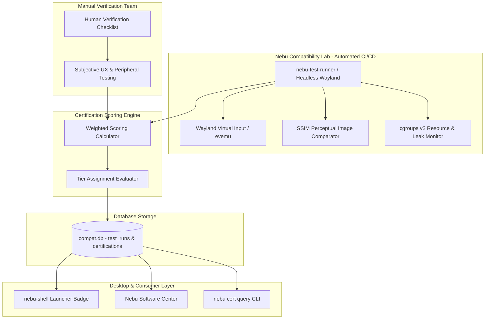
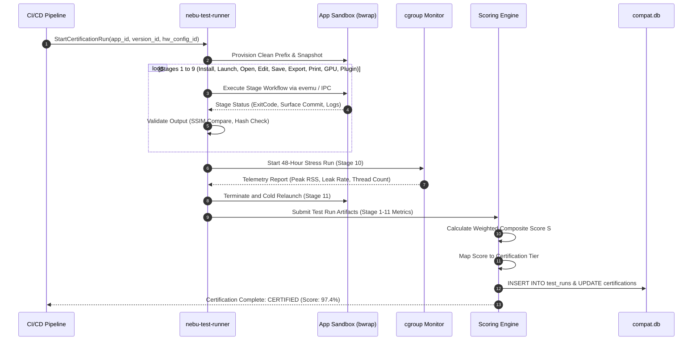
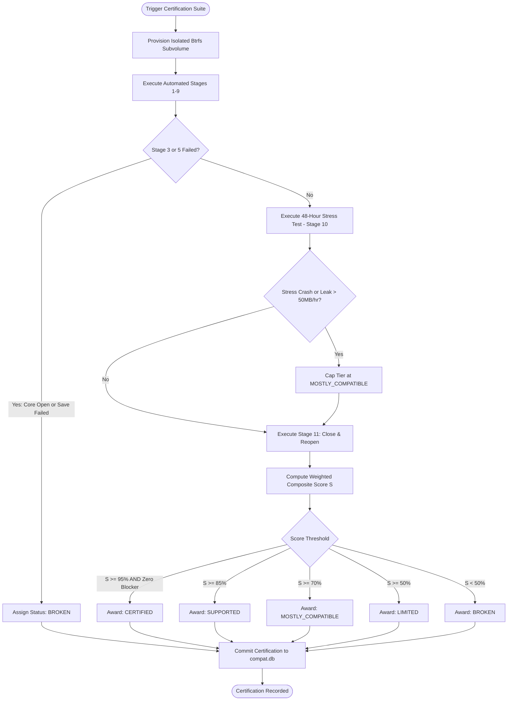

# Compatibility Certification Model Specification — NebuOS

**Status:** DRAFT  
**Purpose:** Define the 7 certification status tiers, empirical test case definitions, weighted scoring formulas, automated Compatibility Lab harness, revalidation lifecycle, and community submission protocols.

---

## 1. Status
DRAFT — Under architectural review. Governs the empirical grading, badging, regression testing, and quality assurance framework for Windows applications running on NebuOS.

## 2. Purpose
To eliminate the ambiguity of subjective compatibility claims, NebuOS employs a rigorous, mathematically modeled certification framework. An application is never granted compatibility status based on simple executable startup. Compatibility is awarded strictly through reproducible, multi-dimensional validation across the 11-stage verification pipeline.

This specification establishes:
1. The formal criteria, constraints, and visual indicators for all 7 certification tiers.
2. The exact empirical test case definitions (TC-INST-01 through TC-STR-02).
3. The weighted mathematical scoring formula ($S$) with real-world calculation examples.
4. The division between automated test harness execution and manual verification.
5. Certification expiration rules and automated CI/CD revalidation pipelines.
6. The cryptographic schema for community certification submissions.

## 3. Scope
- Empirical validation of Windows software on NebuOS workstations.
- Test orchestration within the automated Nebu Compatibility Lab.
- Hardware matrix evaluation across Intel, AMD, and NVIDIA architectures.
- Badging presentation across `nebu-shell`, Software Center, and CLI tools.
- Community submission intake and cryptographic validation.

## 4. Non-goals
- Guaranteeing third-party proprietary cloud services (e.g. OneDrive, Adobe Creative Cloud online storage) beyond standard web browser access.
- Certifying software requiring ring-0 Windows kernel drivers or ring-0 anti-cheat.
- Manual certification of untested obscure shareware without community submission data.

## 5. Requirements

### 5.1 Functional Requirements
- **REQ-CRT-001:** The system must classify tested applications into exactly one of seven tiers: `CERTIFIED`, `SUPPORTED`, `MOSTLY_COMPATIBLE`, `LIMITED`, `UNTESTED`, `BROKEN`, or `UNSUPPORTED`.
- **REQ-CRT-002:** The certification score must be calculated using the weighted multi-factor composite formula ($S$).
- **REQ-CRT-003:** To receive `CERTIFIED` status, an application must achieve $S \ge 95.0\%$, score $100\%$ on Core Editing and File Handling, and pass the 48-hour continuous stress test without memory leaks exceeding $50\text{ MB/hr}$.
- **REQ-CRT-004:** Test execution must record structured per-stage results (pass/fail, latency, peak RSS, error logs) in `compat.db`.
- **REQ-CRT-005:** Certifications must automatically expire or trigger revalidation upon major updates to the base OS kernel, Mesa driver stack, or Wine runtime.

### 5.2 Non-Functional Requirements
- **REQ-CRT-NFR-001 (Automated Test Execution):** The automated portion of the 11-stage test suite must complete in $\le 45\text{ minutes}$ per application (excluding the 48h stress run).
- **REQ-CRT-NFR-002 (Visual Artifact Detection):** Image comparison for UI rendering validation must achieve a Structural Similarity Index Measure (SSIM) $\ge 0.98$ against golden reference frames.
- **REQ-CRT-NFR-003 (Determinism):** Identical test runs executed on identical hardware configurations must produce identical composite scores within $\pm 1.0\%$.

## 6. Architecture

The certification model spans the automated Nebu Compatibility Lab, test runner daemons, database catalogs, and desktop presentation components:



## 7. Components

### 7.1 `nebu-test-runner` (NebuOS Component)
Headless test orchestrator that deploys sandboxed prefixes, executes installer binaries, injects synthetic Wayland user input events, and monitors execution telemetry.

### 7.2 Headless Wayland Test Environment
An isolated execution context running `nebu-compositor --headless` or headless Smithay with virtual DRM render nodes, capturing framebuffers directly via DMA-BUF for perceptual image diffing.

### 7.3 SSIM Comparator
Rust-based image analysis module comparing rendered application viewports against baseline golden frames, detecting font anti-aliasing glitches, tearing, and missing textures.

### 7.4 Scoring and Certification Engine
Evaluates test run logs against the mathematical grading model, assigns certification badges, and records expiration dates.

## 8. Data Flow



## 9. Control Flow



## 10. Interfaces

### 10.1 The 7 Certification Status Tiers

| Tier Identifier | Formal Definition & Pass Criteria | Shell Badge Appearance | System Policy |
| :--- | :--- | :--- | :--- |
| **CERTIFIED** | $S \ge 95.0\%$. Zero critical defects. 100% pass on Core Functionality and File Handling. 48h stress run passes without memory leak. Hardware GPU acceleration verified. | **Green Shield:** "Certified for NebuOS" | Recommended for production. Featured in Software Center. Automatic profile lock. |
| **SUPPORTED** | $S \ge 85.0\%$. Core workflows fully functional. Minor cosmetic flaws permitted (e.g. slight cursor offset in sub-dialogs). | **Blue Check:** "Supported" | Available out of the box with standard vendor profile. |
| **MOSTLY_COMPATIBLE** | $S \ge 70.0\%$. Primary document editing works. Secondary features (cloud collaboration, advanced macro scripting) impaired. | **Yellow Triangle:** "Mostly Compatible" | Displays non-blocking notification of known limitations upon first launch. |
| **LIMITED** | $S \ge 50.0\%$. Requires specific hardware configuration, dedicated dGPU, or legacy Windows NT profile to run. | **Orange Hexagon:** "Limited Compatibility" | Software Center warns of hardware constraints before installation. |
| **UNTESTED** | Application has not completed official QA test suite. Synthetic or generic profile applied. | **Gray Circle:** "Untested" | User prompted with disclaimer on initial launch. |
| **BROKEN** | $S < 50.0\%$. Fails to install, crashes on startup, or corrupts files during save. | **Red Octagon:** "Known Broken" | Software Center blocks launch unless user passes `--force-unsupported`. |
| **UNSUPPORTED** | Application relies on fundamental architectural impossibilities (kernel `.sys` drivers, ring-0 anti-cheat). | **Black Cross:** "Unsupported" | Launch strictly rejected with educational dialogue. |

### 10.2 Empirical Test Case Definitions

The certification matrix executes sixteen discrete test cases across the 11 invariant stages:

| Test Case ID | Stage Ref | Test Name & Target Invariant | Evaluation Method & Acceptance Threshold |
| :--- | :--- | :--- | :--- |
| **TC-INST-01** | Stage 1 | Silent Unattended Installation | Installer completes with return code `0` within $\le 300\text{ s}$; no hung background threads. |
| **TC-INST-02** | Stage 1 | Interactive UI Installation | Installer wizard maps Wayland surface; buttons and license check accept synthetic input. |
| **TC-INST-03** | Stage 1 | Desktop Integration & Shortcuts | Valid `.desktop` entry created; high-resolution icon extracted; MIME associations registered. |
| **TC-LNCH-01** | Stage 2 | Cold Launch Latency & Mapping | Main application window maps within $\le 3.0\text{ s}$; no loader crashes or missing DLL faults. |
| **TC-LNCH-02** | Stage 2 | Windowing & Shell Integration | Window handles resize, maximize, minimize, and restore; cursor clipping complies with Wayland. |
| **TC-LNCH-03** | Stage 2 | Fractional DPI Scaling | Text rendered at 125%, 150%, and 200% scaling factors without blurriness; SSIM $\ge 0.98$. |
| **TC-DOC-01** | Stage 3 | Production Document Open | Loads standard complex document ($>50\text{ MB}$ DOCX, $>100\text{ MB}$ DWG) without parse errors. |
| **TC-DOC-02** | Stage 4 | Interactive Canvas / Text Edit | Edits text, inserts primitives, tests undo/redo stack; no redraw corruption or deadlocks. |
| **TC-DOC-03** | Stage 5 | Atomic File Commit & Lock | Saves modified file; verifies byte structure on disk; verifies file lock release upon save. |
| **TC-EXP-01** | Stage 6 | Vector & PDF Document Export | Exports active document to PDF; verifies embedded vector curves and font fidelity via `pdftoppm`. |
| **TC-PRN-01** | Stage 7 | CUPS Print Spooler Pipeline | Dispatches document to virtual CUPS PDF printer; verifies output margins and font glyphs. |
| **TC-GPU-01** | Stage 8 | Hardware Acceleration & Pacing | DXVK/VKD3D viewport maintains steady $\ge 60\text{ fps}$; zero Vulkan pipeline compilation hangs. |
| **TC-GPU-02** | Stage 8 | VRAM Memory Leakage | Iterates 500 render canvas resets; total allocated VRAM stabilizes within $< 5\%$ drift. |
| **TC-PLUG-01** | Stage 9 | COM Automation & SDK Add-in | Loads standard vendor plugin; instantiates external COM automation server successfully. |
| **TC-STR-01** | Stage 10 | 48-Hour Continuous Stress Run | Automated script executes continuous document edits for 48 hours; RSS growth $\le 50\text{ MB/hr}$. |
| **TC-STR-02** | Stage 11 | Cold Relaunch & State Check | Terminates process; verifies registry flushed; relaunches and reopens document saved in TC-DOC-03. |

### 10.3 Weighted Scoring Formula

The overall compatibility score ($S$) is computed as a weighted sum of the category sub-scores ($C_i$), scaled from $0.0$ to $100.0\%$:

$$S = \sum_{i=1}^{8} w_i \cdot C_i$$

Where weights ($w_i$) are distributed as follows:

| Category Index ($i$) | Evaluation Category | Weight ($w_i$) | Associated Test Cases |
| :---: | :--- | :---: | :--- |
| $1$ | **Installation & Setup** | $0.10$ | TC-INST-01, TC-INST-02, TC-INST-03 |
| $2$ | **Launch & Windowing** | $0.10$ | TC-LNCH-01, TC-LNCH-02, TC-LNCH-03 |
| $3$ | **Core Editing & Tooling** | $0.30$ | TC-DOC-01, TC-DOC-02 |
| $4$ | **File I/O & Document Save** | $0.10$ | TC-DOC-03 |
| $5$ | **Viewport & GPU Acceleration** | $0.15$ | TC-GPU-01, TC-GPU-02 |
| $6$ | **Performance & Latency** | $0.10$ | Cold launch speed, frame pacing, responsiveness |
| $7$ | **Plugins, Macros & Scripting** | $0.10$ | TC-PLUG-01, TC-EXP-01, TC-PRN-01 |
| $8$ | **Stability & Persistence** | $0.05$ | TC-STR-01, TC-STR-02 |

#### Critical Gate Invariants:
- If Category 3 (Core Editing) scores $< 100\%$, the maximum possible tier is **MOSTLY_COMPATIBLE**, regardless of total $S$.
- If Category 4 (File I/O) scores $< 100\%$, the maximum possible tier is **BROKEN**.

### 10.4 Concrete Scoring Calculation Examples

#### Example 1: Microsoft Office 2024 (Word/Excel)
- **Category 1 (Installation):** Silent install and icon extraction flawless: $100.0\% \times 0.10 = 10.00$
- **Category 2 (Launch):** Window maps in 1.4s, fractional scaling sharp: $100.0\% \times 0.10 = 10.00$
- **Category 3 (Core Editing):** Complex DOCX formatting and formulas: $100.0\% \times 0.30 = 30.00$
- **Category 4 (File I/O):** Atomic save verified, zero data loss: $100.0\% \times 0.10 = 10.00$
- **Category 5 (GPU Viewport):** DirectWrite text rendering clean: $95.0\% \times 0.15 = 14.25$
- **Category 6 (Performance):** Responsive typing, low CPU idle: $98.0\% \times 0.10 = 9.80$
- **Category 7 (Plugins/Macros):** VBA macros pass; cloud OneDrive disabled: $90.0\% \times 0.10 = 9.00$
- **Category 8 (Stability):** 48-hour run passes without leaks: $100.0\% \times 0.05 = 5.00$
- **Composite Score:** $S = 98.05\%$
- **Result:** **CERTIFIED** (Green Badge)

#### Example 2: Autodesk AutoCAD 2024
- **Category 1 (Installation):** Custom installer requires VC++ prerequisite: $95.0\% \times 0.10 = 9.50$
- **Category 2 (Launch):** Launch time 2.8s, multi-monitor functional: $95.0\% \times 0.10 = 9.50$
- **Category 3 (Core Editing):** 2D drafting and 3D solid modeling pass: $100.0\% \times 0.30 = 30.00$
- **Category 4 (File I/O):** DWG format read/write 100% verified: $100.0\% \times 0.10 = 10.00$
- **Category 5 (GPU Viewport):** DXVK DirectX 11 hardware viewport at 60fps: $98.0\% \times 0.15 = 14.70$
- **Category 6 (Performance):** Complex mesh panning maintains $\ge 55\text{ fps}$: $92.0\% \times 0.10 = 9.20$
- **Category 7 (Plugins):** .NET add-ins functional; WebGL preview falls back: $85.0\% \times 0.10 = 8.50$
- **Category 8 (Stability):** 48-hour render loop stable: $95.0\% \times 0.05 = 4.75$
- **Composite Score:** $S = 95.15\%$
- **Result:** **CERTIFIED** (Green Badge)

#### Example 3: Edge-Case Legacy Engineering Tool
- **Category 1 (Installation):** Interactive install succeeds: $90.0\% \times 0.10 = 9.00$
- **Category 2 (Launch):** Window maps, but fractional scaling blurry: $80.0\% \times 0.10 = 8.00$
- **Category 3 (Core Editing):** Primary calculations work: $100.0\% \times 0.30 = 30.00$
- **Category 4 (File I/O):** Saves native project format: $100.0\% \times 0.10 = 10.00$
- **Category 5 (GPU Viewport):** Software GDI fallback rendering: $65.0\% \times 0.15 = 9.75$
- **Category 6 (Performance):** Viewport redraw sluggish under high load: $75.0\% \times 0.10 = 7.50$
- **Category 7 (Plugins):** Legacy COM plugin fails to register: $60.0\% \times 0.10 = 6.00$
- **Category 8 (Stability):** 48-hour test completes with 120 MB RSS growth: $80.0\% \times 0.05 = 4.00$
- **Composite Score:** $S = 84.25\%$
- **Result:** **MOSTLY_COMPATIBLE** (Yellow Badge)

### 10.5 Automated vs Manual Test Split

```
+-------------------------------------------------------------------------+
| AUTOMATED LAB SUITE (90% of Test Coverage)                             |
+-------------------------------------------------------------------------+
| - Silent unattended installation and return-code tracking               |
| - Launch timing, process tree spawning, and cgroup accounting           |
| - Window mapping and Wayland surface commit verification               |
| - Synthetic mouse/keyboard event injection (evemu)                      |
| - Programmatic document open, edit, save, export, and close             |
| - Headless DXVK frame buffer capture and SSIM perceptual comparison     |
| - 48-hour headless continuous stress run and memory leak monitoring     |
+-------------------------------------------------------------------------+
| MANUAL VERIFICATION CHECKLIST (10% of Test Coverage)                   |
+-------------------------------------------------------------------------+
| - Proprietary online license activation dialogs (OAuth web flows)       |
| - Physical drawing tablet pressure sensitivity and tilt evaluation      |
| - Multi-monitor mixed-DPI display dragging perceptual smoothness        |
| - Audio glitch and buffer underrun subjective listening tests           |
+-------------------------------------------------------------------------+
```

### 10.6 Certification Expiry and Revalidation Policy
Certifications are time-bounded and environment-bounded:
1. **Validity Window:** 180 days from the date of lab evaluation.
2. **Event-Driven Invalidation:** A certification is flagged for revalidation when:
   - NebuOS issues a major Linux kernel LTS upgrade.
   - Mesa graphics driver bumps a major release (e.g. Mesa 24.1 $\rightarrow$ 24.2).
   - The application receives an upstream patch or version update.
3. **Grace Period:** Applications maintain their current badge for a 30-day grace period while automated CI pipelines re-execute the test suite. If regressions are detected, the badge is automatically downgraded in `compat.db`.

### 10.7 Community Certification Submission Protocol
Community members can submit test reports via the Nebu CLI:
```bash
nebu cert submit --app autodesk.autocad.2024 --log-bundle ~/.nebu/logs/test_run_092.tar.zst
```

The payload is packaged as an Ed25519-signed JSON manifest:
```json
{
  "submission_version": "1.0",
  "submitter": {
    "public_key": "3d4e5f6a7b8c9d0e1f2a3b4c5d6e7f8a9b0c1d2e3f4a5b6c7d8e9f0a1b2c3d4e",
    "signature": "8a9b0c1d2e3f4a5b6c7d8e9f0a1b2c3d4e5f6a7b8c9d0e1f2a3b4c5d6e7f8a9b..."
  },
  "test_execution": {
    "app_id": "autodesk.autocad",
    "version_string": "2024.1.2",
    "hardware": {
      "cpu": "AMD Ryzen 7 7840U",
      "gpu": "AMD Radeon 780M (radv)",
      "mesa_version": "24.1.5",
      "kernel_version": "6.10.3"
    },
    "stages_passed": [1, 2, 3, 4, 5, 6, 7, 8, 9, 11],
    "composite_score": 96.2,
    "log_archive_sha256": "5a6b7c8d9e0f1a2b3c4d5e6f7a8b9c0d1e2f3a4b5c6d7e8f9a0b1c2d3e4f5a6b"
  }
}
```

## 11. Dependencies

| Subsystem | Role |
| :--- | :--- |
| `nebu-test-runner` | Automated test orchestrator and harness |
| `nebu-compositor --headless` | Virtual Wayland frame capture environment |
| `evemu` / `uinput` | Synthetic Linux input event injection |
| `image` / `ssim` Rust Crates | Perceptual visual diffing and frame validation |
| `ed25519-dalek` | Cryptographic signature validation for community submissions |

## 12. Security

- **Isolation during Testing:** All test runs execute within throwaway Bubblewrap containers with network namespaces disconnected unless explicit license activation testing is required.
- **Log Sanitization:** Automated crash logs and backtraces are scrubbed for usernames, IP addresses, and document paths before submission to central catalogs.
- **Submission Guardrails:** Community submissions cannot overwrite certified ratings without automated reproduction in the Nebu Compatibility Lab.

## 13. Resource Requirements

- **Compatibility Lab Nodes:** x86_64 nodes with minimum 16 GB RAM and hardware GPU passthrough.
- **Client Test Runner:** Peak memory usage during test orchestration $\le 35\text{ MB}$ RSS.
- **Storage per Run:** Test logs and SSIM diff buffers require $\sim 15\text{ MB}$ ephemeral disk space.

## 14. Failure Modes

| Failure ID | Description | Impact | Recovery Protocol |
| :--- | :--- | :--- | :--- |
| **FAIL-CRT-001** | Test Timeout during Stage 10 | Stress test hangs or deadlocks | Process killed via cgroup; test marked failed; score penalized |
| **FAIL-CRT-002** | Visual Diff SSIM Mismatch | Corrupt font rendering or broken shader | Snapshot frame saved; human review queued |
| **FAIL-CRT-003** | Corrupt Submission Signature | Invalid Ed25519 signature on community test | Reject submission immediately |
| **FAIL-CRT-004** | Regressed Wine Update | Wine release breaks previously certified app | Automated CI gate halts OS rollout; pins previous Wine version |

## 15. Recovery Behavior

### 15.1 Regression Gate Rollback
If an OS update triggers a certification downgrade for a Tier 1 enterprise application (Office, AutoCAD):
1. The CI regression gate fails the release candidate image.
2. The compatibility profile is automatically updated to pin the last known good runtime version.
3. The application status remains `CERTIFIED` under the pinned runtime.

### 15.2 Test Prefix Cleanup
If a test process hangs or panics:
1. `nebu-test-runner` executes `bwrap-kill` across the target cgroup.
2. The temporary subvolume `~/.nebu/test/<run_id>` is deleted via `btrfs subvolume delete`.

## 16. Testing Requirements

- **Harness Self-Test:** Automated verification that `nebu-test-runner` correctly detects synthetic failures across all 11 stages.
- **SSIM Calibration Test:** Unit tests validating that known visual tear frames score SSIM $< 0.95$, while clean frames score $> 0.99$.
- **Scoring Formula Invariant Tests:** Mathematical test suite asserting that the scoring algorithm strictly respects critical gate invariants.

## 17. Performance Requirements

- **Composite Score Calculation:** $\le 1.0\text{ ms}$ evaluation time.
- **SSIM Comparison Latency:** $\le 25\text{ ms}$ for $1920\times1080$ frame comparison.
- **Log Bundle Packaging:** Compression and SHA-256 digest of 50 MB log bundle $\le 500\text{ ms}$.

## 18. Compatibility Considerations

- **Multi-GPU Matrixing:** Certifications record specific GPU vendor and driver versions to capture vendor-specific Vulkan driver quirks (RADV vs ANV vs Proprietary NVIDIA).
- **Proton Game Ratings:** Gaming titles integrate ProtonDB community ratings alongside native NebuOS laboratory scores.

## 19. Open Questions

- **OPEN-CRT-001:** Should NebuOS offer a bounty program or developer points for verified community certification submissions?
- **OPEN-CRT-002:** Can headless Wayland testing be accelerated through GPU virtual function (SR-IOV) hardware slicing?

## 20. Related Documents
- [00-compatibility-specification.md](00-compatibility-specification.md) — Master Compatibility Platform Specification
- [01-database-schema.md](01-database-schema.md) — Relational Schema for Compatibility Profiles and Certifications
- [02-compatibility-profile.md](02-compatibility-profile.md) — Profile JSON Specification and Inheritance Rules
- [03-patch-engine.md](03-patch-engine.md) — 9-Tier Remediation Engine Specification
- [04-application-detection.md](04-application-detection.md) — Application Detection and PE Fingerprinting
- [06-known-limitations.md](06-known-limitations.md) — Hard Non-Compatibility Boundaries and Error Handling
