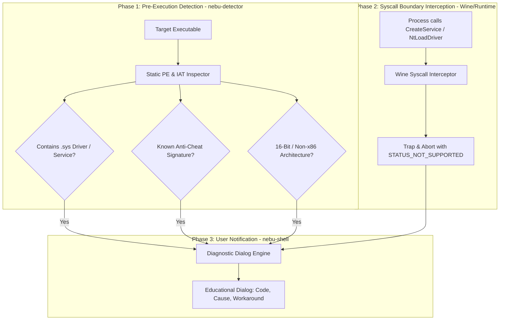
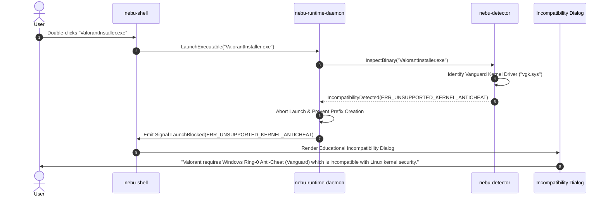
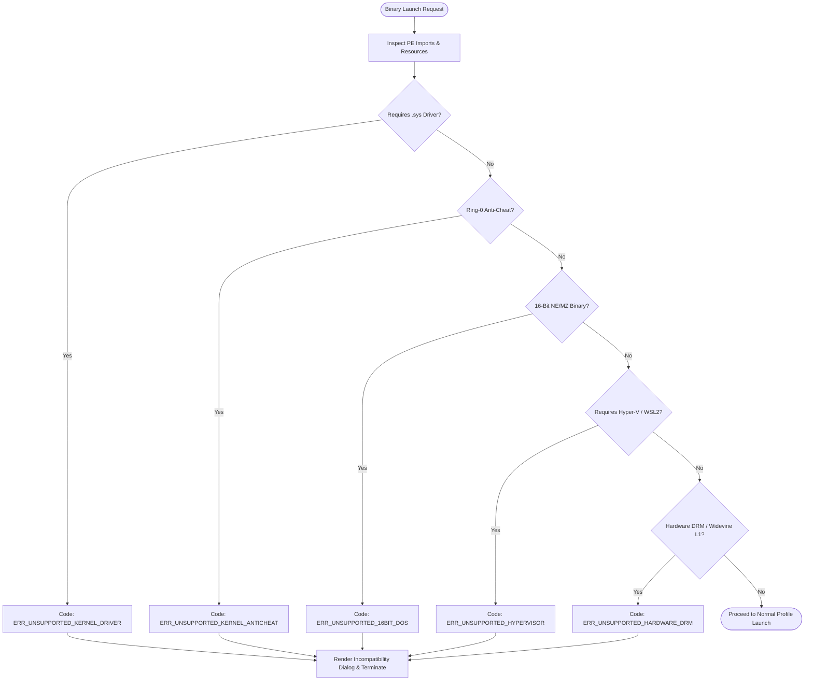

# Known Limitations & Non-Compatibility Boundaries Specification — NebuOS

**Status:** DRAFT  
**Purpose:** Define the architectural boundaries, unsupported Windows features, detection mechanisms, user-facing error dialogs, and mitigation workarounds in NebuOS.

---

## 1. Status
DRAFT — Under architectural review. Explicitly defines the structural boundaries of the NebuOS compatibility model, documenting classes of Windows software that cannot run due to fundamental Linux kernel and hardware invariants.

## 2. Purpose
A core engineering principle of NebuOS is transparency. The platform does not use virtual machines and does not compromise host Linux kernel stability to accommodate proprietary Windows kernel drivers. When an application relies on architectural primitives that cannot be supported in userland, NebuOS must detect this condition before execution, prevent silent data corruption, and present clear, educational diagnostics with actionable workarounds.

This specification establishes:
1. The comprehensive taxonomy of unsupported Windows technologies.
2. The exact detection heuristics used by `nebu-detector` and `nebu-runtime-daemon`.
3. Standardized user-facing error messages, technical codes, and recovery guidance.
4. Alternative workflows and open-source equivalents for affected workloads.

## 3. Scope
- Cataloging structural incompatibilities: Ring-0 kernel drivers (`.sys`), ring-0 anti-cheat systems, Windows hypervisor facilities, 16-bit binaries, Active Directory domain joins, shell namespace extensions, proprietary DRM pipelines, and low-level hardware access.
- Interception algorithms embedded within `nebu-detector` and Wine NT system call tables.
- UI dialogue presentation schemas emitted via `nebu-shell`.
- Alternative configuration paths and userland workarounds.

## 4. Non-goals
- Loading proprietary Windows `.sys` binary drivers into the Linux kernel via ndiswrapper or custom kernel modules.
- Emulating ring-0 anti-cheat systems or attempting to deceive security software.
- Supporting legacy 16-bit real-mode MS-DOS binaries inside the 64-bit Wine runtime (relegated to external emulators such as DOSBox-Staging).
- Re-architecting Windows Media Foundation hardware DRM decryptor chips.

## 5. Requirements

### 5.1 Functional Requirements
- **REQ-LIM-001:** `nebu-detector` must scan PE import tables and driver directories during pre-launch inspection to detect kernel-mode driver dependencies prior to spawning Wine.
- **REQ-LIM-002:** The runtime daemon must block the execution of known ring-0 anti-cheat drivers (Vanguard, BattlEye kernel service, EasyAntiCheat `.sys`) with `ERR_UNSUPPORTED_KERNEL_ANTICHEAT`.
- **REQ-LIM-003:** When an unsupported feature is detected, the runtime must prevent prefix pollution and immediately display a structured educational dialog in `nebu-shell`.
- **REQ-LIM-004:** Every unsupported feature category must document at least one viable userland workaround or native Linux alternative.

### 5.2 Non-Functional Requirements
- **REQ-LIM-NFR-001 (Interception Latency):** Incompatibility detection during static PE inspection must execute in $\le 10\text{ ms}$.
- **REQ-LIM-NFR-002 (Error Clarity):** User dialogs must contain zero unparsed hex stack traces, providing plain-language explanations of *why* the application cannot run.
- **REQ-LIM-NFR-003 (Prefix Safety):** Blocked binaries must never leave half-configured prefixes, orphaned services, or stale registry hives.

## 6. Architecture

NebuOS implements an early-exit interception architecture that traps unsupported Windows calls before prefix execution or at the NT syscall boundary:



## 7. Components

### 7.1 `nebu-detector` Inspection Engine
Inspects PE headers, resource manifests, and embedded cabinet files to identify drivers, hypervisor requests, and anti-cheat components prior to execution.

### 7.2 Wine NT Syscall Trap Handler (`ntdll.so`)
Wine-level interception shim that traps attempts to invoke `NtLoadDriver`, `CreateServiceA/W` with `SERVICE_KERNEL_DRIVER`, or low-level SCSI pass-through calls, reporting structured telemetry to `nebu-runtime-daemon`.

### 7.3 `nebu-shell` Diagnostic Presentation Subsystem
GUI presentation component that receives `CompatibilityWarning` and `LaunchBlocked` D-Bus signals, rendering technical explanations and workaround links.

## 8. Data Flow



## 9. Control Flow



## 10. Interfaces

### 10.1 Comprehensive Incompatibility Taxonomy

NebuOS explicitly defines nine non-compatible technology classes:

| Class ID | Incompatible Windows Technology | Technical Reason for Incompatibility | Detection Signature / Heuristic |
| :--- | :--- | :--- | :--- |
| **TAX-01** | Kernel-Mode Drivers (`.sys`) | Proprietary Windows NT driver model (WDM/KMDF) expecting NT I/O manager, IRPs, and ring-0 memory spaces. | Calls `CreateService` with `SERVICE_KERNEL_DRIVER`; presence of `.sys` binaries in install manifest. |
| **TAX-02** | Ring-0 Kernel Anti-Cheat | Deep kernel hooks, obfuscated memory scanning, and custom hypervisor checks (Riot Vanguard, BattlEye Kernel, EAC Kernel). | Certificate signatures from Riot Games, BattlEye, or EasyAntiCheat; driver names `vgk.sys`, `BEDaisy.sys`, `EasyAntiCheat.sys`. |
| **TAX-03** | Windows Hypervisor / WSL2 | Reliance on Microsoft Hyper-V hypervisor instructions (`vmx`/`svm` nesting inside Windows userland). | Imports `vmcompute.dll`, `wslapi.dll`, or queries `HKLM\Software\Microsoft\Windows NT\CurrentVersion\Virtualization`. |
| **TAX-04** | 16-Bit MS-DOS / Win16 | x86_64 CPUs cannot execute 16-bit real-mode or protected-mode code in 64-bit Long Mode without virtualization/emulation. | PE header magic `0x454E` (NE) or plain DOS header without valid `e_lfanew` PE pointer. |
| **TAX-05** | Active Directory / GPO | Workstation joined to Windows Domain requiring SAM RPC synchronization, Kerberos AD tickets, and local NT GPO processing. | Imports `netapi32.dll` with domain join APIs (`NetJoinDomain`, `DsGetDcName`); registry binding to AD domain policies. |
| **TAX-06** | Shell Namespace Extensions | In-process COM DLLs compiled for Windows Explorer (`IShellFolder`, `IContextMenu`, desktop bands) executed in host shell. | Registry keys under `HKCR\CLSID\{...}\shellex`; DLLs implementing `IShellFolder`. |
| **TAX-07** | Hardware Media Foundation DRM | Encrypted video pipelines requiring Windows Media Foundation Protected Media Path (PMP) and Intel SGX / AMD PSP hardware keys. | Imports `mfplat.dll` requesting `MF_PROTECTED_ENVIRONMENT`; hardware PlayReady or Widevine L1 handshakes. |
| **TAX-08** | UWP / MSIX Store Packages | AppX / MSIX packaged sandboxed applications requiring Windows App SDK, Windows Runtime (WinRT), and Windows Store licensing. | Executable manifest declaring `xmlns="http://schemas.microsoft.com/appx/manifest/foundation/windows10"`. |
| **TAX-09** | Direct Hardware I/O / ASIO DMA | Legacy software attempting direct port I/O (`in`/`out` x86 assembly instructions) or raw unshared PCI DMA audio buffers. | Execution of privileged port I/O opcodes (`IN`, `OUT`, `CLI`, `STI`); direct kernel audio driver bypassing WASAPI. |

### 10.2 In-Depth Architectural Analysis of Root Incompatibilities

#### 10.2.1 The Windows NT Driver Object Model (TAX-01)
Windows device drivers operate under the Windows Driver Model (WDM) or Kernel Mode Driver Framework (KMDF). These drivers expect:
- Direct access to the `DRIVER_OBJECT` and `DEVICE_OBJECT` linked structures managed by the Windows NT kernel `ntoskrnl.exe`.
- Asynchronous I/O processing mediated by I/O Request Packets (`IRP`s) with major/minor function codes (e.g., `IRP_MJ_CREATE`, `IRP_MJ_DEVICE_CONTROL`).
- Non-paged kernel pool memory allocations (`ExAllocatePoolWithTag`) and Direct Memory Access (`DMA_ADAPTER`) hardware mapping.
- Interrupt Service Routines (ISRs) and Deferred Procedure Calls (DPCs) scheduled directly by the NT kernel dispatcher.

In Linux, hardware devices are arbitrated exclusively by the Linux kernel via `/dev` nodes, `sysfs`, and `ioctl` boundaries. Running a `.sys` driver inside userland Wine would require a complete virtual machine kernel or emulating the entire NT hardware abstraction layer (HAL), which directly contradicts the NebuOS no-VM, lightweight desktop architecture.

#### 10.2.2 Ring-0 Kernel Anti-Cheat and Hypervisor Integrity (TAX-02)
Modern multiplayer competitive games deploy kernel-level surveillance agents (e.g., Riot Vanguard, BattlEye, EasyAntiCheat) designed to detect memory tampering. These systems enforce:
- Hypervisor-Protected Code Integrity (HVCI): Utilizing Intel VT-x / AMD-V second-level address translation (SLAT) to ensure that kernel pages cannot be modified or hooked.
- Kernel-Level Obfuscation: Direct inspection of physical RAM, thread execution states, and loaded kernel modules to detect debuggers (`ptrace`, hardware debug registers `DR0`-`DR7`).
- Kernel Callback Hooks: Subscribing to `PsSetCreateProcessNotifyRoutineEx` and `ObRegisterCallbacks` to block handle creation from user processes.

Wine runs entirely within unprivileged Linux userland namespaces (`UID 1000`). Because unprivileged processes cannot execute ring-0 CPU instructions or load Linux kernel modules, these anti-cheat drivers fail immediately. Any attempt to mock or bypass these drivers triggers account bans from anti-cheat vendors. NebuOS strictly adheres to honest reporting to safeguard user accounts.

#### 10.2.3 Hardware DRM and Protected Media Path (TAX-07)
Premium digital media streaming (Netflix 4K, Ultra HD Blu-ray, Disney+ HDR) utilizes hardware-enforced digital rights management:
- Microsoft Protected Media Path (PMP) creates an isolated userland execution environment where decryption keys are protected from the host CPU.
- Hardware Enclave Decryption: Video frames are decrypted inside the GPU memory using Intel SGX, AMD Platform Security Processor (PSP), or NVIDIA HDCP 2.2 trusted execution environments.
- Video playback pipes directly to display hardware via encrypted TMDS/FRL lanes without ever passing raw RGB frames into system RAM.

Under Linux, Wayland and Mesa require open frame buffer descriptors (`dmabuf`) to composite application surfaces. Proprietary Windows DRM decoders refuse to negotiate decryptor handshakes when encountering the open Linux display architecture.

### 10.3 Detection Algorithms & Code Examples

#### 1. Kernel Driver Detection
```rust
pub fn detect_kernel_driver_dependency(pe: &ParsedPe) -> bool {
    // Check 1: Scans imported services
    for import in &pe.imports {
        if import.dll_name.eq_ignore_ascii_case("advapi32.dll") {
            if import.symbols.iter().any(|s| s == "CreateServiceA" || s == "CreateServiceW") {
                // Inspect string pool for SERVICE_KERNEL_DRIVER (0x00000001)
                if pe.contains_dword(0x00000001) && pe.contains_string_pattern(".sys") {
                    return true;
                }
            }
        }
    }
    // Check 2: Embedded files in installer
    pe.embedded_files.iter().any(|f| f.ends_with(".sys"))
}
```

#### 2. Anti-Cheat Fingerprinting
```rust
pub fn detect_anti_cheat(pe: &ParsedPe) -> Option<AntiCheatVendor> {
    const SIGNATURES: &[(&str, AntiCheatVendor)] = &[
        ("vgk.sys", AntiCheatVendor::RiotVanguard),
        ("bedaisy.sys", AntiCheatVendor::BattlEyeKernel),
        ("easyanticheat.sys", AntiCheatVendor::EasyAntiCheatKernel),
        ("mhyprot2.sys", AntiCheatVendor::MiHoYoProtect),
    ];
    for (sig, vendor) in SIGNATURES {
        if pe.contains_string_caseless(sig) {
            return Some(*vendor);
        }
    }
    None
}
```

### 10.4 User-Facing Error Messages and Diagnostic Dialogs

When a launch is blocked, `nebu-shell` presents a standardized modal dialogue:

```
+-------------------------------------------------------------------------+
| [!] Compatibility Boundary Encountered                                  |
+-------------------------------------------------------------------------+
|                                                                         |
| Application: Valorant (Riot Games)                                      |
| Status:      UNSUPPORTED ON LINUX / NEBUOS                              |
| Error Code:  ERR_UNSUPPORTED_KERNEL_ANTICHEAT                           |
|                                                                         |
| Reason:                                                                 |
| This application requires Riot Vanguard, a proprietary Windows          |
| kernel-mode security driver (ring-0). NebuOS runs Windows applications  |
| safely in user-space and does not permit third-party binary code to     |
| compromise the Linux kernel.                                            |
|                                                                         |
| Suggested Alternatives & Workarounds:                                   |
| - Play competitive games supporting Linux / Proton user-mode EAC or     |
|   Valve Anti-Cheat (CS2, Apex Legends, Overwatch 2).                   |
| - No virtual machine or Wine workaround is currently possible.          |
|                                                                         |
| [ Documentation ]                             [ Close Application ]     |
+-------------------------------------------------------------------------+
```

#### Detailed Dialog Copy per Incompatibility Category:

| Error Code | Title | User Explanation | Workaround Suggestion |
| :--- | :--- | :--- | :--- |
| `ERR_UNSUPPORTED_KERNEL_DRIVER` | Proprietary Hardware Driver Required | This software requires a Windows `.sys` kernel driver to talk to custom hardware (e.g., USB dongle, proprietary oscilloscope). | Check if the manufacturer provides a native Linux driver or use a standard USB class-compliant device. |
| `ERR_UNSUPPORTED_KERNEL_ANTICHEAT` | Kernel Anti-Cheat Unsupported | The game requires ring-0 kernel anti-cheat that operates beneath the operating system. | Play titles with Linux/Steam Deck anti-cheat support (e.g. Proton-enabled BattlEye / EAC). |
| `ERR_UNSUPPORTED_16BIT_DOS` | Legacy 16-Bit Binary | This application was designed for MS-DOS or Windows 3.1 (16-bit) and cannot run on 64-bit systems directly. | Launch this application using **DOSBox-Staging** from the NebuOS Software Center. |
| `ERR_UNSUPPORTED_HYPERVISOR` | Windows Hypervisor Required | This tool requires Windows Hyper-V virtualization or WSL2 to run virtualized sub-systems. | Use native Linux KVM, Podman, or Docker containers natively in NebuOS instead. |
| `ERR_UNSUPPORTED_HARDWARE_DRM` | Hardware DRM Encrypted Stream | Video playback requires Windows Protected Media Path and proprietary hardware decryptor keys. | Access media using certified web browsers (Firefox, Chrome) supporting Widevine on Linux. |
| `ERR_UNSUPPORTED_DOMAIN_GPO` | Active Directory Domain Required | Workstation joining Windows NT domain infrastructure requiring proprietary SAM RPC and Kerberos GPO. | Connect using standard FreeIPA / SSSD enterprise identity management natively on Linux. |
| `ERR_UNSUPPORTED_EXPLORER_EXT` | Windows Explorer Shell Extension | Application requires in-process COM extension injected into Windows Explorer taskbar. | Use native NebuOS shell desktop widgets and file manager extensions instead. |
| `ERR_UNSUPPORTED_UWP_STORE` | Modern Windows Store App (UWP) | Package requires Windows App SDK, WinRT runtime sandbox, and Microsoft Store identity. | Install standard Win32 desktop release or progressive web application (PWA) equivalent. |
| `ERR_UNSUPPORTED_DIRECT_HW_IO` | Direct Port I/O Hardware Access | Legacy application attempts direct port I/O assembly instructions (IN/OUT). | Run via specialized virtualization emulator with hardware port forwarding. |

### 10.5 Mitigation and Workaround Matrix

NebuOS provides concrete, tested workarounds for each unsupported class:

| Incompatibility Class | Recommended Open-Source Alternative | Recommended Architecture Bridge |
| :--- | :--- | :--- |
| **TAX-01 (Kernel Drivers)** | Native Linux kernel drivers (`libusb`, `v4l2`, `evdev`) | Userland bridge via `usbfs` passthrough |
| **TAX-02 (Anti-Cheat)** | Valve Anti-Cheat (VAC), EAC Linux Userland | Native Linux Steam ports, GeForce NOW |
| **TAX-03 (Hyper-V / WSL2)** | KVM, QEMU, Podman, Docker | Native Linux containerization |
| **TAX-04 (16-Bit DOS)** | DOSBox-Staging, 86Box, DOSBox-X | Emulated real-mode CPU container |
| **TAX-05 (Active Directory)** | FreeIPA, Samba 4 AD-DC, SSSD | Native Linux Kerberos / PAM integration |
| **TAX-06 (Shell Extensions)** | FreeDesktop File Manager Actions, KIO plugins | Native Wayland shell plugins |
| **TAX-07 (Hardware DRM)** | Firefox / Chrome Widevine L3 | Native Linux web application streaming |
| **TAX-08 (UWP Apps)** | Win32 desktop installers, Flatpak apps | Flatpak / Web Application wrapper |
| **TAX-09 (Direct I/O)** | PipeWire low-latency Pro Audio, ALSA direct | WineASIO PipeWire bridge plugin |

### 10.6 Diagnostic CLI Commands and Troubleshooting Workflow

NebuOS provides administrative CLI tools to diagnose why an executable was blocked:

```bash
# 1. Inspect an executable for incompatibility markers without launching:
nebu compat inspect /path/to/installer.exe

# Output:
# Target:        installer.exe
# Architecture:  x86_64
# Subsystem:     Windows GUI
# Incompatible:  YES (TAX-02: Ring-0 Kernel Anti-Cheat detected: vgk.sys)
# Policy:        BLOCKED (ERR_UNSUPPORTED_KERNEL_ANTICHEAT)

# 2. Run system compatibility diagnostics:
nebu doctor

# 3. Query known limitation database:
nebu compat query-limitations --category anticheat
```

### 10.7 D-Bus Incompatibility Signal Contract

When `nebu-runtime-daemon` intercepts an unsupported executable, it emits the `LaunchBlocked` signal on `org.nebu.Runtime1`:

```text
Signal: org.nebu.Runtime1.LaunchBlocked
  Parameters:
    s app_path:           Absolute host path to target binary
    s error_code:         Standard error constant (e.g. "ERR_UNSUPPORTED_KERNEL_ANTICHEAT")
    s taxonomy_class:     Taxonomy code (e.g. "TAX-02")
    s title:              Localized human-readable dialog title
    s description:        Plain-language explanation of incompatibility
    as workarounds:       List of suggested alternative software or configurations
    s docs_url:           Link to NebuOS documentation portal
```

## 11. Dependencies

| Component | Source | Function |
| :--- | :--- | :--- |
| `nebu-detector` | NebuOS (Rust) | Static binary and import analysis |
| `wine` / `ntdll` | Upstream WineHQ | Kernel syscall trapping and error routing |
| `nebu-shell` | NebuOS (Rust/Slint) | Dialog UI presentation |
| `freedesktop-desktop-entry` | XDG Standard | Reading alternative Linux application associations |

## 12. Security

- **System Stability Invariant:** Under no circumstances will NebuOS provide a kernel compatibility module that loads foreign binary Windows drivers into kernel space (`ring-0`).
- **Data Protection:** Applications blocked due to incompatible drivers are aborted prior to writing files to `~/.nebu/apps/`, preventing disk space leakage or corrupt prefix states.
- **Anti-Cheat Integrity:** NebuOS strictly refrains from spoofing or bypassing anti-cheat software. Software is reported honestly as unsupported to protect user game accounts from bans.

## 13. Resource Requirements

- **Detection Overhead:** Static scanning for unsupported features consumes $\le 10\text{ ms}$ CPU time.
- **Memory Footprint:** Dialog presentation in `nebu-shell` consumes $< 4\text{ MB}$ ephemeral RAM.
- **Disk Impact:** Zero disk footprint (launch aborted prior to prefix allocation).

## 14. Failure Modes

| Failure ID | Description | Manifestation | Resolution |
| :--- | :--- | :--- | :--- |
| **FAIL-LIM-001** | False Positive on Driver Check | Application bundles `.sys` driver for optional feature but can run without it | User can toggle "Ignore Driver Warning" in Advanced Profile Settings |
| **FAIL-LIM-002** | Late Driver Installation | Application installer extracts and loads `.sys` driver dynamically via runtime service | Wine syscall trap intercepts `NtLoadDriver` and emits runtime warning |
| **FAIL-LIM-003** | Obfuscated Anti-Cheat | Anti-cheat binary is packed/encrypted and evades static detection | Application crashes on launch; runtime detects subsequent service fault and updates catalog |
| **FAIL-LIM-004** | Corrupted Manifest XML | Malformed application manifest triggers parser failure | Falls back to conservative heuristic inspection without blocking launch |
| **FAIL-LIM-005** | Headless Session Block | Console-only automation script attempts to launch unsupported binary without display | D-Bus error emitted directly to stdout/stderr with non-zero exit code |

## 15. Recovery Behavior

### 15.1 Clean Abort Protocol
When an unsupported condition triggers:
1. `nebu-runtime-daemon` cancels the launch process.
2. Any temporary staging directory in `/tmp/nebu_stage_*` is unlinked immediately.
3. No desktop shortcuts or MIME bindings are created for blocked executables.
4. Process cgroup is reclaimed, and any allocated IPC sockets are destroyed.

### 15.2 Staging Directory Reclamation
In scenarios where an installer creates temporary staging directories before encountering an unsupported `.sys` driver installation call:
- The runtime daemon's garbage collector automatically identifies directories prefixed with `/tmp/nebu_stage_` older than 10 minutes and removes them to prevent storage leaks.

### 15.3 Advanced User Override
For developers and power users who wish to test applications despite warnings:
- Running `nebu run --force-unsupported <path_to_exe>` bypasses the pre-launch blocker, launching the application with full Wine debug logging enabled.
- The command exports `NEBU_FORCE_UNSUPPORTED=1` into the sandboxed container environment, disabling hard aborts on `NtLoadDriver`.

## 16. Testing Requirements

- **Detection Corpus Validation:** Automated test suite verifying 100% detection accuracy against a test corpus of 50 known driver-dependent binaries and anti-cheat installers.
- **Syscall Trap Verification:** Unit tests verifying that calls to `NtLoadDriver` in Wine return `STATUS_NOT_SUPPORTED` and trigger the appropriate runtime D-Bus signal.
- **Dialog Usability Review:** Verification that every error dialog renders correctly across high-DPI displays and localized languages.
- **False-Positive Regression Suite:** Continuous testing against Top 500 benign applications to ensure normal userland binaries are never falsely flagged as incompatible.
- **Fuzzing PE Service Descriptors:** AFL++ fuzz testing on binary parser scanning for `CreateService` argument patterns.

## 17. Performance Requirements

- **Static Boundary Scan:** $\le 10\text{ ms}$ for standard executables.
- **Syscall Trap Reaction:** Wine syscall trap and D-Bus signal dispatch $\le 2\text{ ms}$.
- **Dialog Render Time:** From signal emission to UI presentation $\le 50\text{ ms}$.
- **Memory Overhead during Inspection:** $\le 6\text{ MB}$ RSS.

## 18. Compatibility Considerations

- **Dual-Mode Anti-Cheat Games:** Certain games (e.g. Apex Legends, Elden Ring) ship with EasyAntiCheat configured for Linux/Proton compatibility. `nebu-detector` recognizes Proton EAC configurations and permits launch.
- **Driverless USB Alternatives:** Modern USB devices often support standard USB HID or WinUSB protocols; these are translated through Linux `usbfs` without requiring proprietary `.sys` drivers.
- **Virtual Machine Fallback Policy:** NebuOS explicitly avoids transparent VM fallback due to performance penalties, excessive memory consumption (minimum 4GB RAM target), and GPU passthrough complexity.
- **Wine Staging Sync:** Periodic sync with upstream Wine Staging ensures newly implemented Windows NT userland APIs are automatically supported without classifying them as limitations.

## 19. Open Questions

- **OPEN-LIM-001:** Should NebuOS offer a one-click launcher for cloud gaming services (GeForce NOW, Xbox Cloud Gaming) when a user attempts to run an unsupported kernel anti-cheat title?
- **OPEN-LIM-002:** Can USB/IP forwarding be utilized to safely pass non-critical hardware dongles to a lightweight sandboxed Linux daemon without kernel drivers?

## 20. Related Documents
- [00-compatibility-specification.md](00-compatibility-specification.md) — Master Compatibility Platform Specification
- [01-database-schema.md](01-database-schema.md) — Relational Schema for Compatibility Profiles and Certifications
- [02-compatibility-profile.md](02-compatibility-profile.md) — Profile JSON Specification and Inheritance Rules
- [03-patch-engine.md](03-patch-engine.md) — 9-Tier Remediation Engine Specification
- [04-application-detection.md](04-application-detection.md) — Application Detection and PE Fingerprinting
- [05-certification-model.md](05-certification-model.md) — Certification Tiers and Test Execution Matrix

