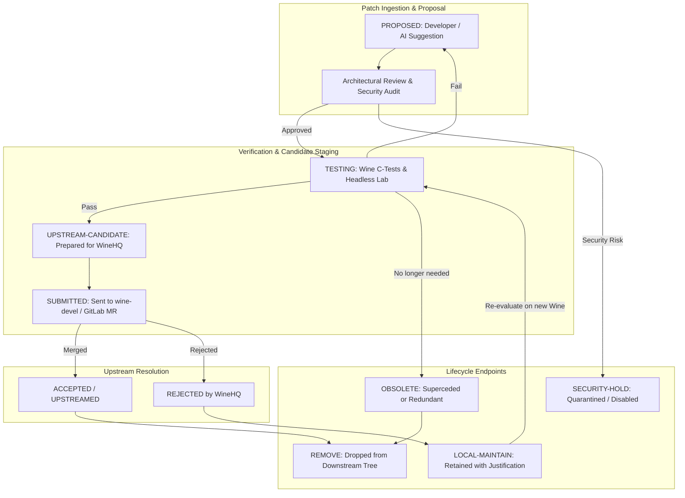

# Wine Source Patch Governance Specification — NebuOS

## Status
APPROVED

## Purpose
This specification defines the authoritative engineering, lifecycle, and security governance for all downstream source code modifications applied to the Wine codebase (`wine.git`) within NebuOS. It enforces the core architectural mandate:

$$\text{Upstream First} \longrightarrow \text{Local When Necessary} \longrightarrow \text{Upstream Again When Possible}$$

$$\text{NebuWine} = \text{Upstream Wine} + \text{Minimal Maintained Delta}$$

## Scope
This specification governs:
- **Domain A (Wine Source Code Patching):** Modifications to C, assembly, and build definitions in the `wine.git` repository.
- The 6 formal patch categories and mandatory patch metadata schema.
- The 10-state patch lifecycle progression model.
- Upstream equivalence detection algorithms and confidence tiering.
- Handling procedures for upstream-rejected patches.
- Git branch management, downstream commit tagging, and delta size caps.
- Strict AI governance rules restricting automated agents from autonomous release or security modifications.

## Non-goals
- **Domain B (Prefix Remediation):** Prefix-level configurations, registry injection, DLL overrides, environment variables, and binary hooks are managed strictly by `nebu-patcher` per `docs/compatibility/03-patch-engine.md`.
- **Third-Party Graphics Projects:** Source patches for DXVK, VKD3D-Proton, or Mesa are governed by their respective upstream project workflows and are not tracked in this specification.

## Requirements

### Functional Requirements
- **REQ-WPG-001 (Zero Undocumented Patches):** Every downstream patch applied to `wine.git` must possess a complete, valid YAML metadata header conforming to Section 7 of this specification.
- **REQ-WPG-002 (Categorization):** Every patch must be assigned exactly one of the six approved patch categories.
- **REQ-WPG-003 (Upstream Tracking):** Every patch categorized as `UPSTREAM-CANDIDATE` or `APPLICATION-COMPATIBILITY` must be actively tracked against an open WineHQ bug or merge request.
- **REQ-WPG-004 (Automated Equivalence Detection):** The CI pipeline must compare active downstream patches against incoming WineHQ commits using multi-stage equivalence detection (exact commit, `git patch-id`, semantic diff, behavioral match).
- **REQ-WPG-005 (Safe Deletion Gate):** No patch may be deleted based on semantic similarity alone; deletion requires functional verification and test confirmation.
- **REQ-WPG-006 (AI Boundary Enforcement):** AI tools may propose patches and analyze code but are cryptographically prohibited from autonomously approving, committing, or merging changes to production release channels.

### Non-Functional Requirements
- **NFR-WPG-001 (Recommended Maintenance Threshold):** Downstream patch governance establishes a **Recommended Maintenance Threshold of $\le 60\text{ active patches}$** (governance indicator). This threshold exists as an engineering discipline heuristic to prevent unmanageable rebase debt and maintenance bankruptcy. Exceeding 60 active downstream source patches triggers a mandatory architectural review by the Lead Compatibility Architect and initiates an upstreaming acceleration sprint. Exceptions are permitted for validated application compatibility requirements upon documented review. This metric counts strictly active downstream source patches maintained against `wine.git`, excluding already-upstreamed commits, obsolete patches, or prefix-level declarative configuration rules (Domain B).
- **NFR-WPG-002 (Security Invariant):** Any patch failing security evaluation or creating an unconfined code execution path must be blocked immediately:
$$\text{Compatibility PASS} + \text{Security FAIL} = \mathbf{REJECT}$$

## System Overview



## Architecture

Patch governance operates at the Git layer through rebase scripts, metadata linters, and CI verification hooks.

```
wine.git (NebuWine Downstream Tree)
├── patches/
│   ├── 0001-ntdll-implement-mitigation-policy-stub.patch
│   ├── 0002-winewayland-handle-xdg-output-v3-events.patch
│   └── 0003-server-optimize-ntsync-futex-fastpath.patch
├── patch-registry.yaml     # Machine-readable database of all patches
└── scripts/
    ├── lint-patch-metadata.py
    ├── detect-upstream-equivalence.py
    └── generate-sync-report.py
```

## Component Specifications

### 1. The Six Patch Categories

1. **`UPSTREAM-CANDIDATE`:** General-purpose bug fixes or clean Win32 API additions intended directly for upstream WineHQ submission. Must adhere 100% to WineHQ coding guidelines.
2. **`APPLICATION-COMPATIBILITY`:** Targeted fixes for high-priority productivity or CAD software (e.g. AutoCAD, Revit, SolidWorks) addressing obscure Win32 behaviors where upstream consensus is slow.
3. **`NEBUOS`:** Platform integration patches tailoring Wine to NebuOS architecture (e.g., custom IPC bindings to `nebu-runtime-daemon`, Smithay Wayland extensions, and `@runtimes` layout).
4. **`PERFORMANCE`:** Low-latency optimizations, fast-path wineserver IPC, or NTSYNC kernel synchronization bindings.
5. **`SECURITY-SENSITIVE`:** Patches touching process isolation, file descriptors, memory sandboxing, or token impersonation. Requires dual architectural sign-off.
6. **`EXPERIMENTAL`:** Temporary research prototypes under active exploration in developer branches. Forbidden in `Stable` and `Candidate` builds.

### 2. The 10-State Patch Lifecycle

```
[ PROPOSED ] --------> [ TESTING ] --------> [ UPSTREAM-CANDIDATE ]
     |                      |                          |
     v                      v                          v
[ SECURITY-HOLD ]      [ OBSOLETE ]               [ SUBMITTED ]
                            |                          |
                            v                          +---> [ ACCEPTED ] ---> [ UPSTREAMED ] ---> [ REMOVE ]
                        [ REMOVE ]                     |
                                                       +---> [ REJECTED ] ---> [ LOCAL ] ---> [ RE-EVALUATE ]
```

| Lifecycle State | Description | Gate to Next State |
|---|---|---|
| **PROPOSED** | Patch authored, metadata verified, under peer review | Passes initial architectural review |
| **TESTING** | Built into test runtime; undergoing Wine and app tests | Passes all C-tests and L0-L3 application tests |
| **UPSTREAM-CANDIDATE** | Validated locally; code cleaned and formatted for WineHQ | Submitted to WineHQ GitLab or `wine-devel` |
| **SUBMITTED** | Under active upstream review by WineHQ maintainers | Feedback received from upstream maintainers |
| **ACCEPTED** | Merged into WineHQ git master | Released in an official WineHQ tag |
| **UPSTREAMED** | Integrated in target Wine baseline | Verified functional equivalence |
| **REMOVE** | Cleanly dropped from downstream patch queue | Regression testing confirms zero degradation |
| **REJECTED** | Upstream WineHQ rejected submission | Formal Rejection Record documented |
| **LOCAL** | Justified local maintenance retained in downstream tree | Documented ongoing necessity and review schedule |
| **SECURITY-HOLD** | Quarantined due to potential security regression | Remediated or permanently dropped |

## Data Flow

### Upstream Equivalence and Ingestion Flow

```
[ New WineHQ Tag Ingested ]
            |
            v
[ Extract Upstream Commits ]
            |
            v
[ Tier 1: Exact Git Commit Check (Cherry-pick hash) ]
   +--> Matched? ---> Flag as UPSTREAMED (Confidence: 100%)
            |
            v
[ Tier 2: Git Patch-ID Comparison (`git patch-id`) ]
   +--> Matched? ---> Flag as UPSTREAMED (Confidence: 95%)
            |
            v
[ Tier 3: Equivalent Diff & AST Analysis ]
   +--> Matched? ---> Flag as CANDIDATE-EQUIVALENT (Confidence: 85%)
            |          Requires: Automated C-Test Execution
            v
[ Tier 4: Semantic Equivalence Analysis ]
   +--> Matched? ---> Flag as CANDIDATE-EQUIVALENT (Confidence: 70%)
            |          Requires: C-Tests + L0-L3 App Tests
            v
[ Tier 5: Behavioral Test Verification ]
   +--> Test PASS? -> Flag as UPSTREAMED; Schedule REMOVE
   +--> Test FAIL? -> Retain Patch; Open Upstream Triage Issue
            |
            v
[ Tier 6: UNKNOWN (Ambiguous / Unverified) ]
   +--> Action: RETAIN downstream patch; deletion strictly prohibited
```

### Upstream Conflict, Equivalence and Obsolescence Protocol

1. **Git Conflict $\neq$ Patch Obsolescence:**
   - A merge or rebase conflict during upstream sync frequently stems from adjacent code restructuring, copyright header bumps, or variable renames in upstream WineHQ rather than upstream adoption or obsolescence.
   - A rebase conflict **never** justifies dropping a downstream patch. The patch owner must rebase the patch against the new upstream context, recompile, and execute automated regression tests.

2. **Clean Git Apply $\neq$ Still Required:**
   - A patch may apply cleanly (`git am --3way` succeeds with zero offset) even when upstream WineHQ has resolved the underlying issue through a completely different subsystem redesign (e.g., migrating a driver from userland to NT-side syscalls).
   - Surviving patches must be evaluated against functional behavior; clean application is a necessary condition for building, not proof of ongoing necessity.

3. **Similar Upstream Diff $\neq$ Behavioral Equivalence:**
   - An upstream commit modifying identical files or functions might implement different semantics, omit edge-case error codes expected by specific enterprise software (e.g. AutoCAD, Revit), or address a different bug altogether.
   - Equivalence requires verification against the patch's dedicated `Regression-Test` suite.

4. **Partial Upstreaming (`SPLIT / REWORK` Protocol):**
   - When upstream WineHQ accepts a subset of commits from a downstream patch series, or refactors one component of a patch:
     - The downstream patch series must be immediately split.
     - Accepted portions are transitioned to `UPSTREAMED` and scheduled for `REMOVE`.
     - Remaining unmerged hunks are refactored into a minimized residual patch (`SPLIT`), preserving only the remaining delta, and submitted for re-review.

### False-Upstreaming Protection & Confidence Tiers

To prevent premature deletion of vital compatibility patches based on false assumptions of upstream fixes:

| Confidence Tier | Matching Mechanism | Automated CI Action | Human Sign-off Required? |
|---|---|---|---|
| **Tier 1: `EXACT COMMIT` (100%)** | Matching Git commit hash (cherry-pick from upstream or mirror) | Auto-tag `UPSTREAMED`; drop on verified build | No (Automated CI verification) |
| **Tier 2: `PATCH-ID MATCH` (95%)** | `git patch-id` matches upstream commit modulo whitespace/line offsets | Auto-tag `UPSTREAMED`; drop on verified build | No (Automated CI verification) |
| **Tier 3: `EQUIVALENT DIFF` (85%)** | Diff touches identical symbols, logic, and branches with minor syntax drift | Tag `CANDIDATE-EQUIVALENT`; run Wine C-tests | Yes (Lead Compatibility Engineer) |
| **Tier 4: `SEMANTIC EQUIVALENCE` (70%)** | Different implementation construct achieving equivalent Win32 behavior | Tag `CANDIDATE-EQUIVALENT`; run C-tests + L0-L3 suite | Yes (Dual sign-off: Compat + QA) |
| **Tier 5: `BEHAVIORAL EQUIVALENCE`** | Upstream resolved issue via alternative architectural approach | Tag `TESTING-ALTERNATIVE`; run full Compatibility Lab L0-L7 | Yes (Dual sign-off: Compat + QA) |
| **Tier 6: `UNKNOWN` (0%)** | Ambiguous upstream change; conflicting test results | **MANDATORY RETENTION:** Retain downstream patch; do not drop | N/A (Deletion strictly prohibited) |

### Domain B (Prefix Remediation) Anti-Bypass Guardrails

While this specification primarily governs Domain A (Wine source code), downstream patches frequently interact with Domain B (Prefix Remediation via `nebu-patcher` per `docs/compatibility/03-patch-engine.md`). Prefix remediations must strictly enforce:

1. **No Licensing or DRM Bypass:**
   - Prefix workarounds, DLL overrides, and registry modifications must never bypass, crack, or disable software licensing checks, product activation, serial verification, hardware dongles, or DRM systems.
2. **No Anti-Cheat Tampering:**
   - Workarounds must never hook, disable, or tamper with anti-cheat client binaries or integrity checks.
3. **No Unsandboxed Host Modification:**
   - Prefix scripts run strictly within the unprivileged Bubblewrap user namespace; they cannot write outside `~/.local/share/nebu/prefixes/<app>/` or modify host binaries.
4. **Full Provenance and Reversibility:**
   - Every Domain B configuration rule must declare an immutable cryptographic hash of target binaries, author provenance, and an automated rollback recipe.

## Interfaces

### Mandatory Patch Metadata Schema (YAML)
Every `.patch` file in `patches/` must begin with:

```yaml
# --- NEBUWINE PATCH METADATA ---
Patch-ID: NW-PATCH-2026-0084
Category: APPLICATION-COMPATIBILITY
Purpose: "Implement GdiAlphaBlend half-tone rasterizer fallback for SolidWorks 2024"
Owner: "NebuOS Compatibility Group <compat@nebuos.org>"
Affected-Subsystem: gdi32 / graphics
Affected-Applications: "Dassault SolidWorks 2024, Siemens NX"
Introduced-Baseline: "wine-11.0"
Last-Verified-Baseline: "wine-11.6"
Upstream-Issue-URL: "https://bugs.winehq.org/show_bug.cgi?id=56120"
Upstream-MR-URL: "https://gitlab.winehq.org/wine/wine/-/merge_requests/5842"
Upstream-Status: SUBMITTED
Regression-Test: "dlls/gdi32/tests/bitmap.c:test_alphablend_fallback"
Security-Impact: "NONE (Pure user-space GDI rasterization buffer check)"
Performance-Impact: "NEGLIGIBLE (< 0.1% CPU variance in drawing benchmarks)"
Compatibility-Impact: "Fixes blank viewport rendering in SolidWorks 2024"
Lifecycle-Status: SUBMITTED
# --- END METADATA ---
```

## Security

### Security Review Rules
1. **Zero Privilege Escalation:** Downstream patches must never request supplementary Linux capabilities (`cap_sys_admin`, `cap_net_admin`, etc.).
2. **Buffer Safety:** All memory operations in Win32 stub functions must enforce explicit bounds checking (`sizeof`, bounded buffer writes).
3. **Token Impersonation Protection:** Patches implementing NT token semantics must never map Win32 tokens to elevated Linux UIDs/GIDs.
4. **Hard Security Gate:**
$$\text{Compatibility PASS} + \text{Security FAIL} = \mathbf{REJECT}$$

## Performance

- Every downstream patch in the `PERFORMANCE` category must submit reproducible benchmark results demonstrating $\ge 5\%$ improvement in target metrics without degrading standard workloads by $> 1\%$.
- Patches touching wineserver IPC or context switching must profile thread wakeups using `perf` and `ftrace`.

## Error Handling

### Upstream-Rejected Patch Protocol
When a downstream patch is rejected by upstream WineHQ maintainers:
1. **Do NOT Delete Silently:** The patch must not be discarded if it is required for certified applications.
2. **Record Rejection Rationale:** Document the upstream maintainer's critique (e.g., "Violates NT architecture", "Incomplete stub", "Needs refactoring into separate DLL").
3. **Transition to `LOCAL`:** Assign `Lifecycle-Status: LOCAL`.
4. **Provisional Review Interval (90 Days):** Define a mandatory review date (maximum 90 days - Provisional Policy) to evaluate whether upstream WineHQ has introduced architectural prerequisites that make redesign feasible, or whether the patch can be converted into an out-of-tree Domain B prefix workaround (`nebu-patcher`).
5. **Maintenance Audit Horizon (180 Days - Provisional Policy):** Patches retained under `LOCAL` status for $\ge 180\text{ days}$ undergo a formal Maintenance Audit by the Lead Compatibility Architect to prevent indefinite technical debt accumulation. The audit decides whether to:
   - Refactor and resubmit to WineHQ under a revised design.
   - Migrate to a userland/prefix DLL override (`nebu-patcher`).
   - Deprecate if target application versions have evolved.
   - Re-authorize for an additional 180-day cycle with documented architectural justification. Under no circumstances is working code deleted without an alternative solution.

## Testing & Verification

- **Linting Gate:** `scripts/lint-patch-metadata.py` executes on every pull request to ensure 100% compliance with metadata schemas.
- **Regression Isolation:** Every patch must be associated with an automated unit test compiled into `dlls/<module>/tests/`.
- **Differential Verification:** Headless automated runs verify that applying the patch produces no regressions across the top 30 certified applications.

## Deployment

Patches are applied automatically during the containerized build sequence:
```bash
git am --3way patches/*.patch || {
    echo "ERROR: Downstream patch application failed."
    exit 1
}
```

## Dependencies

- `git` $\ge 2.40$
- Python $\ge 3.11$ for metadata verification and report generation
- Upstream WineHQ Git repository

## Observability

### Downstream Delta Health Metrics
`scripts/generate-sync-report.py` emits an aggregated markdown dashboard (`PATCH_METRICS.md`) and JSON metrics tracking the 6 core downstream delta health indicators:
1. **Active Patch Count:** Current total of active downstream source patches measured against the Recommended Maintenance Threshold ($\le 60$).
2. **Category Breakdown:** Distribution across the six approved categories (`UPSTREAM-CANDIDATE`, `APPLICATION-COMPATIBILITY`, `NEBUOS`, `PERFORMANCE`, `SECURITY-SENSITIVE`, `EXPERIMENTAL`).
3. **Average Patch Age:** Mean duration (in days) that active patches have remained in the downstream tree since introduction.
4. **Unsubmitted Patch Count:** Number of patches in `PROPOSED` or `TESTING` state exceeding the target 30-day preparation window.
5. **Rejected / Local Ratio:** Percentage of active patches residing in `LOCAL` or `REJECTED` state, highlighting persistent divergence from upstream.
6. **Rebase Churn Rate:** Count of downstream patches requiring manual conflict resolution per upstream Wine release cycle.

## Concurrency

Patch rebase scripts use file locking on `patch-registry.yaml` to prevent concurrent CI workers from corrupting patch lifecycle states.

## Configuration

Governance thresholds are configured in `patch-policy.conf`:
```ini
[limits]
# Advisory governance threshold to prevent rebase debt (governance indicator, not a build-breaking hard cap)
recommended_maintenance_threshold = 60
# Provisional review intervals
stale_patch_warning_days = 90
stale_patch_critical_days = 180

[upstream]
auto_detect_equivalence = true
require_regression_test = true
require_c_tests = true
```

## Constraints

- Patches must never contain proprietary, closed-source, or copyrighted code from Microsoft Windows SDKs, leaked source code, or reverse-engineered proprietary symbols.
- All patches must comply with LGPL-2.1 licensing.

## Migration & Compatibility

- Historical patches present before the adoption of this standard must be retroactively audited, enriched with metadata headers, and cataloged into `patch-registry.yaml`.

## AI Governance Specification

Artificial Intelligence models, agents, and automated code assistants are subject to strict boundaries:

### Permitted AI Functions
1. Static analysis of Wine source code and backtraces.
2. Automated tracking and semantic matching of WineHQ commit logs.
3. Generating initial drafts of unit test cases in `tests/`.
4. Proposing candidate patch implementations for human engineer review.
5. Identifying merge conflict resolutions for mechanical rebase churn.

### Strictly Prohibited Autonomous AI Actions
1. **NO Autonomous Commits to Release Branches:** AI agents cannot push directly to `master`, `stable`, or `candidate` branches.
2. **NO Autonomous Deletion of Patches:** An AI agent cannot drop a downstream patch without verified human-reviewed test passes.
3. **NO Security Exception Overrides:** AI tools are strictly forbidden from relaxing security gates, suppressing static analysis warnings, or altering Bubblewrap configurations.
4. **NO Licensing/DRM Circumvention:** AI tools must never generate code designed to bypass licensing, DRM, or anti-cheat mechanisms.

## References

- [ADR-0016: NebuWine Downstream Distribution Architecture](file:///root/NebuOS/docs/decisions/ADR-0016-nebuwine-architecture.md)
- [NebuWine Technical Specification](file:///root/NebuOS/docs/runtime/08-nebuwine-specification.md)
- [Prefix Patch Engine Specification](file:///root/NebuOS/docs/compatibility/03-patch-engine.md)
- [WineHQ Developer Guidelines](https://wiki.winehq.org/Developer_Guidelines)
