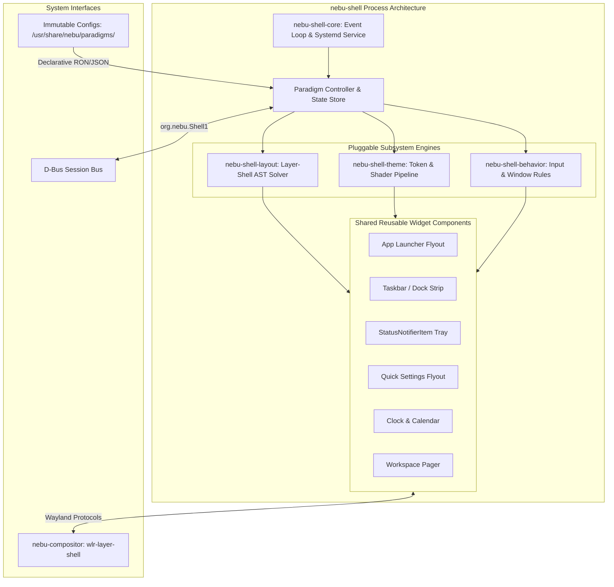

# ADR-0009: NebuShell UI Architecture — Pluggable Paradigm Engine (Theme, Layout, and Behavior)

**Status:** APPROVED  
**Date:** 2026-09-04  
**Deciders:** Principal Systems Architect, Lead Desktop Engineer, Compatibility Lead  
**Scope:** Desktop Shell Subsystem (`nebu-shell`), Wayland Surface Architecture, Desktop Customization  
**Related Documents:** [ADR-0006-nebu-shell.md](ADR-0006-nebu-shell.md), [desktop/02-shell.md](../desktop/02-shell.md), [desktop/01-compositor.md](../desktop/01-compositor.md), [desktop/03-window-management.md](../desktop/03-window-management.md), [architecture/03-process-and-ipc.md](../architecture/03-process-and-ipc.md), [performance/01-memory.md](../performance/01-memory.md)

---

## 1. Context

NebuOS is engineered to provide a seamless, lightweight Linux desktop experience capable of running Windows applications natively via Wine/Proton with under 800 MB idle RAM on 4 GB target hardware. A primary requirement established in the Product Requirements Document (PRD Section 12 & 63) is accommodating users transitioning from diverse operating systems without imposing a steep cognitive learning curve.

Specifically, the PRD mandates first-class support for three primary desktop interaction paradigms:
1. **Windows-like Paradigm ("Taskbar / Start Menu"):** Single primary panel anchored to the bottom edge, Start Menu launcher on the bottom-left, grouped application task items with running indicators in the center-left, notification flyout, and system tray (StatusNotifierItem) on the bottom-right. Floating window management default.
2. **macOS-like Paradigm ("Dock + Top Bar"):** Persistent slim menu/status bar anchored to the top edge (system status, clock, quick toggles), paired with a floating, auto-hiding application Dock anchored to the bottom edge displaying pinned and active applications with magnification/bounce indicators.
3. **Traditional Paradigm ("Classic Desktop"):** Dual-panel or single classic panel (GNOME 2 / MATE / XFCE mental model) with hierarchical category application menus ("Applications", "Places", "System"), explicit window lists with text labels, and a dedicated workspace pager.

In accordance with [ADR-0006](ADR-0006-nebu-shell.md), NebuShell must be authored entirely in native Rust using a declarative UI toolkit (Slint/Iced) communicating with `nebu-compositor` via the `wlr-layer-shell-unstable-v1` protocol. NebuShell strictly prohibits web runtime environments (Electron, Chromium, Node.js).

---

## 2. Problem Statement

How should the NebuOS desktop shell be architected to support Windows-like, macOS-like, and Traditional desktop paradigms while strictly respecting our 45 MB RSS memory budget, sub-100ms UI interaction latency, and immutable OS root filesystem?

Specifically, should NebuOS develop, compile, and maintain three separate, independent shell binaries corresponding to each desktop paradigm, or implement a single, unified `nebu-shell` binary driven by a pluggable, declarative Theme + Layout + Behavior subsystem?

---

## 3. Scope and Non-Goals

### 3.1 In Scope
- Architectural decomposition of the `nebu-shell` process.
- Definition of the pluggable Layout, Theme, and Behavior configuration model.
- Dynamic runtime paradigm switching without terminating user processes, restarting the Wayland compositor, or requiring user session logout.
- Layer-shell surface reconfiguration protocol sequences between `nebu-shell` and `nebu-compositor`.
- D-Bus management APIs for paradigm state inspection and live mutation.
- Memory, binary footprint, and performance limits for the shell customization subsystem.

### 3.2 Non-Goals
- Supporting arbitrary third-party compiled plugins (`.so` dynamic loading) or untrusted script execution (e.g., JavaScript/GJS, Lua, or Python runtime engines).
- Implementing full external window managers (window positioning and tiling remain strictly inside `nebu-compositor`).
- Replicating proprietary macOS or Windows visual assets, trademarks, or proprietary iconography.
- Arbitrary free-floating desktop canvas widgets (e.g., Active Desktop or Conky-style embedded root window monitors).

---

## 4. Options Considered

### Option A: Single Unified NebuShell with Pluggable Theme + Layout + Behavior Engine (CHOSEN)

Under this design, NebuOS implements a single native Rust binary (`/usr/bin/nebu-shell`). The internal architecture is partitioned into four modular crates:
- `nebu-shell-core`: Manages Wayland client event loops, D-Bus session registration, system daemon monitoring (PipeWire, NetworkManager, logind), and widget lifecycle.
- `nebu-shell-layout`: Interprets declarative layout definitions (serialized in RON/JSON), calculating dynamic anchor points, surface dimensions, and exclusive zones for `wlr-layer-shell`.
- `nebu-shell-theme`: Manages design tokens (color palettes, corner radiuses, typography, vibrancy shaders, icon themes).
- `nebu-shell-behavior`: Routes user input bindings, panel auto-hide heuristics, taskbar window grouping, and workspace navigation rules.

Paradigms are represented as declarative configuration packages installed at `/usr/share/nebu/paradigms/<paradigm_id>/`. When a paradigm switch is requested, `nebu-shell` mutates its active layout AST, updates layer-shell surface anchors via Wayland requests, and re-binds UI event listeners live.

- **Advantages:**
  - Single process and single codebase to maintain, test, and profile.
  - Zero code duplication for complex system integrations: StatusNotifierWatcher, PipeWire volume streams, NetworkManager D-Bus bindings, battery levels, and calendar backends are implemented exactly once.
  - Instant runtime switching: Users can transition between Windows, macOS, and Traditional layouts in < 150ms without closing open applications, losing clipboard state, or restarting Wine/Proton sessions.
  - Minimal storage footprint on the immutable ostree rootfs: One stripped Rust binary (~14 MB) rather than three (~42 MB total).
  - Memory consumption remains strictly bounded: Only the active paradigm layout tree is held in memory (~38-44 MB RSS).
- **Disadvantages:**
  - Increases the internal code complexity of `nebu-shell` by approximately 15% to support dynamic widget tree reconstruction and adaptive layout constraints.
  - Requires rigorous unit and regression testing to prevent layout leaks or geometry miscalculations during dynamic surface re-anchoring.

---

### Option B: Multiple Independent Shell Binaries (REJECTED)

Under this approach, NebuOS would develop and maintain three separate shell applications:
1. `nebu-shell-windows`: Fixed bottom panel, Windows-style start menu flyout.
2. `nebu-shell-macos`: Top status bar and bottom floating auto-hiding dock.
3. `nebu-shell-traditional`: Classic dual-panel shell with hierarchical category menus.

Each binary would link against a common system helper library but compile into an independent executable invoked by a desktop session manager or systemd target.

- **Advantages:**
  - Each individual binary is simpler in internal control flow; layout geometry can be hardcoded with minimal dynamic abstraction.
  - A crash in a specific shell implementation only impacts users using that specific layout.
- **Disadvantages:**
  - **Severe Maintenance Overhead:** Triplicates UI bug tracking, styling updates, accessibility hooks, and release testing. Every update to system tray handling, PipeWire volume control, or power management must be ported and tested across three separate shell applications.
  - **Disruptive User Experience:** Switching paradigms requires terminating the current shell process, clearing session locks, and spawning the new binary. This causes visible desktop tearing, momentary loss of system tray icons, and requires a full session reload or user logout.
  - **Image Bloat:** Triples the binary size footprint on the bootc/ostree immutable system image, consuming unnecessary storage on resource-constrained devices.
  - **IPC Race Conditions:** Tearing down and recreating D-Bus endpoints (`org.freedesktop.StatusNotifierWatcher`, `org.freedesktop.Notifications`) during a shell switch causes dropped notifications and orphaned system tray clients.

---

### Option C: Single Rigid Shell with No Paradigm Customization (REJECTED)

Under this approach, NebuOS would dictate a single immutable desktop paradigm (e.g., standard Windows-like layout only) with fixed visual styling and no configuration beyond wallpaper and light/dark color accents.

- **Advantages:**
  - Lowest engineering complexity; smallest binary size; fastest initial development.
  - Zero dynamic layout recalculation code paths.
- **Disadvantages:**
  - **Direct PRD Violation:** Directly fails PRD Section 12, which requires user-selectable desktop paradigms to ease transition for enterprise and creative users migrating from macOS or traditional desktop environments.
  - **High User Alienation:** Eliminates flexibility for users accustomed to top-bar or dual-panel workflows, driving users toward unsupported third-party window managers that break NebuOS compatibility integration.

---

## 5. Architectural Decision Matrix

The following decision matrix contrasts the three evaluated options against NebuOS architectural requirements:

| Architectural Criterion | Weight | Option A: Single Pluggable Shell (Chosen) | Option B: Multiple Shell Binaries | Option C: Monolithic Rigid Shell |
|---|:---:|:---:|:---:|:---:|
| **PRD Paradigm Compliance** | 25% | **100%** (Full runtime support for all 3) | **90%** (Requires restart/logout) | **20%** (Single fixed paradigm) |
| **Maintenance Burden** | 20% | **90%** (Single unified codebase, 15% complexity) | **30%** (3x maintenance, bug drift) | **95%** (Trivial single codebase) |
| **Idle Memory Footprint (RSS)** | 20% | **95%** (38–44 MB RSS; single active tree) | **90%** (38–44 MB per active binary) | **98%** (~35 MB RSS) |
| **Seamless Live Switching** | 15% | **100%** (< 150ms live switch, no logout) | **10%** (Kills session/drops D-Bus SNI) | **0%** (Not supported) |
| **Rootfs Storage Footprint** | 10% | **95%** (~14 MB binary + ~500 KB configs) | **35%** (~42 MB for 3 binaries) | **98%** (~12 MB binary) |
| **System Daemon IPC Cohesion**| 10% | **100%** (D-Bus endpoints remain stable) | **40%** (IPC unregister/reregister races)| **100%** (D-Bus endpoints stable) |
| **Weighted Total Score** | 100% | **95.5%** | **55.5%** | **55.1%** |

---

## 6. Detailed Architecture of Chosen Solution (Option A)

### 6.1 Subsystem Decomposition

The single `nebu-shell` executable is structured into clean separation of concerns:



### 6.2 The Three Canonical Paradigms

1. **`paradigm-windows` (Default):**
   - *Primary Surface:* Bottom-anchored panel (height: 44px, exclusive zone: 44px, anchor: `BOTTOM | LEFT | RIGHT`).
   - *Widget Slots:* Left: Start Menu button (`nebu-launcher`), search entry. Center-Left: Grouped running application icons with active indicators and window preview popups. Right: System tray (`StatusNotifierItem`), network/audio quick indicators, clock.
   - *Flyout Geometry:* Start Menu anchors bottom-left (480x560px), opens upward.
   - *Window Behavior:* Applications launch floating; Super key toggles Start Menu.

2. **`paradigm-macos`:**
   - *Top Surface:* Top-anchored menu/status bar (height: 28px, exclusive zone: 28px, anchor: `TOP | LEFT | RIGHT`). Left: System logo, active application name/menu. Right: System status tray, clock, control center toggle.
   - *Bottom Surface:* Floating auto-hiding Dock (height: 56px, exclusive zone: 0px, anchor: `BOTTOM`, margin bottom: 8px). Centered horizontally, containing pinned and active running application icons with live badge counters and dot indicators.
   - *Flyout Geometry:* Quick Settings slides out from top-right. Application grid flyout presents full-screen or centered overlay.
   - *Window Behavior:* Applications default to maximized or centered floating with top padding avoiding the top bar.

3. **`paradigm-traditional`:**
   - *Dual-Panel Surface Topology:*
     - Top Panel (height: 28px, exclusive zone: 28px, anchor: `TOP | LEFT | RIGHT`): Hierarchical category menu button ("Applications"), quick launchers, clock, system tray, power menu.
     - Bottom Panel (height: 26px, exclusive zone: 26px, anchor: `BOTTOM | LEFT | RIGHT`): Desktop toggle button ("Show Desktop"), wide taskbar buttons with full application titles and window state, multi-workspace pager.
   - *Window Behavior:* Classic task switching (Alt-Tab cycling with list view), explicit minimize-to-bottom-panel behavior.

---

## 7. Dynamic Runtime Switching Flow

Switching paradigms occurs without restarting processes or dropping Wayland surfaces. The sequence executes as follows:

```mermaid
sequenceDiagram
    autonumber
    actor User as User / Settings App
    participant DBus as D-Bus (Session Bus)
    participant Shell as nebu-shell-core
    participant Layout as nebu-shell-layout
    participant Theme as nebu-shell-theme
    participant Comp as nebu-compositor

    User->>DBus: Call org.nebu.Shell1.SwitchParadigm("macos")
    DBus->>Shell: Dispatch Method Call
    Shell->>Shell: Validate schema & load /usr/share/nebu/paradigms/macos.ron
    Shell->>Shell: Snapshot active widget states (pinned apps, active SNI tray items)
    
    Shell->>Layout: Recompute surface layout & layer-shell anchors
    Layout->>Comp: zwlr_layer_surface_v1.set_anchor(TOP | LEFT | RIGHT) [Top Bar]
    Layout->>Comp: zwlr_layer_surface_v1.set_size(0, 28)
    Layout->>Comp: zwlr_layer_surface_v1.set_exclusive_zone(28)
    
    Layout->>Comp: Create new layer surface for Floating Dock (BOTTOM, 56px, no exclusive)
    Layout->>Comp: Destroy obsolete bottom taskbar surface
    
    Shell->>Theme: Apply design tokens (macOS styling, radii, shadows)
    Shell->>Comp: wl_surface.commit() on all reconfigured surfaces
    Comp->>Comp: Recompute usable workarea; notify running XDG clients
    Comp-->>Shell: xdg_surface.configure / layer_surface.configure
    Shell-->>DBus: Return success (elapsed: ~110ms)
    DBus-->>User: Paradigm active
```

---

## 8. Interfaces and D-Bus APIs

NebuShell exposes a clean D-Bus interface on the session bus at `org.nebu.Shell1`:

```text
Service:     org.nebu.Shell1
Object Path: /org/nebu/Shell1
Interface:   org.nebu.Shell1.ParadigmManager

Methods:
  SwitchParadigm(s paradigm_id) -> (b success, s error_message)
    - Validates paradigm_id ("windows", "macos", "traditional", or custom user preset).
    - Applies layout, theme, and behavior live within 150ms.

  GetActiveParadigm() -> (s paradigm_id, a{sv} details)
    - Returns current active paradigm ID and configuration metadata.

  ListAvailableParadigms() -> (as paradigm_ids)
    - Enumerates installed paradigms in /usr/share/nebu/paradigms/ and ~/.config/nebu/paradigms/.

  SetThemeVariant(s variant) -> (b success)
    - Switches color mode ("dark", "light", "auto") across the active paradigm.

Signals:
  ParadigmChanging(s old_paradigm, s new_paradigm)
  ParadigmChanged(s active_paradigm)
```

---

## 9. Security, Sandboxing, and Integrity

1. **Strict Declarative Validation:**
   - Paradigm definitions are serialized strictly in declarative RON (Rusty Object Notation) or JSON.
   - Absolutely no executable scripts (bash, Python, Lua, or JavaScript) are permitted within paradigm packages.
   - Parsing is implemented using Rust's `serde` with strict schema validation; unexpected fields or syntax errors immediately reject the file without causing panics or buffer overflows.
2. **Path Traversal and Privilege Isolation:**
   - System paradigms are loaded from the read-only ostree sysroot (`/usr/share/nebu/paradigms/`).
   - User overrides are strictly scoped to `~/.config/nebu/paradigms/<paradigm_id>.ron`. Path traversal tokens (`..`, symlink escapes) are rejected during validation.
   - `nebu-shell` runs entirely as an unprivileged user process (UID 1000) under a hardened systemd `--user` scope with `NoNewPrivileges=true` and `ProtectSystem=strict`.
3. **No Dynamic Code Injection:**
   - The shell binary does not link against `dlopen` for layout plugins. All widget types (Launcher, Taskbar, SystemTray, QuickSettings, Dock) are statically compiled into `nebu-shell`. Paradigms can rearrange, restyle, and reconfigure widgets, but cannot introduce unvetted machine code.

---

## 10. Performance, Latency, and Resource Budgets

| Resource Metric | Specification Limit | Architectural Enforcement |
|---|:---:|---|
| **Idle Memory (RSS)** | <= 45 MB | Reusable widget cache; inactive surfaces drop GPU buffers. |
| **Switch Latency** | <= 150 ms | In-memory layout solver; avoids cold process startup or filesystem scans. |
| **Launcher Open Time** | <= 80 ms | In-memory SQLite indexing; zero disk I/O on hot keypress. |
| **Animation Frame Rate**| 60 / 120 FPS | Hardware-accelerated GPU render passes via Vulkan/GLES2; zero CPU rasterization. |
| **Storage Footprint** | <= 15 MB | Single compiled Rust binary with LTO and symbols stripped. |

---

## 11. Failure Modes and Recovery Behavior

| Failure Scenario | Immediate Detection | Automated Recovery Strategy |
|---|---|---|
| **Corrupt Paradigm File** | Serde deserialization failure during parse phase. | Shell logs error to journald; aborts switch; remains in current stable paradigm; falls back to embedded `paradigm-windows` if booting. |
| **Layer-Shell Surface Rejection** | Compositor returns protocol error or drops connection. | Shell detects surface configure failure; attempts fallback surface geometry; if terminal, triggers systemd service restart. |
| **Process Crash in NebuShell** | Systemd user instance receives SIGSEGV / SIGABRT. | Systemd restarts `nebu-shell.service` within 300ms. Since `nebu-compositor` runs as a separate process, all client windows and Wine applications remain running without data loss. |
| **Missing Asset/Icon Theme** | FreeDesktop icon lookup returns null. | Fallback to embedded generic SVG placeholders (`application-x-executable.svg`). |

---

## 12. Consequences of Decision

### Positive Consequences
- **Eliminates 3x Maintenance Burden:** System tray, audio, power, network, and application launching logic are maintained in a single codebase.
- **Superior User Experience:** Users can test different desktop layouts seamlessly with a single click in Settings—no logouts, no lost work, and zero desktop flicker.
- **Strict Adherence to Hardware Constraints:** Single binary keeps system memory footprint under 45 MB and saves root filesystem capacity on low-cost devices.
- **Rock-Solid Stability:** Decoupled architecture isolates crashes; running apps and the Wayland compositor are never interrupted by shell layout reconfiguration.

### Negative Consequences / Trade-offs
- **Internal Shell Complexity:** The `nebu-shell` codebase incurs ~15% higher architectural complexity due to the requirement for dynamic layout recalculation and adaptive widget positioning.
- **Strict Layout Constraints:** Widget developers must write components that can adapt to different geometric constraints (e.g., behaving as an icon-only dock item or a wide titled taskbar button).

---

## 13. Rejected Alternatives Summary

- **Option B (Multiple Shell Binaries):** Rejected due to massive code triplication, maintenance drift, binary bloat on the immutable rootfs, and inability to switch paradigms without terminating the user session and dropping active D-Bus connections.
- **Option C (Single Rigid Shell):** Rejected because it violates PRD requirements for desktop flexibility and would severely harm adoption among users migrating from macOS or traditional desktop environments.

---

## 14. Testing and Verification Requirements

1. **Automated Layout Switching Stress Test (`TEST-SHELL-004`):**
   - Headless test script issues 500 consecutive `SwitchParadigm` D-Bus calls cycling between Windows, macOS, and Traditional paradigms under AddressSanitizer and Valgrind.
   - *Pass Criterion:* Zero memory leaks, zero layer-shell protocol violations, RSS memory delta < 2.0 MB after 500 cycles.
2. **Switch Latency Benchmark (`TEST-PERF-008`):**
   - Measure time delta from D-Bus invocation to Wayland surface frame commit.
   - *Pass Criterion:* P99 latency <= 150ms on baseline 4GB Celeron reference hardware.
3. **Multi-Monitor Re-anchoring Test (`TEST-SHELL-005`):**
   - Verify layout placement across multi-head setups (e.g., top bar on primary monitor, taskbar on secondary monitor).
   - *Pass Criterion:* Surfaces correctly anchor to designated `wl_output` heads without overlapping usable client workareas.

---

## 15. Open Questions

1. *Should user-defined custom paradigms be allowed in NebuOS 1.0, or should the feature be restricted to the three curated system presets?*  
   **Recommendation:** Support custom `.ron` presets in `~/.config/nebu/paradigms/` for advanced developers, but only expose the three official presets in the default Settings GUI for 1.0.
2. *How should the macOS-style Global Menu Bar (`com.canonical.AppMenu.Registrar`) handle legacy Wine applications that do not export DBusMenu?*  
   **Recommendation:** When running in macOS paradigm, Wine applications that lack DBusMenu support retain their in-window Win32 menu bar; the global top bar displays the application title and standard system status indicators.
