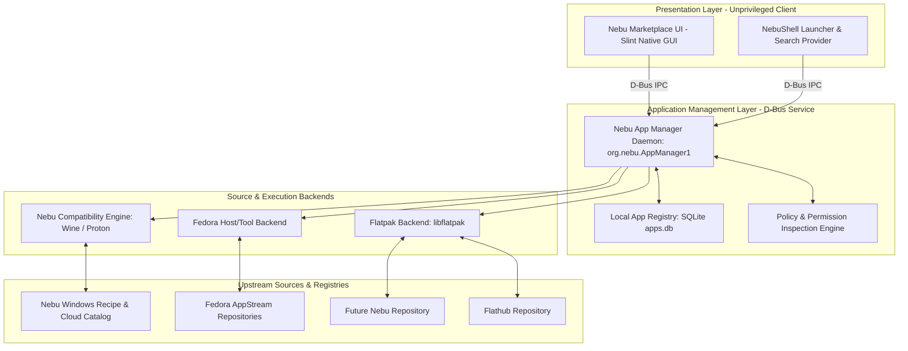

# ADR-0012: NebuOS Application Distribution and Marketplace Architecture

**Status:** APPROVED  
**Date:** 2026-09-04  
**Deciders:** Principal OS Architect, Application Platform Lead, Security Architect, Desktop Systems Engineer, Release Gate Auditor  
**Consulted:** PRD §45 (Package Management), §46 (Application Store), §14–19 (Application Lifecycle), §41–42 (Security & Sandboxing); ADR-0002 (Fedora Base); ADR-0008 (Atomic Updates); ADR-0010 (Bubblewrap Isolation); ADR-0011 (OS Update Architecture)  

---

## 1. Context and Problem Statement

NebuOS aims to provide a unified, seamless desktop experience where users can effortlessly discover, install, update, and manage both native Linux desktop applications and certified Windows applications without dealing with command-line package managers, complex dependency solvers, or system instability.

However, operating systems face major architectural challenges in desktop application distribution:
1. **Packaging Ecosystem Fragmentation:** Traditional Linux package formats (deb, rpm, tarballs) mutate host system libraries, create dependency hell, lack sandboxing, and collide with immutable, image-based OS filesystems (where `/usr` is mounted strictly read-only by `bootc`).
2. **Re-inventing Package Ecosystems is Prohibitive:** Creating a proprietary package format and building a complete Linux packaging repository from scratch requires massive engineering overhead, ongoing repository maintenance, security patch backporting, and upstream developer buy-in that diverts resources from NebuOS's core mission.
3. **Application Sandbox & Permission Visibility:** Desktop users expect modern mobile/desktop security paradigms: explicit visibility into network, camera, microphone, and filesystem permissions before and after installation, enforced by OS-level containment.
4. **Conflation of System and Application Lifecycles:** Conflating base OS updates with desktop application updates risks breaking application runtime dependencies or forcing disruptive OS reboots just to update a text editor or web browser.
5. **Windows Application Distinction:** Windows applications running via Wine/Proton require dedicated prefix isolation, PE header analysis, DLL override management, and DirectX-to-Vulkan translation. They cannot and must not be treated identically to native containerized Linux applications.

NebuOS requires a clear, layered, and scalable Application Platform architecture that leverages mature upstream ecosystems while delivering a first-class, curated desktop user experience.

---

## 2. Decision Drivers

- **Do Not Reinvent the Wheel:** Leverage mature, battle-tested open-source packaging and sandboxing ecosystems (Flatpak, Flathub) rather than inventing a bespoke package format or building a package repository from scratch.
- **Immutable Host Compatibility:** All desktop applications must install and run entirely in user space (`~/.local/share/flatpak` or `~/.var/app`) or designated unprivileged stateful partitions (`/var/lib/flatpak`), leaving the `/usr` OS sysroot 100% read-only.
- **Strong Sandboxing & Portals:** Applications must run inside unprivileged user namespaces with granular permission controls mediated by standard XDG Desktop Portals.
- **Unified Discovery & Abstraction:** Users interact with a single, elegant Nebu Marketplace UI that talks to an abstraction layer (`Nebu App Manager`). The UI must never directly invoke package managers or know backend implementation specifics.
- **Strict Separation of Lifecycles:** OS updates (`bootc`), application updates (Flatpak / App Manager), compatibility database updates (SQLite deltas), and firmware updates (`fwupd`) must operate on completely independent schedules and mechanisms.
- **Separation of Windows and Linux Lifecycles:** Windows applications run via the Nebu Compatibility Engine in isolated per-app Btrfs prefixes, while Linux applications run in Flatpak runtimes.
- **Milestone Discipline:** Application Platform and Marketplace design is assigned to Milestone P6; zero marketplace or application manager code is permitted in Milestones P0–P5.

---

## 3. Considered Options

### Option 1: Native Flatpak Foundation + Flathub Source + Nebu App Manager Abstraction + Separate Wine Pipeline [SELECTED]
Adopt Flatpak as the primary packaging and runtime sandbox for native Linux desktop applications, backed by Flathub as the primary upstream discovery source and Fedora repositories for complementary tools. Build a dedicated abstraction daemon (`nebu-app-manager-daemon`) and a native lightweight UI (`nebu-marketplace` in Slint). Windows applications are managed through a parallel compatibility recipe engine that configures isolated Btrfs Wine prefixes.
- *Pros:* Zero reinvented wheels; immediate access to thousands of maintained applications; strong unprivileged sandboxing; works perfectly with immutable `/usr`; separates UI from package engines; clean architectural boundaries.
- *Cons:* Requires managing metadata normalization across diverse sources; initial Flatpak runtime downloads consume disk space (mitigated by runtime deduplication).

### Option 2: Custom NebuOS Package Format and Proprietary Package Repository
Design a bespoke `.nebu` package archive format and host an independent package build farm, CDN, and repository infrastructure for all Linux applications.
- *Rejected:* Enormous maintenance burden; zero initial ecosystem; upstream developers will not package for a new format; high infrastructure costs; distracts from core Windows compatibility mission.

### Option 3: Forking Flathub or Re-hosting All Packages Locally
Fork the Flathub build pipeline, mirror all packages on NebuOS servers, and brand the upstream packages as NebuOS proprietary assets.
- *Rejected:* Unethical and impractical; massive bandwidth and storage costs; severe lag in delivering upstream security patches; licensing and legal complications; violates community collaboration principles.

### Option 4: Packaging Windows Applications as Flatpaks
Bundle Wine runtimes, Windows PE binaries, and prefixes into monolithic Flatpak bundles for distribution.
- *Rejected:* Destroys Btrfs reflink deduplication; prevents shared shader caching and dynamic GPU profiling; inflates application sizes by 500MB–2GB per app; impairs fine-grained prefix repairs and patch injections.

---

## 4. Decision Outcome

**Chosen Option: Option 1 — Native Flatpak Foundation + Flathub Source + Nebu App Manager Abstraction + Separate Wine Pipeline.**

### 4.1 System Topology & Abstraction Flow

### 4.2 Core Decisions and Specifications

#### 1. Flatpak as Primary Linux Application Packaging & Sandbox
- Flatpak is established as the standard application format and runtime environment for all graphical third-party Linux software on NebuOS.
- Applications run in unprivileged user namespaces managed by Bubblewrap, utilizing standardized runtimes (`org.freedesktop.Platform`, `org.gnome.Platform`, `org.kde.Platform`).
- Host `/usr` remains pristine and immutable.
- User-installed Flatpaks live in `~/.local/share/flatpak`; system-wide Flatpaks live in `/var/lib/flatpak`.

#### 2. Flathub as Primary Discovery & Source Ecosystem
- NebuOS integrates Flathub as an external upstream application source.
- Nebu Marketplace queries Flathub's AppStream metadata and API to display descriptions, screenshots, developer information, and categories.
- NebuOS **does not claim ownership** of Flathub packages, **does not fork Flathub**, and **does not create a Flathub mirror** in initial phases.

#### 3. Fedora Repositories as Complementary Source
- Fedora repositories provide core system libraries, command-line utilities, and base packages embedded during image build via `bootc`.
- Desktop user applications are **not** installed directly from Fedora RPM repositories via dnf on running systems. Fedora RPMs are reserved for base OS composition or containerized development environments (Toolbx/Distrobox).

#### 4. Future Nebu Repository
- Defined strictly as a future capability for Milestone P6.4+.
- Reserved exclusively for:
  - First-party NebuOS system utilities and configuration tools.
  - Deep desktop integrations and NebuShell widgets.
  - Highly optimized packages requiring Nebu-specific IPC interfaces.
- No repository infrastructure will be built during early milestones.

#### 5. Windows Application Compatibility Separation
- Windows applications are **never packaged into Flatpaks**.
- Windows applications are managed via the **Nebu Compatibility Engine**:
  - The Marketplace displays Windows application metadata and compatibility certification badges.
  - Installation executes automated recipes (fetching installers, verifying SHA-256 hashes, setting up isolated Btrfs reflink prefixes, applying DLL overrides).
  - Runtime execution is supervised by `nebu-runtime-daemon` under Bubblewrap with Wine/Proton.

#### 6. Nebu App Manager Abstraction (`org.nebu.AppManager1`)
- The Marketplace UI and NebuShell launcher **never** invoke `flatpak` or `wine` directly.
- All operations (search, metadata query, installation, uninstallation, updates, permission inspection, repair) are handled by `nebu-app-manager-daemon`.
- The App Manager exposes normalized data structures (`Application`, `ApplicationSource`, `PermissionRequest`, `CompatibilityReport`).

#### 7. Permission Architecture & Presentation
- Before installing any application, the Marketplace queries the App Manager to inspect declared permissions.
- The UI renders an easy-to-understand permission card highlighting sensitive resources:
  - Network access
  - Audio output and microphone input
  - Camera / webcam access
  - Local filesystem exposure (home directory, arbitrary paths, removable media)
  - Hardware devices (GPU, USB, Bluetooth)
  - D-Bus communication
- Runtime permission prompts are mediated by standard XDG Desktop Portals (`xdg-desktop-portal-nebu`).

#### 8. Update Architecture Independence
- Base OS updates: Managed via `bootc` transactional deployments and applied on reboot.
- Application updates: Managed via Flatpak / App Manager and applied live in userspace without rebooting the OS.
- Compatibility database: Versioned SQLite delta files updated out-of-band via HTTPS.
- Firmware updates: Managed independently by `fwupd`.

---

## 5. Consequences and Trade-offs

### Positive Consequences
- **Instant Software Availability:** Thousands of popular desktop applications (Steam, Spotify, Discord, Chrome, LibreOffice, Blender) are immediately installable on day one via Flathub without packaging effort.
- **Host Immutability Guaranteed:** Zero pollution of `/usr`; system updates can never break installed applications, and application crashes cannot corrupt the OS.
- **Rock-Solid Security:** Applications run confined with explicit permission governance; malicious scripts cannot modify system binaries.
- **Architectural Modularity:** The Marketplace UI can be rewritten, updated, or themed without touching packaging backends.

### Negative Consequences / Trade-offs
- **Initial Disk Overhead:** Flatpak runtimes (GNOME/KDE/freedesktop runtimes) require 500MB–1.5GB each on first download. This is mitigated by runtime sharing and Btrfs filesystem compression (`zstd:1`).
- **External Dependency on Flathub Availability:** Downtime on Flathub servers temporarily halts new app downloads. Mitigated by robust local metadata caching and retry queues.
- **Dual Application Paradigms:** Users run both Flatpaks and Windows applications. Mitigated by the unified abstraction layer presenting uniform launchers, icons, and lifecycle controls.

---

## 6. Rejected Approaches

1. **Reject Custom Package Manager:** Creating a custom package manager (`nebu-pkg`) was rejected as an unjustified drain on engineering resources.
2. **Reject Monolithic Update Lifecycle:** Coupling OS and app updates into a single monolithic bundle was rejected because users must be able to update desktop apps without rebooting their computers.
3. **Reject Unsandboxed Wine Execution:** Running Windows installers globally in the user's unconfined home folder was rejected due to extreme security, stability, and uninstallation clutter risks.
4. **Reject Electron/Webview Store Client:** Building the Marketplace in Electron or WebKit was rejected to uphold NebuOS's strict performance and memory budgets (Slint client consumes < 35 MB RSS; Electron consumes 250MB+).
