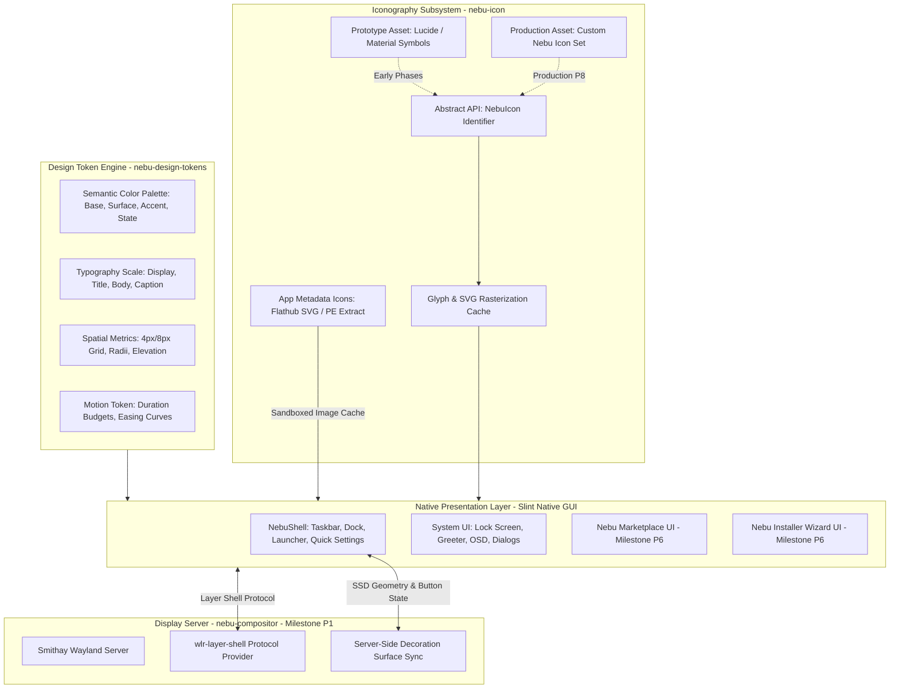

# ADR-0013: NebuOS UI Design System, Iconography, and Desktop Visual Architecture

**Status:** APPROVED  
**Date:** 2026-09-04  
**Deciders:** Principal OS Architect, Desktop Systems Engineer, UI/UX Lead, Accessibility Engineer, Documentation Auditor  
**Consulted:** PRD §11–13 (Desktop Experience), §52–54 (Visual Consistency & Layouts), §56–57 (Accessibility & Display), §62–63 (Theme Engine & Settings); ADR-0003 (Pure Wayland); ADR-0004 (Rust); ADR-0009 (NebuShell UI Architecture); ADR-0012 (Application Platform & Marketplace)  

---

## 1. Context and Problem Statement

NebuOS provides a unified, modern, high-performance desktop experience tailored for mixed native Linux and certified Windows application execution without virtual machines. To achieve a cohesive, distraction-free environment that rivals commercial operating systems, the visual presentation, desktop layout, iconography, and input responsiveness must be rigorously engineered.

Historically, Linux desktop environments and emerging OS distributions encounter fundamental visual and architectural pitfalls:
1. **Visual Fragmentation & Token Drift:** System applications, shell panels, app stores, and settings windows frequently use discordant color palettes, divergent corner radii, conflicting typography scales, and ad-hoc spacing values, producing an unpolished "stitched-together" aesthetic.
2. **Webview and Electron Bloat:** Shell components, launchers, and app stores built with Chromium/Electron or heavy webviews introduce catastrophic memory overhead (250MB–1GB+ RSS), sluggish launch times, and non-native input handling that violate NebuOS's strict performance invariants (<150MB total desktop idle RAM).
3. **Hardcoded Icon Dependencies and Lock-in:** Directly hardcoding SVG assets or specific third-party icon libraries (FontAwesome, Material Symbols, Lucide) into application source code creates tight vendor lock-in, prevents global visual restyling, causes licensing ambiguities, and makes replacing the icon set a grueling codebase-wide refactor.
4. **Conflation of System UI Icons vs. Application Metadata Icons:** Treating third-party application icons (retrieved dynamically from Flathub AppStream metadata or extracted from Windows PE `.ico` resources) identically to first-party system UI control icons (taskbar toggles, volume sliders, window controls) creates cache pollution, security attack surfaces (malicious SVG vectors), and scaling artifacts.
5. **Architectural Confusion Across Phases:** Blurring the lines between compositor duties (Wayland surface presentation, DRM/KMS, input event dispatch in P1) and shell visual design (theme tokens, window control styling, dock geometry in P2) leads to compositor bloat and brittle tight coupling. Furthermore, implementing UI elements in early headless milestones (P0) violates milestone isolation.

NebuOS requires a clear, rigorous Architecture Decision Record establishing the Design System, Iconography Abstraction, Tripartite Desktop Engine, Component Taxonomy, Phase Ownership Boundaries, and Licensing Rules.

---

## 2. Decision Drivers

- **Systemic Visual Cohesion:** All native NebuOS desktop interfaces (NebuShell, Settings, Lock Screen, Greeter, Installer Wizard, and Nebu Marketplace) must share a single, mathematically grounded Design System and Token Engine.
- **Native Rust Performance & Low Memory Budget:** Zero Electron, zero Chromium, zero webviews. The desktop shell (`nebu-shell`) must consume <= 45 MB RSS idle, and the marketplace UI (`nebu-marketplace-ui`) <= 35 MB RSS idle.
- **Strict Phase Isolation:**
  - **Milestone P0:** Strictly headless foundation (kernel, bootc, systemd, Btrfs, networking, TTY login). ZERO graphical UI, Wayland, Slint, icons, or desktop code.
  - **Milestone P1:** NebuCompositor (Smithay-based Wayland compositor, DRM/KMS presentation, layer-shell protocol server, surface stacking, input routing). Provides SSD surfaces, but NOT the visual shell application.
  - **Milestone P2:** NebuShell (primary home of desktop UI, design tokens, iconography engine, theme & layout engines, launcher, dock, taskbar, notifications, settings, window decoration sync).
  - **Milestones P3–P5:** Non-visual runtime, compatibility, and graphics subsystems.
  - **Milestone P6:** Application Platform & Marketplace (Slint UI client consuming NebuDesignSystem tokens).
- **Abstracted Iconography Architecture:** UI components must reference icons strictly through an abstract enum/key API (`NebuIcon("...")`). The underlying glyph renderer must remain swappable without touching application code.
- **Open-Source Prototype Path to Dedicated Production Set:** Use an established open-source candidate library (Lucide or Material Symbols) for prototyping and early development under clear licensing, transitioning to a dedicated custom Nebu Icon Set for production release.
- **Tripartite Desktop Model (ADR-0009):** Single `nebu-shell` binary runtime-configured by `Theme` (visual tokens), `Layout` (spatial arrangement), and `Behavior` (interaction rules). Zero separate binaries for Windows-like vs macOS-like paradigms.
- **Accessibility & Hardware Feasibility:** High contrast modes, keyboard navigability, touch target minimums (>= 44x44px), and blur-free fractional scaling must be engineered into the token and rendering foundation.

---

## 3. Considered Options

### Option 1: Native Slint Design System + Semantic Token Engine + NebuIcon Abstraction Layer + Tripartite Shell Architecture [SELECTED]
Define a unified design system in Rust and Slint markup, governed by semantic tokens (colors, typography, 4px/8px spacing grid, corner radii, elevation, motion). Isolate icon consumption behind a `NebuIcon` trait/enum abstraction layer. Standardize on an open-source candidate icon set (Lucide / Material Symbols) for early milestones, maintaining an automated asset pipeline for SVG rasterization/compilation, with an explicit path to a dedicated Nebu Icon Set in production.
- *Pros:* Ultra-lightweight (native compilation, < 45 MB shell RSS); zero webview bloat; complete immunity to icon library lock-in; seamless paradigm switching (Theme + Layout + Behavior); strict phase boundaries; full accessibility and HiDPI compliance.
- *Cons:* Requires upfront authoring of token definitions, Slint component primitives, and an abstraction crate (`nebu-icon`).

### Option 2: Hardcoded GTK4/Adwaita or Qt6/Breeze Stack
Build the desktop shell and applications using existing GTK4 or Qt6 desktop stacks, inheriting their standard widget libraries and icon naming schemes (Freedesktop icon spec).
- *Rejected:* Heavy dependency footprint (~150MB+ RSS); difficult to enforce unified tripartite paradigm switching (Windows-like vs macOS-like); high impedance mismatch with custom Smithay compositor integration; risk of toolkit fragmentation across desktop components.

### Option 3: Webview-Based Desktop Shell (Electron / Tauri / CEF)
Implement the launcher, dock, and marketplace using web technologies (HTML5/CSS/React) inside embedded webview containers.
- *Rejected:* Violates master performance invariants. A single Electron launcher or CEF window consumes 200MB–500MB RAM, incurs garbage collection hitches, and breaks native Wayland sub-surface synchronizations. Completely prohibited across all milestones.

### Option 4: Direct Hardcoded Binding to a Single Third-Party Icon Library
Directly embed SVG files or icon glyph constants from a single library (e.g., FontAwesome or Material Symbols) into Slint templates without an abstraction layer.
- *Rejected:* Creates rigid vendor lock-in. If license terms change or custom operating system glyphs (e.g., Nebu logo, specialized prefix state icons, wine compatibility status badges) are introduced, every UI template must be manually refactored.

---

## 4. Decision Outcome

**Chosen Option: Option 1 — Native Slint Design System + Semantic Token Engine + NebuIcon Abstraction Layer + Tripartite Shell Architecture.**

### 4.1 System Topology & Design Subsystem Boundaries



---

## 5. Detailed Architectural Decisions

### 5.1 Design System & Semantic Design Tokens

1. **Design Principles:**
   - **Clarity over Clutter:** Desktop surfaces must prioritize content over decorative chrome.
   - **Tactile & Predictable:** Interactive components must provide instantaneous visual feedback (<16ms response) across hover, active, focus, and disabled states.
   - **Native & Fluent:** Visual styling adapts organically to the user's selected paradigm without visual distortion or misaligned hit targets.

2. **Semantic Color Tokens (Light & Dark Variants):**
   - UI elements **never** hardcode raw hex color values. All components bind to semantic tokens:
     - `Color.Background`: Main desktop canvas and window background (`#0D1117` dark / `#F6F8FA` light).
     - `Color.Surface`: Container elements, panels, dialog boxes (`#161B22` dark / `#FFFFFF` light).
     - `Color.SurfaceElevated`: Floating docks, menus, tooltips, flyouts (`#21262D` dark / `#FFFFFF` with drop shadow).
     - `Color.Border`: Subtle boundary separators (`#30363D` dark / `#D0D7DE` light).
     - `Color.TextPrimary`: High-contrast readable copy (WCAG AA >= 4.5:1, dark `#F0F6FC` / light `#1F2328`).
     - `Color.TextSecondary`: De-emphasized labels and metadata (`#8B949E` dark / `#656D76` light).
     - `Color.Accent`: System brand accent for active toggles, primary buttons, and progress indicators (`#388BFD` default, user customizable).
     - `Color.State{Hover, Active, Focus, Disabled}`: Mathematical alpha overlays applied to surface or accent bases.
     - `Color.Status{Success, Warning, Error, Info}`: Functional feedback colors for system health, wine prefix status, and download alerts.

3. **Typography Scale & Font Fallback Chain:**
   - Base typography uses a 1.250 Major Third typographic scale:
     - `Display`: 28px / Semi-Bold / Line-height 36px (Greeter clock, hero banners)
     - `Title`: 20px / Semi-Bold / Line-height 28px (Window titles, section headers)
     - `Subtitle`: 16px / Medium / Line-height 24px (Group headers, dialog titles)
     - `Body`: 14px / Regular / Line-height 20px (Default desktop copy, settings labels)
     - `Caption`: 12px / Regular / Line-height 16px (Timestamps, metadata, tooltips)
     - `Code`: 12px / Monospace / Line-height 16px (Log viewers, terminal snippets, prefix paths)
   - Font Fallback Stack:
     - Primary UI Font: `InterVariable` / `Inter Display` (OFL-1.1 license).
     - Primary Monospace Font: `JetBrains Mono` (OFL-1.1 license).
     - Universal Fallback: `Noto Sans` / `Noto Color Emoji` to guarantee worldwide CJK, Arabic, Cyrillic, and emoji coverage.

4. **Spatial Grid, Radii, Elevation & Motion:**
   - **Grid System:** Strict 4px/8px modular spacing scale: `space-xxs (2px)`, `space-xs (4px)`, `space-sm (8px)`, `space-md (16px)`, `space-lg (24px)`, `space-xl (32px)`.
   - **Corner Radii:** Standardized hierarchy: `radius-xs (2px)`, `radius-sm (4px)` for small controls; `radius-md (8px)` for buttons and inputs; `radius-lg (12px)` for cards and dialogs; `radius-xl (16px)` for floating docks; `radius-full (9999px)` for pills and badges.
   - **Elevation:** Expressed as ambient and directional drop-shadow tuples (`elevation-0` flat to `elevation-3` modal overlay).
   - **Motion:** Micro-interactions budgeted at <= 150ms with standard cubic-bezier curves (`ease-out: cubic-bezier(0.0, 0.0, 0.2, 1.0)`). All motion is bypassable when `reduced_motion = true` (accessibility requirement).

---

### 5.2 Iconography Architecture & `NebuIcon` Abstraction

1. **Abstract Icon Reference API (`NebuIcon`):**
   - Application code, Slint templates, and shell widgets **must never load raw icon file paths** or bind directly to external library identifiers.
   - All icon requests resolve through an abstract enum or typed identifier:
     ```rust
     // Abstract identifier decouples UI logic from physical SVG/PNG assets
     pub enum NebuIcon {
         // Navigation & System
         Launcher,
         Settings,
         Search,
         Power,
         Restart,
         Suspend,
         // Window Controls
         WindowMinimize,
         WindowMaximize,
         WindowRestore,
         WindowClose,
         // Media & Hardware
         VolumeMute,
         VolumeLow,
         VolumeHigh,
         Brightness,
         BatteryCharging,
         WifiConnected,
         Bluetooth,
         // Marketplace & Compatibility
         AppInstall,
         AppUpdate,
         CompatibilityCertified,
         CompatibilityWarning,
     }
     ```
   - In Slint templates:
     ```slint
     export component IconButton {
         in property <NebuIconId> icon-id;
         // Resolved by the backend IconProvider into cached vector textures
         Image { source: IconTheme.lookup(root.icon-id, IconSize.Medium); }
     }
     ```

2. **Prototype vs. Dedicated Production Icon Sets:**
   - **Prototyping & Development (Milestones P2–P6):** Adopt an established, clean, open-source candidate icon library (**Lucide Icons** under ISC License, or **Material Symbols** under Apache 2.0). Assets are ingested into the repository's prototype asset pipeline with complete SPDX licensing metadata.
   - **Production Target (Milestones P7–P8):** Commission and integrate a custom, dedicated **Nebu Icon Set** tailored specifically to NebuOS's visual identity. Because the entire codebase consumes icons exclusively via `NebuIcon`, swapping the prototype set for the production set requires zero modifications to Slint UI markup or business logic.

3. **System Control Icons vs. Application Metadata Icons:**
   - **System UI Icons:** Vector SVG masters rendered at standardized optical grid sizes:
     - `Micro (16x16px)`: Taskbar tray, inline notifications, list action items.
     - `Small (20x20px)`: Compact menu items, window control buttons.
     - `Medium (24x24px)`: Standard toolbar buttons, launcher sidebar items.
     - `Large (32x32px)`: Category headers, dialog title icons.
     - Standard stroke weight: 1.5px to 2.0px with rounded joins and terminal caps.
   - **Application Metadata Icons:** Third-party application icons (retrieved from Flathub AppStream or extracted from Windows PE executables):
     - Treated as untrusted external raster/vector data.
     - Routed through an isolated sandboxed parsing process (`bwrap` + `resvg` / `image-rs`) to prevent buffer overflows or malicious XML attacks.
     - Scaled and cached locally in `~/.cache/nebu/icons/` as pre-rasterized RGBA DMA-BUFs (32x32, 48x48, 64x64, 128x128).
     - Displayed inside standardized icon squircle containers to guarantee visual harmony on the launcher grid.

---

### 5.3 Tripartite Desktop Architecture (Theme, Layout, Behavior)

Following ADR-0009, NebuOS avoids building separate binaries for different desktop paradigms. A single executable (`nebu-shell`) orchestrates three independent plugins:

1. **Theme Engine (Visual Styling):**
   - Controls: Color palettes, design tokens, font families, corner radii, elevation shadows, icon theme variants, opacity levels, and animation curves.
   - Format: Declarative TOML theme manifests (`/usr/share/nebu/themes/` and `~/.config/nebu/themes/`).
   - Hot-Reload: File watcher detects token changes and applies updates across live Slint windows without restarting the shell process.

2. **Layout Engine (Spatial Geometry):**
   - Controls: Geometry and placement of shell layer-shell surfaces (top menu bar vs. bottom taskbar vs. floating dock), launcher placement (full-screen overlay vs. start menu popup), system tray position, and window control button ordering (Close/Min/Max vs. Min/Max/Close).
   - Dynamic Switching: Users switch between Nebu Default, Windows-like, and macOS-like layouts in <= 150ms via D-Bus call `org.nebu.Shell1.SwitchLayout()`.

3. **Behavior Engine (Interaction & Keybindings):**
   - Controls: Global keybindings (Super key behavior, Alt+Tab switcher semantics, snapping hotkeys, multi-touch gestures).
   - Decoupled from visual styling and geometry.

---

### 5.4 Component Taxonomy

Desktop interfaces are strictly organized into five standardized component tiers:

| Tier | Component Group | Responsibilities | Target Consumers |
|---|---|---|---|
| **1. Foundation** | `Button`, `IconButton`, `TextInput`, `Checkbox`, `Slider`, `ToggleSwitch`, `Badge`, `Divider` | Atomic input, atomic display, state handling, micro-interactions | All Slint UI windows |
| **2. Navigation** | `TabBar`, `Breadcrumb`, `SidebarMenu`, `Pagination`, `CommandPalette` | View switching, workspace navigation, hierarchical discovery | Settings, Marketplace, File Browser |
| **3. Desktop Shell** | `PanelSurface`, `TaskbarItem`, `DockContainer`, `LauncherGrid`, `SystemTrayItem`, `WindowTitlebar` | Layer-shell surface composition, running app management, window decoration sync | `nebu-shell`, `nebu-compositor` SSD |
| **4. Feedback** | `NotificationToast`, `ModalDialog`, `ContextMenu`, `Tooltip`, `VolumeOSD`, `ProgressBar` | Ephemeral user alerts, confirmation gates, status indication | System UI, Notification Daemon |
| **5. Application** | `MarketplaceCard`, `PermissionMatrixCard`, `CompatibilityBadge`, `InstallerWizardStep` | High-level domain workflows for software management | `nebu-marketplace-ui`, `nebu-installer-ui` |

---

### 5.5 Phase Ownership Boundaries

To eliminate architectural ambiguity, responsibility for visual elements is partitioned across milestones:

- **Milestone P0 (Foundation OS):**
  - Strictly Headless.
  - Zero UI code, zero Slint, zero Wayland, zero graphical toolkits, zero desktop icons.
  - Verification is purely serial console, TTY login, and systemd readiness in QEMU.
- **Milestone P1 (NebuCompositor):**
  - Display server and window manager primitives (Smithay, DRM/KMS, libinput).
  - Implements Server-Side Decoration (SSD) surface geometry and provides `wlr-layer-shell-unstable-v1` for shell clients.
  - **Does NOT** contain application launcher logic, system tray menus, or widget UI design.
- **Milestone P2 (NebuShell):**
  - Primary home of desktop UI, design system implementation, token engine, and `nebu-icon` abstraction.
  - Implements panel, taskbar, dock, launcher, notifications (`org.freedesktop.Notifications`), quick settings, and window decoration visual synchronization.
- **Milestones P3–P5 (Runtime, Compatibility, Graphics):**
  - Pure non-visual system daemons (`nebu-runtime-daemon`, compatibility SQLite database, DXVK/VKD3D packaging).
  - Zero visual UI elements.
- **Milestone P6 (Application Platform & Marketplace):**
  - Marketplace UI (`crates/nebu-marketplace-ui/`) and Installer Wizard (`crates/nebu-installer-ui/`).
  - Consumes design system tokens and component primitives established in P2.
  - Sandboxed processing of third-party application icons.
- **Milestones P7–P8 (Testing & Production Readiness):**
  - Visual regression testing harness (pixel-diff assertions in CI).
  - Accessibility audit (WCAG AA validation).
  - Commissioning and deployment of the final dedicated Nebu Icon Set.

---

### 5.6 External Asset Governance & Licensing

1. **SPDX Compliance:** Every asset integrated into the NebuOS repository (fonts, candidate icons, sound effects, wallpapers) must be accompanied by an explicit license declaration in `assets/LICENSES.md` with standard SPDX identifiers.
2. **Acceptable Open-Source Licenses:**
   - Fonts: SIL Open Font License 1.1 (`OFL-1.1`).
   - Prototype Icons: ISC (`ISC`), MIT (`MIT`), Apache 2.0 (`Apache-2.0`), or CC0 1.0 (`CC0-1.0`).
   - Prohibited Licenses: Non-commercial only (`CC-BY-NC`), share-alike (`CC-BY-SA` unless audited for non-copyleft compatibility), or ambiguous freeware.
3. **Attribution & Provenance:**
   - Third-party assets must retain upstream copyright notices, author attribution, and source repository URLs in `assets/ATTRIBUTION.md`.
4. **Prototype Asset Isolation:**
   - Candidate icon SVGs must reside in `assets/prototype/icons/` to maintain a strict separation from production-ready proprietary/custom assets in `assets/branding/`.

---

### 5.7 Accessibility & Performance Taxonomy

To eliminate vague engineering promises, requirements are strictly categorized into four technical tiers:

1. **Hard Requirements (Mandatory for Milestone Exit Gates):**
   - `REQ-ACC-01`: Minimum contrast ratio of **4.5:1** for standard text and **3.0:1** for large text/icons against their backgrounds (WCAG 2.1 AA).
   - `REQ-ACC-02`: Full keyboard navigation (focus indicators, tab loops, escape dismissal) across all shell and system dialogs.
   - `REQ-ACC-03`: Zero screen flicker or animations exceeding 3 flashes per second.
   - `REQ-ACC-04`: Reduced motion toggle (`settings.accessibility.reduced_motion`) instantly forces all transitions to 0ms.
   - `REQ-PERF-01`: Steady-state idle RSS of `nebu-shell` must be **<= 45 MB**.
   - `REQ-PERF-02`: Steady-state idle RSS of `nebu-marketplace-ui` must be **<= 35 MB**.
   - `REQ-PERF-03`: Shell invocation to interactive frame latency must be **<= 80ms**.

2. **Engineering Targets (Measurable Goals with Tolerances):**
   - `TGT-ACC-01`: Touch interactive targets should be **>= 44x44 CSS px** (or 8mm physical) on touchscreen displays.
   - `TGT-PERF-01`: Frame rendering pacing target of **60 FPS minimum** (16.6ms frame budget) on integrated Intel Gen9 / AMD Vega graphics, and **120/144 FPS** on high-refresh displays.
   - `TGT-PERF-02`: Fractional scaling visual fidelity: crisp vector rendering without bilinear blur across 125%, 150%, 175%, and 200% scale factors via `wp_fractional_scale_v1`.

3. **Benchmarks (Reference Hardware Profiling):**
   - Benchmark against baseline hardware: Dual-core x86_64, 4GB RAM, Intel UHD 620 iGPU. Combined desktop environment (compositor + shell + background daemons) must idle below 120 MB RAM.

4. **Recommendations (Best-Practice Guidelines):**
   - Recommend dark mode as factory default to conserve OLED/laptop battery power.
   - Recommend subtle 80ms haptic or visual pulses on touch interactions.

---

## 6. Consequences and Trade-offs

### Positive Consequences
- **Absolute Visual Consistency:** System dialogs, launchers, quick settings, and the marketplace share identical design tokens, typography, and spacing.
- **Architectural Immunity to Icon Lock-in:** Codebase interacts with icons purely through `NebuIcon`, enabling seamless switching from the candidate library (Lucide/Material Symbols) to the production Nebu Icon Set.
- **Extreme Performance & Low Footprint:** Native Slint UI compiles directly to C++/Rust machine code with software or hardware rasterization, eliminating the 250MB+ RSS burden of Electron.
- **Milestone Clarity:** P0 remains 100% headless and protected; desktop UI work is strictly contained in P2; Marketplace UI in P6.
- **Accessibility by Default:** Hard contrast minimums and keyboard navigation eliminate retrofitting costs later.

### Negative Consequences / Trade-offs
- **Custom UI Component Authoring:** Rather than pulling off-the-shelf React or Electron components, foundation UI primitives (buttons, inputs, sliders) must be implemented and tested in Slint markup during P2.
- **Icon Set Transition Overhead:** Creating a bespoke, high-quality production Nebu Icon Set requires dedicated graphic design effort in later milestones.
- **Double Icon Pipeline:** System control icons and application metadata icons must be maintained as two separate processing pipelines.

---

## 7. Rejected Approaches

1. **Reject Hardcoding Material/Lucide SVG Paths in Slint:** Directly using `<Image source="lucide-settings.svg" />` was rejected because it binds UI templates to a specific third-party library filename structure, preventing seamless transition to a dedicated Nebu Icon Set.
2. **Reject Electron/Webview Shell:** Building any desktop UI component in Electron, CEF, or WebView2 was categorically rejected due to violation of the <= 150 MB total desktop RAM invariant.
3. **Reject Conflating Compositor and Shell:** Forcing `nebu-compositor` to draw the launcher, taskbar, or system tray directly inside the display server process was rejected because a shell UI glitch should never crash the display compositor.
4. **Reject Separate Shell Binaries for Windows-like and macOS-like Layouts:** Building multiple shell binaries was rejected in ADR-0009 and reaffirmed here; a single shell binary dynamically driven by Theme and Layout plugins avoids a 3x maintenance nightmare.
5. **Reject Permissive SVG Rendering for App Icons:** Directly passing third-party SVGs from Flathub or untrusted apps into the shell's renderer without sandboxed sanitization was rejected due to known SVG XML entity expansion and script injection vulnerabilities.
