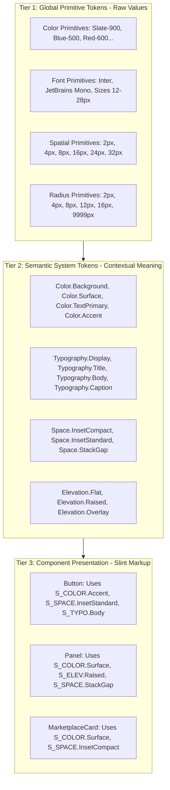
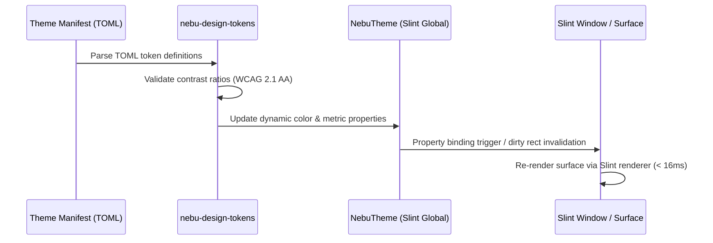

# Master Design System & Design Tokens Specification — NebuOS

**Document ID:** NEBU-SPEC-DSN-000  
**Status:** DRAFT (Approved for Implementation in Milestone P2)  
**Authority Level:** Master Subsystem Specification  
**Governing ADR:** [ADR-0013: NebuOS UI Design System, Iconography, and Desktop Visual Architecture](../decisions/ADR-0013-ui-design-system-and-icon-architecture.md)  
**Target Audience:** Desktop Systems Engineers, UI/UX Engineers, Accessibility Engineers  

---

## 1. Status

DRAFT — Formally specifies the foundational design principles, semantic token architecture, mathematical spatial scales, typography hierarchy, elevation model, motion curves, and interactive component states for all native graphical user interfaces in NebuOS.

---

## 2. Purpose

This specification establishes an immutable mathematical and semantic contract for the visual styling of NebuOS desktop interfaces. By centralizing all visual attributes into strongly typed design tokens, NebuOS guarantees visual consistency across all first-party components (NebuShell, System UI, Settings, Installer Wizard, and Nebu Marketplace) while entirely preventing styling drift, arbitrary magic numbers, and heavyweight web technology dependencies.

---

## 3. Scope

- Definition of core design principles: Clarity, Tactility, Native Performance.
- Two-tier token hierarchy: Global Primitive Tokens -> Semantic Component Tokens.
- Semantic color palette covering light and dark modes with WCAG 2.1 AA mathematical contrast ratios.
- Typography scale based on a 1.250 Major Third scale, with font fallback chains (`Inter`, `JetBrains Mono`, `Noto`).
- 4px/8px modular spatial grid, margin scales, and padding definitions.
- Standardized corner radii, border weights, and ambient/directional elevation shadow models.
- Interactive component states: Normal, Hover, Active/Pressed, Focused, Disabled, Error, Warning, Success.
- Motion duration budgets and cubic-bezier easing curves with reduced-motion accessibility enforcement.
- Compact vs. Standard density modes for small displays and touchscreen interfaces.

---

## 4. Non-goals

- Implementing web-based CSS, Sass, Less, or web components (prohibited; NebuOS uses native Rust and Slint).
- Embedding webview frameworks (Electron, CEF, Tauri, WebKitGTK) for any desktop component.
- Creating arbitrary pixel-nudging or per-application ad-hoc color overrides.
- Conflating visual styling with Wayland compositor surface scheduling (handled separately in P1).
- Direct drawing inside `nebu-compositor` (the compositor manages surfaces; the shell renders UI).

---

## 5. Requirements

1. **REQ-DSN-01 (Zero Hardcoded Values):** All Slint templates and UI crates must bind exclusively to semantic tokens provided by `nebu-design-tokens`. Raw hex colors, arbitrary pixel paddings, and inline font sizes are prohibited in application code.
2. **REQ-DSN-02 (Contrast Assurance):** Normal body text must achieve a contrast ratio of >= 4.5:1 against its background. Large titles and primary icon controls must achieve >= 3.0:1.
3. **REQ-DSN-03 (Fractional Scaling Support):** All spatial measurements and token dimensions must scale cleanly under Wayland fractional scaling (125%, 150%, 175%, 200%) without subpixel tearing or blurred edges.
4. **REQ-DSN-04 (Reduced Motion Compliance):** When the user enables `reduced_motion = true`, all transition animations and duration tokens must evaluate to `0ms`.
5. **REQ-DSN-05 (Density Adaptation):** The design system must support both `Standard` (desktop mouse/keyboard) and `Touch` (minimum 44x44px hit targets) density modes.
6. **REQ-DSN-06 (Boot Experience & System UI Invariance):** Visual styling for early system experiences (Milestone P2 boot splash, BGRT fallback backgrounds, recovery alert cards, lock screens) must bind strictly to master tokens (`Color.Background #0D1117`, `Color.Accent #388BFD`, `Typography.FontFamilySans Inter`). A separate or competing design system for boot or splash is strictly forbidden (governed by ADR-0014).

---

## 6. Architecture

The design token system is structured in a strict three-tier hierarchy to ensure maximum flexibility and zero circular dependencies:



---

## 7. Components

1. **`nebu-design-tokens` (Rust Crate):** The core authoritative token definition crate. Contains Rust enums, structs, serializable TOML definitions, and Slint compile-time code-generators.
2. **`NebuTheme` (Slint Global Module):** A Slint `global` singleton exported to all `.slint` files, exposing live token bindings (`NebuTheme.colors`, `NebuTheme.typography`, `NebuTheme.spacing`).
3. **`ThemeWatcher` (Background Service):** An in-process file watcher inside `nebu-shell` monitoring `/usr/share/nebu/themes/` and `~/.config/nebu/themes/` for live hot-reloading.

---

## 8. Data Flow



---

## 9. Control Flow

1. On startup of any graphical client (`nebu-shell`, `nebu-marketplace-ui`), the application initializes `nebu_design_tokens::init()`.
2. The engine reads the active theme name from user configuration (`~/.config/nebu/theme.toml`) or falls back to `/usr/share/nebu/themes/default-dark.toml`.
3. The engine parses primitive scales, maps them to semantic tokens, and binds them to the Slint `NebuTheme` global.
4. If a theme switch or high-contrast toggle occurs at runtime, a D-Bus signal from `org.nebu.Shell1` broadcasts `ThemeChanged(new_theme)`.
5. The token engine resolves the new token values in memory and updates Slint properties without process restart.

---

## 10. Interfaces

### 10.1 Rust Token Definition Trait
```rust
pub trait DesignTokenProvider {
    fn background(&self) -> slint::Color;
    fn surface(&self) -> slint::Color;
    fn surface_elevated(&self) -> slint::Color;
    fn text_primary(&self) -> slint::Color;
    fn text_secondary(&self) -> slint::Color;
    fn accent(&self) -> slint::Color;
    fn border(&self) -> slint::Color;
    fn spacing(&self, step: SpacingStep) -> f32;
    fn radius(&self, step: RadiusStep) -> f32;
    fn is_reduced_motion(&self) -> bool;
}
```

### 10.2 Slint Global Contract (`nebu-theme.slint`)
```slint
export global NebuTheme {
    in-out property <color> bg-base: #0D1117;
    in-out property <color> surface: #161B22;
    in-out property <color> surface-elevated: #21262D;
    in-out property <color> border: #30363D;
    in-out property <color> text-primary: #F0F6FC;
    in-out property <color> text-secondary: #8B949E;
    in-out property <color> accent: #388BFD;
    in-out property <color> accent-hover: #58A6FF;
    in-out property <color> status-error: #F85149;
    in-out property <color> status-success: #3FB950;
    
    in-out property <length> space-xxs: 2px;
    in-out property <length> space-xs: 4px;
    in-out property <length> space-sm: 8px;
    in-out property <length> space-md: 16px;
    in-out property <length> space-lg: 24px;
    
    in-out property <length> radius-sm: 4px;
    in-out property <length> radius-md: 8px;
    in-out property <length> radius-lg: 12px;
    
    in-out property <bool> reduced-motion: false;
}
```

---

## 11. Dependencies

- `slint` (1.8+): Declarative native UI toolkit compiled to native machine code.
- `serde`, `toml`: Manifest parsing and validation.
- `palette`: High-precision color math and automated WCAG contrast calculation.
- Font assets: `Inter-Variable.ttf`, `JetBrainsMono-Regular.ttf` (licensed under OFL-1.1).

---

## 12. Security

- **Sandboxed Token Loading:** Theme manifests are strictly declarative data (TOML/JSON). The parser strictly rejects executable scripts, dynamic expressions, or file references outside `/usr/share/nebu/themes/` and `~/.config/nebu/themes/`.
- **Buffer Overflow Protection:** All string parsing for font family names and color hex strings is length-bounded and validated with strict type checks before memory allocation.
- **Resource Exhaustion Containment:** Theme manifests exceeding 1MB in size are rejected to prevent memory exhaustion attacks.

---

## 13. Resource Requirements

- **Memory Overhead:** The entire `nebu-design-tokens` runtime state occupies **<= 1.5 MB RSS** in memory.
- **CPU Idle Impact:** Zero CPU cycles consumed when the desktop is static.
- **Startup Impact:** Cold parsing and binding of the default theme tokens completes in **< 4.0ms** on baseline hardware.

---

## 14. Failure Modes

1. **Corrupted Theme Manifest:** User syntax error in `~/.config/nebu/themes/custom.toml`.
2. **Insufficient Contrast:** Custom user theme selects dark grey text on black background (< 4.5:1 ratio).
3. **Missing System Fonts:** System font files deleted or unreadable in `/usr/share/fonts/`.
4. **Fractional Subpixel Bleed:** Floating-point division causing hairline artifacts on non-integer display scales.

---

## 15. Recovery Behavior

- If a user-supplied theme fails parsing, the engine logs an error via `tracing::warn` and instantly falls back to the immutable system default (`/usr/share/nebu/themes/default-dark.toml`).
- If an active theme fails contrast assertions in high-contrast mode, the token engine automatically clamps the `text-primary` token to pure white (`#FFFFFF`) or pure black (`#000000`).
- If primary fonts are missing, the font subsystem falls back through `Inter` -> `DejaVu Sans` -> `sans-serif`.
- All spatial coordinates in Slint are snapped to nearest physical device pixels to eliminate fractional subpixel bleeding.

---

## 16. Testing Requirements

- **Automated Contrast Test:** CI test asserting every built-in theme satisfies WCAG 2.1 AA (>= 4.5:1) across all text/background combinations.
- **Token Completeness Test:** Assertion verifying no component in `nebu-shell` or `nebu-marketplace-ui` references a missing or uninitialized token.
- **Theme Hot-Reload Test:** Automated test modifying a TOML file on disk and verifying that Slint property values update within 50ms.
- **Snapshot Visual Regression:** Headless pixel-diff testing verifying layout stability across 100%, 125%, 150%, and 200% scaling factors.

---

## 17. Performance Requirements

- Theme token resolution latency: **<= 1.0ms**.
- Dynamic theme hot-reload to first frame: **<= 50ms**.
- Property change dispatch to Slint surfaces: **<= 16ms** (within single VSync interval).

---

## 18. Compatibility Considerations

- **Color Spaces:** All color calculations operate in linear sRGB space before gamma correction for display presentation.
- **Display Server Invariance:** Tokens remain identical whether rendering directly to Wayland shm buffers or DMA-BUF hardware textures.
- **High-DPI Scaling:** All length units are declared in logical pixels (`px` in Slint), automatically multiplied by the display scale factor configured via Wayland `wp_fractional_scale_v1`.

---

## 19. Open Questions

- **OQ-DSN-01:** Should NebuOS support dynamic user accent color picking via a 32-bit color wheel, or restrict choices to a curated palette of 12 certified high-contrast accents? (Recommendation: Curated 12-color palette to guarantee WCAG compliance).
- **OQ-DSN-02:** Should the design token engine compile to a standalone shared library (`.so`) or remain statically linked into each native binary? (Current decision: Statically linked Rust crate for zero-cost abstraction).

---

## 20. Related Documents

- [ADR-0013: UI Design System and Icon Architecture](../decisions/ADR-0013-ui-design-system-and-icon-architecture.md)
- [01-iconography.md](01-iconography.md)
- [02-theming-layout-behavior.md](02-theming-layout-behavior.md)
- [03-components.md](03-components.md)
- [04-accessibility-and-performance.md](04-accessibility-and-performance.md)
- [05-external-assets-and-licensing.md](05-external-assets-and-licensing.md)
- [docs/desktop/03-ui-theme-system.md](../desktop/03-ui-theme-system.md)
- [ADR-0014: Boot Experience and Graphical Handoff](../decisions/ADR-0014-boot-experience-and-graphical-handoff.md)
