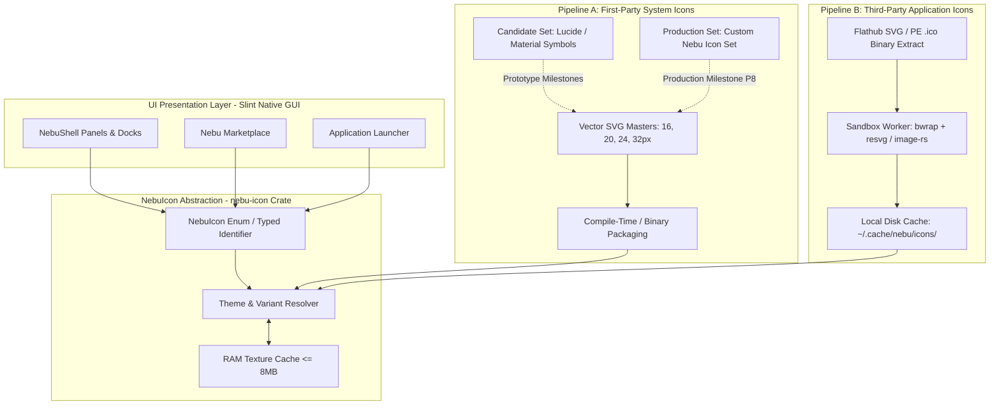
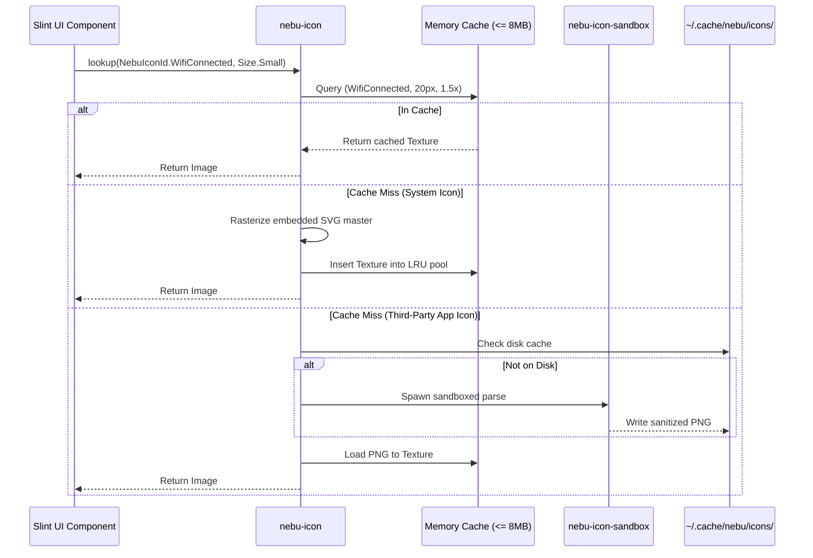

# Iconography Architecture & Asset Pipeline Specification — NebuOS

**Document ID:** NEBU-SPEC-DSN-001  
**Status:** DRAFT (Approved for Implementation in Milestone P2)  
**Authority Level:** Master Subsystem Specification  
**Governing ADR:** [ADR-0013: NebuOS UI Design System, Iconography, and Desktop Visual Architecture](../decisions/ADR-0013-ui-design-system-and-icon-architecture.md)  
**Target Audience:** Desktop Systems Engineers, Shell Developers, Application Platform Engineers  

---

## 1. Status

DRAFT — Formally specifies the abstract iconography architecture (`NebuIcon`), the dual asset lifecycle (prototype candidate library transitioning to a dedicated custom Nebu Icon Set), the strict segregation between system UI control icons and untrusted third-party application icons, optical sizing standards, and the sandboxed icon asset pipeline.

---

## 2. Purpose

This specification decouples all user interface code in NebuOS from physical icon files, third-party naming schemes, and external icon library implementations. It provides an abstract, strongly typed icon query layer, establishes rigorous optical sizing and stroke standards, and enforces strict security isolation when parsing and caching third-party application icons from Flathub or Windows executables.

---

## 3. Scope

- Abstract Rust API (`nebu-icon`) and Slint interface (`IconTheme.lookup`).
- Dual-phase icon asset roadmap: Open-source prototype candidate (Lucide / Material Symbols) -> Dedicated custom Nebu Icon Set in production.
- Architectural segregation between System UI Icons and Application Metadata Icons.
- Optical grid standards: 16x16, 20x20, 24x24, and 32x32 pixels, with 1.5px–2.0px stroke rules.
- Untrusted icon parsing pipeline using Bubblewrap sandboxing and `resvg`.
- Icon caching architecture in `~/.cache/nebu/icons/` with DMA-BUF texture backing.

---

## 4. Non-goals

- Directly hardcoding external SVG paths or icon library identifiers into `.slint` templates or Rust crates.
- Parsing untrusted external SVG or `.ico` files directly inside the `nebu-shell` process.
- Packaging proprietary or unvetted icon libraries without SPDX license verification.
- Conflating application window surface icons with shell control glyphs.

---

## 5. Requirements

1. **REQ-ICO-01 (Abstract Access Invariant):** All UI components in `nebu-shell`, `nebu-marketplace-ui`, and system utilities must request icons strictly through the `NebuIcon` enum or string identifier. Direct filesystem path references to icon SVGs are prohibited.
2. **REQ-ICO-02 (Optical Alignment):** System icons must align to pixel grids at 16, 20, 24, and 32px optical sizes. Strokes must maintain 1.5px to 2.0px thickness with round caps and joins.
3. **REQ-ICO-03 (Prototype Decoupling):** Upstream prototype candidate icons (Lucide or Material Symbols) must be stored in `assets/prototype/icons/` and mapped through an abstract lookup table, ensuring that replacing them with the production Nebu Icon Set requires zero changes to Slint files.
4. **REQ-ICO-04 (Application Icon Isolation):** All third-party application icons (from Flathub AppStream metadata or extracted Windows PE `.ico` files) must be parsed in an unprivileged `bwrap` sandbox before rendering.
5. **REQ-ICO-05 (Memory Budget):** The in-memory icon texture cache in `nebu-shell` must not exceed **8.0 MB** total footprint.

---

## 6. Architecture

The iconography subsystem operates through two distinct pipelines: a zero-copy compiled pipeline for first-party System UI Icons, and an isolated sandboxed pipeline for third-party Application Metadata Icons:



---

## 7. Components

1. **`nebu-icon` (Rust Crate):** The core abstraction library containing the `NebuIcon` enum, sizing metrics, optical snapping rules, and lookup engines.
2. **`nebu-icon-sandbox` (Daemon / Helper):** An isolated helper binary that runs inside an unprivileged Bubblewrap sandbox (`bwrap --unshare-all --ro-bind /usr /usr ...`) to parse untrusted external SVGs and Windows PE `.ico` files and emit sanitized RGBA pixel buffers.
3. **`nebu-icon-cache`:** A persistent disk and memory caching layer that indexes rasterized icons by content hash (SHA-256) and requested display density.

---

## 8. Data Flow

### First-Party System Icon Data Flow
1. Slint component requests an icon: `IconTheme.lookup(NebuIconId.Launcher, IconSize.Medium)`.
2. `nebu-icon` resolves the enum to the active theme's vector asset.
3. If cached in GPU/RAM memory, the pre-rasterized texture handle is returned immediately (< 0.5ms).
4. If uncached, the embedded SVG master is rasterized via `resvg` at the display's exact scale factor, cached in the 8MB pool, and returned.

### Third-Party Application Icon Data Flow
1. App Manager discovers an installed Flatpak or Windows application with an untrusted icon file.
2. The file path is passed to `nebu-icon-sandbox`.
3. The sandbox validates the image dimensions, sanitizes SVG nodes (stripping `<script>`, external entity declarations, and foreign objects), and renders sanitized PNG/RGBA buffers at standard densities (32, 48, 64, 128px).
4. Sanitized buffers are written to `~/.cache/nebu/icons/<sha256>.png`.
5. The launcher displays the icon wrapped inside a standardized squircle surface.

---

## 9. Control Flow



---

## 10. Interfaces

### 10.1 Rust Abstract Icon Definition
```rust
#[derive(Debug, Clone, Copy, PartialEq, Eq, Hash)]
pub enum NebuIcon {
    // Desktop Navigation
    Launcher,
    Search,
    Overview,
    Settings,
    FileBrowser,
    Terminal,
    
    // Window Management
    WindowMinimize,
    WindowMaximize,
    WindowRestore,
    WindowClose,
    
    // Status & Indicators
    NetworkEthernet,
    NetworkWifiHigh,
    NetworkWifiMedium,
    NetworkWifiLow,
    NetworkWifiOff,
    BluetoothConnected,
    BluetoothDisabled,
    BatteryCharging,
    BatteryFull,
    BatteryWarning,
    VolumeMute,
    VolumeLow,
    VolumeHigh,
    
    // Application & Marketplace
    AppInstall,
    AppInstalled,
    AppUpdate,
    AppWarning,
    CompatibilityGold,
    CompatibilitySilver,
    CompatibilityBronze,
}

#[derive(Debug, Clone, Copy, PartialEq, Eq)]
pub enum IconSize {
    Micro,   // 16x16 px
    Small,   // 20x20 px
    Medium,  // 24x24 px
    Large,   // 32x32 px
}
```

### 10.2 Slint Declarative Interface
```slint
export global IconTheme {
    pure callback lookup(NebuIconId, IconSize) -> image;
}
```

---

## 11. Dependencies

- `resvg` (0.44+): Deterministic, security-hardened SVG rendering library written in pure Rust.
- `image` (0.25+): Decoding and scaling for raster formats (PNG, ICO).
- `lru`: Least-recently-used cache implementation for managing in-memory texture quotas.
- `bubblewrap`: Lightweight containerization for the untrusted icon sanitizer process.

---

## 12. Security

1. **Malicious SVG Sanitization:** Third-party SVG icons from Flathub or untrusted web sources may contain exploit payloads (XML External Entity attacks, quadratic blowup, embedded javascript). All SVG parsing occurs inside a restricted `bwrap` container with no network access (`--unshare-all`), a read-only root, and a strict 50ms processing timeout.
2. **Decompression Bomb Protection:** Input raster files (`.ico`, `.png`) exceeding 10MB or declaring uncompressed dimensions larger than 2048x2048 pixels are immediately rejected.
3. **Memory Pool Isolation:** Third-party application icons are managed in an eviction-capped memory pool so that a user installing 5,000 applications cannot induce an Out-Of-Memory (OOM) crash in `nebu-shell`.

---

## 13. Resource Requirements

- **Memory Cache Cap:** Hard cap at **<= 8.0 MB RSS** for in-memory rasterized icon textures inside `nebu-shell`.
- **Disk Cache Cap:** Maximum **<= 64.0 MB** disk footprint in `~/.cache/nebu/icons/`; automated LRU pruning purges icons unreferenced for > 30 days.
- **CPU Time per System Icon:** **< 0.8ms** to rasterize from embedded SVG master.

---

## 14. Failure Modes

1. **Missing Icon Glyph:** A newly requested `NebuIcon` identifier is not implemented in the active theme.
2. **Malformed App Icon:** An installed Windows game has a corrupt or truncated `.ico` resource.
3. **Sandbox Parsing Crash:** A malformed SVG triggers a panic in the sanitizer helper.
4. **Cache Directory Read-Only:** User home directory runs out of disk space or permissions are altered.

---

## 15. Recovery Behavior

- If a requested `NebuIcon` identifier is missing, `nebu-icon` automatically renders a fallback neutral glyph (`NebuIcon::GenericApp` or a rounded question mark) and logs a warning.
- If a third-party application icon fails validation in the sandbox, the app is assigned a standardized generic executable icon. The shell process never crashes.
- If disk cache writes fail, icons fall back to transient in-memory textures without persisting.

---

## 16. Testing Requirements

- **Icon Set Completeness Test:** Automated unit test verifying that every variant in `enum NebuIcon` maps to a valid SVG asset in both light and dark themes.
- **Optical Dimension Verification:** Test asserting all system SVG assets conform to the 16x16, 20x20, 24x24, or 32x32px coordinate viewBoxes with stroke widths between 1.5px and 2.0px.
- **Malicious SVG Exploit Suite:** Test suite asserting the sandbox helper successfully neutralizes Billion Laughs attacks, local file read exploits (`file:///etc/passwd`), and infinite loops.
- **Cache Eviction Test:** Stress test loading 2,000 distinct icons and verifying that RAM usage never exceeds the 8.0 MB ceiling.

---

## 17. Performance Requirements

- System icon retrieval from memory cache: **<= 0.1ms**.
- System icon rasterization on cache miss: **<= 1.5ms**.
- Sandboxed parsing and disk write of third-party icon: **<= 35ms**.

---

## 18. Compatibility Considerations

- **Freedesktop Standard Interoperability:** `nebu-icon` provides an export mapping to standard Freedesktop icon names (e.g. `applications-system`, `preferences-desktop`, `system-shutdown`) so that standard X11/Wayland applications querying the GTK icon theme receive valid fallbacks.
- **Display Scale Snap:** SVGs are rasterized at the exact physical integer resolution corresponding to the display scale (e.g. 24px icon at 1.5x scale is rasterized to 36x36 physical pixels) to maintain razor-sharp fidelity.

---

## 19. Open Questions

- **OQ-ICO-01:** Which candidate open-source icon set should be selected for the Milestone P2–P6 development phase: Lucide Icons (ISC License) or Google Material Symbols (Apache 2.0)? (Recommendation: Lucide Icons, due to cleaner stroke aesthetics and lighter vector payload).
- **OQ-ICO-02:** When should the dedicated custom "Nebu Icon Set" be commissioned? (Target: Milestone P7/P8 during visual regression testing and production hardening).

---

## 20. Related Documents

- [ADR-0013: UI Design System and Icon Architecture](../decisions/ADR-0013-ui-design-system-and-icon-architecture.md)
- [00-design-system.md](00-design-system.md)
- [02-theming-layout-behavior.md](02-theming-layout-behavior.md)
- [03-components.md](03-components.md)
- [04-accessibility-and-performance.md](04-accessibility-and-performance.md)
- [05-external-assets-and-licensing.md](05-external-assets-and-licensing.md)
