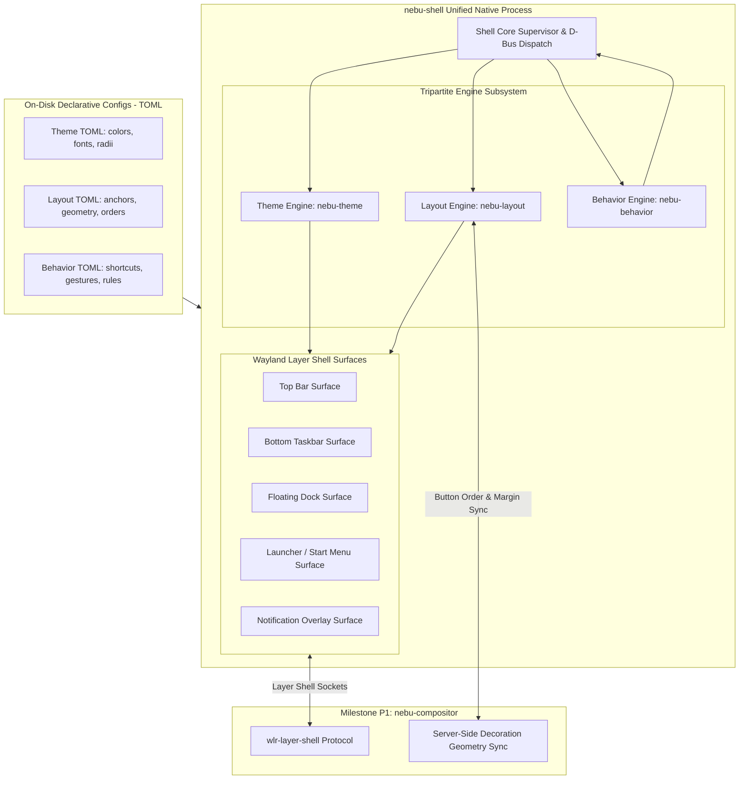
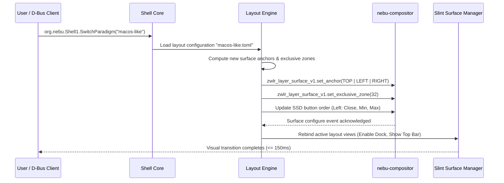

# Tripartite Desktop Architecture Specification (Theme, Layout, Behavior) — NebuOS

**Document ID:** NEBU-SPEC-DSN-002  
**Status:** DRAFT (Approved for Implementation in Milestone P2)  
**Authority Level:** Master Subsystem Specification  
**Governing ADR:** [ADR-0009: NebuShell UI Architecture](../decisions/ADR-0009-nebushell-ui-architecture.md), [ADR-0013: UI Design System and Icon Architecture](../decisions/ADR-0013-ui-design-system-and-icon-architecture.md)  
**Target Audience:** Desktop Systems Engineers, Shell Developers, Compositor Engineers  

---

## 1. Status

DRAFT — Formally specifies the tripartite separation of desktop responsibilities (`NebuShell = Theme + Layout + Behavior`), the single-binary shell architecture, the runtime paradigm switching engine, declarative TOML schema specifications, and in-process hot-reloading mechanisms.

---

## 2. Purpose

This specification prevents the fragmentation of desktop codebases by establishing a single, highly modular desktop shell binary (`nebu-shell`). By decoupling visual styling (`Theme`), spatial geometry (`Layout`), and interaction policies (`Behavior`), NebuOS empowers users to switch dynamically between distinct operating desktop paradigms (Nebu Modern, Windows-like, macOS-like) within 150 milliseconds without restarting the shell process or losing application session state.

---

## 3. Scope

- Tripartite architecture model and component boundaries.
- Single-binary executable design with dynamic plugin/engine loading.
- Specifications for the three foundational desktop paradigms:
  1. **Nebu Default:** Balanced modern desktop (adaptive bottom panel, integrated quick settings, unified search launcher).
  2. **Windows-like:** Traditional bottom taskbar, left start button & hierarchical menu, right system tray, top-right window buttons (Min/Max/Close).
  3. **macOS-like:** Top unified status/menu bar, bottom floating dock, top-left window buttons (Close/Min/Max).
- Declarative TOML schema definitions for themes, layouts, and behaviors.
- IPC interface `org.nebu.Shell1` for dynamic paradigm switching.
- File system monitoring and hot-reload architecture.

---

## 4. Non-goals

- Authoring separate shell binaries or maintaining parallel codebase forks for different desktop styles (prohibited by ADR-0009).
- Shifting window management or surface compositing into `nebu-shell` (handled by `nebu-compositor` in P1).
- Requiring X11 compatibility hacks or multi-process web engine runtimes.
- Restarting the display session or terminating running applications when switching layouts.

---

## 5. Requirements

1. **REQ-TLB-01 (Single Binary Invariant):** All desktop shell layouts and themes must be executed by the single native Rust binary `nebu-shell`.
2. **REQ-TLB-02 (Sub-150ms Dynamic Switching):** Switching between desktop paradigms (e.g. from Windows-like to macOS-like) must execute completely in **<= 150ms** without tearing, flickering, or process termination.
3. **REQ-TLB-03 (Strict Tripartite Separation):**
   - `Theme` may alter visual tokens (colors, fonts, radii, icons, shadows) but must **NEVER** alter panel position or hotkey bindings.
   - `Layout` may alter surface geometry, panel anchors, and widget positions, but must **NEVER** alter color values or window focus semantics.
   - `Behavior` may alter keyboard shortcuts, gesture bindings, and snapping rules, but must **NEVER** draw UI elements.
4. **REQ-TLB-04 (Zero Session Interruption):** Paradigm switching must preserve running application windows, clipboard contents, audio streams, and background tasks intact.
5. **REQ-TLB-05 (Resource Footprint):** The combined in-memory overhead of the Theme, Layout, and Behavior engines within `nebu-shell` must not exceed **3.5 MB RSS**.

---

## 6. Architecture



---

## 7. Components

1. **`ThemeEngine`:** Evaluates declarative theme TOML manifests, resolves semantic tokens into `nebu-design-tokens`, and triggers property updates in Slint UI components.
2. **`LayoutEngine`:** Solves spatial constraints for layer-shell surfaces. It computes bounding rectangles, sets layer anchors (`top`, `bottom`, `exclusive_zone`), and transmits window control button ordering (Close/Min/Max vs. Min/Max/Close) to `nebu-compositor`.
3. **`BehaviorEngine`:** Binds global Wayland input shortcuts (via `ext-workspace-v1` and compositor keybindings) to shell actions (e.g. toggle launcher, switch virtual workspace, activate overview).

---

## 8. Data Flow



---

## 9. Control Flow

1. User or Settings UI requests paradigm switch via D-Bus: `gdbus call --session --dest org.nebu.Shell1 --object-path /org/nebu/Shell1 --method org.nebu.Shell1.SwitchParadigm "windows-like"`.
2. `nebu-shell` validates that `windows-like` theme, layout, and behavior manifests exist.
3. The shell pauses input event processing for 20ms to prevent stale hit-testing.
4. `LayoutEngine` recalculates surface roles:
   - Dismisses floating dock surface.
   - Anchors primary panel to screen bottom (`anchor = BOTTOM | LEFT | RIGHT`, height = 44px).
   - Informs `nebu-compositor` via SSD protocol to place window controls on the top-right in `[Minimize, Maximize, Close]` sequence.
5. `ThemeEngine` loads corresponding theme tokens (`windows-dark.toml`).
6. `BehaviorEngine` binds the `Super` key to reveal the bottom-left start menu.
7. Slint renders dirty surfaces; atomic layer-shell commit presents updated desktop in < 150ms.

---

## 10. Interfaces

### 10.1 Declarative Theme Schema (`theme.toml`)
```toml
[metadata]
name = "nebu-dark"
version = "1.0.0"
author = "NebuOS Design Team"
spdx_license = "Apache-2.0"

[colors]
bg_base = "#0D1117"
surface = "#161B22"
surface_elevated = "#21262D"
border = "#30363D"
text_primary = "#F0F6FC"
text_secondary = "#8B949E"
accent = "#388BFD"

[metrics]
corner_radius_panel = 0
corner_radius_surface = 8
corner_radius_button = 6
elevation_level = 2

[typography]
font_family = "Inter"
font_size_base = 14
```

### 10.2 Declarative Layout Schema (`layout.toml`)
```toml
[metadata]
name = "windows-like"
paradigm = "traditional"

[panels.bottom_taskbar]
enabled = true
anchor = ["bottom", "left", "right"]
height = 44
exclusive = true
auto_hide = false

[panels.bottom_taskbar.elements]
left = ["launcher_button", "running_tasks"]
center = []
right = ["system_tray", "clock", "quick_settings", "show_desktop"]

[dock]
enabled = false

[window_controls]
position = "top_right"
order = ["minimize", "maximize", "close"]
style = "windows"
```

### 10.3 D-Bus Control Interface (`org.nebu.Shell1.xml`)
```xml
<interface name="org.nebu.Shell1">
  <method name="SwitchParadigm">
    <arg name="paradigm_id" type="s" direction="in"/>
    <arg name="success" type="b" direction="out"/>
  </method>
  <method name="GetActiveParadigm">
    <arg name="paradigm_id" type="s" direction="out"/>
  </method>
  <signal name="ParadigmChanged">
    <arg name="paradigm_id" type="s"/>
  </signal>
</interface>
```

---

## 11. Dependencies

- `wlr-layer-shell-unstable-v1`: Wayland protocol for anchoring shell surfaces to screen edges.
- `zbus`: Pure Rust async D-Bus library for inter-process communication.
- `notify`: File system monitoring crate for hot-reloading TOML manifests in developer mode.

---

## 12. Security

- **Restricted Manifest Search Paths:** Themes, layouts, and behaviors are loaded strictly from `/usr/share/nebu/` (system immutable) and `~/.config/nebu/` (user mutable). Symlinks traversing outside these roots are rejected.
- **Strict Keybinding Containment:** Keybinding definitions cannot bind privileged Linux system calls (e.g. raw kernel reboots); all privileged actions must route through `systemd-logind`.
- **D-Bus Authorization:** `SwitchParadigm` calls are restricted to the local logged-in user UID over the private session bus.

---

## 13. Resource Requirements

- **Theme Engine RAM:** **<= 1.2 MB RSS**.
- **Layout Engine RAM:** **<= 1.5 MB RSS**.
- **Behavior Engine RAM:** **<= 0.8 MB RSS**.
- **Switching CPU Spike:** **< 5%** single-core CPU utilization for <= 100ms during layout rebuild.

---

## 14. Failure Modes

1. **Invalid Layout TOML:** User provides a layout config with conflicting anchors (e.g. requesting both top and bottom exclusive anchors on a single panel).
2. **Layer Shell Protocol Desync:** Compositor rejects a surface resize during rapid paradigm switching.
3. **Missing Built-in Assets:** An incomplete layout references a non-existent UI widget.

---

## 15. Recovery Behavior

- If a layout configuration is invalid, the engine refuses the switch, logs the syntax error, and continues running the previous active layout without interruption.
- If the layer-shell protocol encounters a protocol error, `nebu-shell` destroys and re-creates the affected layer-shell surface cleanly.
- If user configs in `~/.config/nebu/` become unparseable, an emergency reset command (`nebu-shell --reset-defaults`) restores factory configurations.

---

## 16. Testing Requirements

- **Dynamic Switch Latency Benchmark:** Automated test switching between Nebu Default, Windows-like, and macOS-like paradigms 50 consecutive times while asserting execution time <= 150ms per switch.
- **State Preservation Test:** Verification that running Xwayland/Wine applications maintain window focus and geometry across shell layout changes.
- **TOML Schema Fuzzing:** Fuzz tester parsing randomized/corrupted TOML strings asserting zero panics.

---

## 17. Performance Requirements

- Layout solver calculation time: **<= 8ms**.
- Total paradigm switch latency: **<= 150ms** end-to-end.
- Idle CPU consumption of hot-reload watcher: **0.0%**.

---

## 18. Compatibility Considerations

- **Multi-Monitor Layouts:** Layout configurations define rules per output connector (e.g., primary monitor displays taskbar + tray, secondary monitor displays taskbar only).
- **Server-Side Decorations (SSD):** `nebu-compositor` reads the active layout's button ordering so that native Windows applications running under Wine display consistent titlebar buttons matching the active desktop theme.

---

## 19. Open Questions

- **OQ-TLB-01:** Should custom user-created layouts be shareable via simple archive packages in Milestone P6? (Decision deferred to P6).
- **OQ-TLB-02:** Should the macOS-like paradigm support an interactive application global menu bar proxy via `com.canonical.AppMenu.Registrar`? (Recommendation: Planned for P2 subphase).

---

## 20. Related Documents

- [ADR-0009: NebuShell UI Architecture](../decisions/ADR-0009-nebushell-ui-architecture.md)
- [ADR-0013: UI Design System and Icon Architecture](../decisions/ADR-0013-ui-design-system-and-icon-architecture.md)
- [00-design-system.md](00-design-system.md)
- [01-iconography.md](01-iconography.md)
- [03-components.md](03-components.md)
- [docs/desktop/04-layout-system.md](../desktop/04-layout-system.md)
