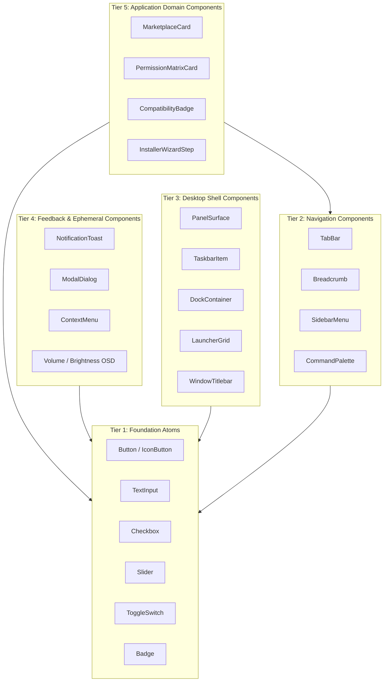
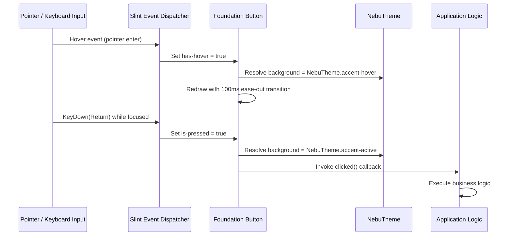

# Component Taxonomy & UI Architecture Specification — NebuOS

**Document ID:** NEBU-SPEC-DSN-003  
**Status:** DRAFT (Approved for Implementation in Milestone P2)  
**Authority Level:** Master Subsystem Specification  
**Governing ADR:** [ADR-0013: NebuOS UI Design System, Iconography, and Desktop Visual Architecture](../decisions/ADR-0013-ui-design-system-and-icon-architecture.md)  
**Target Audience:** UI/UX Engineers, Shell Developers, Application Platform Engineers  

---

## 1. Status

DRAFT — Formally specifies the comprehensive five-tier component taxonomy, Slint widget architectures, interactive state machines, keyboard navigation contracts, focus indicators, and touch-target sizing for all graphical interfaces in NebuOS.

---

## 2. Purpose

This specification establishes an immutable blueprint for constructing user interface components across NebuOS. By partitioning interface primitives into five standardized tiers—from atomic buttons up to complex application distribution cards—NebuOS ensures code reuse, deterministic styling, strict state handling, full keyboard navigability, and complete avoidance of bloated web component frameworks.

---

## 3. Scope

- Comprehensive five-tier component taxonomy:
  - **Tier 1 (Foundation):** Buttons, IconButtons, Inputs, Checkboxes, Sliders, Toggles, Badges, Dividers.
  - **Tier 2 (Navigation):** TabBars, Breadcrumbs, Sidebars, Pagination, Command Palettes.
  - **Tier 3 (Desktop Shell):** Taskbar Items, Floating Dock Containers, App Launcher Grids, System Tray SNI Widgets, Window Titlebars.
  - **Tier 4 (Feedback):** Notification Toasts, Modal Confirmation Dialogs, Context Menus, Tooltips, OSD Overlays.
  - **Tier 5 (Application Domain):** Marketplace Cards, Permission Matrix Cards, Compatibility Badges, Installer Wizard Steps.
- Universal component state model: `Normal`, `Hover`, `Active/Pressed`, `Focused`, `Disabled`, and semantic validation states (`Error`, `Warning`, `Success`).
- Slint declarative component schemas.
- Accessibility standards: 2px solid high-contrast focus rings and minimum 44x44px touch targets.

---

## 4. Non-goals

- Implementing HTML/DOM custom elements or React/Vue components (NebuOS uses native Slint).
- Introducing heavy runtime widget reflection systems.
- Conflating presentation components with background system daemons.
- Ad-hoc widget styling that bypasses `nebu-design-tokens`.

---

## 5. Requirements

1. **REQ-CMP-01 (Tiered Modularity):** All UI elements must derive from the five-tier taxonomy. Higher-tier components must compose lower-tier foundation widgets rather than duplicating atomic drawing logic.
2. **REQ-CMP-02 (State Determinism):** Every interactive component must handle and visually present all 6 standard states: Normal, Hover, Active, Focused, Disabled, and Error/Warning where applicable.
3. **REQ-CMP-03 (Keyboard Focus Rings):** Every focusable control must render an unambiguous **2px solid focus indicator** with a 2px offset when navigating via keyboard (`Tab` / `Shift+Tab`).
4. **REQ-CMP-04 (Touch Target Minimum):** Interactive controls in standard and touch modes must provide an effective hit-test area of at least **44x44 physical pixels** (or 8mm equivalent).
5. **REQ-CMP-05 (Zero Memory Leaks):** Slint components must allocate zero dynamic heap memory during render passes; all layout calculations must occur on the stack or statically allocated model arrays.

---

## 6. Architecture



---

## 7. Components

### 7.1 Tier 1: Foundation Atoms
- **`Button` / `IconButton`:** Atomic action trigger supporting text label, abstract `NebuIcon`, and 3 visual variants (`Primary`, `Secondary`, `Destructive`).
- **`TextInput`:** Text entry field with placeholder text, clear button, error state borders, and optional leading/trailing icon slots.
- **`Checkbox` & `ToggleSwitch`:** Binary state selectors with accessible label bindings.
- **`Slider`:** Continuous range selector with filled progress track and draggable thumb.
- **`Badge`:** Compact indicator for counts, status badges, or compatibility certification tiers.

### 7.2 Tier 2: Navigation
- **`TabBar`:** Horizontal/vertical tab switcher with animated active indicator underline/pill.
- **`SidebarMenu`:** Grouped navigation drawer utilized in Settings and Marketplace applications.
- **`CommandPalette`:** Rapid keyboard-driven search and action execution overlay.

### 7.3 Tier 3: Desktop Shell
- **`TaskbarItem`:** Running application indicator showing icon, running dot, active outline, and hover window thumbnail preview.
- **`DockContainer`:** Floating container featuring optional parabolic mouse magnification and icon shelf styling.
- **`LauncherGrid`:** Paginated or scrollable grid of application squircles with search filtering.
- **`WindowTitlebar`:** Server-side decoration header coordinating window title, icon, and paradigm-aligned control buttons.

### 7.4 Tier 4: Feedback
- **`NotificationToast`:** Transient desktop notification card supporting app icon, title, body text, and up to two action buttons.
- **`ModalDialog`:** Center-screen focus-trapping confirmation dialog with semi-transparent backdrop shield.
- **`VolumeOSD`:** Transient floating pill showing hardware volume or brightness level changes.

### 7.5 Tier 5: Application Domain
- **`MarketplaceCard`:** Application discovery card displaying app squircle, title, category, star rating, developer name, and install button.
- **`PermissionMatrixCard`:** Pre-installation security review card highlighting network, filesystem, audio, and device permissions.
- **`CompatibilityBadge`:** Certified tier badge (`Gold`, `Silver`, `Bronze`, `Uncertified`) for Windows applications.

---

## 8. Data Flow



---

## 9. Control Flow

1. **State Machine Evaluation:** Every frame, each component evaluates its boolean state variables:
   - `is_disabled`: If true, all pointer and keyboard events are ignored; opacity drops to 40%.
   - `is_focused`: If true (and triggered by keyboard), the 2px focus ring is drawn around the boundary.
   - `has_hover`: Evaluated when pointer coordinates intersect the hit-test geometry.
   - `is_active`: Evaluated when pointer button 1 is pressed down within the hit boundary.
2. **Transition Execution:** State transitions interpolate color tokens using Slint property animations (`animate background { duration: 120ms; easing: ease-out; }`).
3. **Action Dispatch:** Upon mouse button release (or `Enter`/`Space` key release), the component emits its public callback event.

---

## 10. Interfaces

### 10.1 Foundation Button Definition (`button.slint`)
```slint
import { NebuTheme } from "nebu-theme.slint";

export component NebuButton {
    in property <string> text: "Button";
    in property <bool> enabled: true;
    in property <bool> primary: false;
    in property <bool> destructive: false;
    
    callback clicked();
    
    min-height: 36px;
    min-width: 80px;
    
    states [
        disabled when !root.enabled: {
            bg.background: NebuTheme.surface;
            txt.color: NebuTheme.text-secondary;
            opacity: 0.4;
        }
        pressed when touch.pressed: {
            bg.background: root.destructive ? NebuTheme.status-error.darker(20%) : 
                           root.primary ? NebuTheme.accent.darker(20%) : NebuTheme.surface-elevated.darker(10%);
        }
        hover when touch.has-hover: {
            bg.background: root.destructive ? NebuTheme.status-error : 
                           root.primary ? NebuTheme.accent-hover : NebuTheme.surface-elevated;
        }
    ]
    
    bg := Rectangle {
        border-radius: NebuTheme.radius-md;
        border-width: 1px;
        border-color: root.primary ? transparent : NebuTheme.border;
        background: root.primary ? NebuTheme.accent : NebuTheme.surface;
        
        animate background { duration: NebuTheme.reduced-motion ? 0ms : 100ms; }
        
        txt := Text {
            text: root.text;
            font-size: 14px;
            font-weight: 500;
            color: root.primary || root.destructive ? #FFFFFF : NebuTheme.text-primary;
            horizontal-alignment: center;
            vertical-alignment: center;
        }
    }
    
    touch := TouchArea {
        enabled: root.enabled;
        clicked => { root.clicked(); }
    }
}
```

---

## 11. Dependencies

- `slint` (1.8+): Core rendering and widget compiler.
- `nebu-design-tokens`: Authoritative token provider.
- `nebu-icon`: Icon glyph provider for `IconButton` and shell widgets.

---

## 12. Security

- **No Arbitrary Code Injection:** Slint templates do not execute untrusted scripts or dynamic eval.
- **Backdrop Shielding:** Modal dialogs enforce a modal barrier that intercepts all mouse and keyboard events, preventing background windows from receiving unauthorized clicks while a security confirmation is active.

---

## 13. Resource Requirements

- **Render Overhead:** Foundation components render in **< 0.1ms** per frame.
- **Memory Footprint:** Static widget definitions require zero per-instance heap allocations outside standard Slint item trees.

---

## 14. Failure Modes

1. **Focus Trap Failure:** User navigates with keyboard into a complex widget and `Tab` stops cycling.
2. **Clipping / Text Truncation:** High localized string length in non-English locales causes text overflow.
3. **Stuck Pressed State:** Mouse pointer leaves widget boundary while pressed down.

---

## 15. Recovery Behavior

- Focus cycling wraps cleanly using Slint's built-in focus hierarchy; pressing `Escape` clears active focus.
- All text labels declare `overflow: elide` with automatic tooltip revelation on hover.
- Slint's `TouchArea` automatically resets `pressed` to false when the pointer exits the active region.

---

## 16. Testing Requirements

- **Focus Ring Accessibility Test:** Automated headless test asserting that pressing `Tab` advances focus across all input fields and renders visible focus outlines.
- **Hit-Test Boundary Verification:** Assertion that all buttons and icons satisfy minimum 44x44px touch bounding boxes in touch mode.
- **State Transition Test:** Verification that disabled buttons never trigger `clicked` callbacks.

---

## 17. Performance Requirements

- Micro-interaction animation duration: **<= 120ms**.
- Input event to visual state update: **<= 16ms** (1 frame at 60Hz).

---

## 18. Compatibility Considerations

- **Bidirectional Text (RTL):** Layout boxes adapt dynamically to right-to-left layout when active locale is Arabic or Hebrew.
- **Touchscreen Compatibility:** Touch events automatically inflate padding on buttons and menu rows to ensure seamless finger targeting.

---

## 19. Open Questions

- **OQ-CMP-01:** Should `CommandPalette` support fuzzy search out-of-the-box or delegate search indexing entirely to `nebu-shell`? (Decision: Slint UI renders results; search index managed by background worker).

---

## 20. Related Documents

- [ADR-0013: UI Design System and Icon Architecture](../decisions/ADR-0013-ui-design-system-and-icon-architecture.md)
- [00-design-system.md](00-design-system.md)
- [01-iconography.md](01-iconography.md)
- [02-theming-layout-behavior.md](02-theming-layout-behavior.md)
- [04-accessibility-and-performance.md](04-accessibility-and-performance.md)
