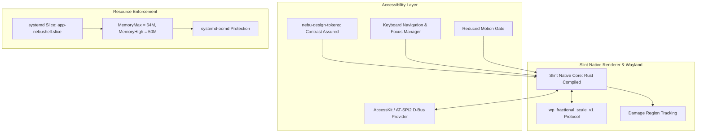
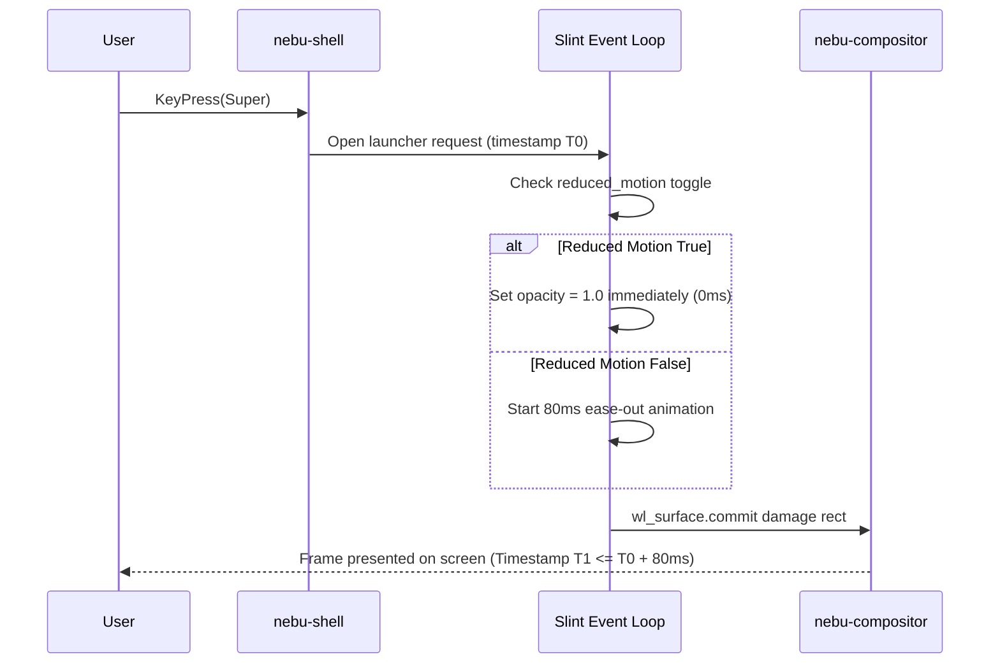

# Accessibility & Performance Engineering Specification — NebuOS

**Document ID:** NEBU-SPEC-DSN-004  
**Status:** DRAFT (Approved for Implementation in Milestone P2)  
**Authority Level:** Master Subsystem Specification  
**Governing ADR:** [ADR-0013: NebuOS UI Design System, Iconography, and Desktop Visual Architecture](../decisions/ADR-0013-ui-design-system-and-icon-architecture.md)  
**Target Audience:** Accessibility Engineers, Performance Architects, QA Engineers, Release Auditors  

---

## 1. Status

DRAFT — Formally specifies the accessibility compliance rules, keyboard navigation semantics, contrast validation formulas, screen reader integrations, fractional scaling standards, memory ceilings, latency budgets, and performance benchmarks across all visual desktop components in NebuOS.

---

## 2. Purpose

This specification establishes an uncompromising technical baseline for accessibility and performance. NebuOS treats accessibility not as an afterthought or optional plugin, but as an architectural invariant embedded in its design tokens and Slint widget primitives. Simultaneously, it enforces strict memory and latency ceilings to ensure that NebuOS remains exceptionally lightweight, booting and operating smoothly even on modest 4GB hardware without webview bloat.

---

## 3. Scope

- Four-tier requirements taxonomy:
  - **Hard Requirements:** Non-negotiable pass/fail criteria gating release candidate builds.
  - **Engineering Targets:** Measurable architectural goals with defined engineering tolerances.
  - **Benchmarks:** Concrete hardware profiles and reference test configurations.
  - **Recommendations:** Best-practice design guidelines.
- Contrast verification: Mathematical formula for WCAG 2.1 AA luminance contrast.
- Full keyboard navigation, focus indicators, and screen reader semantic bindings.
- Wayland fractional scaling without bilinear blur via `wp_fractional_scale_v1`.
- Touch target sizing (minimum 44x44px).
- Memory budgets: `nebu-shell` (<= 45 MB RSS), `nebu-marketplace-ui` (<= 35 MB RSS), zero Electron/Chromium.
- Latency budgets: Shell open latency (<= 80ms), input dispatch to scanout (<= 16ms).

---

## 4. Non-goals

- Allowing accessibility regressions to ship under "experimental" or "beta" tags.
- Permitting Electron, CEF, or Node.js runtimes to bypass memory budgets.
- Implementing heavy visual gimmicks (excessive blur shaders, unoptimized particle effects) that degrade battery life.
- Relying on X11 magnification hacks.

---

## 5. Requirements Taxonomy

### 5.1 Hard Requirements (Release-Blocking Gates)
1. **REQ-ACC-01 (Luminance Contrast):** All standard text (< 18pt or < 14pt bold) must maintain a contrast ratio of at least **4.5:1** against its immediate background. Large headers (>= 18pt) and primary interactive icons must maintain at least **3.0:1**.
2. **REQ-ACC-02 (Keyboard Operability):** Every interactive control (buttons, inputs, menus, dock items, close buttons) must be fully reachable and operable via keyboard alone (`Tab`, `Shift+Tab`, `Arrow keys`, `Space`, `Enter`, `Escape`).
3. **REQ-ACC-03 (Unambiguous Focus Indicator):** Active keyboard focus must be highlighted by a **2px solid focus ring** with minimum 2px offset and a contrast ratio of >= 3.0:1 against adjacent colors.
4. **REQ-ACC-04 (Reduced Motion Clamp):** When `settings.accessibility.reduced_motion` is true, all CSS/Slint animations, transitions, and slide effects must evaluate to **0ms duration**.
5. **REQ-ACC-05 (Seizure Prevention):** No UI element may flash or oscillate at a rate between 3 Hz and 50 Hz.
6. **REQ-PERF-01 (Shell Memory Budget):** The `nebu-shell` process must not exceed **45 MB RSS** in steady-state idle.
7. **REQ-PERF-02 (Marketplace Memory Budget):** The `nebu-marketplace-ui` client must not exceed **35 MB RSS** in steady-state idle.
8. **REQ-PERF-03 (Zero Heavy Webviews):** No graphical desktop component may embed Chromium, CEF, Electron, or WebKit.
9. **REQ-PERF-04 (Shell Launch Latency):** Shell launcher overlay must render its first interactive frame within **<= 80ms** of `Super` key release.

### 5.2 Engineering Targets (Measurable Goals)
1. **TGT-ACC-01 (Touch Hit Targets):** Interactive target bounding boxes should measure at least **44x44 physical pixels** (or 8mm equivalent) when running on touchscreen hardware.
2. **TGT-PERF-01 (Rendering Pacing):** Frame presentation should hit **60 FPS rock-solid** (16.6ms budget) on baseline Intel UHD 620 iGPUs, and **120/144 FPS** on high-refresh panels.
3. **TGT-PERF-02 (Crisp Fractional Scaling):** High-DPI displays operating at non-integer scales (125%, 150%, 175%) should render vector text and icons at native physical raster density without blurry bilinear interpolation.

### 5.3 Benchmarks (Reference Hardware Profiles)
- **Baseline Hardware Profile:** Dual-core Intel Core i3 (8th Gen) / AMD Ryzen 3, 4GB RAM, Intel UHD 620 iGPU, SATA SSD.
  - Idle Desktop RAM (Compositor + Shell + Background Daemons): **<= 120 MB total**.
  - Cold boot to ready desktop: **<= 8.0 seconds**.
- **Performance Hardware Profile:** 8-core modern CPU, 16GB+ RAM, dedicated GPU, NVMe SSD.
  - Shell open latency: **<= 25ms**.

### 5.4 Recommendations (Best Practices)
- **REC-01 (Dark Mode Default):** Ship dark mode as factory default to minimize power draw on OLED/AMOLED laptop displays.
- **REC-02 (Haptic / Audio Cues):** Provide subtle, optional 80ms audio or visual cues on touch interactions for users with visual impairments.

---

## 6. Architecture



---

## 7. Components

1. **Contrast Verification Engine:** Embedded mathematical calculation inside `nebu-design-tokens` utilizing relative luminance formulas:
   $$L = 0.2126 \times R + 0.7152 \times G + 0.0722 \times B$$
   $$\text{Contrast Ratio} = \frac{L_1 + 0.05}{L_2 + 0.05}$$
2. **AccessKit / AT-SPI Bridge:** Translates Slint accessibility semantic trees to standard Linux accessibility bus (`org.a11y.Bus`) for screen readers (Orca).
3. **Wayland Fractional Scale Handler:** Binds to `wp_fractional_scale_v1` on Wayland compositor outputs to dynamically configure the Slint viewport raster scale.

---

## 8. Data Flow



---

## 9. Control Flow

1. On component instantiation, Slint constructs both visual and accessibility semantic nodes.
2. If `settings.accessibility.high_contrast` is toggled on:
   - Token engine overrides `border` tokens with high-contrast outlines (e.g., `#FFFFFF` in dark mode).
   - Text colors clamp to maximum luminance contrast (ratio >= 7.0:1).
3. The keyboard navigation manager tracks active focus index. Pressing `Tab` increments focus index, calculates target bounding box, and animates the focus ring.
4. During rendering, damaged surface rectangles are submitted to the compositor. If the UI is static, frame generation stops completely (0.0% CPU).

---

## 10. Interfaces

### 10.1 Accessibility Configuration Schema (`~/.config/nebu/accessibility.toml`)
```toml
[accessibility]
high_contrast = false
reduced_motion = false
large_text = false
screen_reader_enabled = false
touch_mode = "auto" # "auto", "always", "never"
cursor_size = 24    # 24, 32, 48, 64
focus_ring_color = "#388BFD"
```

### 10.2 Memory Control Cgroup Unit (`nebu-shell.service`)
```ini
[Unit]
Description=NebuOS Desktop Shell
PartOf=graphical-session.target

[Service]
ExecStart=/usr/bin/nebu-shell
Restart=always
RestartSec=200ms
Slice=session.slice

# Strict Resource Governance
MemoryHigh=50M
MemoryMax=64M
CPUWeight=100
```

---

## 11. Dependencies

- `accesskit` (0.16+): Accessibility infrastructure for Rust UI toolkits.
- `slint` (1.8+): Vector rasterizer and layout engine.
- `libwayland-client`: For `wp_fractional_scale_v1` protocol extensions.

---

## 12. Security

- **Sandboxed Accessibility Bus:** Screen reader communication routes strictly through private user session sockets; untrusted sandboxed Flatpaks cannot intercept global keyboard input via AT-SPI without user permission.
- **Cgroup Memory Isolation:** If `nebu-shell` ever suffers a memory leak exceeding 64MB, `systemd` throttles memory allocation and triggers controlled recovery rather than degrading the entire OS.

---

## 13. Resource Requirements

- **Shell Idle RSS:** **<= 45 MB**.
- **Marketplace Idle RSS:** **<= 35 MB**.
- **Compositor Idle RSS:** **<= 35 MB**.
- **Combined Desktop Idle RSS:** **<= 120 MB**.
- **Idle CPU Utilization:** **0.0%** (zero redraw when quiescent).

---

## 14. Failure Modes

1. **Low Contrast Token Injection:** Third-party theme supplies low-contrast color values.
2. **Focus Navigation Black Hole:** A modal dialog fails to trap focus, allowing keyboard users to interact with invisible background surfaces.
3. **Fractional Scale Blurriness:** Compositor scales down an integer 2x buffer rather than using fractional viewport buffers.

---

## 15. Recovery Behavior

- Contrast verification fails safe: if an active theme produces contrast < 4.5:1, the token provider automatically substitutes high-contrast tokens.
- Modal dialogs intercept global keyboard events and automatically restore focus to the dialog header upon `Tab` overflow.
- Fractional scaling falls back to integer 2x scaling with downsampling only if the display compositor lacks `wp_fractional_scale_v1`.

---

## 16. Testing Requirements

- **Automated Contrast Audit:** CI script scanning all `.slint` color bindings and verifying contrast compliance against WCAG 2.1 AA.
- **Memory Footprint Assertion:** Headless benchmark running `nebu-shell` and `nebu-marketplace-ui` in QEMU for 10 minutes and asserting that RSS memory remains under 45MB and 35MB respectively.
- **Keyboard Traversal Test:** End-to-end test simulating `Tab` strokes across all system dialogs, asserting zero focus lockups.

---

## 17. Performance Requirements

- Shell open latency: **<= 80ms** from key release to frame presentation.
- Frame drop rate during panel reveal: **0 frames dropped** at 60Hz.
- Input dispatch latency: **<= 16ms**.

---

## 18. Compatibility Considerations

- **Legacy HiDPI Applications:** X11 applications running through rootless Xwayland are scaled cleanly via compositor viewport extensions.
- **Screen Reader Interoperability:** Implements standard AT-SPI2 interfaces, ensuring seamless operation with Orca and Linux screen magnifiers.

---

## 19. Open Questions

- **OQ-ACC-01:** Should screen magnification be implemented as a compositor-level pixel shader in `nebu-compositor` (P1) or as a shell overlay in `nebu-shell` (P2)? (Decision: Compositor-level shader in P1 for zero-overhead whole-desktop magnification).

---

## 20. Related Documents

- [ADR-0013: UI Design System and Icon Architecture](../decisions/ADR-0013-ui-design-system-and-icon-architecture.md)
- [00-design-system.md](00-design-system.md)
- [01-iconography.md](01-iconography.md)
- [02-theming-layout-behavior.md](02-theming-layout-behavior.md)
- [03-components.md](03-components.md)
- [docs/performance/01-memory-budget.md](../performance/01-memory-budget.md)
