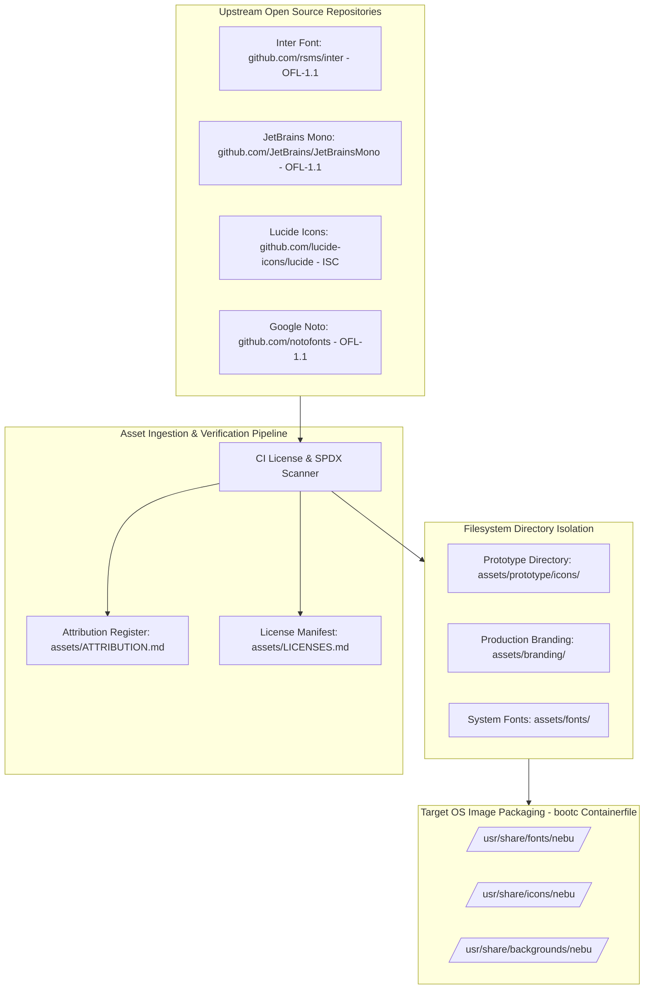
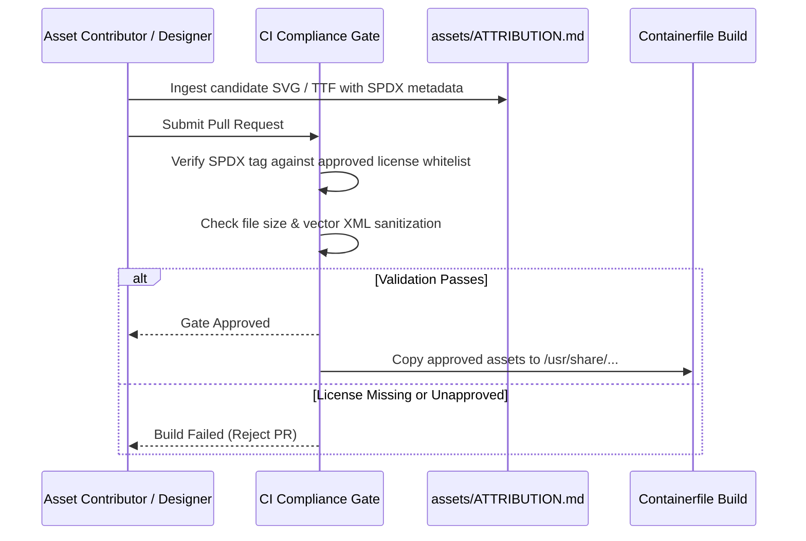

# External Asset Governance & Licensing Policy Specification — NebuOS

**Document ID:** NEBU-SPEC-DSN-005  
**Status:** DRAFT (Approved for Implementation in Milestone P2)  
**Authority Level:** Master Subsystem Specification  
**Governing ADR:** [ADR-0013: NebuOS UI Design System, Iconography, and Desktop Visual Architecture](../decisions/ADR-0013-ui-design-system-and-icon-architecture.md)  
**Target Audience:** Release Engineers, Legal & Compliance Auditors, UI Designers, Asset Maintainers  

---

## 1. Status

DRAFT — Formally specifies the governance policies, licensing validation workflows, SPDX metadata requirements, attribution manifests, and directory lifecycle boundaries for all external visual, typographic, and audio assets integrated into NebuOS.

---

## 2. Purpose

This specification establishes strict legal, technical, and architectural boundaries for all external static assets incorporated into the operating system. By enforcing standardized open-source licensing (SPDX identifiers), explicit copyright attribution, and physical filesystem isolation between temporary prototype assets and permanent production branding, NebuOS guarantees legal compliance, prevents intellectual property contamination, and enables seamless asset upgrades.

---

## 3. Scope

- Permitted and prohibited open-source licenses for fonts, candidate icons, wallpapers, and sound assets.
- Explicit SPDX identifier tagging for all bundled assets.
- Separation between prototype assets (`assets/prototype/`) and production assets (`assets/branding/`).
- Font asset governance: `Inter` (UI), `JetBrains Mono` (Terminal/Code), `Noto Sans` (International fallback).
- Candidate prototype icon set governance: Lucide Icons (`ISC`) / Material Symbols (`Apache-2.0`).
- Attribution tracking manifests: `assets/ATTRIBUTION.md` and `assets/LICENSES.md`.
- Automated CI license compliance scanning.

---

## 4. Non-goals

- Including proprietary, commercial, or non-commercial-only ("NC") copyrighted assets.
- Embedding unvetted third-party binary asset packages.
- Merging temporary prototype icon files directly into production branding directories.
- Granting blanket exceptions to SPDX license verification.

---

## 5. Requirements

1. **REQ-AST-01 (SPDX License Mandatory):** Every external asset introduced into the repository must specify a valid SPDX license identifier matching an approved open-source license.
2. **REQ-AST-02 (Attribution Integrity):** Upstream author names, copyright years, and original source repository URLs must be maintained in `assets/ATTRIBUTION.md`.
3. **REQ-AST-03 (Prototype Directory Isolation):** All temporary candidate icons, draft wallpapers, and evaluation sound files must be quarantined in `assets/prototype/`. They must never be placed in `assets/branding/`.
4. **REQ-AST-04 (Font License Invariant):** All bundled system fonts must be licensed under the SIL Open Font License 1.1 (`OFL-1.1`).
5. **REQ-AST-05 (Production Nebu Asset Ownership):** The final production Nebu Icon Set and OS branding assets (Milestone P8) must be owned by the NebuOS project or released under permissive licenses (`Apache-2.0`, `MIT`, or `CC0-1.0`).

---

## 6. Architecture



---

## 7. Components

1. **`assets/LICENSES.md`:** Comprehensive register containing the verbatim full-text legal licenses for every bundled external asset.
2. **`assets/ATTRIBUTION.md`:** Markdown table detailing asset name, upstream author/creator, original source URL, SPDX license ID, and NebuOS usage scope.
3. **CI Asset Linter (`cargo check-licenses` / script):** Automated verification tool validating that every SVG, TTF, and WOFF2 file is documented in the attribution registers.

---

## 8. Data Flow



---

## 9. Control Flow

1. Prior to committing any external font, icon, or wallpaper, the contributor verifies that the asset's license is on the approved whitelist.
2. The contributor adds an entry into `assets/ATTRIBUTION.md`.
3. If the asset is a prototype candidate icon, it is placed in `assets/prototype/icons/`.
4. During CI builds, the license scanner verifies that:
   - No `.gitignored` or unverified binary files exist.
   - All font files are OFL-1.1.
   - All prototype icons have ISC or Apache-2.0 declarations.
5. In Milestone P8, the production Nebu Icon Set replaces the prototype directory contents; the `nebu-icon` lookup mappings are updated with zero code refactoring.

---

## 10. Interfaces

### 10.1 Attribution Register Schema (`assets/ATTRIBUTION.md`)
```markdown
| Asset Identifier | Category | Upstream Author / Project | Source Repository URL | SPDX License | Usage Scope |
|---|---|---|---|---|---|
| `Inter-Variable.ttf` | Font | Rasmus Andersson | https://github.com/rsms/inter | `OFL-1.1` | Primary Desktop UI Typography |
| `JetBrainsMono.ttf` | Font | JetBrains s.r.o. | https://github.com/JetBrains/JetBrainsMono | `OFL-1.1` | Terminal & Developer Tools |
| `NotoSans-Regular.ttf`| Font | Google Fonts | https://github.com/notofonts | `OFL-1.1` | Universal International Fallback |
| `lucide-prototype-*` | Icons | Lucide Contributors | https://github.com/lucide-icons/lucide | `ISC` | Prototype UI Icons (Milestones P2–P6) |
```

---

## 11. Dependencies

- Git LFS (Large File Storage) for high-resolution wallpaper masters.
- Python `reuse` tool / `cargo-about` for automated license verification in CI.

---

## 12. Security

- **Vector XML Sanitization:** All external SVG files are parsed to strip out malicious active payloads (`<script>`, external entity calls, embedded HTML) before inclusion into the build tree.
- **Font Parsing Hardening:** Bundled TrueType/OpenType fonts must pass validation via `ftbench` / `ots` (OpenType Sanitizer) to eliminate font engine vulnerability exploits in FreeType.

---

## 13. Resource Requirements

- **Font Package Size:** Core font payload (`Inter` + `JetBrains Mono` + minimal `Noto`) capped at **<= 25 MB** total compressed image footprint.
- **Icon Package Size:** Vector icon masters capped at **<= 5 MB** in base OS image.

---

## 14. Failure Modes

1. **Unlicensed Asset Ingestion:** A developer checks in a proprietary commercial font or icon pack.
2. **Viral Copyleft Contamination:** Ingestion of an asset under GPL-3.0 without clear packaging separation.
3. **Missing Upstream Copyright Notice:** Attribution file omitted during asset upgrade.

---

## 15. Recovery Behavior

- CI automated license linter immediately halts pull request builds upon encountering an unapproved license.
- Any tainted asset discovered post-merge is subject to immediate emergency removal and replacement with an approved open-source equivalent.

---

## 16. Testing Requirements

- **CI License Lint Test:** Automated script validating that every file in `assets/` has a corresponding entry in `assets/ATTRIBUTION.md`.
- **OpenType Sanitizer Gate:** Automated execution of `ots-sanitize` on all TTF/OTF font files.
- **SVG Well-Formedness Test:** Automated XML validation asserting all SVGs are valid XML without external entity declarations.

---

## 17. Performance Requirements

- CI asset license validation check execution time: **<= 5.0 seconds**.
- Font loading and glyph rasterization latency: **<= 10ms** on system cold start.

---

## 18. Compatibility Considerations

- **Font Metrics Parity:** Fallback fonts are selected with closely matching x-heights and ascender/descender metrics to avoid visual layout shifts during font substitution.
- **Cross-Platform Compatibility:** Fonts and icons conform to standard XDG and FreeDesktop fontconfig directories (`/usr/share/fonts`).

---

## 19. Open Questions

- **OQ-AST-01:** Should wallpapers be bundled directly into the base OSTree image or distributed as an optional Flatpak background pack to conserve base image size? (Decision: Include 2 minimal high-resolution default wallpapers in base image; offer wallpaper packs via Marketplace).

---

## 20. Related Documents

- [ADR-0013: UI Design System and Icon Architecture](../decisions/ADR-0013-ui-design-system-and-icon-architecture.md)
- [00-design-system.md](00-design-system.md)
- [01-iconography.md](01-iconography.md)
- [02-theming-layout-behavior.md](02-theming-layout-behavior.md)
- [03-components.md](03-components.md)
- [04-accessibility-and-performance.md](04-accessibility-and-performance.md)
