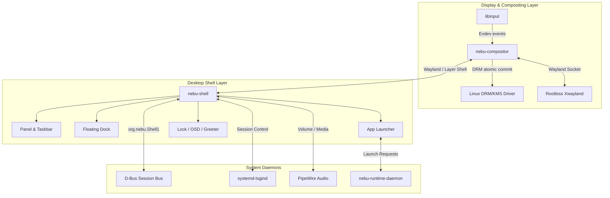
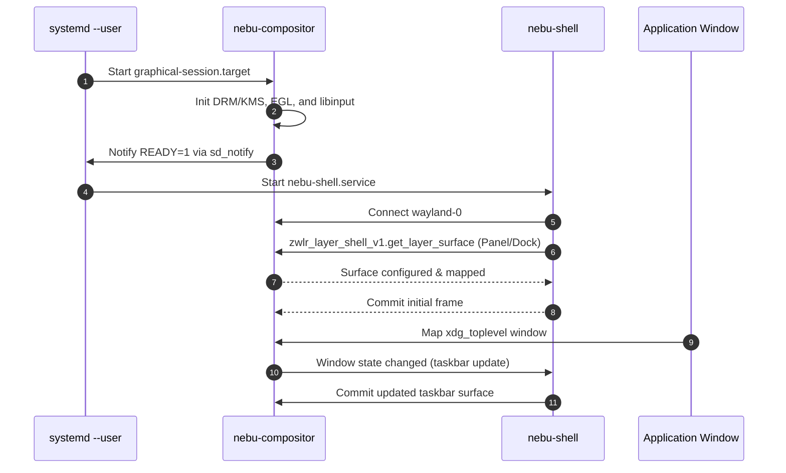

# Desktop Subsystem Specification — NebuOS

**Status:** DRAFT  
**Purpose:** Define the master architecture, process topology, Wayland protocol contracts, system services, and resource budgets for the NebuOS Desktop Environment.

---

## 1. Status
DRAFT — Master specification for the desktop subsystem, unifying NebuCompositor, NebuShell, theme engine, layout engine, and system UI components.

## 2. Purpose
The NebuOS Desktop Subsystem delivers a lightweight, modern, responsive Wayland user experience tailored for mixed Linux and Windows application execution. It coordinates surface rendering, frame presentation, input dispatch, dynamic layout switching, and system notifications without bloat, webviews, or multi-process Electron overhead.

## 3. Scope
- Master architecture and process boundaries of the desktop subsystem.
- Communication mechanisms between `nebu-compositor` and `nebu-shell`.
- Display server lifecycle and integration with `systemd --user` session targets.
- Coordinated resource limits (Compositor + Shell <= 120 MB combined idle RSS).
- Session startup, locking, idle management, and logout flows.

## 4. Non-goals
- X11 display server support as primary compositor (X11 supported solely via rootless Xwayland).
- Implementation of multiple desktop environments (GNOME, KDE, XFCE). NebuOS provides a single native Rust desktop.
- Web-based shell UI (no Electron, CEF, or Node.js).
- Heavy 3D window physics or resource-draining visual gimmicks.

## 5. Requirements
1. **R-DSK-01:** Provide native Wayland display management implemented in Rust using Smithay primitives.
2. **R-DSK-02:** Execute desktop shell as a separate unprivileged process using `wlr-layer-shell-unstable-v1`.
3. **R-DSK-03:** Maintain steady-state idle memory footprint of <= 35 MB RSS for Compositor and <= 45 MB RSS for Shell.
4. **R-DSK-04:** Support live switching between Nebu Default, Windows-like, and macOS-like desktop paradigms in <= 150ms without process restart (ADR-0009).
5. **R-DSK-05:** Present frames at native display refresh rates (60Hz–240Hz) with tearing-free atomic KMS commits and zero-copy direct scanout for fullscreen applications.

## 6. Architecture
The desktop subsystem consists of two core cooperating daemons and external FreeDesktop/systemd services:

## 7. Components
1. **`nebu-compositor`:** Standalone Wayland compositor handling DRM/KMS output, input event routing, window stacking, and surface presentation (Milestone P1).
2. **`nebu-shell`:** Unified desktop UI process containing the panel, launcher, notification center, quick settings, and dock (Milestone P2).
3. **`nebu-greeter`:** Display manager login screen compliant with `greetd` protocol.
4. **Theme & Design System Subsystem:** Rust-native token engine (`nebu-design-tokens`) and abstract iconography engine (`nebu-icon`) styling UI elements with zero CSS overhead (governed by ADR-0013 and `docs/design/`).
5. **Layout Subsystem:** Geometry solver dynamically placing panels, docks, and controls in accordance with tripartite desktop architecture.

## 8. Data Flow
1. Hardware input event generated (keyboard/mouse/touch).
2. Kernel evdev subsystem forwards event to `libinput` inside `nebu-compositor`.
3. Compositor tests hit regions:
   - If event targets a shell layer surface (e.g. start button click), event routes to `nebu-shell` via `wl_pointer`/`wl_keyboard`.
   - If event targets a client surface (e.g. Wine application window), event routes to client Wayland socket.
4. Client updates internal buffer, attaches new DMA-BUF, and issues `wl_surface.commit`.
5. Compositor collects damage rects, schedules composite pass or direct scanout, and executes `drmModeAtomicCommit` at VSync.

## 9. Control Flow

## 10. Interfaces
- **Wayland Socket:** `$XDG_RUNTIME_DIR/wayland-0`
- **Session Control D-Bus:** `org.nebu.Shell1` (`SwitchParadigm`, `GetActiveParadigm`)
- **Compositor Query D-Bus:** `org.nebu.Compositor1` (`ListOutputs`, `GetWindowTree`)
- **System Notification Protocol:** `org.freedesktop.Notifications` v1.2

## 11. Dependencies
- `smithay` 0.3+ (Rust compositor building blocks).
- `libinput` >= 1.25.
- `libdrm` >= 2.4.120.
- `mesa` >= 24.0 (EGL, GBM, Wayland platform).
- Slint / Iced native Rust UI toolkits (no webview/Chromium).

## 12. Security
- Wayland security model enforces strict client isolation: clients cannot snoop keystrokes or capture screen content without explicit privileged portal APIs (`xdg-desktop-portal`).
- Compositor and shell execute under unprivileged user UID (1000).
- Session lock screen utilizes `ext-session-lock-v1` guaranteeing that untrusted clients cannot bypass authentication.
- IPC sockets permissioned `0700` inside user runtime directory.

## 13. Resource Requirements
- **Compositor Memory:** Budgeted <= 35 MB RSS on idle (with 1 display output).
- **Shell Memory:** Budgeted <= 45 MB RSS on idle.
- **CPU Idle:** Combined desktop CPU consumption < 0.3% on modern x86_64 cores.
- **GPU VRAM:** Framebuffers allocated based on screen resolution (e.g. double-buffered 4K: ~64 MB).

## 14. Failure Modes
1. **GPU Hang / Driver Reset:** DRM driver encounters kernel timeout and resets GPU context.
2. **Compositor Crash:** Fatal panic or assertion inside `nebu-compositor`.
3. **Shell Process Crash:** Unexpected termination of `nebu-shell`.
4. **Wayland Socket Exhaustion:** File descriptor leak in client connection handling.

## 15. Recovery Behavior
- When GPU resets, compositor catches `EGL_CONTEXT_LOST`, drops invalid GBM textures, rebuilds render pipelines, and prompts clients to re-commit surfaces without terminating session.
- If `nebu-shell` crashes, systemd user supervisor immediately restarts it (`Restart=always`, `RestartSec=200ms`). Layer-shell surfaces re-anchor seamlessly; client applications remain running.
- If `nebu-compositor` crashes, systemd restarts `graphical-session.target`.

## 16. Testing Requirements
- Headless compositor test harness verifying Wayland protocol compliance.
- Virtual input injection test verifying mouse hover, click, drag, and window focus transitions.
- Multi-monitor hotplug simulation (display connect/disconnect events).
- Paradigm switch latency benchmark (< 150ms ceiling).

## 17. Performance Requirements
- Input latency (mouse movement to screen scanout): <= 16ms at 60Hz, <= 6ms at 165Hz.
- Application launcher invocation latency: <= 80ms from Super key release to first rendered frame.
- Zero dropped frames during window moving, resizing, and panel animations.

## 18. Compatibility Considerations
- Legacy X11 applications and games run through rootless Xwayland with automatic clipboard synchronization (`wl_data_device` <-> X11 CLIPBOARD).
- Fractional scaling handled via `wp_fractional_scale_v1` to prevent blur in Win32 HiDPI applications.
- Windows non-client decorations (custom titlebars, borderless windows) mapped accurately to xdg-toplevel states.

## 19. Open Questions
- **OQ-DSK-01:** Should Xwayland run on-demand (socket activated) or continuously as a standard session daemon?
- **OQ-DSK-02:** What is the preferred mechanism for custom shader effects on low-end Intel Gen9 iGPUs?

## 20. Related Documents
- [01-nebucompositor-specification.md](01-nebucompositor-specification.md)
- [02-nebushell-specification.md](02-nebushell-specification.md)
- [03-ui-theme-system.md](03-ui-theme-system.md)
- [04-layout-system.md](04-layout-system.md)
- [05-window-management.md](05-window-management.md)
- [06-input-display.md](06-input-display.md)
- [07-system-ui.md](07-system-ui.md)
- [ADR-0009: NebuShell UI Architecture](../decisions/ADR-0009-nebushell-ui-architecture.md)
- [ADR-0013: UI Design System and Icon Architecture](../decisions/ADR-0013-ui-design-system-and-icon-architecture.md)
- [Master Design System Specification](../design/00-design-system.md)
- [Iconography Architecture Specification](../design/01-iconography.md)
- [Tripartite Desktop Architecture Specification](../design/02-theming-layout-behavior.md)
- [Component Taxonomy Specification](../design/03-components.md)
- [Accessibility & Performance Specification](../design/04-accessibility-and-performance.md)
- [External Asset Governance Specification](../design/05-external-assets-and-licensing.md)
