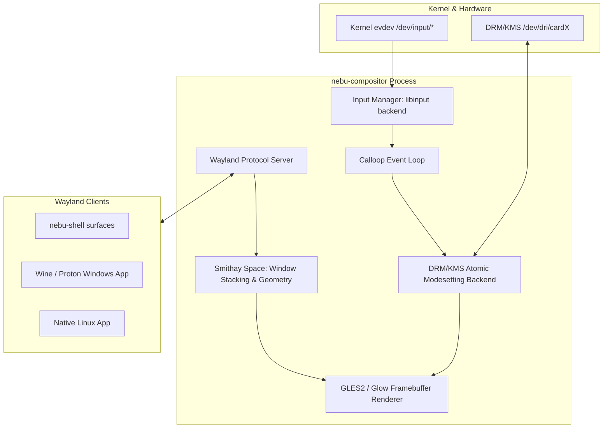
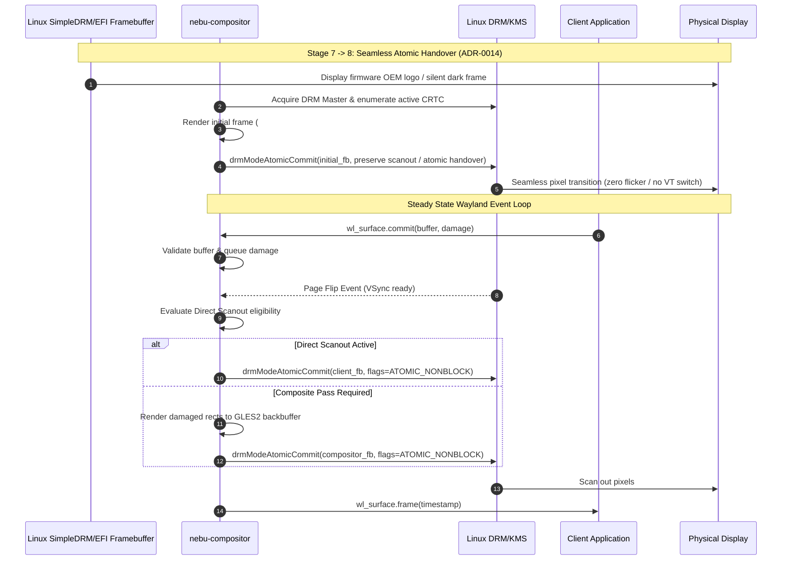

# NebuCompositor Technical Specification — NebuOS

**Status:** DRAFT  
**Purpose:** Provide the detailed engineering specification for `nebu-compositor`, the native Rust Wayland display server, render pipeline, and frame presentation scheduler.

---

## 1. Status
DRAFT — Technical implementation specification for Phase P1.

## 2. Purpose
`nebu-compositor` is the core display server for NebuOS. Written in Rust using Smithay, it manages display hardware via DRM/KMS, receives input events via libinput, coordinates buffer exchange with client applications, and schedules atomic page flips with deterministic frame pacing and minimal latency.

## 3. Scope
- DRM/KMS device enumeration, atomic modesetting, and page-flip lifecycle.
- GBM (Generic Buffer Management) buffer allocation and EGL/GLES2 rendering backend.
- Wayland protocol extension implementations (`xdg_shell`, `wlr_layer_shell`, `linux_dmabuf_v1`, `wp_fractional_scale_v1`).
- Direct scanout engine for uncomposited fullscreen gaming and video.
- Window stacking, geometry calculation, damage tracking, and dirty-rect composite passes.

## 4. Non-goals
- Embedding shell widgets or UI controls inside the compositor process.
- Software rasterization fallback for primary desktop rendering (GPU acceleration required).
- Supporting legacy proprietary display drivers incompatible with standard DRM/KMS GBM.

## 5. Requirements
1. **R-CMP-01:** Implement 100% safe Rust architecture for core event dispatch and window management logic, isolating unsafe FFI to graphics and ioctl bindings.
2. **R-CMP-02:** Expose standard Wayland core and extension protocols with strict protocol adherence.
3. **R-CMP-03:** Provide zero-copy direct scanout for eligible fullscreen surfaces bypassing the compositing shader.
4. **R-CMP-04:** Enforce memory usage budget <= 35 MB RSS during steady-state single-monitor operation.
5. **R-CMP-05:** Implement explicit GPU synchronization (`linux-drm-syncobj-v1`) to prevent frame tearing and pipeline bubbles.

## 6. Architecture
`nebu-compositor` is architected as an event-driven state machine centered around the `smithay` event loop and DRM backend:

## 7. Components
1. **DRM Node Manager:** Discovers primary GPU (`/dev/dri/card0`), enumerates connectors (CRTCs, encoders, planes), and binds atomic modesetting states. Implements seamless EFI framebuffer scanout plane inheritance (guided by ACPI BGRT metadata) during boot handover.
2. **Buffer Importer (`linux-dmabuf`):** Imports client DMA-BUF textures into GBM and EGL without CPU copies.
3. **Damage Tracker:** Aggregates surface dirty rectangles to restrict rendering strictly to damaged screen regions.
4. **Direct Scanout Arbiter:** Evaluates if a fullscreen window covers the entire CRTC; if pixel formats match, flips the client DMA-BUF directly to the hardware primary plane.
5. **Layer Shell Coordinator:** Maps and arranges `wlr-layer-shell` surfaces (panels, background wallpapers, docks, notifications) into dedicated visual tiers.
6. **Graphical Handoff Controller (ADR-0014):** Preserves existing scanout buffer inherited from Linux SimpleDRM / EFI framebuffer on startup, staging the initial compositor frame before atomic commit under the scanout preservation principle (avoiding unnecessary modeset when compatible, while permitting clean atomic modeset if hardware requires link retraining) to guarantee zero-flicker handover from boot to Wayland desktop.

## 8. Data Flow
1. **Startup Handover:** Compositor discovers active CRTC and existing scanout FB (SimpleDRM / EFI framebuffer). It initializes GBM/EGL in the background, renders the initial desktop background frame matching design token `Color.Background (#0D1117)`, and applies the scanout preservation principle: it commits atomically via `DRM_CLIENT_CAP_UNIVERSAL_PLANES` preserving current scanout timings without unnecessary modesetting. If native hardware requires a modeset (e.g. link retraining), it executes cleanly via atomic KMS without VT churn.
2. Client draws into a Vulkan/OpenGL framebuffer and issues `wl_surface.commit` with an attached DMA-BUF handle.
3. Compositor receives `commit` event via Wayland UNIX socket.
4. Damage tracker records bounding boxes of modified regions.
5. Render tick triggered by DRM `PAGE_FLIP_EVENT`:
   - If direct scanout applies: assigns client buffer directly to DRM plane property `FB_ID`.
   - If compositing required: binds screen framebuffer, sets scissor rect to damage union, renders background, windows, and overlays via GLES2 shaders.
6. Issues non-blocking `drmModeAtomicCommit` with presentation timeline syncobj.
7. Hardware scans out buffer at next VSync; compositor dispatches `wl_surface.frame` callbacks to clients.

## 9. Control Flow

## 10. Interfaces
- **Exported Wayland Protocols:**
  - `wl_compositor` (v6), `wl_subcompositor` (v1)
  - `wl_seat` (v8), `wl_output` (v4), `wl_shm` (v1)
  - `xdg_wm_base` (v4), `wlr-layer-shell-unstable-v1` (v4)
  - `linux_dmabuf_v1` (v4), `wp_fractional_scale_v1` (v1), `wp_viewporter` (v1)
  - `ext-session-lock-v1` (v1), `linux-drm-syncobj-v1` (v1)
- **Private IPC:**
  - Custom protocol `nebu_window_grouping_v1` for Windows multi-window taskbar grouping.
  - Session D-Bus `org.nebu.Compositor1`.

## 11. Dependencies
- `smithay` = "0.3"
- `calloop` = "0.13"
- `nix` = "0.28"
- `drm-rs` = "0.11"
- `gbm` = "0.15"

## 12. Security
- Complete isolation of client surfaces: applications cannot read pixels of other windows.
- Clipboard data transfer governed strictly by user interaction (paste events).
- Privileged protocols (`wlr-layer-shell`, `screencopy`) restricted to authorized binaries (`nebu-shell`, `nebu-screenshot`) via Unix domain socket UID/credential checks.
- Virtual input injection restricted to authorized tools.

## 13. Resource Requirements
- **Idle Memory:** <= 35 MB RSS.
- **Active Memory (4K desktop with 10 windows):** <= 65 MB RSS.
- **CPU Utilization:** < 0.2% CPU when desktop is idle; < 2% during continuous 60 FPS window dragging.
- **File Descriptors:** Capped at 1024 open descriptors.

## 14. Failure Modes
1. **DRM Atomic Commit Failure (`EINVAL` / `EBUSY`):** Invalid hardware plane configuration.
2. **GPU Driver Hang (`EIO` / `ENODEV`):** Driver reset during execution.
3. **Out of Memory during Buffer Allocation:** GBM buffer allocation fails.
4. **Wayland Client Protocol Violation:** Client sends malformed arguments.

## 15. Recovery Behavior
- When atomic commit returns `EINVAL` (unsupported multi-plane layout), direct scanout arbiter drops to safe single-plane composited mode immediately and retries.
- Client protocol violations trigger `wl_client_post_implementation_error`, terminating solely the offending client without destabilizing compositor.
- Under memory pressure, unused cached surface textures and scratch framebuffers are evicted immediately.

## 16. Testing Requirements
- Virtual KMS test runner executing in CI via `vkms` (Virtual Kernel Modesetting).
- Protocol conformance test suite asserting valid state transitions across all exposed Wayland interfaces.
- Direct scanout verification test verifying 0 shader draw calls when fullscreen video/game active.

## 17. Performance Requirements
- Frame scheduling precision: standard deviation of frame delivery time <= 0.5ms at 60Hz.
- Compositor internal latency (commit received to atomic commit ioctl dispatched): <= 2.5ms.
- Zero copy overhead for fullscreen DMA-BUF scanout.

## 18. Compatibility Considerations
- Wine applications requiring non-standard window border behavior are governed through xdg-toplevel rules.
- Legacy full-screen resolutions (e.g. 800x600, 1024x768) scaled seamlessly using `wp_viewporter` without altering physical monitor resolution.
- Xwayland rootless windows receive seamless window stacking and focus transitions.

## 19. Open Questions
- **OQ-CMP-01:** Should Variable Refresh Rate (VRR / Adaptive Sync) be enabled globally or toggled strictly per-window for detected gaming surfaces?
- **OQ-CMP-02:** What is the optimal threshold for switching from DRM double-buffering to triple-buffering during heavy GPU load?

## 20. Related Documents
- [00-desktop-specification.md](00-desktop-specification.md)
- [02-nebushell-specification.md](02-nebushell-specification.md)
- [05-window-management.md](05-window-management.md)
- [06-input-display.md](06-input-display.md)
- [../decisions/ADR-0005-nebu-compositor.md](../decisions/ADR-0005-nebu-compositor.md)
- [../decisions/ADR-0014-boot-experience-and-graphical-handoff.md](../decisions/ADR-0014-boot-experience-and-graphical-handoff.md)
