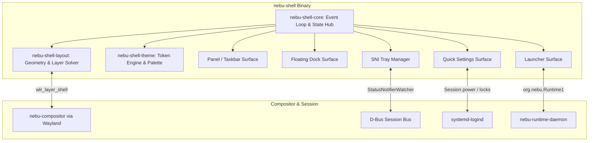
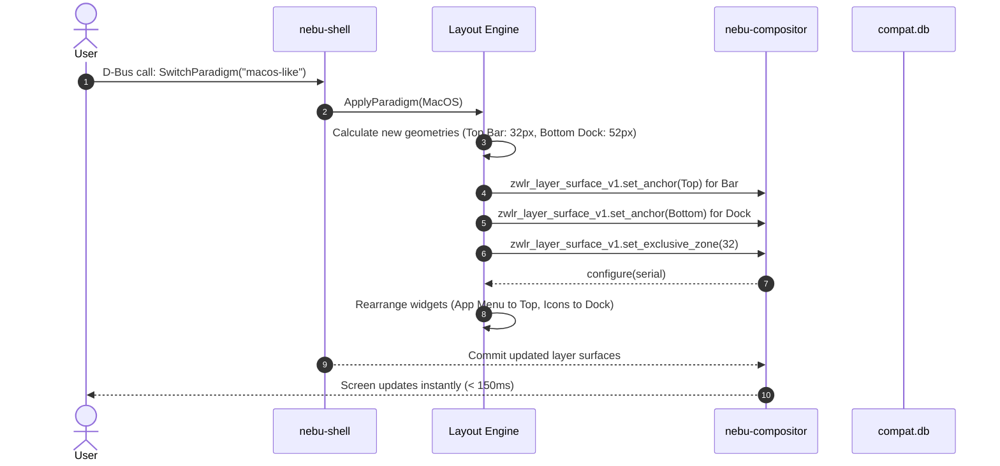

# NebuShell Technical Specification — NebuOS

**Status:** DRAFT  
**Purpose:** Provide the detailed engineering specification for `nebu-shell`, the unified native Rust desktop shell implementing configurable themes, layouts, panels, and system widgets.

---

## 1. Status
DRAFT — Technical implementation specification for Phase P2.

## 2. Purpose
`nebu-shell` is the sole user-facing desktop shell process for NebuOS. In accordance with ADR-0009, NebuShell avoids maintaining fragmented, separate shell binaries. Instead, it provides a single, high-performance Rust process equipped with a declarative theme and layout engine capable of rendering Nebu-default, Windows-like, and macOS-like paradigms live at runtime.

## 3. Scope
- Unified shell process architecture and sub-module topology.
- Taskbar/panel surface rendering and layer-shell integration.
- Application launcher with in-memory indexed search.
- Quick settings modal, system tray (StatusNotifierItem), and OSD overlays.
- Dynamic layout reconfiguration without process restart or user logout.
- Memory budget enforcement (<= 45 MB idle RSS).

## 4. Non-goals
- Multi-process shell architectures where every widget runs as a separate binary.
- Web-based frontends (Electron, React, HTML/CSS).
- Arbitrary untrusted JavaScript plugin ecosystems.
- Window compositor responsibilities (rendering done via Wayland client surfaces).

## 5. Requirements
1. **R-SHL-01:** Implement NebuShell as a single native Rust binary utilizing the Slint GUI toolkit in accordance with [ADR-0019](../decisions/ADR-0019-slint-toolkit-adoption.md).
2. **R-SHL-02:** Anchor all UI surfaces via `wlr-layer-shell-unstable-v1` into designated Wayland layers (`Bottom`, `Top`, `Overlay`).
3. **R-SHL-03:** Support instant paradigm switching (Nebu, Windows-like, macOS-like) in <= 150ms over D-Bus without killing running applications.
4. **R-SHL-04:** Ensure application launcher response time is <= 80ms from Super key press to visible UI.
5. **R-SHL-05:** Implement StatusNotifierWatcher and StatusNotifierItem (SNI) specifications for background application tray icons.

## 6. Architecture
NebuShell is structured into decoupled functional crates within the NebuOS workspace:

## 7. Components
1. **Shell State Hub:** Centralized reactive state store managing running windows, active layout, theme tokens, and network/audio status.
2. **Layout Solver (`nebu-layout`):** Computes monitor boundaries, calculates exclusive zones, anchors layer surfaces, and dynamically reconfigures anchors during paradigm switches.
3. **Design Token Engine (`nebu-design-tokens`):** Central token provider binding semantic colors, typography scale, 4px/8px spatial grids, and motion budgets (governed by ADR-0013 and `docs/design/00-design-system.md`).
4. **Abstract Icon Engine (`nebu-icon`):** Strongly typed `NebuIcon` resolver providing vector glyphs, prototype/production library abstraction, and untrusted icon sandbox caching (`docs/design/01-iconography.md`).
5. **Taskbar & Window Switcher:** Displays active windows with live running indicators, thumbnails, and multi-window grouping for Wine/Linux apps.
6. **Fast Launcher:** Queries in-memory SQLite application index with fuzzy search matching (sub-millisecond query latency).
7. **System Tray Host:** Implements `org.kde.StatusNotifierWatcher` providing native tray icon hosting for Wine background apps and Linux utilities.
8. **Boot Transition Coordinator (ADR-0014):** In Milestone P2, coordinates the smooth, flicker-free cross-fade from the boot splash/background into the interactive desktop shell session, applying master motion tokens (`Motion.DurationNormal 200ms`, `Motion.EasingEmphasized`).

## 8. Data Flow
1. **Boot Splash Handover (Milestone P2):** When `nebu-shell` initializes, it connects to `nebu-compositor` via Wayland layer-shell. Compositor notifies shell that initial display scanout is active. `nebu-shell` renders initial panel and desktop state off-screen, then triggers a 200ms opacity cross-fade, seamlessly dissolving any boot splash into the ready interactive desktop.
2. Window mapped or state changed in `nebu-compositor`.
3. Compositor broadcasts window event over Wayland protocol extension.
4. `nebu-shell` receives event; State Hub updates window list.
5. Taskbar widget invalidates local rect and triggers minimal repaint.
6. Slint renderer draws updated panel UI to DMA-BUF/SHM and issues `wl_surface.commit`.
7. Total time from compositor event to committed shell frame: < 8ms.

## 9. Control Flow

## 10. Interfaces
- **D-Bus Session Interface:** `org.nebu.Shell1`
  - Methods: `SwitchParadigm(String name)`, `GetActiveParadigm() -> String`, `ListAvailableParadigms() -> Array<String>`, `ToggleLauncher()`, `ToggleQuickSettings()`.
- **System Tray Protocol:** `org.kde.StatusNotifierWatcher` / `org.kde.StatusNotifierItem`.
- **Layer Shell Wayland Protocol:** `zwlr_layer_shell_v1` surfaces.

## 11. Dependencies
- Native Rust GUI toolkit (`slint` or `iced`).
- `wayland-client` = "0.31".
- `zbus` = "4.0" (asynchronous D-Bus).
- `rusqlite` = "0.31" (read-only in-memory search index).

## 12. Security
- Executes exclusively as unprivileged user session process (UID 1000).
- Password inputs (lock screen / authentication prompts) wrapped in memory-safe `zeroize::Zeroizing` buffers.
- D-Bus methods restricted to session owner.
- Shell does not execute arbitrary shell scripts; all application launches routed through `nebu-runtime-daemon` validation.

## 13. Resource Requirements
- **Idle Memory:** <= 45 MB RSS.
- **Peak Search Memory:** <= 70 MB RSS.
- **CPU Idle:** 0.0% CPU when no animations active; event-driven rendering only.
- **Binary Footprint:** Stripped executable <= 18 MB on disk.

## 14. Failure Modes
1. **D-Bus Daemon Disconnection:** Session bus restarts or drops socket.
2. **Layer Shell Surface Collision:** Exclusive zone conflicts with display edge.
3. **Tray App Malformed Icon:** Background application provides invalid PNG/ARGB data.
4. **Rapid Paradigm Toggling:** User triggers repeated paradigm changes within milliseconds.

## 15. Recovery Behavior
- In D-Bus disconnection, `nebu-shell` maintains local rendering and enters a reconnection loop with exponential backoff (100ms to 2s).
- Malformed SNI icons are caught by parser and replaced with standard fallback asset without crashing tray thread.
- Paradigm switch requests are debounced by 200ms in the event loop, preventing race conditions or layout instability.

## 16. Testing Requirements
- Unit tests for layout constraint solver verifying all display aspect ratios (16:9, 16:10, 21:9, 32:9).
- Integration test benchmarking launcher search query latency with 5,000 indexed application entries.
- Automated paradigm switch stress test verifying 100 consecutive switches without memory leaks or UI artifacts.

## 17. Performance Requirements
- Cold start launch to visible panel: <= 200ms.
- Launcher search keystroke to filtered results render: <= 12ms.
- Paradigm switch execution: <= 150ms.
- Frame delivery during dock magnification / panel animation: locked 60/120 FPS.

## 18. Compatibility Considerations
- Windows applications minimizing to system tray map directly to SNI icons with right-click context menu forwarding.
- Start menu search integrates Wine application shortcuts (`.desktop` files) transparently alongside native Linux tools.
- Multi-monitor environments allow panel replication or primary-monitor-only configurations.

## 19. Open Questions
- **OQ-SHL-01:** Should application launcher include integrated web search suggestions or remain strictly local-only? (PRD leans local-only for privacy and speed).
- **OQ-SHL-02:** Should panel widgets support user drag-and-drop rearrangement in P2 or be deferred to P4?

## 20. Related Documents
- [00-desktop-specification.md](00-desktop-specification.md)
- [01-nebucompositor-specification.md](01-nebucompositor-specification.md)
- [03-ui-theme-system.md](03-ui-theme-system.md)
- [04-layout-system.md](04-layout-system.md)
- [07-system-ui.md](07-system-ui.md)
- [../decisions/ADR-0009-nebushell-ui-architecture.md](../decisions/ADR-0009-nebushell-ui-architecture.md)
- [../decisions/ADR-0013-ui-design-system-and-icon-architecture.md](../decisions/ADR-0013-ui-design-system-and-icon-architecture.md)
- [Master Design System Specification](../design/00-design-system.md)
- [Iconography Architecture Specification](../design/01-iconography.md)
- [Tripartite Desktop Architecture Specification](../design/02-theming-layout-behavior.md)
- [Component Taxonomy Specification](../design/03-components.md)
- [Accessibility & Performance Specification](../design/04-accessibility-and-performance.md)
- [External Asset Governance Specification](../design/05-external-assets-and-licensing.md)
- [../decisions/ADR-0014-boot-experience-and-graphical-handoff.md](../decisions/ADR-0014-boot-experience-and-graphical-handoff.md)
