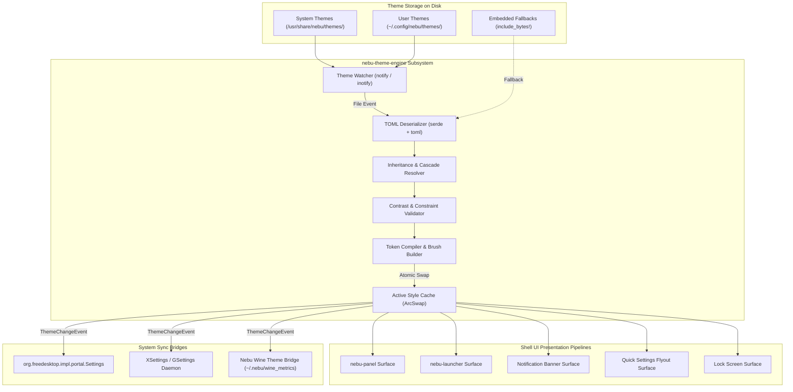
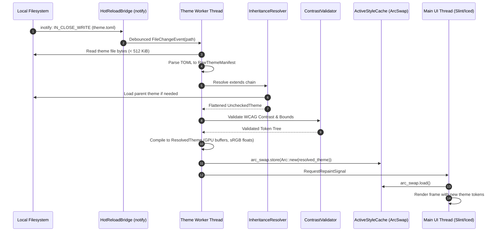
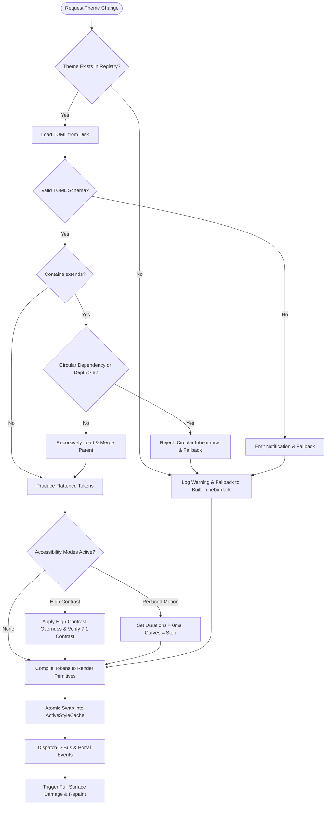

# UI Theme System Specification — NebuOS

**Status:** DRAFT  
**Purpose:** Specify the native theming architecture, token resolution model, declarative configuration schemas, hot-reloading mechanism, built-in themes, and accessibility adaptations for NebuShell.

---

## 1. Status
Current Status: **DRAFT** (Review cycle 1.0)  
Target Implementation: NebuOS Core Desktop Milestone (Shell v1.0)

---

## 2. Purpose
The NebuOS UI Theme System provides a centralized, deterministic, and lightweight visual styling engine for `nebu-shell` and its associated desktop surfaces. The theme engine standardizes color semantics, typography, corner geometry, elevation shadows, widget opacities, and transition animation curves without embedding a web browser engine, CSS layout engine, or dynamic runtime interpreter. It delivers pixel-crisp rendering, instant hot-reloading for developers and users, and hard constraints ensuring resource usage remains within the 4 GB hardware envelope.

---

## 3. Scope
### In-Scope
- **Token Definition & Architecture:** Semantic design tokens for colors, typography, geometry (border radius, padding, margins), elevation shadows, visual effects, and physics-based animation curves.
- **File Format & Specification:** Formal TOML-based theme specification schema supporting declarative inheritance and granular token overrides.
- **Engine Architecture:** Rust-native token parser, inheritance cascade resolver, style cache, and thread-safe atomic swap mechanism.
- **Hot-Reload Subsystem:** Low-overhead filesystem notification bridge watching system and user theme directories for immediate runtime styling updates.
- **Built-in Theme Suite:** Concrete token definitions for `nebu-default`, `nebu-dark`, `windows-like`, and `macos-like` visual profiles.
- **Accessibility Engine:** Contrast calculation rules adhering to WCAG 2.1 AAA (>= 7:1 for text), automatic high-contrast token overrides, and reduced-motion timing collapse.
- **Performance & Resource Guardrails:** Strict memory ceiling (<= 2.0 MB RSS overhead) and zero-frame-drop theme switching.
- **Ecosystem Synchronization:** Projection of active theme tokens to freedesktop standards (`org.freedesktop.appearance.color-scheme`, GTK/Qt configuration files, and Wine system metrics).

### Out-of-Scope
- Web technologies (CSS3, SCSS, HTML DOM, Chromium/Blink, WebKit, or Gecko).
- Direct arbitrary code execution or scripting within theme files (no JavaScript, Lua, or Python plugins).
- Application internal client-side rendering (the theme system styles NebuShell surfaces; client applications style themselves, though NebuShell exports hints to them).
- Custom 3D shader mesh deformation or physics-based liquid glass simulations.

---

## 4. Non-Goals
1. **No CSS/Web Engine Compatibility:** NebuShell does not implement the W3C CSS specification or HTML box model. Styling uses strongly typed Rust structs and declarative TOML tokens.
2. **No Pixel-for-Pixel Trademark Cloning:** The `windows-like` and `macos-like` themes are ergonomic styling references designed to make migrating users feel comfortable; they do not reproduce proprietary assets, copyrighted icons, or patented interface trade dress.
3. **No Unbounded User Extensions:** Themes cannot introduce custom executable code, dynamic shared libraries (`.so`), or external network dependencies into the shell process space.

---

## 5. Requirements

### 5.1 Functional Requirements
- **FR-THEME-01:** The theme engine must parse, validate, and activate any valid theme TOML file in <= 15 milliseconds on a single core of an Intel Core i5-4200U processor.
- **FR-THEME-02:** The theme engine must support single-inheritance cascades using an explicit `extends = "<theme_id>"` manifest key, resolving circular dependencies with an error.
- **FR-THEME-03:** The engine must expose distinct token categories: Palette, Geometry, Typography, Shadow, Opacity, Animation, and Effects.
- **FR-THEME-04:** Built-in themes (`nebu-default`, `nebu-dark`, `windows-like`, `macos-like`) must be embedded into the `nebu-shell` binary at compile-time as fallbacks.
- **FR-THEME-05:** The engine must watch both system (`/usr/share/nebu/themes/`) and user (`$XDG_CONFIG_HOME/nebu/themes/`) directories via inotify, triggering atomic reload on file writes or attribute updates.
- **FR-THEME-06:** The engine must support High Contrast Mode (`high_contrast = true`) which forces surface-to-text contrast ratios to meet or exceed 7.0:1 (WCAG AAA).
- **FR-THEME-07:** The engine must support Reduced Motion Mode (`reduced_motion = true`) which forces all animation durations to `0ms` and replaces bezier transitions with instantaneous step functions.
- **FR-THEME-08:** The engine must broadcast active theme changes over the D-Bus session bus via `org.nebu.ThemeManager1` and update the standard `org.freedesktop.appearance.color-scheme` key.

### 5.2 Non-Functional Requirements
- **NFR-THEME-01 (Memory Overhead):** The theme engine, including cached parsed tokens, computed colors, font handles, and icon maps, must consume <= 2.0 MB of resident memory (RSS).
- **NFR-THEME-02 (CPU Overhead):** File watching and hot-reload listeners must register zero wakeups (0.0% CPU usage) when theme files are quiescent.
- **NFR-THEME-03 (Frame Budget):** Theme swapping during active user sessions must not block the main Wayland presentation thread or drop frames (presentation deadline < 16.6ms for 60Hz, < 8.3ms for 120Hz).
- **NFR-THEME-04 (Type Safety):** All theme files must be strictly deserialized into strongly typed Rust data structures; missing required non-inheritable keys must produce deterministic diagnostic errors.

---

## 6. Architecture

The theme engine operates as an embedded subsystem within the `nebu-shell` process. It decouples the raw declarative specification on disk from the GPU rendering pipeline through a multi-stage compilation and caching pipeline.



---

## 7. Components

### 7.1 `ThemeRegistry`
- **Location:** `nebu-shell::theme::registry`
- **Responsibility:** Enumerates, catalogs, and indexes all installed themes from `/usr/share/nebu/themes/` and `~/.config/nebu/themes/`.
- **Key Invariants:** Built-in compiled themes are always registered as immutable roots. User themes with identical identifiers override system-level themes.

### 7.2 `ThemeParser`
- **Location:** `nebu-shell::theme::parser`
- **Responsibility:** Ingests raw TOML strings and executes schema validation against strongly typed Rust serde models. Rejects files larger than 512 KiB to prevent denial-of-service memory allocations.

### 7.3 `InheritanceResolver`
- **Location:** `nebu-shell::theme::resolver`
- **Responsibility:** Resolves `extends` inheritance chains. Maintains a recursion depth counter (maximum depth = 8). Recursively merges child token tables into parent token tables, ensuring child values overwrite parent keys.

### 7.4 `StyleCompiler & ActiveStyleCache`
- **Location:** `nebu-shell::theme::cache`
- **Responsibility:** Compiles raw string hex codes and dimension floats into GPU-native primitives:
  - Color values transformed into `[f32; 4]` linear sRGB floats.
  - Dimension units normalized to physical device pixels based on Wayland output scale factors.
  - Shadows parsed into blur radius, spread, horizontal/vertical offsets, and RGBA ambient/key colors.
  - Animation curves parsed into cubic bezier control points `(x1, y1, x2, y2)`.
- **Concurrency Model:** Stores the active theme inside an `ArcSwap<ResolvedTheme>`, enabling lock-free, zero-wait reads from the UI rendering thread.

### 7.5 `HotReloadBridge`
- **Location:** `nebu-shell::theme::watcher`
- **Responsibility:** Spawns a background thread utilizing the `notify` crate to monitor theme configuration directories. Debounces rapid editor write events (150ms debounce window) and queues compile tasks on the shell worker runtime.

### 7.6 `ExternalSyncBridge`
- **Location:** `nebu-shell::theme::sync`
- **Responsibility:** Synchronizes theme changes to external application toolkits so native apps and Wine apps harmonize with the shell theme:
  - Emits `org.freedesktop.portal.Settings.SettingChanged` for `color-scheme` (0: default, 1: dark, 2: light).
  - Writes legacy GTK configuration files (`~/.config/gtk-3.0/settings.ini`, `~/.config/gtk-4.0/settings.ini`).
  - Generates Wine registry color metrics (`Control Panel\\Colors`) applied during prefix execution.

---

## 8. Data Flow

### 8.1 Theme Ingestion and Compilation Pipeline



---

## 9. Control Flow

### 9.1 Theme Selection & Fallback Decision Tree



---

## 10. Interfaces

### 10.1 Theme Specification File Format (TOML Schema)

Theme files are saved with the extension `.toml` (e.g., `nebu-dark.toml`).

```toml
[metadata]
id = "nebu-dark"
name = "Nebu Dark"
version = "1.0.0"
author = "NebuOS Desktop Team <desktop@nebuos.org>"
license = "Apache-2.0 OR MIT"
description = "Default dark theme for NebuOS featuring deep slate surfaces and vibrant cyan accents."
extends = ""                   # Optional parent theme ID
variant = "dark"               # "dark" | "light" | "high-contrast"

[palette]
# Backgrounds & Surfaces
bg_base = "#0f141c"            # Master desktop / canvas background
bg_surface = "#161d27"         # Primary panel, window, and flyout background
bg_surface_elevated = "#1f2937"# Menus, dialogs, flyouts
bg_surface_sunken = "#0a0e14"   # Text inputs, search fields, wells

# Foreground & Typography Colors
fg_primary = "#f3f4f6"         # Primary readable text
fg_secondary = "#9ca3af"       # Subtitles, inactive labels, metadata
fg_tertiary = "#6b7280"        # Placeholders, disabled text
fg_on_accent = "#ffffff"       # Text drawn on top of accent colors

# Accent & Brand Colors
accent_primary = "#06b6d4"     # Nebu Cyan
accent_hover = "#22d3ee"       # Hovered accent
accent_active = "#0891b2"      # Pressed / active accent
accent_subtle = "rgba(6, 182, 212, 0.15)" # Accent tinted background

# Status Indicators
status_info = "#38bdf8"
status_success = "#10b981"
status_warning = "#f59e0b"
status_danger = "#ef4444"

# Borders & Separators
border_subtle = "rgba(255, 255, 255, 0.08)"
border_strong = "rgba(255, 255, 255, 0.18)"
border_focus = "#06b6d4"

[geometry]
border_radius_xs = 2           # Checkboxes, badges
border_radius_sm = 4           # Buttons, input fields
border_radius_md = 8           # Flyouts, popups, notification cards
border_radius_lg = 12          # Quick settings modal, launcher
border_radius_xl = 16          # Floating docks
border_width = 1               # Default border width in physical px

[typography]
font_family_sans = "Inter, Cantarell, Noto Sans, sans-serif"
font_family_mono = "JetBrains Mono, DejaVu Sans Mono, monospace"
font_size_xs = 11
font_size_sm = 12
font_size_base = 13
font_size_lg = 15
font_size_xl = 18
font_weight_regular = 400
font_weight_medium = 500
font_weight_bold = 700
line_height_base = 1.4

[icons]
icon_theme = "nebu-symbolic"   # Freedesktop icon theme name
icon_size_xs = 14
icon_size_sm = 16
icon_size_md = 22
icon_size_lg = 32
icon_size_xl = 48

[shadows]
shadow_sm = "0 1px 2px 0 rgba(0, 0, 0, 0.35)"
shadow_md = "0 4px 6px -1px rgba(0, 0, 0, 0.45)"
shadow_lg = "0 10px 15px -3px rgba(0, 0, 0, 0.60)"

[effects]
enable_blur = true             # Compositor backdrop blur toggle
blur_radius = 16               # Kernel blur radius in pixels
surface_opacity = 0.92         # Base panel/menu surface transparency

[animation]
duration_instant = 0           # ms
duration_fast = 120            # Button hover, toggle switch (ms)
duration_normal = 200          # Flyout opening, launcher reveal (ms)
duration_slow = 320            # Workspace slide, window minimize (ms)
curve_standard = [0.2, 0.0, 0.0, 1.0] # Custom cubic-bezier (x1, y1, x2, y2)
curve_decelerate = [0.0, 0.0, 0.2, 1.0]
curve_accelerate = [0.4, 0.0, 1.0, 1.0]
```

### 10.2 Rust Type Contracts

```rust
// In nebu-theme-engine/src/tokens.rs

use serde::{Deserialize, Serialize};
use std::sync::Arc;

#[derive(Debug, Clone, Serialize, Deserialize)]
pub struct ThemeManifest {
    pub metadata: MetadataTokens,
    pub palette: PaletteTokens,
    pub geometry: GeometryTokens,
    pub typography: TypographyTokens,
    pub icons: IconTokens,
    pub shadows: ShadowTokens,
    pub effects: EffectTokens,
    pub animation: AnimationTokens,
}

#[derive(Debug, Clone, Copy, PartialEq)]
pub struct RgbaColor {
    pub r: f32, // 0.0 to 1.0 linear sRGB
    pub g: f32,
    pub b: f32,
    pub a: f32,
}

#[derive(Debug, Clone)]
pub struct ResolvedShadow {
    pub offset_x: f32,
    pub offset_y: f32,
    pub blur_radius: f32,
    pub spread: f32,
    pub color: RgbaColor,
}

#[derive(Debug, Clone)]
pub struct CubicBezier {
    pub x1: f32,
    pub y1: f32,
    pub x2: f32,
    pub y2: f32,
}

#[derive(Debug, Clone)]
pub struct ResolvedTheme {
    pub id: String,
    pub variant: String,
    pub bg_base: RgbaColor,
    pub bg_surface: RgbaColor,
    pub bg_surface_elevated: RgbaColor,
    pub bg_surface_sunken: RgbaColor,
    pub fg_primary: RgbaColor,
    pub fg_secondary: RgbaColor,
    pub accent_primary: RgbaColor,
    pub accent_hover: RgbaColor,
    pub border_radius_sm: f32,
    pub border_radius_md: f32,
    pub border_radius_lg: f32,
    pub font_sans: String,
    pub font_size_base: f32,
    pub shadow_md: ResolvedShadow,
    pub enable_blur: bool,
    pub blur_radius: f32,
    pub surface_opacity: f32,
    pub duration_normal_ms: u32,
    pub curve_standard: CubicBezier,
}

pub trait ThemeEngine {
    fn load_theme(&self, theme_id: &str) -> Result<Arc<ResolvedTheme>, ThemeError>;
    fn active_theme(&self) -> Arc<ResolvedTheme>;
    fn set_high_contrast(&self, enabled: bool) -> Result<(), ThemeError>;
    fn set_reduced_motion(&self, enabled: bool) -> Result<(), ThemeError>;
}
```

### 10.3 D-Bus IPC Interface

NebuShell exposes the theme control interface on the session bus:

- **Bus Name:** `org.nebu.ThemeManager1`
- **Object Path:** `/org/nebu/ThemeManager1`
- **Interface:** `org.nebu.ThemeManager1`

```xml
<node>
  <interface name="org.nebu.ThemeManager1">
    <!-- Methods -->
    <method name="GetActiveTheme">
      <arg name="theme_id" type="s" direction="out"/>
      <arg name="variant" type="s" direction="out"/>
    </method>
    <method name="SetActiveTheme">
      <arg name="theme_id" type="s" direction="in"/>
      <arg name="success" type="b" direction="out"/>
    </method>
    <method name="ListAvailableThemes">
      <arg name="themes" type="a(ssss)" direction="out"/>
      <!-- Array of (id, name, author, variant) -->
    </method>
    <method name="SetHighContrast">
      <arg name="enabled" type="b" direction="in"/>
    </method>
    <method name="SetReducedMotion">
      <arg name="enabled" type="b" direction="in"/>
    </method>

    <!-- Signals -->
    <signal name="ThemeChanged">
      <arg name="theme_id" type="s"/>
      <arg name="variant" type="s"/>
    </signal>
  </interface>
</node>
```

---

## 11. Dependencies

| Component | Provider | Purpose | Runtime Boundary |
|---|---|---|---|
| `nebu-theme-engine` | NebuOS (In-House Rust) | Parsing, token inheritance, caching, hot-reload | Embedded within `nebu-shell` |
| `serde` & `toml` | External Crates (Rust) | Safe, typed deserialization of TOML specifications | Static library dependency |
| `notify` | External Crate (Rust) | File system watcher abstraction (Linux `fanotify`/`inotify`) | Static library dependency |
| `arc-swap` | External Crate (Rust) | Atomic, lock-free concurrent pointer swapping | Static library dependency |
| `fontconfig` / `freetype` | Fedora Atomic / Linux Base | System font enumeration, matching, and rasterization | Linked system dynamic library |
| `org.freedesktop.portal.Settings` | Linux Desktop Portal | Freedesktop standard color-scheme broadcast | Session D-Bus client connection |
| `wine` registry | Upstream Wine Component | Color metrics sync for Windows application compatibility | Direct file write to prefix user.reg |

---

## 12. Security

1. **Path Traversal Mitigation:** Theme IDs must strictly match the regex `^[a-z0-9_-]{1,32}$`. Any attempt to specify paths containing `..`, `/`, or null bytes causes immediate rejection with a security alert.
2. **Denial-of-Service Defense:**
   - Theme files are capped at **512 KiB**. Files exceeding this threshold are immediately dropped prior to parsing.
   - TOML nesting depth is limited to 4 levels.
   - Theme inheritance depth is capped at 8 hops to prevent recursive loops.
3. **No Dynamic Code Execution:** Themes are declarative data files only. The engine does not execute shell scripts, eval strings, or link foreign dynamic libraries.
4. **Symlink Sandboxing:** When resolving user themes in `~/.config/nebu/themes/`, symlinks pointing outside the user's home directory or targeting sensitive system paths (`/proc`, `/sys`, `/dev`) are rejected.

---

## 13. Resource Requirements

- **Memory (RSS):**
  - Compiled token cache: ~350 KiB.
  - Parsed theme schema & font metadata: ~600 KiB.
  - Icon path hash index: ~500 KiB.
  - Total resident theme system footprint: **<= 1.85 MB** (guaranteed below the 2.0 MB maximum budget).
- **CPU Utilization:**
  - Active Idle: 0.0% CPU (event-driven inotify sleep).
  - Theme Reload Cycle: Peak single-thread usage < 2.5% for <= 8ms.
- **Disk Footprint:**
  - Built-in theme definitions (4 themes compiled into binary): ~32 KiB binary delta.
  - User and system `.toml` files: ~4 KiB per theme on disk.

---

## 14. Built-in Theme Definitions

NebuShell includes four compile-time embedded themes:

### 14.1 `nebu-default` (Modern Cyan Slate)
- **Design Philosophy:** Neutral dark slate surfaces with high-visibility cyan accents. Minimal visual clutter, 8px corner radii, balanced for daytime and nighttime usage.
- **Primary Tokens:**
  - `bg_surface`: `#161d27`
  - `accent_primary`: `#06b6d4`
  - `fg_primary`: `#f3f4f6`
  - `border_radius_md`: `8`
  - `effects.enable_blur`: `true`

### 14.2 `nebu-dark` (Deep Stealth Dark)
- **Design Philosophy:** Optimized for OLED displays and low-light environments. Pure charcoal/black surfaces with subtle cool-grey borders and muted slate-blue accents.
- **Primary Tokens:**
  - `bg_surface`: `#0d1117`
  - `accent_primary`: `#38bdf8`
  - `fg_primary`: `#ffffff`
  - `border_radius_md`: `6`
  - `effects.enable_blur`: `false` (optimized for maximum frame efficiency)

### 14.3 `windows-like` (Fluent-Inspired Ergonomics)
- **Design Philosophy:** Familiar ergonomics for enterprise and Windows emigrants. Crisp 4px corner radii, subtle drop shadows, standard blue accents (`#0078d4`), compact padding, and distinct window control hit targets.
- **Primary Tokens:**
  - `bg_surface`: `#202020`
  - `accent_primary`: `#0078d4`
  - `fg_primary`: `#ffffff`
  - `border_radius_sm`: `2`
  - `border_radius_md`: `4`
  - `border_radius_lg`: `4`
  - `typography.font_family_sans`: `"Segoe UI, Inter, sans-serif"`

### 14.4 `macos-like` (Glass & Pill Geometry)
- **Design Philosophy:** Soft aesthetic with generous corner rounding (12px to 16px), floating translucent panel/dock surfaces, rich backdrop blur, traffic-light status accents (`#ff5f56`, `#ffbd2e`, `#27c93f`), and generous spacing.
- **Primary Tokens:**
  - `bg_surface`: `rgba(30, 30, 30, 0.78)`
  - `accent_primary`: `#007aff`
  - `fg_primary`: `#f5f5f7`
  - `border_radius_sm`: `6`
  - `border_radius_md`: `12`
  - `border_radius_lg`: `16`
  - `border_radius_xl`: `20`
  - `typography.font_family_sans`: `"-apple-system, SF Pro Text, Inter, sans-serif"`
  - `effects.enable_blur`: `true`
  - `effects.blur_radius`: `24`

---

## 15. Failure Modes

| Failure Mode | Root Cause | Impact | System Response |
|---|---|---|---|
| **Invalid TOML Syntax** | User edited file contains malformed characters, unclosed strings, or bad types. | New theme cannot be parsed. | Rejects load; logs parser error with line/column coordinates; retains previous valid theme; emits warning notification to user. |
| **Missing Inherited Parent** | `extends = "non-existent"` specified in manifest. | Tokens cannot be resolved. | Aborts cascade; falls back to compile-time embedded `nebu-dark`; logs diagnostic error. |
| **Circular Inheritance** | Theme A extends Theme B, which extends Theme A. | Infinite loop risk. | Cycle detector catches repeat ID; aborts cascade; falls back to embedded fallback. |
| **Missing Font Family** | Specified font family not installed on host. | Text rendering potential failure. | Fontconfig falls back to system generic `sans-serif` or `monospace`; shell continues running without disruption. |
| **Zero Contrast Tokens** | Author set foreground color identical to surface color. | Text becomes invisible. | Contrast validator detects ratio < 3:1; automatically overrides `fg_primary` to inverted surface color (`#ffffff` or `#000000`). |

---

## 16. Recovery Behavior

1. **Immutable Fallback Core:** The compiled-in `nebu-dark` theme is statically linked into the `nebu-shell` binary. It does not depend on the filesystem, disk I/O, or external assets. If the entire filesystem theme tree is wiped or corrupt, `nebu-shell` guarantees a valid active theme.
2. **Atomic In-Memory Rollback:** When hot-reloading a modified theme file, the existing `ResolvedTheme` remains active in the `ArcSwap` container until the new file has completely passed parsing, inheritance flattening, contrast validation, and GPU primitive compilation. If compilation fails at any step, the new theme is discarded and the old theme continues serving without a single frame glitch.
3. **Emergency Reset Command:** The user can reset desktop theming via D-Bus or command line:
   ```bash
   nebu-shell --reset-theme
   ```
   This deletes or bypasses `~/.config/nebu/themes/active.toml` and activates `nebu-default`.

---

## 17. Testing Requirements

### 17.1 Unit Tests
- **Schema Validation:** Test suite testing all fields, missing optional fields, and rejection of invalid data types.
- **Inheritance Hierarchy:** Multi-level inheritance resolution testing (Theme C -> Theme B -> Theme A) verifying proper key overrides.
- **Cycle Detection:** Verification that cyclic dependencies (A -> B -> C -> A) terminate immediately with `ThemeError::CircularDependency`.
- **Contrast Calculations:** WCAG 2.1 relative luminance math testing verifying exact 7.0:1 threshold detection.

### 17.2 Integration Tests
- **Hot-Reload Stress Test:** Rapid programmatic writes (50 writes per second for 5 seconds) to a theme file verifying no deadlocks, no memory leaks, and that the final file state is accurately reflected.
- **Memory Overhead Test:** Continuous resident memory profiling under Valgrind/Heaptrack confirming RSS <= 2.0 MB during theme cycles.
- **D-Bus Synchronization Test:** Automated test listening to `org.nebu.ThemeManager1.ThemeChanged` verifying signal emission within 10ms of theme reload.

### 17.3 Visual Regression Tests
- Headless rendering of panel, launcher, and notification cards using software Mesa (`llvmpipe`). Pixel comparison against golden reference bitmaps with <= 0.1% tolerance.

---

## 18. Performance Requirements

| Metric | Target | Hard Ceiling | Verification Method |
|---|---|---|---|
| **Theme Parse Time** | < 5 ms | 15 ms | `criterion` benchmark on Intel Core i5-4200U |
| **Full Reload Latency (Disk to Swap)** | < 12 ms | 30 ms | Microsecond timestamp logging |
| **Token Lookup Overhead (UI Frame)** | < 20 ns | 50 ns | Lock-free pointer dereference benchmark |
| **Engine RSS Memory** | < 1.2 MB | 2.0 MB | Linux `/proc/<pid>/smaps` measurement |
| **Frame Presentation Jitter** | 0 dropped frames | 0 dropped frames | Wayland presentation-time feedback analysis |

---

## 19. Compatibility Considerations

### 19.1 Accessibility Modes
- **High-Contrast Mode:**
  - Evaluates active surface colors and elevates border contrasts to a minimum ratio of 7:1 against adjacent backgrounds.
  - Replaces subtle 1px translucent borders (`rgba(255,255,255,0.08)`) with 2px solid high-visibility borders (`#ffffff` or `#ffff00`).
  - Disables all surface transparency (`surface_opacity = 1.0`).
- **Reduced-Motion Mode (PRD Section 62/63):**
  - Automatically activates when `gsettings get org.gnome.desktop.interface enable-animations` is false or when set via `org.nebu.ThemeManager1`.
  - Overrides all animation durations to `0ms`.
  - Replaces bezier curves with instantaneous step curves, preventing motion-sickness and reducing GPU strain on weak hardware.

### 19.2 Nebu Lite Mode (PRD Section 63)
- When system memory pressure is elevated or when running on machines with <= 4 GB RAM:
  - Disables GPU backdrop blur (`effects.enable_blur = false`).
  - Sets `surface_opacity = 1.0` (opaque) to eliminate GPU alpha-blending composite passes.
  - Disables multi-pass box shadows (`shadow_md = "none"`).

### 19.3 Downstream Ecosystem Synchronization
- **Wine / Windows Application Integration:** The theme engine updates `~/.nebu/wine_metrics` with native Windows color keys (`ActiveBorder`, `ButtonFace`, `WindowText`, `Highlight`). When a Windows application launches, the runtime synchronizes these values into the per-application Wine prefix registry, allowing classic Win32 dialogs and menus to harmonize with the desktop color scheme.
- **GTK and Qt Integration:** Updates standard XDG settings and GSettings keys (`color-scheme = 'prefer-dark'`), ensuring native Linux apps adopt matching dark/light modes.

---

## 20. Open Questions

1. **[OPEN QUESTION] Font Fallback Licensing on Fedora Atomic Base:** Should NebuOS ship the `Inter` font family in the immutable base image `/usr/share/fonts/nebu/`, or standardize entirely on Fedora's default `Cantarell` and `Red Hat Text` to avoid licensing complexities and package drift?
2. **[OPEN QUESTION] Real-Time Wine Application Theme Injection:** Can Wine applications actively redraw Win32 common controls when a theme changes mid-session without restarting the Wine prefix server (`wineserver -k`)?
3. **[OPEN QUESTION] Ultra-Low-Spec GPU Blur Shaders:** On legacy Intel HD 3000/4000 graphics, does a two-pass dual-kawase blur shader consume unacceptable GPU fillrate during launcher opening, mandating an automatic runtime capability check?

---

## 21. Related Documents
- [00-desktop-overview.md](00-desktop-overview.md) — Architectural foundation and desktop philosophy.
- [01-compositor.md](01-compositor.md) — Wayland presentation pipeline and compositor integration.
- [02-shell.md](02-shell.md) — NebuShell process topology and component overview.
- [04-layout-system.md](04-layout-system.md) — Structural panel, dock, and widget layout engine.
- [07-system-ui.md](07-system-ui.md) — System UI components (lock screen, greeter, notifications).
- [../architecture/05-security.md](../architecture/05-security.md) — Security boundaries and privilege separation.
- [../decisions/ADR-0006-nebu-shell.md](../decisions/ADR-0006-nebu-shell.md) — In-house native Rust shell architecture decision.
