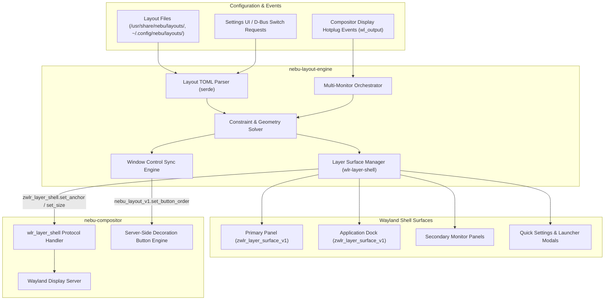
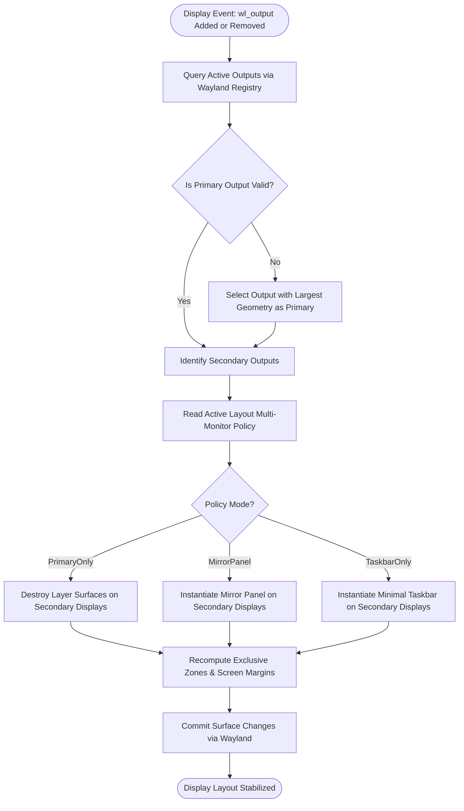

# Layout System Specification — NebuOS

**Status:** DRAFT  
**Purpose:** Specify the declarative layout engine, dynamic surface restructuring, panel and dock arrangements, constraint resolution, multi-monitor behaviors, and runtime switching without shell restart for NebuShell.

---

## 1. Status
Current Status: **DRAFT** (Review cycle 1.0)  
Target Implementation: NebuOS Core Desktop Milestone (Shell v1.0)

---

## 2. Purpose
The NebuOS Layout System defines the spatial topology, structural container hierarchy, and runtime ergonomics of the desktop shell. Unlike monolithic desktop shells that require distinct session executables or process restarts to switch desktop paradigms, NebuShell implements a unified, declarative layout engine (`nebu-layout-engine`). It orchestrates panel placements, dock configurations, launcher trigger geometries, system tray anchors, and window decoration ordering dynamically at runtime while strictly maintaining the system resource budget (< 150 MB combined RAM for shell and compositor).

---

## 3. Scope
### In-Scope
- **Declarative Layout Grammar:** TOML-based layout specification schema defining surfaces, panels, docks, widget containers, and spatial alignments.
- **Dynamic Surface Reconfiguration:** Wayland `wlr-layer-shell-unstable-v1` surface lifecycle management, dynamic anchor/margin modifications, and seamless layout transitions without restarting `nebu-shell`.
- **Built-in Desktop Paradigms:** Reference implementations for `nebu-default` (unified bottom panel), `windows-like` (bottom taskbar with start menu), and `macos-like` (top menu bar with floating bottom dock).
- **Constraint Solver:** Geometric bounds checking, minimum/maximum dimension clamping (e.g., panel height constrained between 32px and 64px), edge-snapping, and overflow handling.
- **Window Decoration Synchronization:** Protocol synchronization between shell layout settings and `nebu-compositor` for Server-Side Decoration (SSD) control button ordering (`close, max, min` vs `min, max, close`) and alignment (left vs right).
- **Multi-Monitor Geometry Rules:** Display topology detection, primary versus secondary display assignments, per-output surface instantiation, and hotplug adaptation.

### Out-of-Scope
- Window tiling algorithms and client window placement policies (governed by `03-window-management.md` and `nebu-compositor`).
- Custom user script execution inside layout containers.
- Dynamic drag-and-drop widget editing tools during initial release (configuration is managed via declarative files and Settings UI).

---

## 4. Non-Goals
1. **No Fragmented Shell Binaries:** NebuOS will not ship separate desktop executables for different UX styles (e.g., no separate `nebu-shell-windows` or `nebu-shell-macos`). One unified Rust binary adapts its internal surface tree to any active layout.
2. **No Unconstrained Web Layouts:** The layout engine does not embed Flexbox, CSS Grid, or HTML rendering engines. Layouts resolve via deterministic, compile-time verified integer mathematics.
3. **No Window Manager Bypass:** The layout engine controls shell-owned surfaces only. It does not manipulate raw client window framebuffers or enforce client-side window layouts directly.

---

## 5. Requirements

### 5.1 Functional Requirements
- **FR-LAYOUT-01:** The layout engine must parse, validate, and activate any valid layout specification in <= 20 milliseconds.
- **FR-LAYOUT-02:** Switching between active layouts must execute dynamically at runtime in <= 50 milliseconds without restarting the `nebu-shell` process or disrupting running client applications.
- **FR-LAYOUT-03:** The layout engine must support anchoring panels to any screen edge: `Top`, `Bottom`, `Left`, and `Right`.
- **FR-LAYOUT-04:** The layout engine must support floating or edge-anchored docks with configurable auto-hide policies (`None`, `Intellihide`, `Autohide`).
- **FR-LAYOUT-05:** The layout engine must provide three built-in immutable layouts: `nebu-default`, `windows-like`, and `macos-like`.
- **FR-LAYOUT-06:** The layout engine must synchronize window control button ordering (`layout.window_controls`) with `nebu-compositor` over private Wayland IPC.
- **FR-LAYOUT-07:** The constraint solver must clamp panel thickness to between 32px and 64px on standard 1080p displays, automatically scaled for HiDPI/fractional scaling factors.
- **FR-LAYOUT-08:** The layout engine must handle display connection and disconnection events within 100 milliseconds, re-evaluating multi-monitor rules without crash or surface leak.
- **FR-LAYOUT-09:** The layout engine must expose runtime control via D-Bus on `org.nebu.LayoutManager1`.

### 5.2 Non-Functional Requirements
- **NFR-LAYOUT-01 (Memory Overhead):** The resident memory footprint of the layout engine, container tree, and widget geometry caches must not exceed 1.5 MB RSS.
- **NFR-LAYOUT-02 (Zero Window Glitches):** Reallocating `zwlr_layer_surface_v1` anchors during layout changes must not cause Wayland protocol violations or client surface unmapping.
- **NFR-LAYOUT-03 (Display Stability):** Disconnecting an active external monitor must immediately migrate secondary panel widgets back to the primary output without data loss.

---

## 6. Architecture

The Layout System coordinates the spatial arrangement of all Wayland surfaces managed by `nebu-shell`. It translates high-level layout declarations into precise `zwlr_layer_surface_v1` protocol requests and internal widget container hierarchies.



---

## 7. Components

### 7.1 `LayoutManager`
- **Location:** `nebu-shell::layout::manager`
- **Responsibility:** Central coordinator holding the active layout state. Receives switch requests, coordinates the constraint solver, and drives the dynamic reallocation of Wayland layer surfaces.
- **State Storage:** Holds the active layout structure in an `Arc<RwLock<ActiveLayout>>`.

### 7.2 `LayoutParser`
- **Location:** `nebu-shell::layout::parser`
- **Responsibility:** Reads TOML layout files from disk. Validates syntactic structure, widget identifiers, and container parameters against strongly typed Serde definitions.

### 7.3 `ConstraintSolver`
- **Location:** `nebu-shell::layout::solver`
- **Responsibility:** Calculates exact physical pixel bounding boxes for all panels, docks, and widget clusters based on current output resolutions:
  - Clamps panel height/width to defined bounds: $[32 \times \text{scale}, 64 \times \text{scale}]$.
  - Resolves widget alignments (`Start`, `Center`, `End`).
  - Ensures minimum widget separation and prevents overlapping UI components.
  - Computes exclusive zone margins reserved for the layer-shell to prevent maximized windows from covering panels.

### 7.4 `SurfaceReallocator`
- **Location:** `nebu-shell::layout::surface`
- **Responsibility:** Manages the Wayland protocol interactions:
  - If a surface role exists in both old and new layouts (e.g., primary panel), it updates the existing `zwlr_layer_surface_v1` using `set_anchor`, `set_size`, and `set_exclusive_zone`, followed by `wl_surface.commit`.
  - If a surface is no longer needed (e.g., removing a dock when switching to Windows-like), the surface is gracefully unmapped and destroyed.
  - If a new surface is required (e.g., adding a dock when switching to macOS-like), a new layer surface is created and mapped.

### 7.5 `MultiMonitorOrchestrator`
- **Location:** `nebu-shell::layout::multimon`
- **Responsibility:** Tracks Wayland `wl_output` bindings. Maintains a registry of active displays, output resolutions, refresh rates, and primary display flags.
- **Multi-Monitor Rules:**
  - Primary displays host the full layout specification (panels, start buttons, notification triggers).
  - Secondary displays follow configurable behavior: `MirrorPrimary`, `TaskbarOnly`, or `Empty`.

### 7.6 `WindowControlSync`
- **Location:** `nebu-shell::layout::decorations`
- **Responsibility:** Bridges layout settings to the compositor. Sends an IPC message to `nebu-compositor` specifying whether window titlebar control buttons (`Minimize`, `Maximize`, `Close`) should be positioned on the top-right (`windows-like`, `nebu-default`) or top-left (`macos-like`), and their precise ordering.

---

## 8. Data Flow

### 8.1 Runtime Layout Transition Flow

```mermaid
sequenceDiagram
    autonumber
    actor User as User / Settings App
    participant Dbus as D-Bus Interface (org.nebu.LayoutManager1)
    participant Mgr as LayoutManager
    participant Parser as LayoutParser
    participant Solver as ConstraintSolver
    participant Realloc as SurfaceReallocator
    participant Wayland as Wayland Compositor (Smithay)
    participant DecSync as WindowControlSync

    User->>Dbus: SetActiveLayout("macos-like")
    Dbus->>Mgr: SwitchLayoutRequest("macos-like")
    Mgr->>Parser: IngestLayoutFile("macos-like.toml")
    Parser-->>Mgr: ValidatedLayoutManifest
    Mgr->>Solver: ResolveLayout(Manifest, CurrentDisplays)
    Solver-->>Mgr: ResolvedLayoutGeometry
    
    rect rgb(30, 45, 60)
        Note over Mgr,Realloc: Atomic Surface Restructuring (< 50ms)
        Mgr->>Realloc: ApplyGeometry(ResolvedLayoutGeometry)
        Realloc->>Wayland: zwlr_layer_surface_v1.set_anchor(TOP | LEFT | RIGHT)
        Realloc->>Wayland: zwlr_layer_surface_v1.set_size(width, 36)
        Realloc->>Wayland: Create New Dock Surface (BOTTOM)
        Realloc->>Wayland: wl_surface.commit()
    end
    
    Mgr->>DecSync: UpdateDecorationOrder(Left, [Close, Min, Max])
    DecSync->>Wayland: nebu_layout_v1.set_button_order(LEFT, 0x01, 0x02, 0x04)
    Mgr-->>Dbus: LayoutTransitionComplete(Success)
    Dbus-->>User: Return OK
```



---

## 9. Control Flow

### 9.1 Multi-Monitor Hotplug & Reconfiguration



---

## 10. Interfaces

### 10.1 Layout Specification File Format (TOML Schema)

Layout files reside in `/usr/share/nebu/layouts/` (system) or `~/.config/nebu/layouts/` (user overrides).

```toml
[metadata]
id = "nebu-default"
name = "Nebu Default"
version = "1.0.0"
author = "NebuOS Architecture Team"
description = "Default balanced single bottom panel layout for NebuOS."

[window_controls]
position = "right"             # "left" | "right"
order = ["minimize", "maximize", "close"] # Sequence of control buttons

[multi_monitor]
secondary_display_policy = "taskbar_only" # "primary_only" | "mirror" | "taskbar_only"
dock_display = "primary"                  # "primary" | "all" | "active_cursor"

[[panels]]
id = "primary-panel"
target_output = "primary"
edge = "bottom"                # "top" | "bottom" | "left" | "right"
size = 44                      # Height in pixels (if horizontal) or width (if vertical)
autohide = false
exclusive_zone = 44            # Reserve workspace space so windows don't overlap

  [panels.constraints]
  min_size = 32
  max_size = 64
  shrink_on_low_res = true

  [panels.clusters.start]
  widgets = ["launcher_button", "workspace_pager"]
  spacing = 8

  [panels.clusters.center]
  widgets = ["task_list"]
  spacing = 4

  [panels.clusters.end]
  widgets = ["system_tray", "media_indicator", "quick_settings_button", "clock_indicator"]
  spacing = 10

# Optional dock configuration (used in macos-like layout)
# [[docks]]
# id = "main-dock"
# target_output = "primary"
# edge = "bottom"
# icon_size = 48
# autohide = true
# intellihide = true
# exclusive_zone = 0           # Floats over windows or autohides
# floating = true
# margin_bottom = 8
# widgets = ["pinned_apps", "running_apps", "trash"]
```

### 10.2 Rust Type Contracts

```rust
// In nebu-layout-engine/src/schema.rs

use serde::{Deserialize, Serialize};

#[derive(Debug, Clone, Serialize, Deserialize)]
pub struct LayoutManifest {
    pub metadata: LayoutMetadata,
    pub window_controls: WindowControlsConfig,
    pub multi_monitor: MultiMonitorConfig,
    pub panels: Vec<PanelConfig>,
    pub docks: Option<Vec<DockConfig>>,
}

#[derive(Debug, Clone, Copy, PartialEq, Eq, Serialize, Deserialize)]
#[serde(rename_all = "snake_case")]
pub enum ScreenEdge {
    Top,
    Bottom,
    Left,
    Right,
}

#[derive(Debug, Clone, Copy, PartialEq, Eq, Serialize, Deserialize)]
#[serde(rename_all = "snake_case")]
pub enum ControlButtonPosition {
    Left,
    Right,
}

#[derive(Debug, Clone, Copy, PartialEq, Eq, Serialize, Deserialize)]
#[serde(rename_all = "snake_case")]
pub enum WindowButton {
    Close,
    Maximize,
    Minimize,
}

#[derive(Debug, Clone, Serialize, Deserialize)]
pub struct WindowControlsConfig {
    pub position: ControlButtonPosition,
    pub order: Vec<WindowButton>,
}

#[derive(Debug, Clone, Serialize, Deserialize)]
pub struct PanelConfig {
    pub id: String,
    pub target_output: String,
    pub edge: ScreenEdge,
    pub size: u32,
    pub autohide: bool,
    pub exclusive_zone: i32,
    pub constraints: PanelConstraints,
    pub clusters: WidgetClusters,
}

#[derive(Debug, Clone, Serialize, Deserialize)]
pub struct PanelConstraints {
    pub min_size: u32,
    pub max_size: u32,
    pub shrink_on_low_res: bool,
}

#[derive(Debug, Clone, Serialize, Deserialize)]
pub struct WidgetClusters {
    pub start: WidgetCluster,
    pub center: WidgetCluster,
    pub end: WidgetCluster,
}

#[derive(Debug, Clone, Serialize, Deserialize)]
pub struct WidgetCluster {
    pub widgets: Vec<String>,
    pub spacing: u32,
}

#[derive(Debug, Clone, Serialize, Deserialize)]
pub struct DockConfig {
    pub id: String,
    pub target_output: String,
    pub edge: ScreenEdge,
    pub icon_size: u32,
    pub autohide: bool,
    pub intellihide: bool,
    pub exclusive_zone: i32,
    pub floating: bool,
    pub margin_bottom: u32,
    pub widgets: Vec<String>,
}

pub trait LayoutEngine {
    fn load_layout(&mut self, layout_id: &str) -> Result<(), LayoutError>;
    fn current_layout(&self) -> &LayoutManifest;
    fn recompute_geometry(&mut self, outputs: &[OutputGeometry]) -> Result<(), LayoutError>;
}
```

### 10.3 D-Bus IPC Interface

The layout manager exposes runtime management over the session bus:

- **Bus Name:** `org.nebu.LayoutManager1`
- **Object Path:** `/org/nebu/LayoutManager1`
- **Interface:** `org.nebu.LayoutManager1`

```xml
<node>
  <interface name="org.nebu.LayoutManager1">
    <!-- Methods -->
    <method name="GetActiveLayout">
      <arg name="layout_id" type="s" direction="out"/>
      <arg name="name" type="s" direction="out"/>
    </method>
    <method name="SetActiveLayout">
      <arg name="layout_id" type="s" direction="in"/>
      <arg name="success" type="b" direction="out"/>
    </method>
    <method name="ListAvailableLayouts">
      <arg name="layouts" type="a(sss)" direction="out"/>
      <!-- Array of (id, name, description) -->
    </method>
    <method name="SetPanelSize">
      <arg name="panel_id" type="s" direction="in"/>
      <arg name="new_size" type="u" direction="in"/>
      <arg name="clamped_size" type="u" direction="out"/>
    </method>

    <!-- Signals -->
    <signal name="LayoutChanged">
      <arg name="layout_id" type="s"/>
    </signal>
    <signal name="GeometryUpdated"/>
  </interface>
</node>
```

---

## 11. Dependencies

| Component | Provider | Purpose | Boundary |
|---|---|---|---|
| `nebu-layout-engine` | NebuOS (In-House Rust) | Layout parsing, constraint resolution, surface re-anchoring | Internal `nebu-shell` module |
| `nebu-compositor` | NebuOS (In-House Rust) | Wayland display server, layer-shell implementation, SSD button sync | Wayland protocol boundary |
| `wayland-client` | Fedora / Linux Base | Low-level Wayland wire protocol bindings | Static/Dynamic Rust library |
| `wlr-layer-shell-unstable-v1` | wlroots / Smithay protocol | Window management layer pinning, exclusive zone margins | Wayland protocol extension |
| `serde` & `toml` | External Crates (Rust) | Strongly typed layout manifest parsing | Static library dependency |

---

## 12. Security

1. **Strict Layer Permission:** Only the authenticated `nebu-shell` process is granted authority to bind to `zwlr_layer_shell_v1` on overlay and top shell layers by `nebu-compositor`. Unprivileged client applications attempting to bind to `wlr-layer-shell` are terminated with a protocol error.
2. **Bounds Enforcement:** Layout specifications cannot configure exclusive zones larger than 50% of the active output resolution, preventing malformed or malicious layout files from starving application windows of viewable screen area.
3. **No Dynamic Execution:** Layout manifests are static data structures. No dynamic code, shell execution, or command hooks are permitted within layout manifests.
4. **Widget ID Whitelisting:** Widget names specified in clusters are strictly matched against a static enum of approved in-tree widgets. Unknown widget identifiers are safely ignored and logged.

---

## 13. Resource Requirements

- **Memory (RSS):**
  - Layout engine state & parser structures: ~400 KiB.
  - Active widget bounding box hierarchy: ~500 KiB.
  - Total resident layout engine footprint: **<= 1.2 MB** (well below the 1.5 MB ceiling).
- **CPU Utilization:**
  - Idle: 0.0% CPU.
  - Layout Switching Operation: Single-thread CPU spike < 2.0% for <= 20ms.
- **Wayland Protocol Transactions:**
  - Standard layout switch requires <= 12 protocol messages per output, completing in < 1 display frame interval.

---

## 14. Built-in Layout Profiles

### 14.1 `nebu-default` (Balanced Bottom Panel)
- **Ergonomics:** Single, consolidated 44px panel anchored to the bottom edge.
- **Start / Launcher Button:** Anchored bottom-left.
- **Tasklist:** Centered running task icons with window grouping indicators.
- **Status & Tray Area:** Bottom-right (clock, system tray, quick settings trigger).
- **Window Controls:** Top-right titlebar positioning; order: `[minimize, maximize, close]`.
- **Target Audience:** Modern desktop users wanting clean, uncluttered, distraction-free space.

### 14.2 `windows-like` (Enterprise / Traditional Taskbar)
- **Ergonomics:** Traditional 40px bottom taskbar.
- **Start / Launcher Button:** Bottom-left with classic "Start" iconography and Super key binding.
- **Tasklist:** Left-aligned next to the launcher button, displaying icon + title labels or compact grouped icons.
- **Status & Tray Area:** Bottom-right featuring fully expanded StatusNotifierItem tray icons, network/sound status flyout trigger, and a dedicated "Show Desktop" 4px sliver on the extreme right edge.
- **Window Controls:** Top-right titlebar positioning; order: `[minimize, maximize, close]`.
- **Target Audience:** Users migrating from Windows 10/11 environments requiring familiar muscle memory.

### 14.3 `macos-like` (Top Menu Bar & Floating Dock)
- **Ergonomics:** Dual-surface paradigm consisting of a top status menu bar (32px) and an independent floating bottom dock.
- **Top Menu Bar:**
  - Left: System logo menu (Nebu menu), active application title, and global menu stubs.
  - Center: Minimalist date and time display.
  - Right: System tray, notification bell, and quick settings toggles.
- **Bottom Dock:**
  - Floating 52px height dock centered horizontally with 8px bottom margin.
  - Contains pinned application icons, running task indicators, and trash shortcut.
  - Supports automatic Intellihide when application windows maximize or overlap the dock area.
- **Window Controls:** Top-left titlebar positioning; order: `[close, minimize, maximize]`.
- **Target Audience:** Users migrating from macOS desiring high vertical workspace clearance and dock-centric multitasking.

---

## 15. Failure Modes

| Failure Mode | Root Cause | Impact | Recovery Behavior |
|---|---|---|---|
| **Malformed Layout TOML** | Invalid syntax or corrupt layout file in user config directory. | Parsing error on layout load. | Rejects layout file; emits user notification; retains active layout or falls back to built-in `nebu-default`. |
| **Constraint Violation** | Author requested 120px panel height on a 768p screen. | Extreme screen space starvation. | Constraint solver clamps requested size to upper bound (64px) and logs a warning. |
| **Output Disconnect During Switch** | External HDMI monitor unplugged precisely during layer-shell reconfiguration. | Dangling `wl_output` reference. | `MultiMonitorOrchestrator` catches output destruction signal, invalidates secondary surface requests, and re-routes widgets to the primary output. |
| **Widget Type Unknown** | Layout specifies `"widget = weather_radar"`, which does not exist in the shell. | Unknown widget error. | Skips the invalid widget cleanly without crashing the container tree; logs warning to journal. |

---

## 16. Recovery Behavior

1. **Static Built-in Fallback:** The `nebu-default` layout manifest is embedded directly into the `nebu-shell` binary at compile time via `include_str!`. In the event that `/usr/share/nebu/layouts/` or `~/.config/nebu/layouts/` becomes inaccessible or corrupted, the shell immediately instantiates the embedded fallback.
2. **Non-Destructive Hot-Swap:** When switching layouts, old layer surfaces are not destroyed until the new surfaces have been successfully configured and verified with the Wayland compositor. If the compositor rejects the new configuration (e.g., protocol error), the old layout remains active.
3. **Emergency Reset Command:**
   ```bash
   nebu-shell --reset-layout
   ```
   Directs `nebu-shell` to purge runtime state, delete custom layout overrides, and activate `nebu-default`.

---

## 17. Testing Requirements

### 17.1 Unit Tests
- **TOML Parsing & Serde Validation:** Verify successful deserialization of all built-in layouts and intentional rejection of invalid schemas.
- **Constraint Clamping Tests:** Ensure requested panel sizes of 10px, 50px, and 120px are correctly clamped to $[32, 64]$ px.
- **Window Control Permutations:** Validate all button sequence permutations (`close/max/min`, `min/max/close`) serialize accurately for compositor IPC.

### 17.2 Integration Tests
- **Zero-Restart Switch Stress Test:** Programmatically switch between `nebu-default`, `windows-like`, and `macos-like` 200 consecutive times in a headless test harness (Smithay virtual compositor) verifying zero memory leaks and 0 protocol errors.
- **Multi-Monitor Simulation:** Simulate connecting and disconnecting 3 virtual outputs dynamically; assert all panels correctly re-anchor within 100ms.
- **Exclusive Zone Measurement:** Verify that maximizing a test window under `nebu-default` reserves exactly 44 physical pixels at the bottom edge.

---

## 18. Performance Requirements

| Metric | Target | Hard Ceiling | Verification Method |
|---|---|---|---|
| **Layout Parse & Validation** | < 5 ms | 20 ms | High-resolution CPU timestamp |
| **Runtime Layout Switch Duration** | < 30 ms | 50 ms | End-to-end timer from D-Bus request to buffer commit |
| **Display Hotplug Adaptation** | < 60 ms | 100 ms | Timestamp from `wl_output.done` to panel commit |
| **Memory Footprint (Layout Engine)** | < 800 KiB | 1.5 MB | Heap profiling via `jemallocator` statistics |
| **Frame Rate Impact During Switch** | 0 dropped frames | 0 dropped frames | Wayland presentation feedback measurement |

---

## 19. Compatibility Considerations

### 19.1 Window Decoration Synchronization
- **Compositor Server-Side Decorations (SSD):** `nebu-compositor` implements SSD for applications requesting server frames (including Wine applications). When the active layout switches from `windows-like` to `macos-like`, `nebu-compositor` receives the layout event and immediately swaps titlebar button clusters from the top-right to the top-left across all managed client windows.
- **Client-Side Decorations (CSD):** For native GTK and Qt applications utilizing client-side decorations, `nebu-shell` broadcasts the button layout string over XDG Desktop Settings / GSettings (`org.gnome.desktop.wm.preferences button-layout` format: `"close,minimize,maximize:"` or `":minimize,maximize,close"`).

### 19.2 Multi-Monitor Layout Rules
- **Rule 1 (Primary Display Anchoring):** Floating docks and complex status areas always default to the identified primary display.
- **Rule 2 (Secondary Output Taskbars):** When `secondary_display_policy = "taskbar_only"`, secondary displays show only running window items located on that specific workspace/output, reducing cognitive overload.
- **Rule 3 (Display Disconnect):** If the primary display is disconnected, the display with the highest resolution is promoted to primary, and the full layout tree migrates automatically.

---

## 20. Open Questions

1. **[OPEN QUESTION] Cursor-Following Floating Dock:** In a multi-monitor configuration with the `macos-like` layout, should the floating dock stay fixed on the primary display, or dynamically hop to the bottom edge of whichever monitor currently contains the pointer cursor?
2. **[OPEN QUESTION] Global Application Menu Bar Extraction:** For the `macos-like` layout, should NebuShell attempt to extract DBusMenu (`com.canonical.dbusmenu`) headers from Wine and Qt applications to present a unified top menu bar, or retain in-window menus to avoid application compatibility breakage?
3. **[OPEN QUESTION] Fractional Scaling Widget Jitter:** At 125% and 150% Wayland display scaling, integer pixel rounding can cause 1px alignment discrepancies between docked widgets; does the layout solver require a fixed subpixel rendering grid?

---

## 21. Related Documents
- [00-desktop-overview.md](00-desktop-overview.md) — Desktop architecture foundation and philosophy.
- [01-compositor.md](01-compositor.md) — Compositor rendering and layer-shell implementation.
- [02-shell.md](02-shell.md) — NebuShell process topology and component specs.
- [03-ui-theme-system.md](03-ui-theme-system.md) — Theme engine, token specifications, and visual styling.
- [03-window-management.md](03-window-management.md) — Window lifecycle, focus policies, and grouping.
- [07-system-ui.md](07-system-ui.md) — System UI components (lock screen, greeter, notifications).
- [../decisions/ADR-0006-nebu-shell.md](../decisions/ADR-0006-nebu-shell.md) — Native Rust shell architecture decision.
