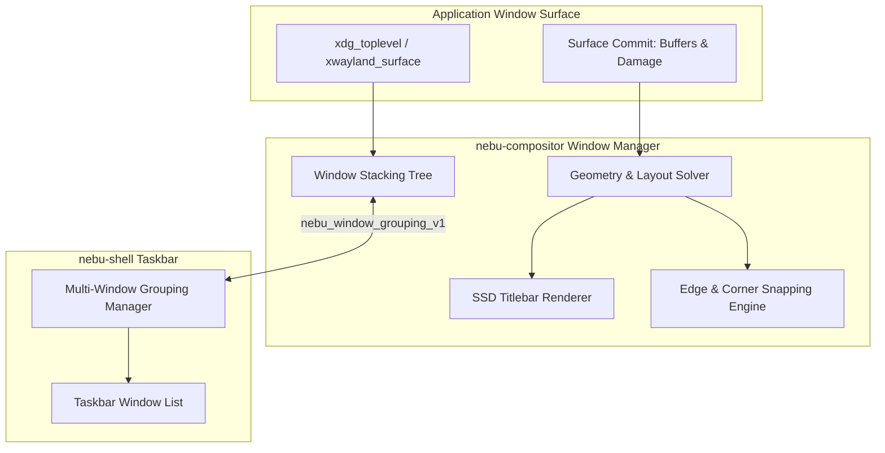
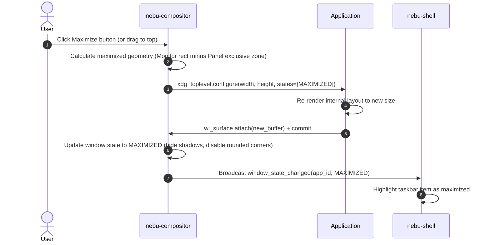

# Window Management Specification — NebuOS

**Status:** DRAFT  
**Purpose:** Specify the window lifecycle, stacking order, tiling and floating policies, window decoration models, and snapping mechanisms in NebuOS.

---

## 1. Status
DRAFT — Technical specification for window management behaviors within `nebu-compositor` and `nebu-shell`.

## 2. Purpose
This document defines how windows are managed in NebuOS. It bridges the behavior of native Wayland Linux clients and sandboxed Windows PE applications running under Wine/Proton, providing consistent decorations, predictable window state transitions, intuitive keyboard shortcuts, and responsive snapping.

## 3. Scope
- Window states: Minimized, Maximized, Fullscreen, Tiled, Floating.
- Server-Side Decorations (SSD) vs. Client-Side Decorations (CSD) policy.
- Multi-window application grouping and taskbar synchronization.
- Edge snapping, split-screen tiling, and virtual workspace transitions.
- Multi-monitor window movement and focus policies.

## 4. Non-goals
- Full manual tiling window manager mechanics (e.g. i3/sway complex tree manipulation).
- Multi-user multi-seat desktop multiplexing.
- 3D spatial window flipping or desktop cube effects.

## 5. Requirements
1. **R-WIN-01:** Provide Server-Side Decorations (SSD) for all applications that do not explicitly negotiate CSD, ensuring uniform titlebars for Win32 apps.
2. **R-WIN-02:** Support dynamic edge snapping: dragging window to top edge maximizes; dragging to left/right halves splits 50/50.
3. **R-WIN-03:** Maintain strict window stacking order: Fullscreen (topmost) > Modal Dialogs > Normal Floating > Tiled > Desktop Background.
4. **R-WIN-04:** Synchronize window controls ordering (Close/Min/Max) with the active desktop layout paradigm (right-side for Nebu/Windows, left-side for macOS).
5. **R-WIN-05:** Track transient parent-child relationships for Windows modal dialogs, preventing parent interaction while modal is active.

## 6. Architecture
Window management logic is embedded within `nebu-compositor`'s space management module and synchronized with `nebu-shell`:

## 7. Components
1. **Stacking Manager:** Maintains the Z-order hierarchy of mapped windows.
2. **Decoration Engine:** Renders native titlebars, window titles, close/minimize/maximize buttons, and drop shadows for SSD clients.
3. **Snapping Controller:** Detects cursor proximity to display edges during interactive drag moves (threshold: 16px) and displays visual snap preview overlays.
4. **Focus Arbiter:** Implements click-to-focus policy with automatic elevation of clicked windows to the top of their stacking layer.
5. **Workspace Manager:** Organizes windows across virtual workspaces with smooth slide transitions.

## 8. Data Flow
1. User clicks and drags window titlebar.
2. Compositor initiates interactive move grab.
3. As cursor approaches screen boundary, Snapping Controller computes half-tile geometry.
4. Compositor renders translucent snap preview rectangle on overlay layer.
5. User releases mouse button:
   - If released near edge: window state transitions to Tiled (Left/Right) and size updates via `xdg_toplevel.configure`.
   - If released in free space: window remains Floating at new coordinates.
6. Compositor informs shell of updated window position; shell taskbar updates active monitor indicator.

## 9. Control Flow

## 10. Interfaces
- **Wayland Extensions:**
  - `xdg-shell` (`xdg_wm_base`, `xdg_toplevel`, `xdg_popup`)
  - `zxdg_decoration_manager_v1` (negotiates SSD vs CSD)
  - `nebu_window_grouping_v1` (custom protocol syncing multi-window Win32 process groups to taskbar)
- **Keybindings:**
  - `Super + Up`: Maximize window
  - `Super + Down`: Restore / Minimize window
  - `Super + Left / Right`: Tile window to left / right half
  - `Alt + Tab`: Fast window switcher popup

## 11. Dependencies
- `smithay` space and desktop abstractions.
- `tiny-skia` or GLES2 for rendering crisp window decorations and vector button glyphs.

## 12. Security
- Windows cannot disguise themselves as system UI panels (layer shell reserved for authenticated shell).
- Sandboxed Windows applications cannot capture global keybindings (`Super`, `Alt+Tab` intercepted by compositor).
- Modal dialogs cannot escape their application sandbox boundary.

## 13. Resource Requirements
- Window management state memory: <= 50 KB per active window.
- Decoration rendering: Cached textures shared across identical window button states; < 2 MB VRAM total.
- Snapping computation: < 0.1ms per pointer motion event.

## 14. Failure Modes
1. **Client Refuses Resize:** Win32 application with fixed-size dialog ignores resize configure events.
2. **Modal Lockout:** Modal window hidden behind unmapped parent.
3. **Infinite Resize Loop:** Application resizes recursively based on decoration size.

## 15. Recovery Behavior
- Fixed-size windows are identified via `min_size == max_size` hints; maximize button is disabled and tile snapping ignored.
- Modals without parent mappings are promoted to normal floating windows.
- Resize loops are broken by rate-limiting configure events to display refresh rate (VSync throttle).

## 16. Testing Requirements
- Unit tests for edge snapping geometry calculation.
- Automated tests verifying Alt+Tab cycling order across multiple workspaces.
- Multi-window Wine process grouping verification test.

## 17. Performance Requirements
- Interactive window dragging: 100% VSync locked (zero stutter or lag).
- Resize configure dispatch: <= 2ms.
- Alt+Tab switcher activation latency: <= 16ms.

## 18. Compatibility Considerations
- Win32 tool windows and floating toolbars mapped to `xdg_popup` or child toplevels without taskbar clutter.
- Wine borderless fullscreen windows granted direct scanout with zero decoration overhead.

## 19. Open Questions
- **OQ-WIN-01:** Should NebuOS support quarter-screen corner snapping (top-left, top-right, etc.) in Phase P2 or P3?
- **OQ-WIN-02:** What is the optimal policy for handling multi-window Win32 MDI (Multiple Document Interface) applications?

## 20. Related Documents
- [00-desktop-specification.md](00-desktop-specification.md)
- [01-nebucompositor-specification.md](01-nebucompositor-specification.md)
- [02-nebushell-specification.md](02-nebushell-specification.md)
- [04-layout-system.md](04-layout-system.md)
