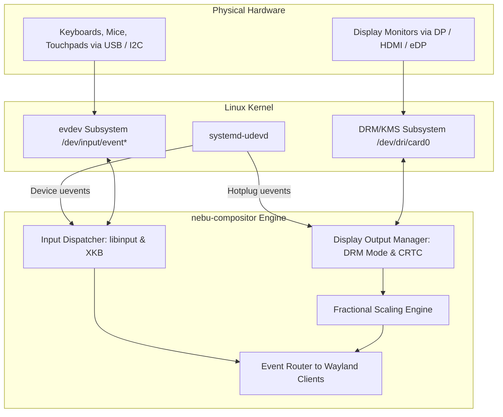
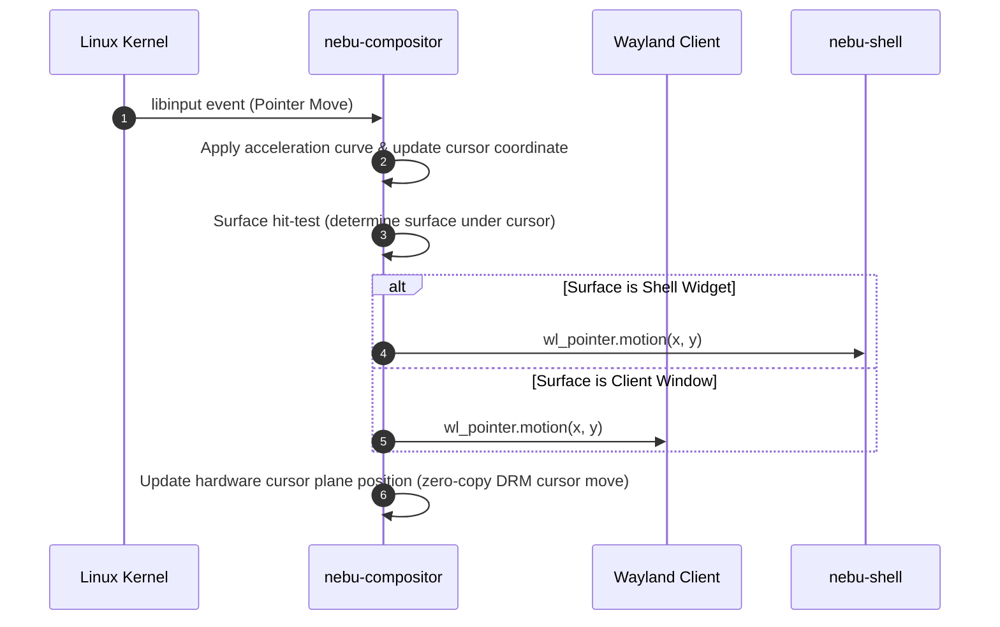

# Input and Display Management Specification — NebuOS

**Status:** DRAFT  
**Purpose:** Specify input device handling (keyboard, pointer, touch, gamepad) and display output management (EDID, modesetting, HiDPI, multi-monitor) in NebuOS.

---

## 1. Status
DRAFT — Technical implementation specification for Phase P1 and P2 display and input subsystems.

## 2. Purpose
This specification governs how hardware displays and user input devices are detected, configured, synchronized, and managed across the display server stack, ensuring precise pointer tracking, crisp fractional scaling, multi-monitor ergonomics, and zero input latency.

## 3. Scope
- DRM/KMS connector management, CRTC allocation, and display hotplugging.
- EDID parsing, mode enumeration, refresh rate selection, and HiDPI scale calculation.
- Fractional scaling protocol (`wp_fractional_scale_v1`) and viewporter integration.
- `libinput` event processing for keyboards, mice, trackpads, and touchscreens.
- Keymap configuration (XKB), repeat rates, acceleration profiles, and gamepad routing.

## 4. Non-goals
- Supporting legacy analog VGA outputs with software bitbanging.
- Complex color-calibration ICC profiling in early phases (deferred to P7).
- Custom proprietary input driver stacks outside standard Linux kernel evdev.

## 5. Requirements
1. **R-IND-01:** Automatically detect display hotplug events via DRM uevents and configure optimal native resolution and refresh rate within 500ms.
2. **R-IND-02:** Support crisp fractional scaling (125%, 150%, 175%, 200%) using `wp_fractional_scale_v1` without blurry nearest-neighbor interpolation.
3. **R-IND-03:** Provide standard libinput pointer acceleration profiles (flat, adaptive) and natural scrolling toggles.
4. **R-IND-04:** Support multi-monitor desktop topologies with arbitrary horizontal, vertical, and mixed-DPI layouts.
5. **R-IND-05:** Map standard multimedia keys (volume, brightness, mute, media playback) directly to desktop shell actions.

## 6. Architecture
Input and display management operate inside `nebu-compositor` via dedicated subsystems:

## 7. Components
1. **Output Manager:** Discovers active connectors via `drmModeGetResources`, reads EDID blocks, and configures CRTC scanout parameters.
2. **Scale Engine:** Computes optimal display scaling factor based on physical screen dimensions and resolution (e.g. 14" 1080p -> 125%, 27" 4K -> 150%).
3. **Input Device Manager:** Wraps `libinput`, applies user configuration (sensitivity, acceleration, tap-to-click), and translates raw events into Wayland events.
4. **XKB Keyboard Processor:** Compiles XKB keymaps (`us`, `de`, `fr`, etc.), manages modifier states (Shift, Ctrl, Alt, Super), and handles key repeats.
5. **Hotplug Monitor:** Listens to netlink uevents on `udev` socket for runtime monitor and peripheral connections.

## 8. Data Flow
1. Hardware monitor plugged into HDMI/DisplayPort.
2. Kernel DRM generates `HOTPLUG=1` uevent.
3. Compositor hotplug listener triggers output probe:
   - Reads EDID string and preferred mode (e.g. 2560x1440 @ 144Hz).
   - Allocates free CRTC and primary plane.
   - Computes layout coordinates (places new display to the right of primary).
4. Compositor registers new `wl_output` global and advertises geometry to connected Wayland clients.
5. Shell dynamically extends taskbar or spawns secondary panel per layout rules.

## 9. Control Flow

## 10. Interfaces
- **Wayland Output Protocols:**
  - `wl_output` (v4)
  - `xdg-output-unstable-v1` (v3)
  - `wp_fractional_scale_v1` (v1)
  - `wp_viewporter` (v1)
- **Wayland Input Protocols:**
  - `wl_seat` (v8), `wl_pointer`, `wl_keyboard`, `wl_touch`
  - `zwp_relative_pointer_manager_v1` (for FPS games)
  - `zwp_pointer_constraints_v1` (pointer lock / confine)
- **Configuration Storage:** Stored in `~/.config/nebu/displays.toml` and `~/.config/nebu/input.toml`.

## 11. Dependencies
- `libinput` >= 1.25.
- `xkbcommon` >= 1.6.
- `libdrm` >= 2.4.120.

## 12. Security
- Keystroke snooping strictly prevented: clients only receive keyboard events when their window has focus.
- Pointer position snooping prevented: clients only receive motion events within their own surface bounds.
- Virtual input injection restricted to privileged processes via authentication tokens.

## 13. Resource Requirements
- Input event processing latency: <= 0.8ms from evdev read to Wayland socket write.
- Memory footprint: <= 1.2 MB RSS for all input/display tracking structures.
- CPU utilization: < 0.1% CPU during continuous high-polling mouse movement (1000Hz gaming mice).

## 14. Failure Modes
1. **Invalid EDID Checksum:** Monitor transmits corrupted EDID data.
2. **Unsupported Mode Requested:** User requests mode exceeding display bandwidth limit.
3. **Pointer Lock Abuse:** Malicious client attempts to trap cursor indefinitely.

## 15. Recovery Behavior
- Corrupted EDID triggers safe standard fallback mode (1024x768 @ 60Hz or 1920x1080 @ 60Hz).
- Bandwidth validation tests mode via `DRM_MODE_ATOMIC_TEST_ONLY` before commit; rejects invalid modes cleanly.
- Pointer lock is immediately revoked whenever user presses `Super` key or Alt+Tabs away.

## 16. Testing Requirements
- Automated test validating fractional scaling math across standard resolutions (1080p, 1440p, 4K).
- Hotplug resilience test simulating 50 consecutive monitor disconnect/reconnect cycles.
- High-frequency pointer event stress test (1000Hz polling rate).

## 17. Performance Requirements
- Display hotplug to visible desktop output: <= 400ms.
- Hardware cursor update: 0ms latency (committed directly to DRM cursor plane).
- Display modeswitch time: <= 1.2s.

## 18. Compatibility Considerations
- Windows games requesting full-screen resolution changes are adapted through `wp_viewporter`, maintaining native monitor resolution while scaling the game surface cleanly.
- Pointer locking enables seamless mouselook in first-person Windows games running via Wine/Proton.

## 19. Open Questions
- **OQ-IND-01:** Should custom monitor color profiles (ICC) be supported via colord integration in P2 or deferred to P7?
- **OQ-IND-02:** Should multi-touch trackpad gestures (3-finger swipe for workspace switch) be handled inside compositor or shell?

## 20. Related Documents
- [00-desktop-specification.md](00-desktop-specification.md)
- [01-nebucompositor-specification.md](01-nebucompositor-specification.md)
- [02-nebushell-specification.md](02-nebushell-specification.md)
- [05-window-management.md](05-window-management.md)
