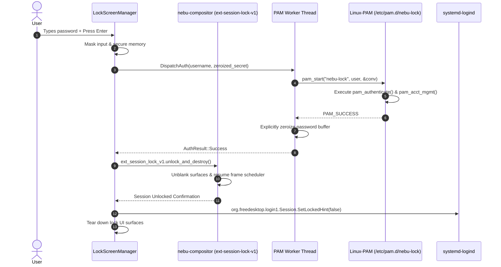
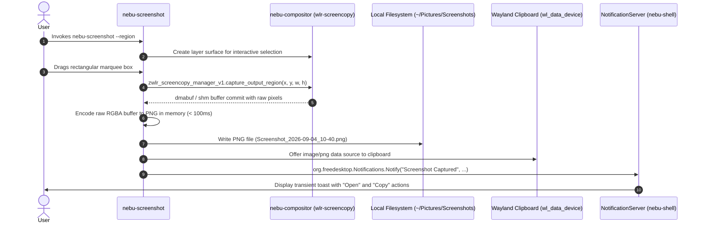
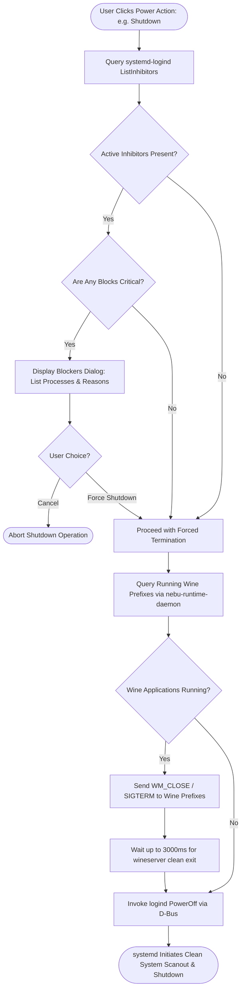

# System UI Components Specification — NebuOS

**Status:** DRAFT  
**Purpose:** Specify the core system user interface components of NebuOS, including the session lock screen, login greeter, power management modal, screenshot capture utility, notification center, on-screen displays (OSD), settings integration points, and accessibility hooks.

---

## 1. Status
Current Status: **DRAFT** (Review cycle 1.0)  
Target Implementation: NebuOS Core Desktop Milestone (Shell v1.0)

---

## 2. Purpose
The NebuOS System UI subsystem coordinates essential interactive session surfaces outside of the standard application panels. Built natively in Rust within `nebu-shell` and its sibling utilities, these components manage authentication boundaries, system power actions, user alerts, hardware state feedback, and system configuration endpoints without relying on heavy web runtimes or external multi-process daemon bloat.

---

## 3. Scope
### In-Scope
- **Session Lock Screen:** Secure screen locking utilizing Wayland `ext-session-lock-v1`, PAM authentication integration, password memory sanitization, clock/media display, and power triggers.
- **Login Greeter (`nebu-greeter`):** Display manager integration, user session selection, multi-user switching, and initial session bootstrap.
- **Power Management UI:** User-facing power menu (Shutdown, Reboot, Suspend, Hibernate, Hybrid Sleep, Logout, Switch User), `systemd-logind` inhibition verification, and graceful Wine process termination countdown.
- **Screenshot Tool (`nebu-screenshot`):** Wayland screencopy protocol integration (`wlr-screencopy-unstable-v1`), region selection marquee, active window capture, fullscreen capture, clipboard integration, and PNG file encoding.
- **Notification Center:** Standard `org.freedesktop.Notifications` D-Bus daemon, banner toast popups, persistent history flyout drawer, application grouping, action buttons, Do Not Disturb (DND) toggle, and SQLite history storage.
- **On-Screen Display (OSD):** Transient hardware feedback overlays for audio volume, microphone mute, display brightness, and keyboard lock states (Caps/Num Lock).
- **Settings App Integration:** D-Bus RPC endpoint `org.nebu.ShellSettings1` exposing shell tuning to the graphical Control Center.
- **Accessibility Engine Hooks:** Screen reader accessibility markers (AT-SPI2), on-screen keyboard spawning (`virtual-keyboard-v1`), high-contrast enforcement, and magnification viewport control.

### Out-of-Scope
- Core compositor rendering pipelines (specified in `01-compositor.md`).
- Primary taskbars and application launchers (specified in `02-shell.md` and `04-layout-system.md`).
- Deep network credential editing or Wi-Fi supplicant state machines (delegated to NetworkManager).
- Audio DSP pipeline routing (delegated to PipeWire).

---

## 4. Non-Goals
1. **No External Web Greeters:** The login greeter and lock screen are compiled native Rust surfaces; web-based greeters (such as WebKit-based LightDM themes) are strictly prohibited.
2. **No Monolithic Display Manager Daemon:** `nebu-greeter` interacts with standard `systemd-logind` and greetd/PAM; NebuOS does not implement a bespoke init or display manager daemon from scratch.
3. **No Unbounded Notification Storage:** Notification history is bounded to a maximum of 250 records or 30 days to guarantee zero database fragmentation and minimal disk I/O.

---

## 5. Requirements

### 5.1 Functional Requirements
- **FR-SYSUI-01:** The lock screen must utilize the Wayland `ext-session-lock-v1` protocol to guarantee that no application surfaces or notifications leak visually while locked.
- **FR-SYSUI-02:** The lock screen and greeter must authenticate user credentials against Linux-PAM via asynchronous worker threads, clearing plaintext password buffers with zeroize immediately after use.
- **FR-SYSUI-03:** The power menu must query `systemd-logind` for active inhibitors; if an application or Wine prefix holds an inhibitor lock, the UI must present an interactive prompt displaying the blocking process name.
- **FR-SYSUI-04:** The screenshot tool must capture physical display buffers via `zwlr_screencopy_manager_v1`, encode to PNG in <= 100 milliseconds, copy image data to `wl_data_device` (clipboard), and save to `~/Pictures/Screenshots/`.
- **FR-SYSUI-05:** The notification system must implement the `org.freedesktop.Notifications` v1.2 specification, supporting urgency levels (Low, Normal, Critical), interactive actions, and desktop-entry icon resolution.
- **FR-SYSUI-06:** The notification center must persist notification history across sessions in a local SQLite database (`~/.local/share/nebu/notifications.db`) in WAL mode.
- **FR-SYSUI-07:** The OSD overlay must appear within 20 milliseconds of a hardware keypress (volume, brightness) and automatically dismiss after 1,800 milliseconds of inactivity.
- **FR-SYSUI-08:** The shell must expose `org.nebu.ShellSettings1` on the session D-Bus, allowing the Settings application to toggle themes, switch layouts, and adjust panel dimensions.
- **FR-SYSUI-09:** Critical battery level alerts (< 10%) must bypass Do Not Disturb mode and play an auditory warning cue via PipeWire.

### 5.2 Non-Functional Requirements
- **NFR-SYSUI-01 (Memory Overhead):** Combined resident memory for all System UI modules (lock screen, notification daemon, OSD, screenshot bridge) within `nebu-shell` must not exceed 6.0 MB RSS.
- **NFR-SYSUI-02 (Lock Screen Robustness):** Any fatal panic or crash in the lock screen UI process must result in `nebu-compositor` immediately blanking display scanout and re-spawning the lock surface; under no circumstance may a crash expose an unlocked desktop.
- **NFR-SYSUI-03 (Authentication Latency):** Successful PAM authentication must transition the user to the active desktop in <= 100 milliseconds.
- **NFR-SYSUI-04 (Frame Budget):** OSD animations and notification toast entry slides must render at a consistent 60/120 FPS using hardware GPU rasterization without causing compositor frame drops.

---

## 6. Architecture

The System UI architecture spans session-level surfaces managed by `nebu-shell` and standalone authentication tools interacting directly with system daemons.

```mermaid
graph TD
    subgraph SYSTEM_SERVICES [Host Operating System Services]
        PAM[Linux-PAM Authentication]
        LOGIND[systemd-logind]
        PIPEWIRE[PipeWire Audio Server]
        UPOWER[UPower Battery Daemon]
        DBUS[D-Bus Session Broker]
    end

    subgraph COMPOSITOR [nebu-compositor]
        LOCK_PROTO[ext-session-lock-v1]
        LAYER_PROTO[wlr-layer-shell-unstable-v1]
        COPY_PROTO[wlr-screencopy-unstable-v1]
    end

    subgraph SHELL_PROCESS [nebu-shell Process]
        subgraph SYSUI_SUBSYSTEM [System UI Module]
            LOCK_MGR[Lock Screen Manager]
            NOTIF_DAEMON[Notification Server & History]
            OSD_CTRL[On-Screen Display Overlay]
            POWER_MODAL[Power Action Controller]
            SETTINGS_IPC[org.nebu.ShellSettings1 IPC]
            A11Y_BRIDGE[AT-SPI2 / Accessibility Bridge]
        end
        DB_STORE[(SQLite Notifications DB)]
    end

    subgraph STANDALONE [Independent Utilities]
        GREETER[nebu-greeter (Greetd Integration)]
        SCREENSHOT[nebu-screenshot (CLI / GUI Marquee)]
    end

    LOCK_MGR <-->|ext-session-lock-v1| LOCK_PROTO
    LOCK_MGR -->|Async PAM Thread| PAM
    LOCK_MGR -->|LockSession / Unlock| LOGIND

    NOTIF_DAEMON <-->|D-Bus: org.freedesktop.Notifications| DBUS
    NOTIF_DAEMON --> DB_STORE
    NOTIF_DAEMON -->|Layer: Top| LAYER_PROTO

    OSD_CTRL -->|Layer: Overlay| LAYER_PROTO
    OSD_CTRL <-->|Volume Events| PIPEWIRE

    POWER_MODAL -->|Inhibitor Queries / Power Actions| LOGIND

    SETTINGS_IPC <-->|D-Bus Session Bus| DBUS

    GREETER -->|greetd IPC / PAM| PAM
    GREETER -->|Session Launch| LOGIND

    SCREENSHOT -->|wlr-screencopy-unstable-v1| COPY_PROTO
    SCREENSHOT -->|Post Toast| NOTIF_DAEMON
```

---

## 7. Components

### 7.1 `LockScreenManager`
- **Location:** `nebu-shell::system_ui::lock`
- **Protocol:** Wayland `ext-session-lock-v1`
- **Responsibility:**
  - Creates a secure full-screen session lock surface on every active display output.
  - Renders clock, date, active battery status, and MPRIS media player playback controls.
  - Captures password input, dispatches validation to a dedicated asynchronous worker thread calling `pam_authenticate(3)`, and unlocks the session upon success.
  - Provides quick access to power actions (Suspend, Reboot, Shutdown) directly from the lock screen.

### 7.2 `LoginGreeter` (`nebu-greeter`)
- **Binary:** `/usr/libexec/nebu-greeter`
- **Integration:** Runs under `greetd` as the system display manager greeter.
- **Responsibility:**
  - Enumerates system user accounts via `getpwent(3)` / `AccountsService`.
  - Supports session type selection (Default: `Nebu Desktop (Wayland)`, Fallback: `Nebu Safe Mode (Software Mesa)`).
  - Handles multi-user switching and guest session bootstrapping.
  - Integrates accessibility triggers (High Contrast, Screen Magnifier, On-Screen Keyboard) prior to user authentication.

### 7.3 `PowerActionController`
- **Location:** `nebu-shell::system_ui::power`
- **Responsibility:**
  - Displays a centered modal dialog with options: `Shutdown`, `Reboot`, `Suspend`, `Hibernate`, `Log Out`, `Switch User`, and `Lock`.
  - Queries `systemd-logind` via D-Bus (`ListInhibitors`) for active shutdown or sleep inhibitors.
  - If inhibitors are present (e.g., active CD burner, running download, or unsaved documents in Wine applications), presents an interactive warning list.
  - Executes graceful shutdown: sends `SIGTERM` to running Wine prefixes, waits up to 3 seconds for prefix unmounting, and subsequently triggers `org.freedesktop.login1.Manager.PowerOff(true)`.

### 7.4 `ScreenshotUtility` (`nebu-screenshot`)
- **Binary:** `/usr/bin/nebu-screenshot`
- **Responsibility:**
  - Connects to `nebu-compositor` via `zwlr_screencopy_manager_v1`.
  - Modes:
    - `Full`: Captures all active outputs into a unified or per-display image.
    - `Window`: Captures the focused or selected Wayland toplevel surface.
    - `Region`: Spawns a translucent layer-shell surface with crosshair cursor, allowing interactive marquee drag-and-drop selection.
  - Copies raw RGBA pixel data to the Wayland clipboard (`image/png` mime type) and writes the encoded PNG file to `~/Pictures/Screenshots/Screenshot_YYYY-MM-DD_HH-MM-SS.png`.
  - Dispatches an interactive desktop notification with "Open Folder" and "Edit" action buttons.

### 7.5 `NotificationServer`
- **Location:** `nebu-shell::system_ui::notifications`
- **Responsibility:**
  - Implements the `org.freedesktop.Notifications` D-Bus interface.
  - Renders transient toast banners on the top-right (or bottom-right in `windows-like` layout) anchored via `zwlr_layer_shell_v1` on the `Top` layer.
  - Manages the slide-out Notification Center history flyout drawer.
  - Groups notifications chronologically and by originating application ID.
  - Persists unread and historical notifications to an embedded SQLite database.
  - Supports Do Not Disturb (DND) toggle, suppressing all banners except `Critical` urgency events.

### 7.6 `OSDOverlay`
- **Location:** `nebu-shell::system_ui::osd`
- **Responsibility:**
  - Displays a compact, floating, semi-transparent pill overlay anchored to the center-bottom of the primary monitor.
  - Monitors PipeWire default sink/source volume changes and mute states.
  - Monitors display backlight brightness changes via `org.freedesktop.ColorManager` / sysfs `/sys/class/backlight/`.
  - Renders keyboard lock state toggles (Caps Lock, Num Lock) received from `wl_keyboard.modifiers`.
  - Auto-dismisses after 1.8 seconds using a monotonic timer.

### 7.7 `SettingsBridge`
- **Location:** `nebu-shell::system_ui::settings_ipc`
- **Responsibility:**
  - Exposes `org.nebu.ShellSettings1` on the session bus.
  - Receives configuration updates from the external `nebu-control-center` application.
  - Modifies active theme, layout, panel thickness, auto-hide parameters, and animation speeds in real time.

---

## 8. Data Flow

### 8.1 Lock Screen Authentication Sequence



### 8.2 Screenshot Capture and Notification Flow



---

## 9. Control Flow

### 9.1 Power Action & Inhibitor Verification Decision Tree



---

## 10. Interfaces

### 10.1 `org.freedesktop.Notifications` D-Bus Specification

NebuShell registers the standard notification service:
- **Bus Name:** `org.freedesktop.Notifications`
- **Object Path:** `/org/freedesktop/Notifications`

```xml
<node>
  <interface name="org.freedesktop.Notifications">
    <!-- Methods -->
    <method name="Notify">
      <arg name="app_name" type="s" direction="in"/>
      <arg name="replaces_id" type="u" direction="in"/>
      <arg name="app_icon" type="s" direction="in"/>
      <arg name="summary" type="s" direction="in"/>
      <arg name="body" type="s" direction="in"/>
      <arg name="actions" type="as" direction="in"/>
      <arg name="hints" type="a{sv}" direction="in"/>
      <arg name="expire_timeout" type="i" direction="in"/>
      <arg name="id" type="u" direction="out"/>
    </method>
    <method name="CloseNotification">
      <arg name="id" type="u" direction="in"/>
    </method>
    <method name="GetCapabilities">
      <arg name="capabilities" type="as" direction="out"/>
      <!-- ["actions", "body", "body-hyperlinks", "body-markup", "persistence"] -->
    </method>
    <method name="GetServerInformation">
      <arg name="name" type="s" direction="out"/>
      <arg name="vendor" type="s" direction="out"/>
      <arg name="version" type="s" direction="out"/>
      <arg name="spec_version" type="s" direction="out"/>
    </method>

    <!-- Signals -->
    <signal name="NotificationClosed">
      <arg name="id" type="u"/>
      <arg name="reason" type="u"/>
    </signal>
    <signal name="ActionInvoked">
      <arg name="id" type="u"/>
      <arg name="action_key" type="s"/>
    </signal>
  </interface>
</node>
```

### 10.2 `org.nebu.ShellSettings1` D-Bus Specification

- **Bus Name:** `org.nebu.ShellSettings1`
- **Object Path:** `/org/nebu/ShellSettings1`

```xml
<node>
  <interface name="org.nebu.ShellSettings1">
    <method name="GetShellConfig">
      <arg name="json_config" type="s" direction="out"/>
    </method>
    <method name="SetTheme">
      <arg name="theme_id" type="s" direction="in"/>
      <arg name="status" type="b" direction="out"/>
    </method>
    <method name="SetLayout">
      <arg name="layout_id" type="s" direction="in"/>
      <arg name="status" type="b" direction="out"/>
    </method>
    <method name="SetDoNotDisturb">
      <arg name="enabled" type="b" direction="in"/>
    </method>
    <method name="GetDoNotDisturb">
      <arg name="enabled" type="b" direction="out"/>
    </method>
    <signal name="ConfigurationChanged">
      <arg name="subsystem" type="s"/>
    </signal>
  </interface>
</node>
```

### 10.3 SQLite Notification History Schema

Notifications are persisted at `~/.local/share/nebu/notifications.db`:

```sql
CREATE TABLE IF NOT EXISTS notification_history (
    id INTEGER PRIMARY KEY AUTOINCREMENT,
    app_id TEXT NOT NULL,
    app_name TEXT NOT NULL,
    app_icon TEXT,
    summary TEXT NOT NULL,
    body TEXT,
    urgency INTEGER DEFAULT 1, -- 0: Low, 1: Normal, 2: Critical
    category TEXT,
    timestamp INTEGER NOT NULL, -- Unix epoch milliseconds
    read_state INTEGER DEFAULT 0, -- 0: Unread, 1: Read, 2: Dismissed
    action_data BLOB            -- Serialized JSON array of available actions
);

CREATE INDEX IF NOT EXISTS idx_notif_timestamp ON notification_history(timestamp DESC);
CREATE INDEX IF NOT EXISTS idx_notif_app_id ON notification_history(app_id);
```

---

## 11. Dependencies

| Component | Provider | Purpose | Boundary |
|---|---|---|---|
| `nebu-shell` | NebuOS (In-House Rust) | Host process for lock screen, notification daemon, and OSD | Desktop shell layer |
| `Linux-PAM` | Fedora / Linux Base | Authentication validation engine (`/etc/pam.d/nebu-lock`) | Dynamic C library (`libpam.so.0`) |
| `systemd-logind` | Fedora / Linux Base | Session tracking, inhibitor checks, power actions | System D-Bus (`org.freedesktop.login1`) |
| `PipeWire` & `libpipewire` | Fedora / Linux Base | Real-time audio stream monitoring and volume event callbacks | Native C IPC socket |
| `ext-session-lock-v1` | Wayland Protocol Extension | Hardware-enforced display locking protocol | Compositor IPC boundary |
| `wlr-screencopy-unstable-v1`| wlroots / Smithay Protocol | Direct GPU display buffer capture for screenshots | Compositor IPC boundary |
| `sqlite3` | Fedora / Linux Base (rusqlite) | Notification history storage and query indexing | Embedded SQLite library in WAL mode |

---

## 12. Security

1. **Lock Screen Surface Isolation:** `ext-session-lock-v1` is an exclusive compositor protocol. Once initialized, the compositor destroys any client access to standard shell layers and routes all keyboard and pointer input exclusively to the lock screen surface. No desktop or window contents can leak through transient compositor events.
2. **Password Buffer Sanitization:** All password buffers in memory are wrapped in `zeroize::Zeroizing<String>`. Plaintext credentials are wiped from memory immediately following the return of `pam_authenticate()`.
3. **PAM Brute-Force Rate Limiting:** The lock screen tracks consecutive failed authentication attempts. After 3 failed attempts, a 3-second delay is introduced. After 5 failed attempts, delay increases to 10 seconds, and an audit warning is emitted to the system journal via `sd_journal_send()`.
4. **Screenshot Permission Containment:** Unprivileged sandboxed applications (e.g., Wine applications running in Bubblewrap or Flatpaks) cannot execute `nebu-screenshot` directly without going through the XDG Desktop Portal (`org.freedesktop.portal.Screenshot`), which requires user consent.

---

## 13. Resource Requirements

- **Memory Overhead (RSS Breakdown within `nebu-shell`):**
  - Lock screen surface structures (unmapped when unlocked): ~1.2 MB.
  - Notification server & cached active banners: ~1.8 MB.
  - Persistent SQLite connection & page cache (WAL mode): ~1.5 MB.
  - OSD overlay surface and icon cache: ~0.8 MB.
  - **Total System UI Memory Budget:** **<= 5.3 MB RSS** (strictly under the 6.0 MB cap).
- **Disk Footprint:**
  - SQLite database: capped at 5 MB (automatic vacuum triggers when records exceed 250).
  - Screenshots directory: user-managed in `~/Pictures/Screenshots/`.
- **CPU Overhead:**
  - Idle: 0.0% CPU usage.
  - Active OSD animation (slide and fade): < 1.0% single-core CPU for 1800ms.

---

## 14. Failure Modes

| Failure Mode | Root Cause | Impact | Recovery Behavior |
|---|---|---|---|
| **Lock Screen UI Crash** | Memory allocation error or unexpected rendering panic. | Lock screen surface unmaps. | Compositor immediately detects lock surface destruction, freezes display scanout to black, and invokes fallback emergency lock command or restarts `nebu-shell`. |
| **PAM Service Deadlock** | Misconfigured PAM module (e.g., hanging network LDAP/Kerberos module). | Authentication hangs indefinitely. | Authentication thread sets a hard 10-second timeout; if expired, returns `PAM_ABORT`, releases UI lock, and alerts user. |
| **Shutdown Blocked by Stuck Wine App** | Windows application hanging on `WM_QUERYENDSESSION`. | System shutdown indefinitely delayed. | Power manager shows interactive blocker list with 10-second countdown; upon countdown expiry, sends `SIGKILL` to Wine prefix and proceeds with shutdown. |
| **Screenshot Buffer Allocation Failure** | Low system memory or unsupported DRM format. | Screencopy protocol fails. | `nebu-screenshot` aborts gracefully, emits diagnostic message to stderr, and triggers an error notification toast. |
| **Notification Flood** | Malicious or runaway background process sends 500 notifications/sec. | Memory exhaustion risk. | Rate-limiter drops messages exceeding 10 notifications/sec per UID; alerts emitted to system journal. |

---

## 15. Recovery Behavior

1. **Compositor Fail-Secure Lock Guard:** If the `LockScreenManager` within `nebu-shell` dies while the session is locked, `nebu-compositor` guarantees security by immediately blanking DRM outputs to solid black and disabling hardware scanout until a replacement lock process acquires `ext-session-lock-v1`.
2. **Notification Database Self-Healing:** If `~/.local/share/nebu/notifications.db` suffers SQLite corruption (e.g., caused by an abrupt system power loss), the database connection detects `SQLITE_CORRUPT`, renames the damaged database to `notifications.db.corrupt.<timestamp>`, and initializes a fresh database schema automatically.
3. **OSD Watchdog:** The OSD overlay maintains an independent monotonic timer. Even if input events flood the shell, the OSD is guaranteed to auto-dismiss and unmap after the inactivity window.

---

## 16. Testing Requirements

### 16.1 Unit Tests
- **PAM Worker State Machine:** Verify state transitions between `Idle`, `Authenticating`, `Success`, and `Failure` using a mock PAM conversation handler.
- **Notification Urgency Filtering:** Test that Do Not Disturb mode strictly filters out `Low` and `Normal` notifications while allowing `Critical` alerts through.
- **SQLite History Ring-Buffer:** Verify that inserting 300 sequential notifications results in exactly the latest 250 rows retained in the database.

### 16.2 Integration Tests
- **Session Lock Protocol Verification:** Execute Wayland test client asserting that when `ext-session-lock-v1` is active, client windows cannot receive input events or query screen coordinates.
- **Screencopy Performance Benchmark:** Measure time elapsed between `zwlr_screencopy_manager_v1.capture_output` and PNG disk write on a 4K display buffer; assert duration <= 120 milliseconds.
- **Power Inhibitor Query Test:** Register a synthetic `systemd-inhibit` lock; assert that opening the power menu accurately detects and displays the test blocker.

---

## 17. Performance Requirements

| Operation | Target Duration | Hard Ceiling | Verification Method |
|---|---|---|---|
| **Lock Screen Dismiss to Desktop** | < 60 ms | 100 ms | Wayland buffer release timestamp |
| **OSD Reveal Latency (from Keypress)** | < 10 ms | 20 ms | Input event to surface commit delta |
| **Notification Toast Display** | < 15 ms | 30 ms | D-Bus message reception to render |
| **Full Display Screenshot to Disk** | < 80 ms | 150 ms | End-to-end `nebu-screenshot` timer |
| **Shutdown Sequence Wine Teardown** | < 1500 ms | 3000 ms | Timestamp from button press to logind PowerOff call |

---

## 18. Compatibility Considerations

### 18.1 Wine / Windows Application Integration
- **Power Inhibitors for Windows Applications:** Wine applications often prevent sleep during presentations or gaming via Windows APIs (`SetThreadExecutionState(ES_SYSTEM_REQUIRED)`). `nebu-runtime-daemon` intercepts these calls and creates a matching `systemd-logind` inhibitor lock, ensuring NebuOS does not sleep while a user is in a full-screen game or CAD session.
- **Graceful Wine Teardown:** During system shutdown or logout, standard Linux `SIGTERM` can cause Windows registry corruption if `wineserver` is halted abruptly. NebuOS's power manager sends a clean logoff signal to `wineserver`, allowing pending registry writes in `~/.nebu/apps/<app_id>/user.reg` to commit safely to disk before the system halts.

### 18.2 Accessibility Architecture (AT-SPI2 & Wayland Protocols)
- **Screen Reader Hooks:** All System UI surfaces implement the AT-SPI2 D-Bus interfaces (`org.a11y.atspi.Accessible`), providing Orca and other assistive technologies with object names, roles, and state descriptions.
- **On-Screen Keyboard Integration:** When a touch or stylus input taps a text entry field on the lock screen or greeter, the shell dispatches the `zwp_virtual_keyboard_v1` protocol to spawn the native on-screen virtual keyboard.
- **High-Contrast System UI:** Under high-contrast mode, lock screen text, power action icons, and notification cards receive thick 2px solid boundary borders (`#ffffff`) and pure `#000000` surface backdrops.

---

## 19. Open Questions

1. **[OPEN QUESTION] Biometric / FIDO2 Authentication Integration:** Should the lock screen support asynchronous fingerprint authentication (`fprintd`) and FIDO2 USB security keys in parallel with PAM password authentication during the initial release?
2. **[OPEN QUESTION] Active Wine Window Screenshot Redaction:** Should the screenshot tool support automated privacy masking or exclusion of sensitive Windows corporate applications (e.g., proprietary enterprise ERP or CAD viewers) flagged with a "protected surface" tag?
3. **[OPEN QUESTION] Fast User Switching Resource Scaling:** On systems with only 4 GB RAM, does retaining background user sessions in RAM violate memory targets, necessitating an automatic policy to enforce full logout rather than user switching?

---

## 20. Related Documents
- [00-desktop-overview.md](00-desktop-overview.md) — Architectural foundation and desktop overview.
- [01-compositor.md](01-compositor.md) — Wayland compositor protocols and display pipelines.
- [02-shell.md](02-shell.md) — NebuShell core topology and process architecture.
- [03-ui-theme-system.md](03-ui-theme-system.md) — UI theme tokens, styling, and visual assets.
- [04-layout-system.md](04-layout-system.md) — Panel, dock, and widget layout engine.
- [../interfaces/08-system-api-interfaces.md](../interfaces/08-system-api-interfaces.md) — System daemon contracts (PipeWire, NetworkManager, UPower, BlueZ).
- [../architecture/05-security.md](../architecture/05-security.md) — Security boundaries and PAM authentication models.
- [../decisions/ADR-0009-nebushell-ui-architecture.md](../decisions/ADR-0009-nebushell-ui-architecture.md) — Pluggable paradigm desktop shell architecture decision.
