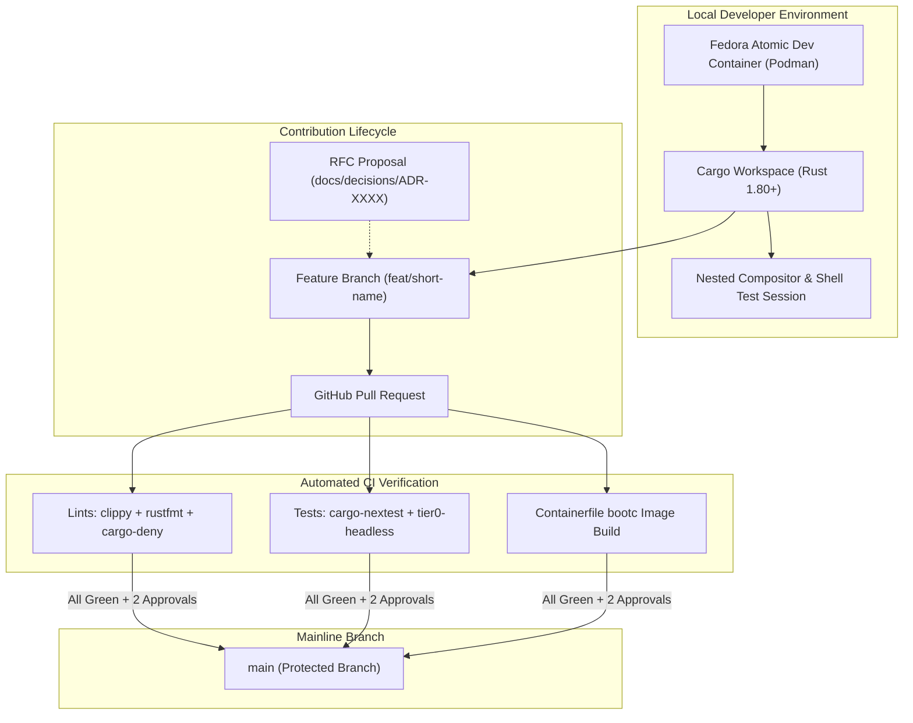
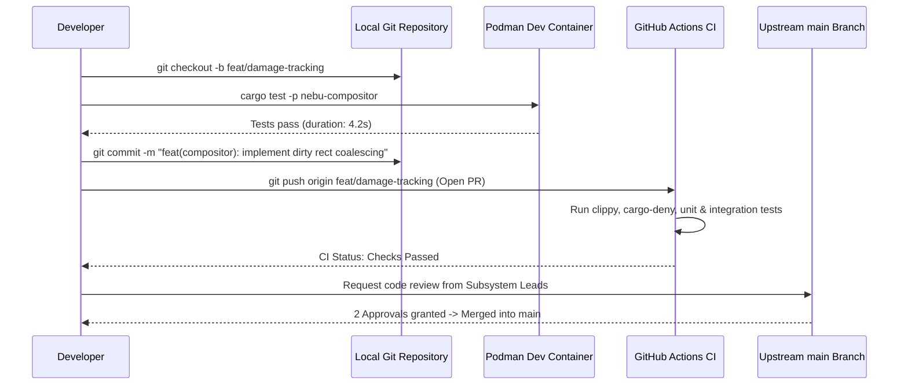

# Master Development Specification — NebuOS

## 1. Status
**Status:** DRAFT  
**Type:** Master Engineering Specification  
**Domain:** System Architecture, Repository Layout, and Contributor Workflow  
**Target Architecture:** x86_64  
**Target Release:** NebuOS 1.0 (Milestones P0-P12)

---

## 2. Purpose
This master specification defines the core engineering standards, software development lifecycle (SDLC), contribution workflows, and development environment specifications for NebuOS. NebuOS is an immutable, desktop-focused Linux operating system combining a Fedora Atomic (bootc/ostree) base, custom Rust desktop daemons (`nebu-compositor`, `nebu-shell`, `nebu-runtime-daemon`, `nebu-patcher`, `nebu-compat-db`), and a sandboxed Windows compatibility subsystem (Wine/Proton, DXVK, VKD3D). This document establishes how developers contribute to, build, debug, and maintain the NebuOS system software stack.

---

## 3. Scope
This specification governs:
- Monorepo development workflows, Git branching strategies, and commit conventions.
- Developer workstation requirements and containerized development environments (Dev Containers).
- The RFC (Request for Comments) governance process for architectural changes.
- Integration points between developer tooling, local emulation harnesses, and upstream repositories.
- Code review criteria, pull request lifecycles, and contributor qualification standards.
- Build, test, and debug workflows across all workspace crates and packaging layers.
- Cross-subsystem development practices between desktop, runtime, and update layers.
- Toolchain configuration, compiler profiles, and IDE setup.

---

## 4. Non-Goals
- Defining specific release engineering, changelog, or binary distribution pipelines (governed by [06-release-engineering.md](06-release-engineering.md)).
- Enforcing end-user application installation policies or desktop app-store guidelines.
- Authoring non-Linux developer environments; NebuOS development is strictly supported on modern x86_64 Linux hosts.
- Rewriting mature upstream components (Wine, Mesa, Linux kernel) within the NebuOS repository.
- Virtual machine hypervisor development or hypervisor guest integrations.
- Support for proprietary out-of-tree hardware drivers in development trees.

---

## 5. Requirements

### 5.1 Functional Requirements
- **REQ-DEV-001:** The repository must provide an automated Dev Container specification capable of bootstrapping a complete build environment with a single command.
- **REQ-DEV-002:** All Rust system components must compile cleanly under the workspace root using standard `cargo build --workspace`.
- **REQ-DEV-003:** Local developer test sessions must allow running `nebu-compositor` in nested Wayland mode inside an existing desktop session.
- **REQ-DEV-004:** Architectural changes affecting database schemas, IPC interfaces, or sandbox boundaries must submit an approved RFC document in `docs/decisions/`.
- **REQ-DEV-005:** Git commit history must strictly follow the Conventional Commits 1.0.0 specification for automated changelog generation.
- **REQ-DEV-006:** All workspace crates must provide unit tests executable via `cargo test` and `cargo nextest`.
- **REQ-DEV-007:** The developer CLI must support ephemeral prefix creation for localized Wine testing without host pollution.
- **REQ-DEV-008:** The repository must provide automated Git hooks enforcing formatting and commit validation locally.
- **REQ-DEV-009:** Developers must be capable of debugging D-Bus method calls locally using `busctl` or `nebu-cli`.

### 5.2 Non-Functional Requirements
- **REQ-DEV-008:** Cold incremental build time for single-crate modifications must not exceed `15 seconds` on reference developer hardware.
- **REQ-DEV-009:** Workspace development dependencies must strictly avoid non-free, proprietary, or GPL-incompatible tooling.
- **REQ-DEV-010:** Local headless test runs must execute without requiring root (`sudo`) privileges on the development host.
- **REQ-DEV-011:** All documentation files must pass Markdown linting (`markdownlint`) and dead-link validation.
- **REQ-DEV-012:** Development containers must initialize in `< 60 seconds` on systems with pre-cached container images.

---

## 6. Architecture

NebuOS organizes development along a Trunk-Based Development model with short-lived feature branches, gated by strict continuous integration and peer review:



---

## 7. Components

### 7.1 Development Environment Subsystems
- **Dev Container (`.devcontainer/`):** Standard OCI container definition providing Fedora 44 dependencies, Rust 1.80+, LLVM/Clang, Wayland development headers, Mesa drivers, and QEMU.
- **Cargo Workspace Root (`Cargo.toml`):** Top-level workspace manifest synchronizing crate dependencies, optimization profiles, and compiler lint flags.
- **Local Test Runner (`nebu-dev-runner`):** Developer CLI utility to launch nested Wayland sessions, spawn ephemeral D-Bus session buses, and inspect prefix states.
- **RFC Governance Registry (`docs/decisions/`):** Version-controlled Architectural Decision Records (ADR-0001 through ADR-XXXX) detailing system design changes.
- **Git Hooks Engine (`.githooks/`):** Pre-commit and pre-push hooks executing `rustfmt` checks and commit message validation.
- **IDE Extensions Configuration (`.vscode/`):** Workspace presets for `rust-analyzer`, `lldb`, and formatting extensions.

### 7.2 Subsystem Ownership Classification
| Component | Classification | Origin / Dependency |
|---|---|---|
| `nebu-dev-runner` | NebuOS Component | In-house Rust utility (`crates/nebu-cli`) |
| Dev Container Manifest | NebuOS Component | Repository configuration (`.devcontainer/`) |
| Cargo Workspace | NebuOS Component | Monorepo structure (`nebuos/`) |
| `podman` | Linux Ecosystem | Fedora upstream container engine |
| `rustc` / `cargo` | Rust Foundation | Upstream Rust toolchain |
### 7.3 Developer Tooling and Diagnostics Matrix

| Tool | Category | Command Invocation | Primary Purpose |
|---|---|---|---|
| `cargo-nextest` | Test Execution | `cargo nextest run` | High-speed isolated unit testing runner. |
| `cargo-deny` | Supply Chain | `cargo deny check` | Validates licenses, bans, and security advisories. |
| `cargo-llvm-cov` | Code Coverage | `cargo llvm-cov --html` | Generates detailed source code line and branch coverage. |
| `mold` / `lld` | Linker | Configured via `.cargo/config.toml` | Reduces incremental linking times by up to 80%. |
| `heaptrack` | Memory Profiling | `heaptrack target/debug/...` | Traces heap allocations and detects leaks in daemons. |
| `wtype` | Input Simulation | `wtype "text"` | Injects synthetic keystrokes into active Wayland surface. |

---

## 8. Data Flow



---

## 9. Control Flow

### 9.1 Pull Request and Review Lifecycle
1. **Branch Creation:** Developer branches from up-to-date `main` using naming pattern `feat/<scope>`, `fix/<scope>`, or `perf/<scope>`.
2. **Local Validation:** Developer executes `cargo clippy --workspace --all-targets -- -D warnings` and `cargo nextest run --workspace`.
3. **Pull Request Submission:** Developer opens PR against `main` using standard PR template.
4. **Automated Pipeline Trigger:** GitHub Actions CI executes formatting, linting, licensing checks, unit tests, and headless boot tests.
5. **Architectural Review:**
   - Changes modifying IPC or schemas require sign-off from Systems Architect.
   - UI/Shell modifications require review from Desktop Lead.
6. **Rebase & Merge:** Upon receiving two maintainer approvals and green CI status, the PR is merged via squash-and-merge or rebase-and-merge.

---

## 10. Interfaces

### 10.1 Conventional Commit Format
All commit messages must adhere to the following specification:
```text
<type>(<scope>): <short summary>

[optional body explaining motivation and architectural trade-offs]

[optional footer: Fixes #123, Refs #456]
```
Allowed types: `feat`, `fix`, `perf`, `refactor`, `docs`, `test`, `build`, `ci`, `chore`.

### 10.2 Developer CLI Commands
```bash
# Enter development container
podman run --rm -it -v $(pwd):/workspace:z ghcr.io/nebu-os/devcontainer:latest

# Build entire workspace in debug mode
cargo build --workspace

# Run nested compositor inside existing Wayland/X11 session
cargo run -p nebu-compositor -- --backend wayland

# Launch local headless integration test harness
cargo run -p nebu-cli -- test --tier 0 --headless

# Format code and run strict linter checks
cargo fmt --all && cargo clippy --workspace --all-targets -- -D warnings

# Profile memory usage of local compositor session
heaptrack target/debug/nebu-compositor --backend headless

# Run eBPF tracing agent locally for application launch profiling
cargo run -p nebu-perf-bench -- trace-launch --app-id com.microsoft.word.2021

# Inspect SQLite compatibility profile database
sqlite3 data/compat.db ".schema" "SELECT * FROM app_profiles LIMIT 5;"
```

---

## 11. Dependencies

### 11.1 Host Workstation Requirements
- **Operating System:** Fedora Atomic / Silverblue, Fedora Workstation 44+, Arch Linux, or Ubuntu 24.04 LTS.
- **Hardware:** x86_64 CPU with hardware virtualization enabled (`/dev/kvm`), >= 16 GB RAM, >= 50 GB free NVMe storage.
- **Container Engine:** Podman 4.9+ or Docker Engine 26+.

### 11.2 Toolchain Versions
- **Rust Toolchain:** Stable `1.80.0` or newer (managed via `rust-toolchain.toml`).
- **C/C++ Compiler:** `clang` 18.x with `lld` linker.
- **Build Tools:** `cmake` 3.28+, `ninja-build` 1.11+, `meson` 1.4+.

---

## 12. Security
- **Commit Signing:** All Git commits submitted to the NebuOS repository must be cryptographically signed using GPG or SSH keys verified against GitHub user profiles.
- **Supply Chain Guardrails:** Third-party crate dependencies are audited on every commit using `cargo-deny` and `cargo-audit` to detect known vulnerabilities and unapproved licenses.
- **Dev Container Isolation:** Local development containers run rootless without host root access, mapping the developer user UID/GID cleanly.
- **Secret Scanning:** Automated pre-commit hooks and GitHub push protection reject commits containing API tokens, private keys, or credentials.

---

## 13. Resource Requirements

| Resource | Minimum Developer Setup | Recommended Developer Setup |
|---|---|---|
| **CPU** | 4 Cores / 8 Threads | 8+ Cores / 16 Threads |
| **RAM** | 16 GB | 32 GB |
| **Storage** | 50 GB SSD | 100 GB NVMe (Btrfs recommended) |
| **Network** | 25 Mbps | 100 Mbps (for bootc container base pulls) |

---

## 14. Failure Modes

| Failure ID | Symptom | Underlying Cause | Developer Remedy |
|---|---|---|---|
| **FAIL-DEV-001** | Linker failure (`undefined reference to wl_*`) | Missing Wayland client development libraries on host/container | Run `dnf install wayland-devel libxkbcommon-devel` or use Dev Container |
| **FAIL-DEV-002** | Nested compositor crash on startup | Host compositor does not support required Wayland sub-protocols | Run compositor with `--backend x11` or `--backend headless` |
| **FAIL-DEV-003** | CI lint failure: `deny(clippy::unwrap_used)` | Explicit `.unwrap()` used in production crate path | Replace `.unwrap()` with `?` operator or structured error handling |
| **FAIL-DEV-004** | Out-of-memory during compilation | Parallel linker invocations consuming excessive memory | Set `CARGO_BUILD_JOBS=4` and configure `mold` or `lld` linker |
| **FAIL-DEV-005** | D-Bus name collision during test | Existing system daemon bound to `org.nebu.Runtime1` | Use isolated private session bus via `dbus-run-session` |

---

## 15. Recovery Behavior
- **Corrupted Cargo Build Cache:** Developers can reset incremental build state cleanly by executing `cargo clean` and clearing `sccache -C`.
- **Dangling Test Sockets:** If a local test session crashes, execute `killall -9 nebu-compositor nebu-runtime-daemon` and remove `/tmp/nebu-dev-*`.
- **Git Rebase Conflicts:** Developers resolve merge conflicts locally using `git rebase origin/main` rather than creating merge commits on feature branches.
- **Dev Container Rebuild:** If system packages inside the dev container become desynchronized, execute `podman build --no-cache -t nebu-dev .devcontainer`.

---

## 16. Testing Requirements
- **Pre-Push Validation:** Contributors must run `cargo test --workspace` and ensure 100% pass rate before opening pull requests.
- **Documentation Tests:** All public API code examples in Rust documentation comments (`///`) must compile and execute successfully via `cargo test --doc`.
- **RFC Acceptance Criteria:** Any new architectural feature must include a corresponding test strategy section before RFC approval.
- **Cross-Component Smoke Test:** Changes affecting IPC schemas must run the nested desktop smoke test before submission.

---

## 17. Performance Requirements
- **Workspace Compilation:** Clean release build of entire workspace (`cargo build --release --workspace`) must complete in `< 4 minutes` on an 8-core CPU.
- **Developer Test Loop:** Incremental compilation and execution of modified unit tests must execute in `< 5 seconds`.
- **Git Hook Latency:** Local pre-commit formatting checks (`rustfmt`) must complete in `< 1.0 second`.

---

## 18. Compatibility Considerations
- **Upstream Sync:** The repository maintains tracking branches for upstream Fedora bootc base images and Wine releases, rebasing changes bi-weekly.
- **Toolchain Pinning:** Rust versions are strictly pinned in `rust-toolchain.toml` to prevent build breakage caused by compiler regressions.
- **Cross-Distro Development:** The Dev Container ensures identical build environments regardless of whether developer workstations run Fedora, Ubuntu, or Arch Linux.

---

## 19. Open Questions
1. *OPEN QUESTION:* Should NebuOS adopt `mold` as the default workspace linker in CI to accelerate build times, or stick to `lld` for broader compatibility?
2. *OPEN QUESTION:* How can local nested Wayland compositor testing be streamlined for developers using NVIDIA proprietary drivers on their host workstations?
3. *OPEN QUESTION:* What is the recommended strategy for local debugging of Wine DLL overrides without rebuilding the entire system image?

---

## 20. Related Documents
- [01-repository-structure.md](01-repository-structure.md) — Cargo workspace layout and crate organization.
- [02-build-system.md](02-build-system.md) — Containerfile build pipeline and caching.
- [03-ci-cd.md](03-ci-cd.md) — GitHub Actions pipeline and artifact deployment.
- [05-coding-guidelines.md](05-coding-guidelines.md) — Rust coding style, errors, and logging.
- [06-release-engineering.md](06-release-engineering.md) — Release lifecycle, versioning, and distribution.
- [../testing/00-testing-specification.md](../testing/00-testing-specification.md) — Testing specification and QA gates.
