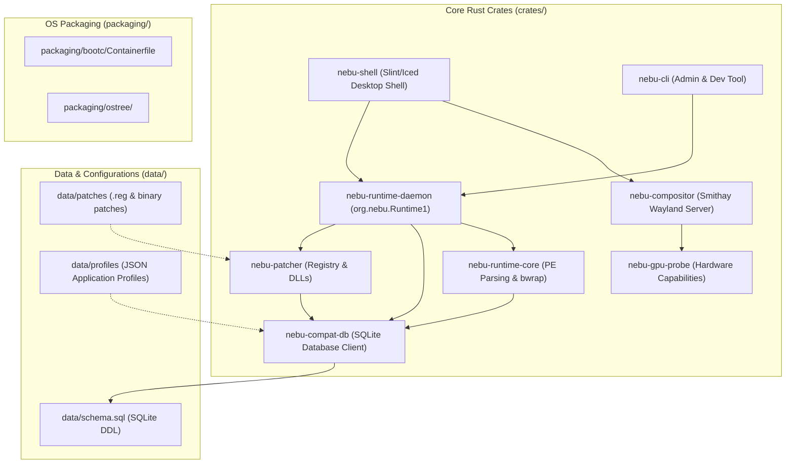
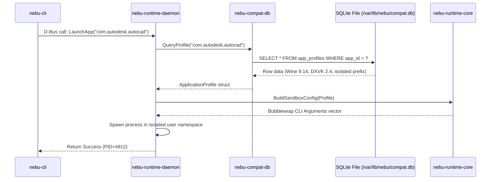

# Repository Structure Specification — NebuOS

## 1. Status
**Status:** DRAFT  
**Type:** Subsystem Engineering Specification  
**Domain:** Monorepo Organization, Cargo Workspace Architecture, and Crate Topography  
**Target Architecture:** x86_64  
**Target Release:** NebuOS 1.0 (Milestones P0-P12)

---

## 2. Purpose
This specification establishes the architectural directory structure, Cargo workspace configuration, crate dependency topology, and feature flag taxonomy for the NebuOS core system monorepo. NebuOS unifies its custom desktop display server, graphical shell, application runtime daemon, patch engine, and hardware probing tools within a single version-controlled repository. This document defines the strict unidirectional dependency invariants, encapsulation boundaries, and build feature configurations governing all repository components.

---

## 3. Scope
This specification governs:
- Monorepo directory hierarchy and file placement conventions.
- Cargo workspace layout, shared profile definitions, and unified dependencies.
- Inter-crate dependency graph and circular dependency prevention rules.
- Crate feature flag taxonomy (UI backends, mocking hooks, sandboxing modes).
- Packaging, assets, compatibility profiles, and test suite locations.
- Code ownership mappings and architectural isolation boundaries.

---

## 4. Non-Goals
- Defining repository layout for external third-party software packaging (e.g., Fedora RPM specfiles).
- Re-architecting upstream C/C++ repositories (Wine, Mesa, Linux kernel).
- Supporting independent multi-repository git submodules for core system crates.
- Documenting packaging and deployment infrastructure outside the monorepo root.

---

## 5. Requirements

### 5.1 Functional Requirements
- **REQ-REPO-001:** The repository must be configured as a Cargo workspace with unified versioning and centralized dependency declaration via `[workspace.dependencies]`.
- **REQ-REPO-002:** The inter-crate dependency graph must be a strict Directed Acyclic Graph (DAG); circular dependencies between crates are strictly prohibited.
- **REQ-REPO-003:** Low-level utility crates (`nebu-runtime-core`, `nebu-compat-db`) must not depend on UI or compositor crates (`nebu-shell`, `nebu-compositor`).
- **REQ-REPO-004:** Crate feature flags must be additive and must not break compilation when combined in arbitrary configurations (`--all-features`).
- **REQ-REPO-005:** Static assets (database schemas, JSON compatibility profiles, patch files) must reside in deterministic locations under `data/`.

### 5.2 Non-Functional Requirements
- **REQ-REPO-006:** All workspace crates must share identical compiler optimization flags and lint rules defined in the root `Cargo.toml`.
- **REQ-REPO-007:** Workspace metadata parsing via `cargo metadata` must execute in `< 1.0 second`.
- **REQ-REPO-008:** The repository must maintain zero binary blobs larger than 100 KB in standard Git tree (larger assets must use Git LFS).

---

## 6. Architecture

The NebuOS repository is organized as a unified monorepo with modular domains:



---

## 7. Components

### 7.1 Monorepo Topography

```text
nebuos/
├── .devcontainer/             # Dev container definition & setup scripts
├── .github/                   # GitHub Actions CI/CD workflows
├── Cargo.toml                 # Master workspace manifest & dependencies
├── Cargo.lock                 # Pinned workspace lockfile
├── rust-toolchain.toml        # Pinned Rust toolchain (1.80.0)
│
├── crates/                    # Core System Rust Crates
│   ├── nebu-compositor/       # Wayland display server (Smithay, DRM/KMS)
│   ├── nebu-shell/            # Native desktop environment (wlr-layer-shell)
│   ├── nebu-runtime-daemon/   # System D-Bus daemon (org.nebu.Runtime1)
│   ├── nebu-runtime-core/     # PE/COFF parsing & Bubblewrap sandboxing
│   ├── nebu-compat-db/        # SQLite compatibility database interface
│   ├── nebu-patcher/          # Declarative registry & binary patch engine
│   ├── nebu-gpu-probe/        # PCI probing & hardware profile detector
│   └── nebu-cli/              # CLI diagnostics & management utility
│
├── data/                      # Static Data & Declarative Schemas
│   ├── profiles/              # Per-application JSON profiles (Word, AutoCAD)
│   ├── patches/               # Curated .reg files and DLL overrides
│   └── schema.sql             # Canonical SQLite DDL schema
│
├── packaging/                 # OS Assembly & Bootc Manifests
│   ├── bootc/                 # Containerfile for bootc OS image builds
│   ├── grub/                  # GRUB2 configuration & splash themes
│   └── systemd/               # Custom systemd service units & presets
│
├── tests/                     # Multi-Subsystem Integration Suites
│   ├── harness/               # nebu-test-harness test orchestrator
│   ├── compat-runner/         # Headless Wine test automation agent
│   └── fixtures/              # Test documents, synthetic DWG, sample PEs
│
└── docs/                      # Technical Architecture & Specifications
```

### 7.2 Crate Taxonomy & Responsibilities

| Crate | Binary / Library | Primary Dependencies | Responsibility |
|---|---|---|---|
| `nebu-compositor` | Bin + Lib | `smithay`, `wayland-server`, `drm`, `ash` | DRM/KMS scanout, Wayland protocols, window tree management. |
| `nebu-shell` | Binary | `slint` (or `iced`), `wayland-client`, `zbus` | Desktop panel, taskbar, launcher, system notifications. |
| `nebu-runtime-daemon`| Bin + Lib | `tokio`, `zbus`, `nix`, `tracing` | D-Bus service, Wine prefix supervision, process lifecycle. |
| `nebu-runtime-core` | Library | `goblin` (PE parser), `bwrap-args`, `serde` | PE interrogation, Bubblewrap argument construction. |
| `nebu-compat-db` | Library | `rusqlite`, `serde`, `r2d2` | SQLite WAL connection pool, migrations, profile queries. |
| `nebu-patcher` | Library | `encoding_rs`, `regex`, `rusqlite` | Registry hive parsing, UTF-16LE conversion, DLL overrides. |
| `nebu-gpu-probe` | Bin + Lib | `udev`, `pci-ids`, `drm` | GPU vendor detection, Mesa capability flags, driver selection. |
| `nebu-cli` | Binary | `clap`, `zbus`, `prettytable-rs` | Administrator CLI for prefix management, logs, and diagnostics. |

---

## 8. Data Flow



---

## 9. Control Flow

### 9.1 Monorepo Build and Compilation Flow
1. **Toolchain Resolution:** Cargo reads `rust-toolchain.toml` to select Rust 1.80.0.
2. **Workspace Dependency Resolution:** Cargo resolves all crate dependencies through root `Cargo.toml`.
3. **Low-Level Compilation:** Compiles leaf libraries in parallel:
   - `nebu-compat-db`, `nebu-patcher`, `nebu-gpu-probe`.
4. **Intermediate Layer:** Compiles `nebu-runtime-core` linking against `nebu-compat-db`.
5. **Daemon & Server Layer:** Compiles `nebu-runtime-daemon` and `nebu-compositor`.
6. **Shell & UI Layer:** Compiles `nebu-shell` and `nebu-cli`.
7. **Artifact Packaging:** Binaries are collected into target staging paths for bootc image assembly.

---

## 10. Interfaces

### 10.1 Master Workspace Manifest (`Cargo.toml`)
```toml
[workspace]
resolver = "2"
members = [
    "crates/nebu-compositor",
    "crates/nebu-shell",
    "crates/nebu-runtime-daemon",
    "crates/nebu-runtime-core",
    "crates/nebu-compat-db",
    "crates/nebu-patcher",
    "crates/nebu-gpu-probe",
    "crates/nebu-cli",
    "tests/harness",
    "tests/compat-runner",
]

[workspace.package]
version = "0.1.0"
edition = "2021"
rust-version = "1.80.0"
license = "MPL-2.0"
repository = "https://github.com/nebu-os/nebuos"

[workspace.dependencies]
tokio = { version = "1.38", features = ["full"] }
zbus = { version = "4.2", default-features = false }
serde = { version = "1.0", features = ["derive"] }
serde_json = "1.0"
tracing = "0.1"
thiserror = "1.0"
rusqlite = { version = "0.31", features = ["bundled"] }
smithay = { version = "0.3", default-features = false }
```

### 10.2 Feature Flags Matrix
```toml
# In crates/nebu-shell/Cargo.toml
[features]
default = ["slint-backend"]
slint-backend = ["dep:slint"]
iced-backend = ["dep:iced"]
mock-daemon = ["nebu-runtime-daemon/mock"]

# In crates/nebu-runtime-daemon/Cargo.toml
[features]
default = ["strict-sandbox"]
strict-sandbox = ["nebu-runtime-core/strict-sandbox"]
mock = ["dep:mockall"]
```

---

## 11. Dependencies

### 11.1 Internal Workspace Dependencies
- `nebu-shell` -> `nebu-runtime-daemon` (IPC client only), `nebu-compositor` (protocols).
- `nebu-runtime-daemon` -> `nebu-runtime-core`, `nebu-compat-db`, `nebu-patcher`.
- `nebu-compositor` -> `nebu-gpu-probe`.
- `nebu-cli` -> `nebu-runtime-daemon` (D-Bus), `nebu-compat-db`.

### 11.2 External C Libraries (Dynamic Linking)
- `libwayland-server.so.0` / `libwayland-client.so.0`
- `libxkbcommon.so.0`
- `libinput.so.10`
- `libdrm.so.2`
- `libdbus-1.so.3`

---

## 12. Security
- **Strict Separation of Privilege:** No workspace binary runs with root setuid permissions. Daemon-to-daemon calls are authenticated over D-Bus policy rules (`/usr/share/dbus-1/system.d/org.nebu.Runtime1.conf`).
- **Encapsulated FFI Boundaries:** Direct C FFI wrappers (e.g., in `nebu-compositor` for libinput) are strictly isolated inside private submodules and wrapped in safe Rust traits.
- **Cargo Deny Policies:** The workspace prohibits dependencies containing known security vulnerabilities (RUSTSEC) or banned licenses via `cargo deny check`.

---

## 13. Resource Requirements

| Resource | Workspace Clean Build | Incremental Build |
|---|---|---|
| **CPU Threads** | 8+ logical cores recommended | 2+ cores |
| **Compiler Memory (RAM)** | 8 GB minimum (16 GB recommended) | 4 GB |
| **Disk Space (`target/`)** | ~12 GB (Debug + Tests) | ~4 GB (Release) |
| **Build Duration** | < 4 minutes (with sccache) | < 15 seconds |

---

## 14. Failure Modes

| Failure ID | Symptom | Underlying Cause | Developer Resolution |
|---|---|---|---|
| **FAIL-REPO-001** | Circular dependency compilation error | Crate A imports Crate B while B imports A | Extract shared data types into `nebu-runtime-core` or new leaf crate |
| **FAIL-REPO-002** | Conflicting dependency versions | Sub-crates specifying incompatible version bounds of `serde` or `tokio` | Enforce all shared dependencies through `[workspace.dependencies]` |
| **FAIL-REPO-003** | Feature flag compilation failure | Feature flag disables code required by a dependent crate | Ensure all feature combinations compile with `cargo hack check --each-feature` |
| **FAIL-REPO-004** | Linker duplicate symbol error | Multiple crates statically bundling SQLite or C stubs | Set `rusqlite = { version = "...", features = ["bundled"] }` only at root |

---

## 15. Recovery Behavior
- **Dependency Tree Reset:** If Cargo's lockfile resolves incompatible sub-dependencies, execute `cargo update --workspace` or selectively update with `cargo update -p <crate>`.
- **Target Directory Cleanup:** Run `cargo clean -p <crate>` to clear artifacts for a single malfunctioning crate without invalidating the entire workspace cache.
- **Git Subtree Synchronization:** In the event of schema divergence, the database migration runner automatically validates `data/schema.sql` against existing SQLite tables.

---

## 16. Testing Requirements
- **Circular Dependency Guard:** CI runs `cargo depgraph --workspace` and validates that no cycles exist in the crate graph.
- **Feature Matrix Verification:** CI executes `cargo check --workspace --all-targets --all-features` and tests default configurations.
- **Path Invariance:** Unit tests must use `std::env::current_dir()` or relative paths from `CARGO_MANIFEST_DIR`; hardcoded `/root/` or `/home/` paths are rejected by linter.

---

## 17. Performance Requirements
- **Incremental Build Latency:** Modifying a single function body in `nebu-shell` must recompile and link in **< 8 seconds**.
- **Metadata Evaluation:** `cargo metadata --format-version 1` must execute in **< 500 ms**.
- **Workspace Test Execution:** Running `cargo nextest run --workspace` must complete in **< 45 seconds**.

---

## 18. Compatibility Considerations
- **Rust MSRV:** Minimum Supported Rust Version is strictly set to `1.80.0`; all crates must compile cleanly on this compiler version.
- **Fedora Base Alignment:** System libraries linked by workspace crates must align with packages present in Fedora Atomic 40.
- **Architecture Portability:** While x86_64 is the initial target, all crate path operations and endian assumptions must remain portable to prepare for future ARM64 milestones.

---

## 19. Open Questions
1. *OPEN QUESTION:* Should `nebu-shell` and `nebu-compositor` share common UI geometry and window state primitives via a dedicated `nebu-desktop-core` leaf crate?
2. *OPEN QUESTION:* Should compatibility profile JSON files in `data/profiles/` be compiled directly into the `nebu-compat-db` binary via `include_str!` or loaded at runtime from `/usr/share/nebu/profiles/`?

---

## 20. Related Documents
- [00-development-specification.md](00-development-specification.md) — Master development workflow and standards.
- [02-build-system.md](02-build-system.md) — Containerfile build pipeline and caching.
- [04-dependency-policy.md](04-dependency-policy.md) — Approved dependency list and license compatibility.
- [05-coding-guidelines.md](05-coding-guidelines.md) — Rust style guide, error handling, and conventions.
- [../architecture/01-system-architecture.md](../architecture/01-system-architecture.md) — High-level system architecture.
