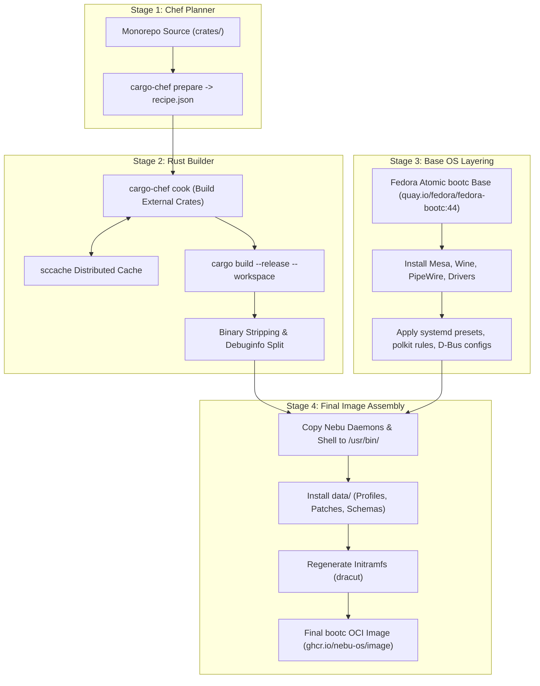
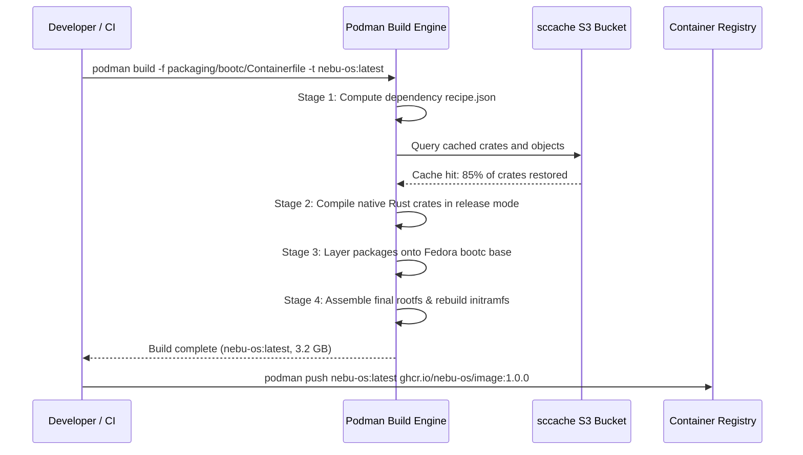

# Build System Specification — NebuOS

## 1. Status
**Status:** DRAFT  
**Type:** Subsystem Engineering Specification  
**Domain:** Image Assembly, Containerfile Layering, Build Caching, and Compilation  
**Target Architecture:** x86_64 (Future: aarch64)  
**Target Release:** NebuOS 1.0 (Milestones P0-P12)

---

## 2. Purpose
This specification establishes the build system architecture, multi-stage Containerfile pipeline, build caching strategies, and cross-compilation infrastructure for NebuOS. NebuOS is distributed as an image-based, bootable OCI container following the Fedora bootc specification. This document codifies how Rust workspace crates, upstream Linux packages (Mesa, PipeWire, Wine, Proton), desktop shell configurations, and filesystem layouts are assembled into verifiable, reproducible, and bootable operating system images.

---

## 3. Scope
This specification governs:
- Multi-stage Containerfile definitions for building the complete OS image.
- Cargo caching and dependency pre-compilation strategies using `cargo-chef` and `sccache`.
- Image layering, filesystem immutability enforcement (`/usr` read-only), and Btrfs subvolume layout.
- Cross-compilation architecture using `cross-rs` and multi-arch OCI manifests.
- Local developer image assembly versus automated CI build pipelines.
- Reproducible build verification and build artifact determinism.

---

## 4. Non-Goals
- Maintaining a custom Linux kernel build system (NebuOS uses Fedora kernel RPMs).
- Building an independent binary package manager (e.g., rewriting `dnf` or `rpm`).
- Supporting traditional mutable package-by-package system installation workflows.
- Compiling proprietary Windows binaries within the build pipeline.

---

## 5. Requirements

### 5.1 Functional Requirements
- **REQ-BLD-001:** The operating system image must be buildable using standard OCI container tooling (`podman build` or `docker build`).
- **REQ-BLD-002:** The build pipeline must utilize multi-stage builds to separate compiler toolchains and build dependencies from the final bootable image.
- **REQ-BLD-003:** The final image must adhere to the `bootc` specification, containing a valid kernel, initramfs, ostree commit, and bootloader config.
- **REQ-BLD-004:** Compilation of Rust workspace crates must integrate with `sccache` for distributed compiler cache sharing across CI runners.
- **REQ-BLD-005:** The build system must support generating both OCI container images (`bootc`) and bootable RAW/ISO disk images (`bootc-image-builder`).

### 5.2 Non-Functional Requirements
- **REQ-BLD-006:** A full CI build from clean cache must complete in `< 18 minutes`; incremental builds with cache hits must complete in `< 4 minutes`.
- **REQ-BLD-007:** The final compressed bootc OCI image size must not exceed `3.5 GB`.
- **REQ-BLD-008:** The build pipeline must guarantee bit-for-bit reproducible output for Rust system binaries given identical input commits.

---

## 6. Architecture

The NebuOS build system relies on a 4-stage containerized build pipeline:



---

## 7. Components

### 7.1 Build Pipeline Components
- **`cargo-chef`:** Cargo plugin that caches external dependencies separately from project source code, accelerating multi-crate builds.
- **`sccache`:** Compiler cache daemon storing intermediate object files locally or in cloud storage (S3, GCS).
- **`Containerfile.bootc`:** Declarative OCI manifest defining base layers, packages, custom daemons, and system presets.
- **`bootc-image-builder`:** Upstream utility packaging the bootc container into an installer ISO, QCOW2 virtual disk, or raw disk image.
- **`cross-rs`:** Multi-architecture cross-compilation environment using containerized cross-toolchains.

### 7.2 Subsystem Ownership Classification
| Component | Classification | Origin / Dependency |
|---|---|---|
| `Containerfile.bootc` | NebuOS Component | Monorepo manifest (`packaging/bootc/`) |
| `cargo-chef` | Open Source Tool | Upstream Rust ecosystem tool |
| `sccache` | Open Source Tool | Mozilla / Rust community tool |
| `fedora-bootc:44` | Base OS Foundation | Upstream Fedora Project |
| `bootc-image-builder`| Base OS Tooling | Red Hat / Fedora container tools |

---

## 8. Data Flow



---

## 9. Control Flow

### 9.1 Image Assembly Sequence
1. **Recipe Extraction:** `cargo chef prepare --recipe-path recipe.json` parses workspace dependencies.
2. **Dependency Pre-compilation:** `cargo chef cook --release --recipe-path recipe.json` compiles all third-party crates.
3. **Workspace Compilation:** Builds `nebu-compositor`, `nebu-shell`, `nebu-runtime-daemon`, and other binaries with LTO (Link-Time Optimization) enabled.
4. **Symbol Extraction:** Strips production binaries; extracts `.debug` symbols to separate debuginfo packages.
5. **OS Base Layering:**
   - Extends `quay.io/fedora/fedora-bootc:44`.
   - Runs `dnf install -y wine-core mesa-dri-drivers pipewire wireplumber bubblewrap`.
6. **Filesystem Integration:**
   - Installs binaries into `/usr/bin/`.
   - Installs systemd units into `/usr/lib/systemd/system/`.
   - Installs D-Bus configuration policies into `/usr/share/dbus-1/system.d/`.
7. **Initramfs Generation:** Invokes `dracut -f` to generate bootloader initramfs containing Btrfs and DRM drivers.
8. **Final OCI Commit:** Labels image as bootable via `LABEL containers.bootc 1`.

---

## 10. Interfaces

### 10.1 Multi-Stage Containerfile Specification (`packaging/bootc/Containerfile`)
```dockerfile
# Stage 1: Recipe Planner
FROM rust:1.80-bookworm AS planner
WORKDIR /app
RUN cargo install cargo-chef
COPY . .
RUN cargo chef prepare --recipe-path recipe.json

# Stage 2: Dependency Cacher & Rust Builder
FROM rust:1.80-bookworm AS builder
WORKDIR /app
RUN cargo install cargo-chef
COPY --from=planner /app/recipe.json recipe.json
# Cook dependencies
RUN cargo chef cook --release --recipe-path recipe.json
# Build full workspace
COPY . .
RUN cargo build --release --workspace

# Stage 3: Final Bootable OS Image
FROM quay.io/fedora/fedora-bootc:44
# Install system foundation packages
RUN dnf install -y \
    wine-core \
    mesa-dri-drivers \
    mesa-vulkan-drivers \
    pipewire \
    wireplumber \
    bubblewrap \
    btrfs-progs \
    && dnf clean all

# Copy compiled NebuOS binaries
COPY --from=builder /app/target/release/nebu-compositor /usr/bin/
COPY --from=builder /app/target/release/nebu-shell /usr/bin/
COPY --from=builder /app/target/release/nebu-runtime-daemon /usr/bin/
COPY --from=builder /app/target/release/nebu-cli /usr/bin/

# Copy configuration and compatibility data
COPY data/schema.sql /usr/share/nebu/schema.sql
COPY data/profiles/ /usr/share/nebu/profiles/
COPY packaging/systemd/ /usr/lib/systemd/system/

# Regenerate initramfs
RUN dracut -f --kver $(rpm -q --qf "%{VERSION}-%{RELEASE}.%{ARCH}" kernel-core)

LABEL containers.bootc 1
```

### 10.2 Build Invocation Commands
```bash
# Build local bootc container image
podman build -t localhost/nebu-os:dev -f packaging/bootc/Containerfile .

# Generate bootable ISO installer from container image
podman run --rm -it --privileged \
    -v /var/run/docker.sock:/var/run/docker.sock \
    -v $(pwd)/output:/output \
    quay.io/centos-bootc/bootc-image-builder:latest \
    --type iso \
    localhost/nebu-os:dev
```

---

## 11. Dependencies

### 11.1 Build-Time Tooling
- **`podman` (4.9+) or `docker` (26.0+):** OCI container engines.
- **`cargo-chef` (0.1.67+):** Docker layer caching for Rust.
- **`sccache` (0.8+):** Shared compiler cache.
- **`dracut` (060+):** Linux initramfs generation tool.

### 11.2 Upstream Packages Ingested
- `quay.io/fedora/fedora-bootc:44`
- `wine-core-9.x.x86_64`
- `mesa-vulkan-drivers.x86_64`
- `pipewire.x86_64`

---

## 12. Security
- **Rootless Build Support:** The build pipeline can execute within unprivileged user namespaces without requiring host root permissions.
- **Base Image Digest Pinning:** Upstream base images are pinned to immutable cryptographic SHA-256 digests:
  `quay.io/fedora/fedora-bootc:44@sha256:7f...` to prevent upstream poisoning.
- **Binary Hardening Flags:** Rust compiler flags enforce full RELRO, stack protection, and control flow integrity:
  `RUSTFLAGS="-C relro-level=full -C link-arg=-Wl,-z,now"`.

---

## 13. Resource Requirements

| Resource | Local Developer Build | CI Pipeline Runner |
|---|---|---|
| **CPU Allocation** | 4-8 Cores | 16-32 vCPUs |
| **RAM** | 16 GB | 32 GB |
| **Scratch Disk Space** | 30 GB free NVMe storage | 100 GB NVMe |
| **Network Throughput** | >= 50 Mbps | >= 1 Gbps |

---

## 14. Failure Modes

| Failure ID | Symptom | Root Cause | Remediation Action |
|---|---|---|---|
| **FAIL-BLD-001** | `dracut` initramfs build failure | Missing kernel modules or insufficient `/tmp` space | Ensure kernel-core package is installed and allocate tmpfs space |
| **FAIL-BLD-002** | `cargo-chef` cache miss on all crates | Modified top-level `Cargo.lock` or workspace manifest | Normal behavior on dependency updates; rebuild cache |
| **FAIL-BLD-003** | Image size exceeds 3.5 GB budget | Unstripped debug symbols or dangling package caches | Ensure `dnf clean all` runs and binaries are stripped with `strip` |
| **FAIL-BLD-004** | Base image digest mismatch | Upstream base container re-tagged or digest corrupted | Verify upstream Fedora registry status and update pinned digest |

---

## 15. Recovery Behavior
- **Build Cache Eviction:** If compiler cache corruption is suspected, flush `sccache` via `sccache -C` and rebuild with `podman build --no-cache`.
- **Dangling Container Cleanup:** Automated post-build hooks run `podman system prune -f --filter "until=24h"` to reclaim host disk space.
- **Fallback Base Mirror:** If `quay.io` encounters an outage, the build pipeline automatically fails over to an internal AWS ECR mirror of the base image.

---

## 16. Testing Requirements
- **Container Linting:** Containerfiles are audited using `hadolint` to enforce best practices and avoid unnecessary layers.
- **Image Boot Validation:** Every produced image must boot in a headless QEMU instance and report healthy systemd status (`systemctl is-system-running == running`).
- **Reproducibility Test:** CI periodically executes twin builds from the same commit and asserts identical binary hashes.

---

## 17. Performance Requirements
- **Clean Image Build Time:** Full image generation from scratch must complete in **< 18 minutes** in CI.
- **Incremental Image Build Time:** Single Rust crate changes must produce an updated image in **< 4 minutes** using layer caching.
- **Initramfs Generation Duration:** `dracut` execution must complete in **< 25 seconds**.

---

## 18. Compatibility Considerations
- **bootc Specification Alignment:** The build system strictly adheres to the official Red Hat / Fedora bootc specification, ensuring compatibility with future ostree/bootc updates.
- **SELinux Policy Invariants:** SELinux labels must be correctly applied during image assembly via `setfiles` to ensure enforcing mode functions on boot.
- **Kernel Version Locking:** The initramfs is explicitly tied to the kernel version installed in `/usr/lib/modules/` during build time.

---

## 19. Open Questions
1. *OPEN QUESTION:* Should NebuOS pre-compile Wine Direct3D shader caches during image build time, or allow them to populate dynamically on the user's system?
2. *OPEN QUESTION:* What is the optimal balance between aggressive `zstd` compression on image layers and user update download/decompression speed?

---

## 20. Related Documents
- [00-development-specification.md](00-development-specification.md) — Master development specification.
- [01-repository-structure.md](01-repository-structure.md) — Cargo workspace and repository topography.
- [03-ci-cd.md](03-ci-cd.md) — Continuous integration and automated build pipelines.
- [06-release-engineering.md](06-release-engineering.md) — Release process, image signing, and publishing.
- [../updates/00-update-strategy.md](../updates/00-update-strategy.md) — Atomic update lifecycle and bootc updates.
