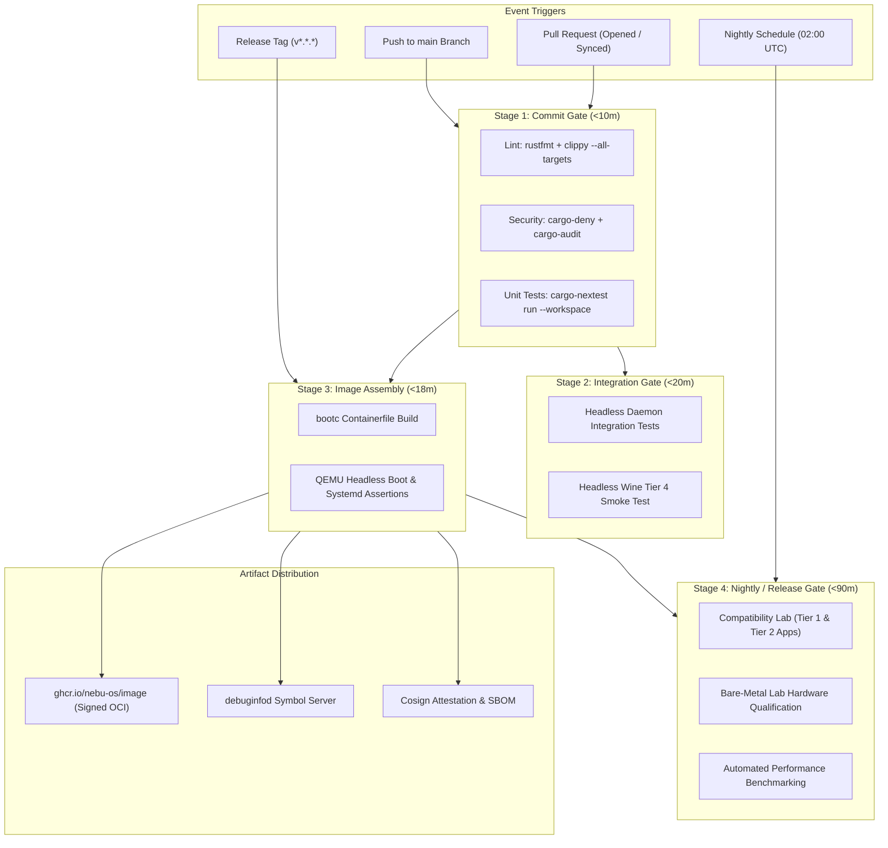
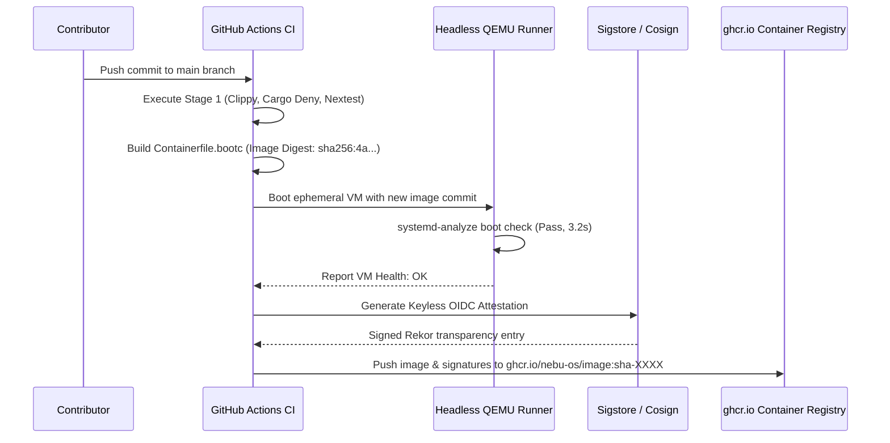

# CI/CD Pipeline Specification — NebuOS

## 1. Status
**Status:** DRAFT  
**Type:** Subsystem Engineering Specification  
**Domain:** Continuous Integration, Automated Delivery, and Pipeline Infrastructure  
**Target Architecture:** x86_64  
**Target Release:** NebuOS 1.0 (Milestones P0-P12)

---

## 2. Purpose
This specification establishes the architecture, pipeline stages, gating policies, and deployment automation for the NebuOS Continuous Integration and Continuous Delivery (CI/CD) system. Built primarily around GitHub Actions and hybrid bare-metal runner infrastructure, the CI/CD pipeline ensures that every code change undergoes automated static analysis, unit testing, multi-daemon integration, full OS bootc image assembly, and headless smoke testing before reaching the `main` branch or production update registries.

---

## 3. Scope
This specification governs:
- GitHub Actions workflow structure, trigger conditions, and job dependencies.
- Tiered pipeline execution: Commit Gate, Integration Gate, Nightly Build, and Release Staging.
- Cloud-hosted virtual runners and self-hosted bare-metal test runners.
- Artifact generation, container image publishing (`ghcr.io/nebu-os/image`), and debug symbol distribution.
- Cryptographic attestation, SLSA Level 3 provenance, and Software Bill of Materials (SBOM) publishing.
- Pipeline caching mechanisms and resource utilization constraints.
- Matrix builds for cross-version validation across Mesa and Wine releases.

---

## 4. Non-Goals
- Managing third-party software repository build systems (e.g., Fedora COPR).
- Orchestrating customer on-premise deployment tooling.
- Managing user bug tracker ticket lifecycles outside GitHub Issues/PRs.
- Building non-x86_64 container images in milestone P0-P12.
- Running long-term manual exploratory QA pipelines within automated CI.

---

## 5. Requirements

### 5.1 Functional Requirements
- **REQ-CICD-001:** Pull requests must trigger an automated Commit Gate pipeline executing `rustfmt`, `clippy`, `cargo-deny`, and workspace unit tests.
- **REQ-CICD-002:** The pipeline must assemble a complete bootable bootc container image for every merged commit to `main`.
- **REQ-CICD-003:** Headless boot tests must boot the assembled OS image in QEMU and assert clean initialization of `systemd`, `nebu-compositor`, and `nebu-runtime-daemon`.
- **REQ-CICD-004:** Published container images must be pushed to GitHub Container Registry (`ghcr.io`) and signed using Cosign keyless signatures.
- **REQ-CICD-005:** Debug symbols must be extracted and published to an internal `debuginfod` server for post-mortem crash analysis.
- **REQ-CICD-006:** The pipeline must verify SBOM completeness and block builds with unmitigated Critical/High vulnerabilities.

### 5.2 Non-Functional Requirements
- **REQ-CICD-007:** Commit Gate feedback on pull requests must complete in `< 10 minutes` total execution time.
- **REQ-CICD-008:** Nightly full-matrix regression suites must complete within `< 90 minutes` across parallel runners.
- **REQ-CICD-009:** Pipeline secret exposure must be prevented through strict secret masking, environment protection rules, and PR fork isolation.
- **REQ-CICD-010:** Build logs and test reports must be preserved for at least 90 days for audit compliance.

---

## 6. Architecture

The NebuOS CI/CD infrastructure is divided into four sequential execution tiers:



---

## 7. Components

### 7.1 Workflow Definitions (`.github/workflows/`)
- **`pr-gate.yml`:** Fast-feedback pull request validation (formatting, lints, security audits, unit tests).
- **`build-image.yml`:** Assembles the bootc image on mainline merges; tests boot in headless QEMU; signs and pushes to `ghcr.io`.
- **`nightly-regression.yml`:** Scheduled full compatibility suite executing Tier 1 (Office/AutoCAD) and Tier 2 (Maya/Photoshop) benchmarks.
- **`release.yml`:** Official release tag workflow generating signed images, installer ISOs, release notes, and provenance metadata.
- **`debuginfod-publish.yml`:** Background task indexing detached debuginfo files.

### 7.2 Subsystem Ownership Classification
| Component | Classification | Origin / Dependency |
|---|---|---|
| Pipeline Manifests (`.github/`) | NebuOS Component | Monorepo repository files |
| GitHub Actions Runners | Cloud Infrastructure | GitHub-hosted standard runners |
| Bare-Metal Test Lab Runners | NebuOS Infrastructure | Self-hosted GitHub Actions runners |
| `cosign` / Sigstore | Linux Ecosystem | Sigstore open-source signing tools |
| `ghcr.io` | External Registry | GitHub Container Registry |

---

## 8. Data Flow



---

## 9. Control Flow

### 9.1 Mainline Image Build and Delivery Sequence
1. **Trigger:** Commit lands on `main` branch.
2. **Pre-flight Checks:** Runner compiles Rust workspace and executes `cargo test`.
3. **Container Build:**
   - Evaluates multi-stage Containerfile using Podman.
   - Restores pre-compiled dependencies via `cargo-chef` cache.
   - Extracts binary artifacts and strips debug symbols.
4. **Image Verification:**
   - Launches QEMU with serial console output.
   - Awaits `login:` prompt; inspects systemd journal for failed units.
5. **Security & Provenance:**
   - Runs `trivy` container scan; blocks on Critical vulnerabilities.
   - Generates SPDX Software Bill of Materials (SBOM) using `syft`.
   - Attests image with `cosign sign --yes`.
6. **Publishing:** Pushes OCI image layers to `ghcr.io/nebu-os/image:main`.

---

## 10. Interfaces

### 10.1 Pull Request Workflow Manifest (`.github/workflows/pr-gate.yml`)
```yaml
name: Pull Request Gate

on:
  pull_request:
    branches: [ main ]

jobs:
  lint-and-audit:
    runs-on: ubuntu-latest
    steps:
      - uses: actions/checkout@v4
      - uses: dtolnay/rust-toolchain@stable
        with:
          toolchain: 1.80.0
          components: clippy, rustfmt
      - name: Check Formatting
        run: cargo fmt --all -- --check
      - name: Clippy Lints
        run: cargo clippy --workspace --all-targets -- -D warnings
      - name: Security & License Audit
        run: |
          cargo install cargo-deny
          cargo deny check

  unit-tests:
    needs: lint-and-audit
    runs-on: ubuntu-latest
    steps:
      - uses: actions/checkout@v4
      - uses: dtolnay/rust-toolchain@stable
      - uses: taiki-e/install-action@nextest
      - name: Run Unit Tests
        run: cargo nextest run --workspace
```

---

## 11. Dependencies

### 11.1 CI Actions & Tools
- **`actions/checkout@v4`:** Source checkout.
- **`dtolnay/rust-toolchain`:** Pinned Rust compiler installer.
- **`taiki-e/install-action@nextest`:** High-performance test runner.
- **`sigstore/cosign-installer`:** Cryptographic signing tool.
- **`aquasecurity/trivy-action`:** Vulnerability scanner.

---

## 12. Security
- **Fork Confinement:** Pull requests originating from community forks run with strictly read-only GitHub tokens (`GITHUB_TOKEN: read`) and have zero access to repository secrets.
- **SLSA Level 3 Provenance:** Release builds generate non-forgeable provenance records detailing the GitHub runner identity, commit SHA, and build steps.
- **Keyless Signing:** Signing uses Sigstore OpenID Connect (OIDC) tokens issued directly to the GitHub Actions runner identity, eliminating long-lived private keys.
- **Runner Sandboxing:** Self-hosted hardware runners reset ephemeral container rootfs partitions between jobs to prevent state contamination.

---

## 13. Resource Requirements

| Pipeline Stage | Runner Type | Target Duration | Parallelism |
|---|---|---|---|
| **PR Gate** | GitHub Standard (4 vCPU, 16 GB) | < 8 minutes | 3 parallel jobs |
| **Image Assembly** | Self-Hosted / Large (16 vCPU, 32 GB) | < 18 minutes | 1 job |
| **Headless QEMU Boot** | Bare-metal KVM Runner (8 vCPU, 16 GB)| < 3 minutes | 1 job |
| **Nightly Compatibility**| Dedicated Lab Nodes (AMD/Intel/NVIDIA)| < 90 minutes | 8 parallel nodes |

---

## 14. Failure Modes

| Failure ID | Symptom | Underlying Cause | Developer Remedy |
|---|---|---|---|
| **FAIL-CI-001** | QEMU boot test timeout (> 180s) | Kernel panic during DRM init or systemd service crash | Review QEMU serial console log uploaded as CI artifact |
| **FAIL-CI-002** | Cosign signing failure | OIDC token generation rejected or Sigstore Rekor API timeout | Check workflow permissions (`id-token: write`); re-run job |
| **FAIL-CI-003** | `ghcr.io` push rate limit / 403 | Token expired or registry permissions misconfigured | Ensure `packages: write` permission is declared in job |
| **FAIL-CI-004** | Cache eviction degradation | CI cache exceeded storage quota; forced clean build | Optimize `sccache` bucket retention policy |
| **FAIL-CI-005** | Flaky runner offline event | Network link glitch on self-hosted lab runner | Runner auto-drains and job retries on secondary node |

---

## 15. Recovery Behavior
- **Job Re-run Safeguards:** CI workflows are idempotent; retrying a failed job re-executes tests with clean temporary state.
- **Broken Image Quarantine:** If post-build smoke tests fail on an image, the pipeline aborts before updating the `latest` or `main` container tags.
- **Runner Auto-Drain:** Self-hosted runners detecting filesystem full or hardware faults automatically unregister from the GitHub pool and notify the infrastructure team.
- **Fallback Caching:** If cloud object storage for `sccache` is unreachable, builders automatically fall back to local disk caches without failing the build.

---

## 16. Testing Requirements
- **Workflow Linter:** All GitHub Actions YAML files must pass `actionlint` checks in CI.
- **QEMU Smoke Test Coverage:** Boot tests must assert that the Wayland socket (`/run/user/1000/wayland-0`) exists and accepts connections.
- **Artifact Verification:** Verify that published OCI manifests conform to the OCI Image Specification v1.1.
- **Vulnerability Check:** Trivy container scans must assert zero unfixed Critical CVEs before push.

---

## 17. Performance Requirements
- **PR Check Latency:** Total wall-clock time from PR open to green status must be **< 10 minutes**.
- **Container Layer Reuse:** Unmodified layers must achieve **> 90% cache hit rate** across sequential runs.
- **QEMU VM Boot Time:** Headless virtual machine boot to login prompt must complete in **< 12 seconds**.

---

## 18. Compatibility Considerations
- **Upstream Fedora Image Updates:** Base image digests are automatically checked weekly; updates are staged in pull requests with full regression testing.
- **Runner Kernel Compatibility:** KVM acceleration requires host runners with Linux kernel >= 6.5 and `/dev/kvm` read/write access for the runner daemon.
- **Multi-OS Runner Support:** GitHub workflows specify standard Linux runners; macOS/Windows runners are explicitly excluded from the build path.

---

## 19. Open Questions
1. *OPEN QUESTION:* Should NebuOS deploy self-hosted ARM64 runners in CI now to maintain continuous compilation for future ARM targets, or wait until milestone P13?
2. *OPEN QUESTION:* How can we securely publish debuginfod symbols without exposing proprietary third-party stub libraries?

---

## 20. Related Documents
- [00-development-specification.md](00-development-specification.md) — Master development specification.
- [02-build-system.md](02-build-system.md) — Multi-stage build system and Containerfile.
- [06-release-engineering.md](06-release-engineering.md) — Release process, versioning, and distribution.
- [../testing/00-testing-specification.md](../testing/00-testing-specification.md) — Testing specification and CI/CD integration.
- [../updates/00-update-strategy.md](../updates/00-update-strategy.md) — Atomic updates and bootc deployment.
