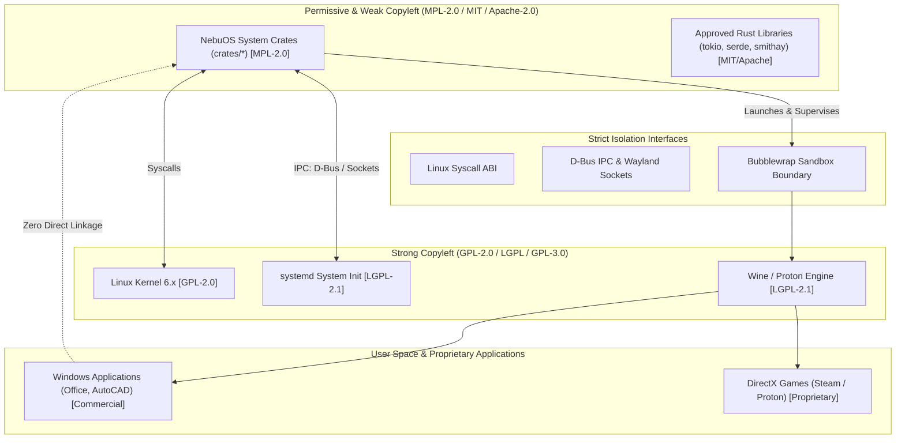
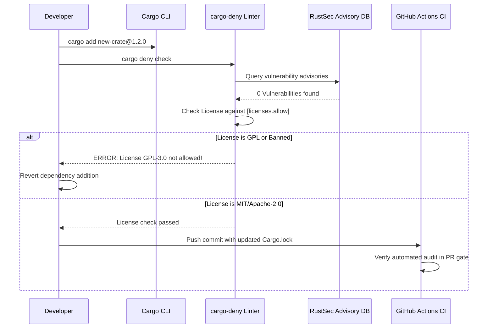

# Dependency Policy Specification — NebuOS

## 1. Status
**Status:** DRAFT  
**Type:** Subsystem Engineering Specification  
**Domain:** Supply Chain Security, Crate Governance, and License Compliance  
**Target Architecture:** x86_64  
**Target Release:** NebuOS 1.0 (Milestones P0-P12)

---

## 2. Purpose
This specification establishes the software dependency policy, approved third-party library catalog, security vulnerability audit schedules, and intellectual property licensing compatibility matrix for NebuOS. To maintain an immutable, highly secure, and legally unassailable operating system, every external Rust crate and Linux system library introduced into the NebuOS tree must satisfy strict licensing criteria, semantic versioning bounds, memory-safety invariants, and supply-chain auditing standards.

---

## 3. Scope
This specification governs:
- Policies for introducing, vetting, and updating Rust crates in the Cargo workspace.
- Approved dependency catalog with exact semver bounds and rationale.
- Intellectual property license compatibility across MPL-2.0, Apache-2.0, MIT, BSD, and GPL-2.0/GPL-3.0.
- Process-level isolation rules governing GPL and proprietary binary boundaries.
- Continuous supply-chain auditing via `cargo-deny`, `cargo-audit`, and Dependabot.
- Emergency CVE remediation timelines and automated vulnerability response protocols.
- Vendoring and offline build verification standards.

---

## 4. Non-Goals
- Regulating user-installed third-party software running inside isolated Wine prefixes or Flatpaks.
- Enforcing license auditing for external closed-source Windows applications certified by NebuOS.
- Managing licensing policies for upstream Fedora packages outside direct monorepo dependencies.
- Restricting open-source contributions under compatible permissive or weak-copyleft licenses.
- Auditing user-space scripting languages (Python, Bash) not bundled in base image.

---

## 5. Requirements

### 5.1 Functional Requirements
- **REQ-DEP-001:** All external dependencies must be audited and enforced automatically in CI using `cargo-deny`.
- **REQ-DEP-002:** Core NebuOS Rust crates must be licensed under the Mozilla Public License 2.0 (MPL-2.0).
- **REQ-DEP-003:** Direct dependencies must specify strict minor semantic versioning bounds (e.g., `"~1.38"` or `"1.38, < 1.39"`).
- **REQ-DEP-004:** Copyleft GPL components (Linux kernel, systemd, Wine) must interact with proprietary or user software solely across defined IPC boundaries (D-Bus, Wayland UNIX sockets, syscalls).
- **REQ-DEP-005:** Any new crate introduction must undergo an architectural security review and achieve consensus from the Security Lead.
- **REQ-DEP-006:** The project must maintain an automated inventory of all third-party dependencies and their corresponding licenses.
- **REQ-DEP-007:** Dependency lockfiles (`Cargo.lock`) must be updated via atomic, dedicated commits without mixing feature logic.
- **REQ-DEP-008:** Dependencies providing build-time code generation (`build.rs`) must be scrutinized to prevent arbitrary host command execution.

### 5.2 Non-Functional Requirements
- **REQ-DEP-007:** All crates must possess zero unpatched CVE advisories with a CVSS score `>= 7.0` in the RustSec Advisory Database.
- **REQ-DEP-008:** Crates utilizing `#![feature(...)]` nightly compiler attributes are strictly forbidden.
- **REQ-DEP-009:** Unsafe Rust code inside third-party dependencies must be audited and verified before dependency approval.
- **REQ-DEP-010:** Dependency resolution must be deterministic via a checked-in `Cargo.lock`.

---

## 6. Architecture

NebuOS enforces strict licensing and boundary separation across system software layers:



---

## 7. Components

### 7.1 Approved Rust Dependency Catalog

| Crate Name | Approved Version Range | License | Primary Usage | Justification |
|---|---|---|---|---|
| `tokio` | `1.38.x` | MIT | Async runtime | Industry-standard async I/O foundation; high performance. |
| `zbus` | `4.2.x` | Apache-2.0 | D-Bus client & service | Pure Rust, memory-safe D-Bus IPC without libdbus FFI bugs. |
| `smithay` | `0.3.x` | MIT | Wayland compositor engine | Modular, pure Rust display server primitives. |
| `rusqlite` | `0.31.x` | MIT | SQLite database driver | Bundled, battle-tested SQLite client with WAL support. |
| `serde` / `serde_json` | `1.0.x` | MIT / Apache-2.0 | Serialization | Universal JSON schema and profile serialization. |
| `tracing` | `0.1.x` | MIT | Structured logging | High-performance diagnostic telemetry across async tasks. |
| `thiserror` | `1.0.x` | MIT / Apache-2.0 | Error handling | Idiomatic derive macros for strongly-typed errors. |
| `nix` | `0.28.x` | MIT | Unix system APIs | Safe Rust wrappers around POSIX system calls. |
| `ash` | `0.38.x` | MIT / Apache-2.0 | Vulkan bindings | Low-level, zero-overhead Vulkan API wrappers. |
| `goblin` | `0.8.x` | MIT | Binary inspection | Fast PE/COFF header parsing without external tools. |

### 7.2 License Compatibility Matrix

| Dependency License | Ingestible into NebuOS Rust Crates? | Dynamic Linkage Allowed? | IPC Interaction Allowed? |
|---|---|---|---|
| **MPL-2.0** | YES (Native license) | YES | YES |
| **MIT / Apache-2.0** | YES (Compatible permissive) | YES | YES |
| **BSD-2-Clause / BSD-3-Clause** | YES (Compatible permissive) | YES | YES |
| **LGPL-2.1 / LGPL-3.0** | NO (Do not statically link in Rust) | YES (Dynamic link only) | YES |
| **GPL-2.0 / GPL-3.0** | NO (Incompatible with MPL-2.0 code) | NO | YES (Via D-Bus/Wayland/Syscall) |
### 7.3 Supply Chain Evaluation Checklist

Before proposing a new dependency for inclusion in `[workspace.dependencies]`, contributors must evaluate:
- **Maintenance Activity:** At least one commit in the last 6 months; active response to issues.
- **Transitive Depth:** Must not introduce more than 10 transitive dependencies without prior architect sign-off.
- **Unsafe Code Footprint:** Crates with > 5% unsafe code lines must provide memory safety audits.
- **Nightly Features:** Zero dependency on unstable compiler intrinsics or `#![feature(...)]`.
- **Pure Rust vs C FFI:** Pure Rust implementations are strictly prioritized over C wrapper crates.

---

## 8. Data Flow



---

## 9. Control Flow

### 9.1 Dependency Introduction Protocol
1. **Proposal:** Developer creates an issue detailing the requested crate, justification, license, and maintenance status.
2. **Security Evaluation:**
   - Review crate repository: commits in last 6 months, active maintainers, open issues.
   - Inspect unsafe code: `cargo geiger` audit of unsafe blocks.
3. **Configuration Update:** Add dependency to root `Cargo.toml` under `[workspace.dependencies]` with pinned minor version.
4. **Automated Verification:** Execute `cargo deny check all` and `cargo audit`.
5. **Architectural Approval:** Security Lead signs off on PR.

---

## 10. Interfaces

### 10.1 Supply Chain Security Configuration (`deny.toml`)
```toml
[licenses]
version = 2
allow = [
    "MPL-2.0",
    "MIT",
    "Apache-2.0",
    "Apache-2.0 WITH LLVM-exception",
    "BSD-2-Clause",
    "BSD-3-Clause",
    "ISC",
    "Unicode-DFS-2016",
]
confidence-threshold = 0.8

[bans]
multiple-versions = "deny"
wildcards = "deny"
deny = [
    { name = "openssl" }, # We enforce rustls over OpenSSL FFI
]

[advisories]
vulnerability = "deny"
unmaintained = "warn"
yanked = "deny"
notice = "warn"
ignore = []

[sources]
unknown-registries = "deny"
unknown-git = "deny"
allow-registry = ["https://github.com/rust-lang/crates.io-index"]
```

---

## 11. Dependencies

### 11.1 Verification Tools
- **`cargo-deny` (0.14+):** License, ban, and advisory enforcement tool.
- **`cargo-audit` (0.20+):** RustSec security database auditor.
- **`cargo-geiger` (0.11+):** Unsafe code ratio accounting utility.
- **`dependabot`:** Automated daily dependency pull request generator.

---

## 12. Security
- **No OpenSSL Dependency:** NebuOS crates standardize on `rustls` for TLS communication to prevent memory safety vulnerabilities associated with C OpenSSL libraries.
- **Crates.io Registry Integrity:** Dependencies are fetched strictly over HTTPS with cryptographic checksums validated against `Cargo.lock`.
- **Vendoring & Mirroring:** Release builds use pre-fetched, cached crate tarballs from internal enterprise Artifactory mirrors to ensure build availability during network outages.
- **Malicious Crate Detection:** Automated screening flags typosquatting attempts or newly registered crate owners before dependency acceptance.

---

## 13. Resource Requirements

| Verification Task | Execution Interval | CI Runtime Budget | Blocking Level |
|---|---|---|---|
| **`cargo-deny check`** | Every Pull Request | < 30 seconds | Blocking |
| **`cargo-audit`** | Daily scheduled run | < 60 seconds | Blocking on Critical |
| **Crate Version Upgrade Review** | Monthly cadence | 2 engineering hours | Advisory |
| **`cargo-geiger` Unsafe Audit** | Milestone release | < 5 minutes | Review Gate |

---

## 14. Failure Modes

| Failure ID | Condition | Root Cause | Remediation Protocol |
|---|---|---|---|
| **FAIL-DEP-001** | Banned license error in CI | New transitive dependency uses GPL-3.0 or non-commercial license | Replace crate or configure feature flags to exclude offending module |
| **FAIL-DEP-002** | RUSTSEC CVE vulnerability detected | Vulnerability published in upstream crate version | Bump minor version or apply patch override in `Cargo.toml` |
| **FAIL-DEP-003** | Multiple versions of same crate linked | Different dependencies requiring mismatched semver ranges | Unify dependencies in `[workspace.dependencies]` |
| **FAIL-DEP-004** | Yanked crate in dependency tree | Upstream maintainer pulled buggy or compromised release | Execute `cargo update` to resolve latest valid patch release |
| **FAIL-DEP-005** | Unsafe code ratio exceeds budget | New crate introduces undocumented unsafe blocks | Perform code audit; encapsulate in safe wrapper or reject crate |

---

## 15. Recovery Behavior
- **Emergency CVE Patching (`[patch.crates-io]`):** If an active vulnerability affects a crate without an upstream patch, NebuOS maintains a secure fork under `github.com/nebu-os-patches/` and overrides it via Cargo's patch mechanism within 4 hours.
- **Lockfile Rollback:** If a dependency upgrade causes regressions, `Cargo.lock` is immediately reverted to the previous commit.
- **Automated Quarantine:** Dependabot PRs introducing breaking API changes are quarantined until manual developer approval.
- **Transitive Pinning:** When sub-dependencies introduce breaking patch releases, explicit pinning in `Cargo.toml` stabilizes the build.
- **Upstream Crate Hijacking Response:** If a crate publisher account is reported compromised, CI immediately halts all dependency updates and freezes lockfile checks until integrity verification completes.
- **Offline Cache Mirroring:** Internal enterprise mirrors retain all historical crate versions used in any tagged release for a minimum of 5 years.

---

## 16. Testing Requirements
- **License Test Suite:** CI must fail immediately if an unapproved license enters the dependency tree.
- **Zero-Warning Invariant:** `cargo deny check` must complete with zero errors and zero warnings on `main`.
- **Offline Build Test:** Verify that `cargo build --offline` succeeds using vendored crates.
- **Reproducible Resolution:** Confirm that building with `--locked` succeeds across distinct development environments.

---

## 17. Performance Requirements
- **Dependency Resolution Time:** `cargo check` on an updated dependency manifest must complete in **< 10 seconds**.
- **Binary Size Impact:** No introduced dependency may increase stripped binary sizes by more than **500 KB** without explicit architect sign-off.
- **Compile Time Impact:** New dependencies must not increase clean workspace build times by more than **10%**.

---

## 18. Compatibility Considerations
- **Upstream C Library ABI:** Dynamic linking against host libraries (`glibc`, `libwayland`) must remain backward compatible across all supported Fedora Atomic base releases.
- **Wine API Drift:** Wine stubs must align with upstream Wine Staging APIs without requiring undocumented internal headers.
- **Toolchain Invariants:** Dependencies must compile cleanly under the project's MSRV (Rust 1.80.0) without requiring experimental compiler flags.

---

## 19. Open Questions
1. *OPEN QUESTION:* Should NebuOS vendor all third-party Rust crates directly in Git via `cargo vendor`, or rely on git-lfs cached tarballs in CI?
2. *OPEN QUESTION:* How should license auditing handle hybrid dual-licensed crates (e.g., `MIT OR Apache-2.0`) when transitive dependencies select conflicting paths?

---

## 20. Related Documents
- [00-development-specification.md](00-development-specification.md) — Master development specification.
- [01-repository-structure.md](01-repository-structure.md) — Monorepo layout and workspace structure.
- [03-ci-cd.md](03-ci-cd.md) — Automated CI/CD pipelines and auditing.
- [05-coding-guidelines.md](05-coding-guidelines.md) — Rust coding guidelines and safety invariants.
- [../architecture/05-security.md](../architecture/05-security.md) — Operating system security architecture.
