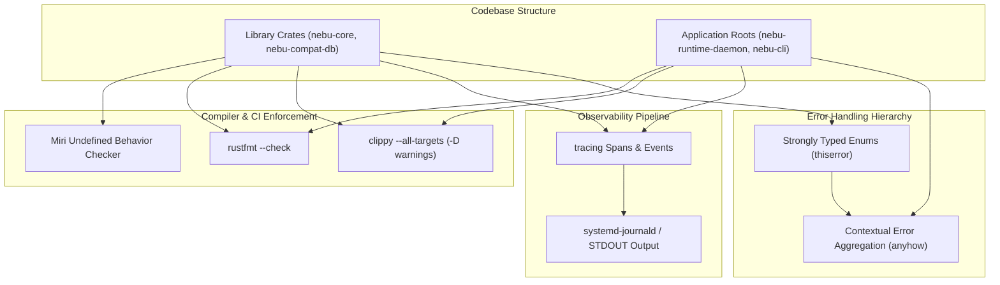
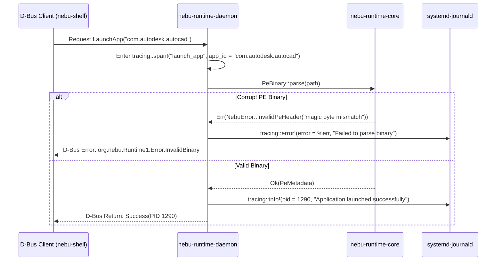

# Coding Guidelines Specification — NebuOS

## 1. Status
**Status:** DRAFT  
**Type:** Subsystem Engineering Specification  
**Domain:** Code Quality, Style Standards, Error Handling, and Observability  
**Target Architecture:** x86_64  
**Target Release:** NebuOS 1.0 (Milestones P0-P12)

---

## 2. Purpose
This specification establishes the software coding standards, Rust architectural style rules, error handling patterns, structured logging conventions, and documentation requirements for the NebuOS project. NebuOS system software (`nebu-compositor`, `nebu-shell`, `nebu-runtime-daemon`, `nebu-patcher`, `nebu-compat-db`) is implemented in memory-safe Rust. This document ensures that all codebase contributions maintain consistent readability, robust error propagation, strict memory safety invariants, and structured diagnostic observability.

---

## 3. Scope
This specification governs:
- Rust formatting (`rustfmt`) and strict compiler linter rules (`clippy`).
- Unsafe code restrictions, audit requirements, and `#![deny(unsafe_op_in_unsafe_fn)]` enforcement.
- Error handling hierarchies: `thiserror` in libraries versus `anyhow` in application roots.
- Structured logging, telemetry span propagation, and logging levels using `tracing`.
- Public API documentation standards, markdown code examples, and Rustdoc generation.
- Asynchronous coding patterns and concurrency safety under Tokio.

---

## 4. Non-Goals
- Defining coding guidelines for external C/C++ upstream projects (Wine, Mesa, Linux kernel).
- Imposing subjective styling rules not enforceable via automated linters (`rustfmt` / `clippy`).
- Regulating script formatting for non-core shell automation scripts.
- Authoring guidelines for non-Rust languages within the repository.

---

## 5. Requirements

### 5.1 Functional Requirements
- **REQ-CODE-001:** All code must format cleanly with standard `cargo fmt` without modifications to default rustfmt rules.
- **REQ-CODE-002:** The codebase must compile cleanly under `#![deny(warnings)]` and `#![deny(clippy::unwrap_used)]` in production paths.
- **REQ-CODE-003:** Unsafe code blocks must be preceded by a `// SAFETY:` explanatory comment detailing invariants upheld by the caller.
- **REQ-CODE-004:** Library crates must expose strongly-typed error enums derived via `thiserror`; panics across public crate boundaries are strictly forbidden.
- **REQ-CODE-005:** Logging must exclusively use the `tracing` crate with structured key-value fields rather than unstructured `println!` or `log::info!`.

### 5.2 Non-Functional Requirements
- **REQ-CODE-006:** All public structs, enums, traits, and functions must have complete Rustdoc docstrings with runnable doctests where practical.
- **REQ-CODE-007:** Asynchronous functions must avoid long-running synchronous CPU-bound operations in the main Tokio reactor thread.
- **REQ-CODE-008:** Code must pass Miri verification without undefined behavior warnings for all unsafe blocks.

---

## 6. Architecture

NebuOS organizes code quality enforcement through compiler-level linting, structured telemetry, and hierarchical error handling:



---

## 7. Components

### 7.1 Lint Configuration and Invariants

The workspace root `Cargo.toml` specifies strict compiler lints applied across all crates:

```toml
[workspace.lints.rust]
unsafe_op_in_unsafe_fn = "deny"
missing_docs = "warn"
rust_2018_idioms = "deny"

[workspace.lints.clippy]
all = "deny"
unwrap_used = "deny"
expect_used = "warn"
panic = "deny"
todo = "deny"
dbg_macro = "deny"
```

### 7.2 Subsystem Responsibilities
- **`thiserror` Derive Handlers:** Used in all library crates (`nebu-runtime-core`, `nebu-compat-db`, `nebu-patcher`) to define granular domain errors.
- **`anyhow` Context Wrappers:** Used in binary crates (`nebu-runtime-daemon`, `nebu-cli`) to attach contextual debugging traces (`.context("failed to bind D-Bus socket")`).
- **`tracing` Infrastructure:** Configured with `tracing-subscriber` supporting structured JSON output in production and human-readable ANSI output in local development.

---

## 8. Data Flow



---

## 9. Control Flow

### 9.1 Error Propagation and Handling Lifecycle
1. **Low-Level Operations:** System calls, file I/O, and parsing operations map native errors to domain error enums via `map_err`:
   ```rust
   let mut file = std::fs::File::open(path)
       .map_err(|e| PatcherError::IoError { path: path.to_path_buf(), source: e })?;
   ```
2. **Library Traversal:** Errors bubble up call stacks using the `?` operator without panicking or discarding source causes.
3. **Daemon Root Boundary:** At the top-level daemon event loop, errors are caught, logged with structured fields (`tracing::error!`), and translated into D-Bus error replies or exit status codes.
4. **Panic Isolation:** Worker threads and async tasks utilize `std::panic::catch_unwind` at critical task boundaries (e.g., parsing untrusted Wine registry files) to prevent crashing the main compositor event loop.

---

## 10. Interfaces

### 10.1 Structured Error Pattern (`thiserror`)
```rust
use thiserror::Error;
use std::path::PathBuf;

#[derive(Error, Debug)]
pub enum RuntimeError {
    #[error("Failed to read binary at '{path}': {source}")]
    Io {
        path: PathBuf,
        #[source]
        source: std::io::Error,
    },

    #[error("Invalid PE32/PE32+ executable header: {reason}")]
    InvalidPe {
        reason: String,
    },

    #[error("Wine prefix creation failed for application '{app_id}'")]
    PrefixInitialization {
        app_id: String,
        details: String,
    },

    #[error("D-Bus method call timed out after {timeout_ms} ms")]
    IpcTimeout {
        timeout_ms: u64,
    },
}
```

### 10.2 Structured Logging Pattern (`tracing`)
```rust
use tracing::{info, warn, error, instrument};

#[instrument(skip(db), fields(app_id = %profile.app_id))]
pub async fn initialize_prefix(profile: &AppProfile, db: &DatabasePool) -> Result<(), RuntimeError> {
    info!(prefix_path = ?profile.prefix_dir, "Creating isolated Wine prefix");

    if profile.requires_dxvk {
        info!("Applying DXVK 2.4 Vulkan translation overrides");
    }

    // Example warning with structured data
    if profile.memory_limit_mb < 2048 {
        warn!(limit_mb = profile.memory_limit_mb, "Low memory budget assigned to CAD profile");
    }

    Ok(())
}
```

---

## 11. Dependencies

### 11.1 Cargo Crates for Quality and Diagnostics
- **`thiserror` (1.0+):** Derive macro for standard `std::error::Error`.
- **`anyhow` (1.0+):** Flexible error reporting for binary application roots.
- **`tracing` (0.1+):** Application-level tracing and diagnostic API.
- **`tracing-subscriber` (0.3+):** Logging backend supporting journald and formatting.
- **`tracing-journald` (0.3+):** Direct native integration with systemd-journald.

---

## 12. Security
- **Unsafe Code Ban:** Unsafe code is strictly disallowed across workspace crates unless interfacing with C FFI (libinput, DRM/KMS). Unsafe code in PRs requires approval from both the Systems Architect and Security Lead.
- **`// SAFETY:` Invariant Comments:** Every `unsafe` block must document why the operation cannot violate memory safety:
  ```rust
  // SAFETY: ptr is guaranteed non-null, properly aligned, and points to a valid wl_display
  // instance initialized by the display server thread.
  unsafe { ffi::wl_display_run(ptr) };
  ```
- **No Uncontrolled Panics:** Code running in daemons must never panic on user input. Functions that can fail must return `Result<T, E>`.

---

## 13. Resource Requirements

| Metric | Target Standard | Enforcement Tool |
|---|---|---|
| **Max Function Length** | < 80 lines of code | Code review guideline |
| **Max Cyclomatic Complexity** | < 15 per function | Clippy cognitive complexity lint |
| **Logging Overhead** | < 1% CPU utilization under normal load | Asynchronous tracing buffers |
| **Doc Coverage** | 100% of public symbols documented | `#![warn(missing_docs)]` |

---

## 14. Failure Modes

| Failure ID | Symptom | Underlying Cause | Developer Remedy |
|---|---|---|---|
| **FAIL-STY-001** | CI rejection: `unwrap_used` | Developer called `.unwrap()` instead of propagating error | Replace `.unwrap()` with `?` or handle `None`/`Err` variant |
| **FAIL-STY-002** | CI rejection: `missing_docs` | New public item added without `///` doc comment | Add descriptive documentation with markdown example |
| **FAIL-STY-003** | Deadlock in async task | Synchronous lock (`std::sync::Mutex`) held across `.await` point | Replace with `tokio::sync::Mutex` or restructure data flow |
| **FAIL-STY-004** | Log flood filling journal | High-frequency polling loop emitting `info!` level events | Demote to `trace!` or `debug!` and rate-limit emissions |

---

## 15. Recovery Behavior
- **Automated Formatting Fixes:** Developers execute `cargo fmt` locally to resolve 100% of formatting errors automatically before commit.
- **Automated Clippy Fixes:** Developers execute `cargo clippy --fix --workspace` to resolve simple deprecations and syntactic anti-patterns automatically.
- **Telemetry Crash Logging:** Uncaught panics that escape to top-level panic hooks automatically write a structured JSON crash record to `/var/log/nebu/crashes/` before graceful exit.

---

## 16. Testing Requirements
- **Documentation Tests:** Public API doc tests must execute and pass via `cargo test --doc`.
- **Error Display Formatting:** Unit tests must verify that `Display` implementations on error enums produce human-readable, actionable error messages.
- **Span Propagation:** Verify that asynchronous tasks propagate `tracing::Span` parent contexts across Tokio worker thread handoffs.

---

## 17. Performance Requirements
- **Zero-Cost Abstractions:** Strongly-typed errors must not allocate heap memory on the happy path; errors should return zero-cost `Result` types.
- **Logging Latency:** Logging disabled log levels (e.g., `debug!` when log level is `info`) must execute in **< 5 nanoseconds** via tracing filter caches.

---

## 18. Compatibility Considerations
- **Rust Edition Compatibility:** Code must adhere strictly to the Rust 2021 Edition.
- **C FFI Struct Alignment:** Structs passed across FFI boundaries to C libraries (Wayland, DRM) must be decorated with `#[repr(C)]`.
- **Systemd Journal Compatibility:** Tracing field keys must follow lowercase alphanumeric snake_case to match journald field naming conventions.

---

## 19. Open Questions
1. *OPEN QUESTION:* Should NebuOS adopt OpenTelemetry spans directly in user daemons for distributed tracing into a local Jaeger instance?
2. *OPEN QUESTION:* Should `nebu-shell` use Slint or Iced as its final primary UI framework, and how should coding patterns diverge between them?

---

## 20. Related Documents
- [00-development-specification.md](00-development-specification.md) — Master development specification.
- [01-repository-structure.md](01-repository-structure.md) — Monorepo workspace organization.
- [04-dependency-policy.md](04-dependency-policy.md) — Approved dependencies and licensing rules.
- [../testing/01-unit-testing.md](../testing/01-unit-testing.md) — Unit testing patterns and frameworks.
- [../architecture/05-security.md](../architecture/05-security.md) — System security model and memory safety.
