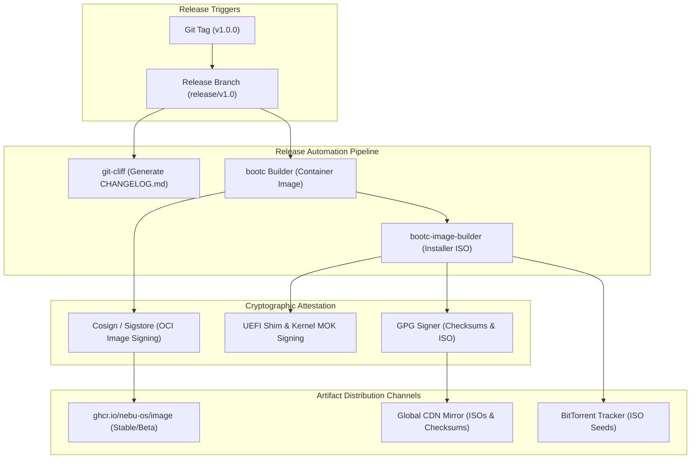
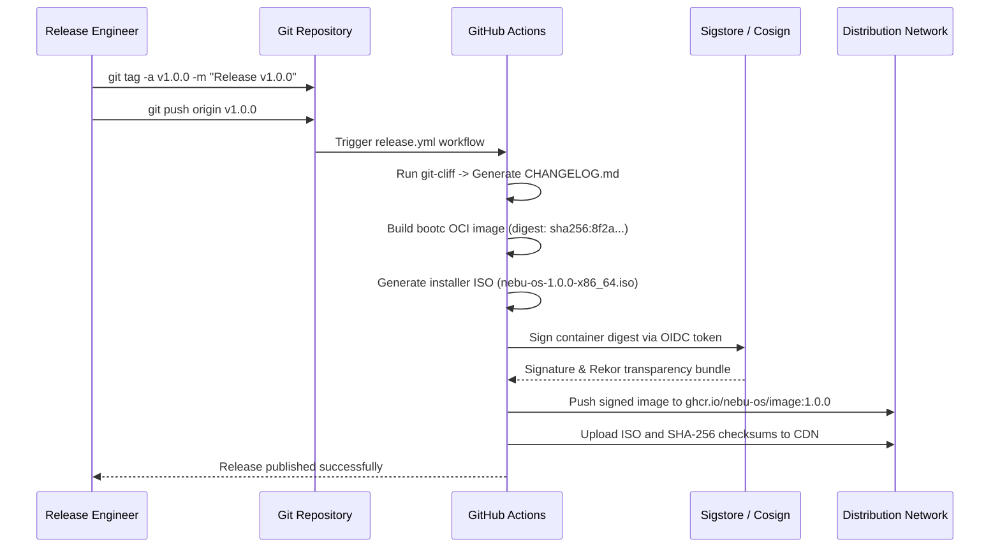

# Release Engineering Specification — NebuOS

## 1. Status
**Status:** DRAFT  
**Type:** Subsystem Engineering Specification  
**Domain:** Release Automation, Versioning, Image Signing, and Artifact Distribution  
**Target Architecture:** x86_64  
**Target Release:** NebuOS 1.0 (Milestones P0-P12)

---

## 2. Purpose
This specification defines the end-to-end release engineering lifecycle, version numbering schemes, changelog automation, cryptographic artifact signing, and multi-channel distribution infrastructure for NebuOS. Because NebuOS is an immutable operating system deployed via Fedora bootc/ostree container images, release engineering oversees not merely application binary distribution, but the packaging, attestation, and deployment of entire bootable operating system images, installer ISOs, and update channels.

---

## 3. Scope
This specification governs:
- Semantic Versioning 2.0.0 implementation across the workspace and OS releases.
- Release branching models, stabilization freezes, and tag lifecycles.
- Automated changelog generation from conventional commit logs using `git-cliff`.
- Cryptographic image signing with Cosign/Sigstore and UEFI Secure Boot shim signing.
- Publication of bootc OCI images to public and private container registries.
- Offline installer ISO generation, torrent distribution, and global CDN caching.
- Staged deployment rollout channels: Nightly, Beta, and Stable.
- Release rollback triggers and post-release monitoring protocols.

---

## 4. Non-Goals
- End-user application store submission guidelines.
- Managing third-party package repositories outside official NebuOS images.
- Packaging for unsupported non-bootc legacy distribution formats (e.g., raw RPM repositories).
- Authoring consumer marketing release notes.
- Supporting arbitrary third-party kernel signing infrastructure.

---

## 5. Requirements

### 5.1 Functional Requirements
- **REQ-REL-001:** Version numbers must strictly adhere to Semantic Versioning 2.0.0 (`MAJOR.MINOR.PATCH-PRERELEASE`).
- **REQ-REL-002:** The release pipeline must generate automated, human-readable changelogs categorized by component using `git-cliff`.
- **REQ-REL-003:** All published bootc container images must be signed using Sigstore Cosign with verifiable Rekor transparency entries.
- **REQ-REL-004:** Bootable ISO installer images must include signed UEFI bootloader shims compatible with standard Microsoft UEFI Secure Boot CAs.
- **REQ-REL-005:** The distribution system must support three distinct release channels: `nightly`, `beta`, and `stable`.
- **REQ-REL-006:** The update server must serve delta layer metadata enabling incremental system upgrades.

### 5.2 Non-Functional Requirements
- **REQ-REL-007:** The automated release pipeline must complete image compilation, signing, and distribution within `< 90 minutes` of tag push.
- **REQ-REL-008:** Distribution infrastructure must provide SHA-256 and SHA-512 checksum manifests signed with the NebuOS Release GPG key.
- **REQ-REL-009:** Registry update pulls must support delta layer compression, minimizing end-user update download sizes to `< 400 MB` for typical minor updates.
- **REQ-REL-010:** Offline installer media must support installation without active internet access.

---

## 6. Architecture

The release engineering architecture coordinates tag events, image signing, and artifact fan-out:



---

## 7. Components

### 7.1 Subsystem Components
- **`git-cliff`:** Fast, Rust-based changelog generator parsing conventional commits and templating Markdown release summaries.
- **`cosign`:** Keyless cryptographic signing utility authenticating OCI container image digests into public transparency ledgers.
- **`bootc-image-builder`:** Containerized tool producing anaconda-based installer ISOs and virtual machine disk images from the bootc container.
- **Release GPG Key Infrastructure:** Offline master key with short-lived subkeys used to sign ISO checksum files and release announcements.
- **Distribution CDN:** Globally replicated HTTP mirror serving bootable ISOs and metadata.
- **BitTorrent Seeder Node:** Dedicated seed daemon publishing `.torrent` files and providing high-bandwidth initial seeding.

### 7.2 Release Channels

| Channel | Cadence | Source Branch | Audience | Stability SLA |
|---|---|---|---|---|
| **Nightly** | Daily (03:00 UTC) | `main` | Developers & Testers | Bleeding-edge; may contain regressions. |
| **Beta** | Bi-weekly | `release/vX.Y` | Early Adopters | Feature-complete; passes Tier 0 & Tier 1 tests. |
| **Stable** | Quarterly (or P-milestone) | `release/vX.Y` | General Users & Enterprise | Certified via formal Sign-Off Matrix; 99.9% uptime. |

---

## 8. Data Flow



---

## 9. Control Flow

### 9.1 Release Execution Protocol
1. **Branch Stabilization:**
   - At milestone code freeze, create `release/vX.Y` branch from `main`.
   - Only critical bug fixes (`fix(...)`) are cherry-picked into the release branch.
2. **Tag Creation:**
   - Release engineer tags candidate: `git tag -s vX.Y.Z -m "NebuOS X.Y.Z Release"`.
3. **Automated Pipeline Execution:**
   - Executes full verification matrix ([07-release-certification.md](07-release-certification.md)).
   - Generates release notes with `git-cliff`.
   - Assembles container image and installer ISO.
4. **Attestation & Signing:**
   - Signs container image layers using `cosign sign`.
   - Signs ISO checksums using Release GPG subkey.
5. **Channel Deployment:**
   - Promotes container tags: `ghcr.io/nebu-os/image:1.0.0` and `ghcr.io/nebu-os/image:stable`.
   - Deploys ISO to download mirrors and seeds torrent files.

---

## 10. Interfaces

### 10.1 Changelog Configuration (`cliff.toml`)
```toml
[changelog]
header = "# Changelog — NebuOS\n\nAll notable changes are documented here.\n"
body = """

### {{ group | upper_first }}

- **{{ commit.scope }}**: {{ commit.message | upper_first }} ([{{ commit.id | truncate(length=7, end="") }}]({{ commit.id }}))


"""

[git]
conventional_commits = true
filter_unconventional = true
commit_parsers = [
    { message = "^feat", group = "Features" },
    { message = "^fix", group = "Bug Fixes" },
    { message = "^perf", group = "Performance" },
    { message = "^refactor", group = "Refactoring" },
    { message = "^docs", group = "Documentation" },
]
```

### 10.2 Release Commands
```bash
# Generate changelog locally
git-cliff --tag v1.0.0 > CHANGELOG.md

# Verify container image signature
cosign verify \
    --certificate-identity "https://github.com/nebu-os/nebuos/.github/workflows/release.yml@refs/tags/v1.0.0" \
    --certificate-oidc-issuer "https://token.actions.githubusercontent.com" \
    ghcr.io/nebu-os/image:v1.0.0

# Generate SHA-256 manifest
sha256sum nebu-os-1.0.0-x86_64.iso > SHA256SUMS
gpg --armor --detach-sign SHA256SUMS

# Verify detached GPG signature
gpg --verify SHA256SUMS.asc SHA256SUMS

# Inspect SLSA Level 3 provenance attestation
cosign verify-attestation \
    --type slsaprovenance \
    ghcr.io/nebu-os/image:v1.0.0
```

---

## 11. Dependencies

### 11.1 Release Toolchain
- **`git-cliff` (2.4+):** Conventional commit parser and changelog generator.
- **`cosign` (2.2+):** Container signature and attestation tool.
- **`bootc-image-builder`:** OCI container to disk/ISO converter.
- **`gnupg2`:** GPG signature engine.
- **`aria2` / `mktorrent`:** BitTorrent metafile generation.

---

## 12. Security
- **Release Signing Authority:** Release GPG master private keys are stored on offline YubiKey hardware tokens and never exposed to CI environments.
- **Cosign Transparency:** Every image signature is automatically logged to the public Rekor transparency log, preventing undetected unauthorized image mutations.
- **Reproducible ISO Builds:** The ISO generation process uses fixed timestamps (`SOURCE_DATE_EPOCH`) to ensure reproducible binary checksums.
- **Supply Chain Attestation:** In-toto provenance attestations link the container image digest directly to the source Git commit SHA.

---

## 13. Resource Requirements

| Pipeline Step | Compute Allocation | Storage | Network |
|---|---|---|---|
| **OCI Image Build** | 16 vCPUs | 40 GB NVMe | 1 Gbps |
| **ISO Assembly** | 8 vCPUs | 20 GB NVMe | 1 Gbps |
| **Artifact Publishing** | 4 vCPUs | 10 GB | 1 Gbps egress |
| **Total Pipeline Run** | ~45 minutes | 70 GB scratch | ~20 GB transfer |

---

## 14. Failure Modes

| Failure ID | Symptom | Underlying Cause | Recovery Action |
|---|---|---|---|
| **FAIL-REL-001** | Cosign verification failure | Mismatched OIDC workflow identity or expired signing certificate | Verify GitHub Actions workflow file path and re-trigger release job |
| **FAIL-REL-002** | ISO generation timeout | Anaconda installer script hang or missing squashfs tools | Review `bootc-image-builder` log; check memory allocation |
| **FAIL-REL-003** | CDN mirror synchronization lag | Network partitioning between origin and edge CDN caches | Invalidate CDN cache tags via API |
| **FAIL-REL-004** | Invalid changelog format | Commits on release branch missing conventional commit prefixes | Update PR squash commit messages or use `git-cliff` override |
| **FAIL-REL-005** | BitTorrent seed stall | Tracker unresponsive or seeder connection throttled | Re-announce torrent to backup community tracker |

---

## 15. Recovery Behavior
- **Yanked Release Protocol:** If an unrecoverable defect is discovered post-release:
  1. The `stable` OCI tag is instantly updated to point to the previous valid release digest.
  2. The faulty release tag is annotated as `YANKED` in GitHub Releases.
  3. A mitigation advisory is broadcast via the system update notification daemon.
- **Emergency Hotfix Patch:** Fast-track `vX.Y.(Z+1)` branch created directly from the release tag; deployed within 4 hours.
- **Mirror Resynchronization:** If a regional CDN mirror serves stale files, a forced purge API call clears the cache in < 5 minutes.

---

## 16. Testing Requirements
- **Post-Release Deployment Smoke Test:** An automated test runner pulls the published image from `ghcr.io` and performs an in-place upgrade on a test VM.
- **ISO Boot Verification:** Ensure the published ISO boots to installer on both UEFI Secure Boot and non-Secure Boot systems.
- **Checksum Verification:** Test script downloads ISO from public CDN and verifies SHA-256 against published signed manifest.

---

## 17. Performance Requirements
- **Pipeline Completion Time:** End-to-end release pipeline must complete in **< 60 minutes** from tag creation.
- **ISO Download Speed:** CDN mirrors must support minimum **100 MB/s** download speeds per user in major global regions.
- **Update Application Duration:** Applying a quarterly minor update via `bootc upgrade` must complete in **< 90 seconds** on client systems.

---

## 18. Compatibility Considerations
- **SemVer Invariants:** Breaking architectural changes, removed D-Bus APIs, or incompatible database schema changes necessitate a MAJOR version increment.
- **OSTree Commit Continuity:** Upgrading between minor versions must not orphan existing ostree deployment stubs or corrupt bootloader menus.
- **UEFI Revocation List (DBX):** Ensure release bootloader shims are not blacklisted in recent UEFI revocation lists.

---

## 19. Open Questions
1. *OPEN QUESTION:* Should NebuOS offer a dedicated LTS (Long Term Support) release channel alongside quarterly stable releases for corporate deployments?
2. *OPEN QUESTION:* What is the optimal Torrent tracker infrastructure for distributing community ISO releases without relying on third-party public trackers?

---

## 20. Related Documents
- [00-development-specification.md](00-development-specification.md) — Master development workflow and standards.
- [02-build-system.md](02-build-system.md) — Multi-stage build system and Containerfile.
- [03-ci-cd.md](03-ci-cd.md) — Continuous integration pipelines and automation.
- [../testing/07-release-certification.md](../testing/07-release-certification.md) — Formal release sign-off gates.
- [../updates/00-update-strategy.md](../updates/00-update-strategy.md) — Atomic OS update architecture.
